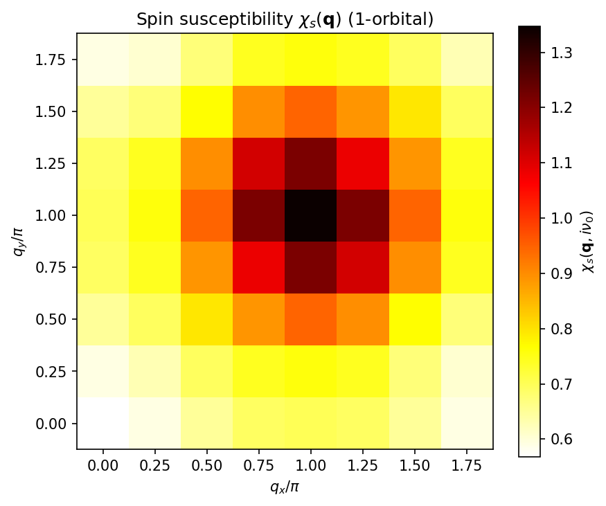
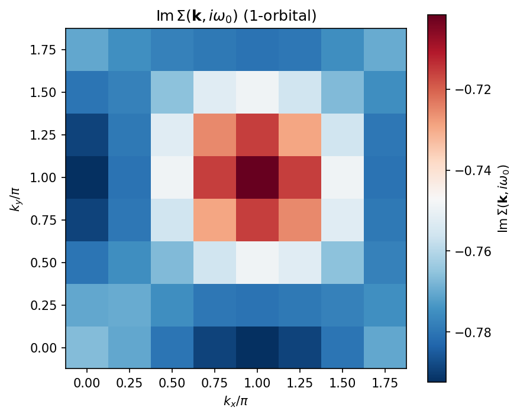
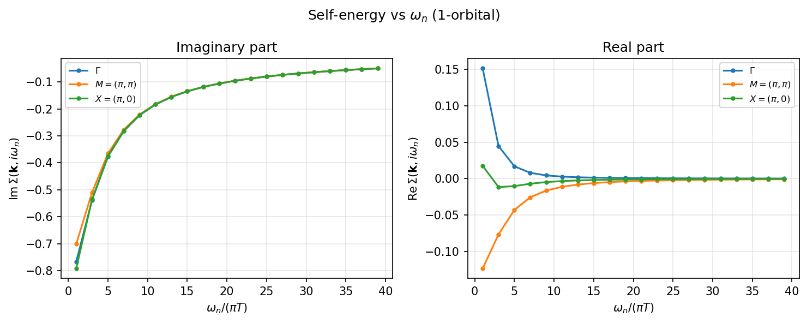
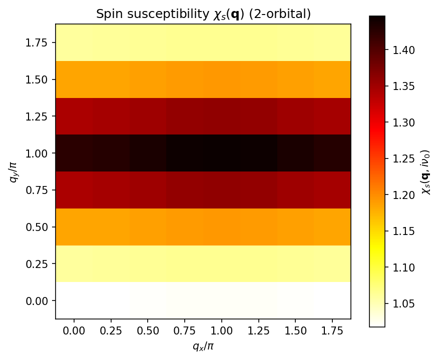
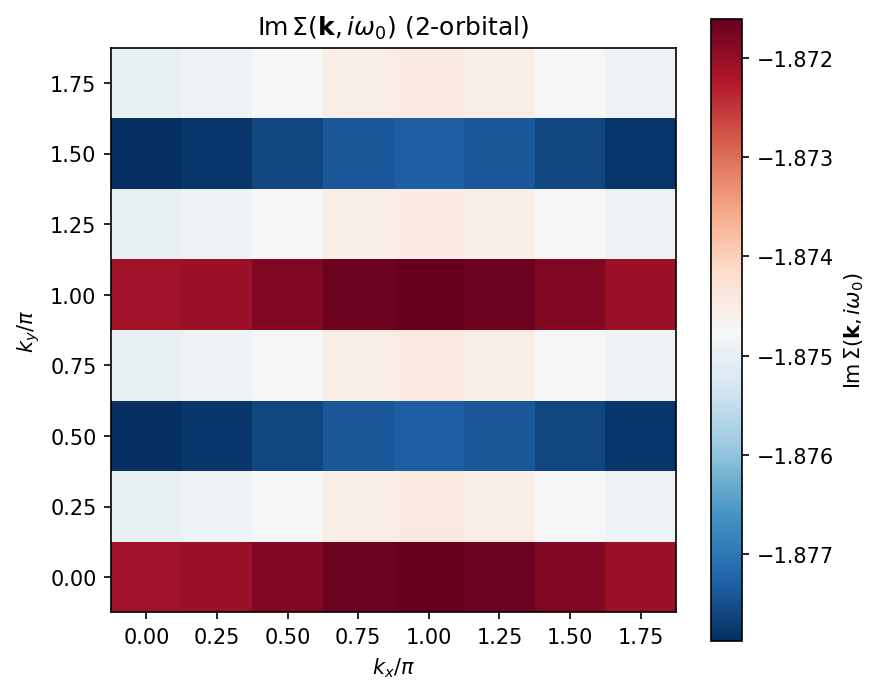
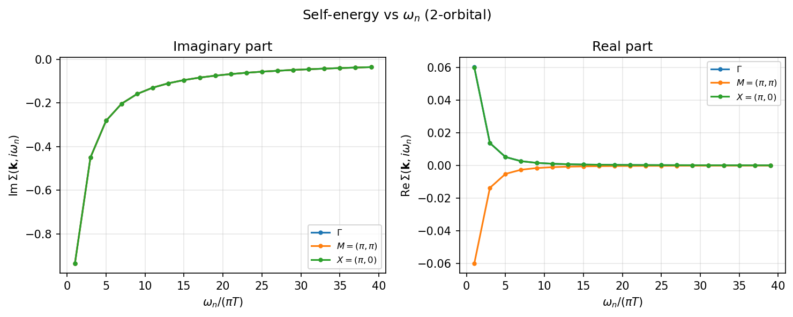
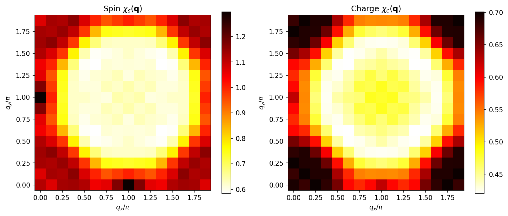
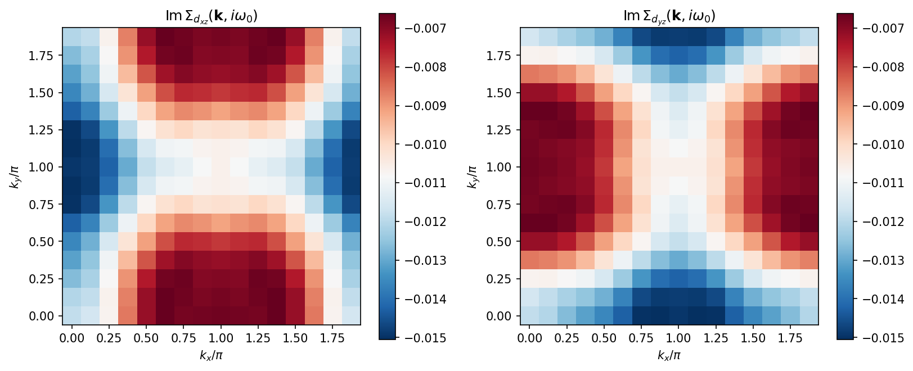
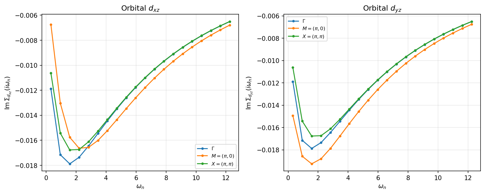

==========================================
Tutorial: FLEX solver
==========================================

This tutorial demonstrates how to use the FLEX
(Fluctuation Exchange Approximation) solver in H-wave.
FLEX extends RPA by using dressed (self-consistent) Green's functions
instead of bare ones, providing a more accurate description of
correlated electron systems.

The sample files for this tutorial are located in
``docs/en/source/flex/sample`` directory.

Overview
----------------------------

The FLEX approximation [1]_ is a self-consistent diagrammatic method
for itinerant electron systems. Unlike RPA, which uses the bare
Green's function :math:`G_0`, FLEX iterates the following self-consistent loop
until convergence:

1. Compute the dressed Green's function :math:`G(\mathbf{k}, i\omega_n)`
   from the Dyson equation.
2. Compute the bare susceptibility :math:`\chi_0(\mathbf{q}, i\nu_m)`
   from the dressed :math:`G`.
3. Decompose the interaction into spin and charge channels.
4. Solve the RPA equations for spin/charge susceptibilities
   :math:`\chi_s` and :math:`\chi_c`.
5. Construct the effective interaction :math:`V_{\mathrm{eff}}`.
6. Compute the self-energy :math:`\Sigma(\mathbf{k}, i\omega_n)` via
   FFT convolution.
7. Check convergence; if not converged, go to step 1.

.. note::

   When the electron number is fixed through ``filling`` / ``Ncond`` (rather
   than a fixed ``mu``), FLEX re-solves the chemical potential :math:`\mu` from
   the *dressed* Green function at every SCF iteration so that the target
   filling is maintained self-consistently as the self-energy grows.  A
   ``FLEX._find_mu_dressed: mu = ...`` line is therefore printed each iteration,
   and the converged :math:`\mu` (and the exact iteration count) differ from a
   calculation that keeps :math:`\mu` fixed at its non-interacting value.  All
   iteration counts and convergence values shown in this tutorial are
   illustrative and may vary slightly with the version and platform.

Theory
----------------------------

Dressed Green's function
^^^^^^^^^^^^^^^^^^^^^^^^^^^^^^^^

The dressed Green's function is obtained from the Dyson equation:

.. math::

   G(\mathbf{k}, i\omega_n)
   = \left[ G_0^{-1}(\mathbf{k}, i\omega_n) - \Sigma(\mathbf{k}, i\omega_n) \right]^{-1}

where :math:`G_0^{-1}(\mathbf{k}, i\omega_n) = i\omega_n + \mu - H_0(\mathbf{k})`
is the inverse bare Green's function.

Spin and charge susceptibilities
^^^^^^^^^^^^^^^^^^^^^^^^^^^^^^^^

The bare susceptibility is computed from the dressed Green's function:

.. math::

   \chi_0(\mathbf{q}, i\nu_m) = -\frac{T}{N_k} \sum_{\mathbf{k}, n}
   G(\mathbf{k}+\mathbf{q}, i\omega_n + i\nu_m)\, G(\mathbf{k}, i\omega_n)

The spin and charge susceptibilities are:

.. math::

   \chi_s = \left[ I - \chi_0 \, U_s \right]^{-1} \chi_0

.. math::

   \chi_c = \left[ I + \chi_0 \, U_c \right]^{-1} \chi_0

where :math:`U_s` and :math:`U_c` are the spin and charge interaction vertices
decomposed from the full interaction Hamiltonian.
For the single-band Hubbard model, :math:`U_s = U_c = U`.

Effective interaction
^^^^^^^^^^^^^^^^^^^^^^^^^^^^^^^^

The effective FLEX interaction combines spin and charge fluctuations [1]_:

.. math::

   V_{\mathrm{eff}}(\mathbf{q}, i\nu_m)
   = W \left[ \frac{3}{2}\chi_s
            + \frac{1}{2}\chi_c - \chi_0 \right] W

where :math:`W` is the bare interaction vertex.
:math:`\chi_0` is subtracted **once**: at lowest order
:math:`\chi_s = \chi_c = \chi_0`, so the bracket reduces to :math:`\chi_0` and
:math:`V_{\mathrm{eff}} = W \chi_0 W` (the second-order :math:`U^2` bubble).
This single subtraction removes the double-counted second-order diagram
contained in :math:`\chi_s` and :math:`\chi_c`.

Self-energy
^^^^^^^^^^^^^^^^^^^^^^^^^^^^^^^^

The self-energy is computed via convolution in real space and
imaginary time:

.. math::

   \Sigma(\mathbf{r}, \tau) = V_{\mathrm{eff}}(\mathbf{r}, \tau) \cdot G(\mathbf{r}, \tau)

This element-wise (Hadamard) product is efficiently evaluated using FFT.

.. _flex_scope:

Scope of the approximation
^^^^^^^^^^^^^^^^^^^^^^^^^^^^^^^^

FLEX is a conserving (Baym--Kadanoff) approximation that resums the RPA
particle--hole bubble and ladder series for the self-energy. It does **not**
include the Aslamazov--Larkin (AL) or Maki--Thompson (MT) vertex corrections,
in which the electron couples to *two* fluctuation propagators through a
triangular fermion loop (mode--mode coupling). These higher-order corrections
are outside the FLEX class and are **not** evaluated here. They can matter when
charge/orbital fluctuations driven by two spin fluctuations are important
(e.g. the orbital-fluctuation mechanism of Onari and Kontani [2]_).

In addition, the ``calc_scheme = "reduced"`` scheme decomposes the
interaction via its density--density part for the spin/charge vertices.
Since version 2.0 ``reduced`` is no longer the default: ``calc_scheme =
"auto"`` is, and ``reduced`` is the explicit opt-out that reproduces the
H-wave 1.0.x behaviour (a documented approximation, warned about once at
construction). ``auto`` selects ``general`` whenever ``Exchange`` or
``PairHop`` is present -- these have **no** density--density vertex content
at all, so ``reduced`` cannot even approximate them, and supplying either
under an explicit ``reduced`` raises a ``ValueError`` directing you to
``calc_scheme = "general"`` (in earlier development builds this input was
accepted with a warning while the interaction silently had zero effect).
``auto`` likewise selects ``general`` whenever ``CoulombInter``, ``Hund``,
``Ising``, or the aggregate ``Coulomb`` interaction is declared, because
these carry cross-family vertex content that ``reduced`` cannot represent
exactly.
``PairLift`` is accepted everywhere: its particle-hole vertex is exactly
zero, so omitting it from the susceptibility channels is exact, not an
approximation. Accordingly, in this scheme "FLEX" means *not exact*: it
is the density--density, AL/MT-free fluctuation-exchange level of
approximation.

The alternative ``calc_scheme = "general"`` instead **retains** the full
off-diagonal Kanamori vertices. It is a paramagnetic full-vertex
formulation following Mochizuki, Yanase, and Ogata (MYO) [3]_ (and
corroborated by Takimoto, Hotta, and Ueda (THU) [4]_): the full matrix-form
spin (:math:`\hat{U}^s`) and charge (:math:`\hat{U}^c`) interaction matrices
are built in the MYO convention, the matrix RPA is solved for
:math:`\chi_s`/:math:`\chi_c`, and the fluctuation interaction is assembled
as :math:`V = \tfrac{3}{2}\hat{U}^s[\chi_s - \chi_0]\hat{U}^s
+ \tfrac{1}{2}\hat{U}^c[\chi_c - \chi_0]\hat{U}^c + W^{(2)}`, the ring
series from third order on plus the second-order kernel :math:`W^{(2)}`
selected by ``flex_second_order`` (see below).
Under ``"general"`` the off-diagonal vertices are therefore **not** dropped
and the density--density reduction warning is suppressed. The AL/MT vertex
corrections noted above remain outside the FLEX class even in the
``"general"`` scheme.

.. [1] N. E. Bickers and D. J. Scalapino,
   Ann. Phys. (N.Y.) **193**, 206 (1989).

.. [2] H. Kontani and S. Onari,
   Phys. Rev. Lett. **104**, 157001 (2010).

.. [3] M. Mochizuki, Y. Yanase, and M. Ogata,
   J. Phys. Soc. Jpn. (cond-mat/0407094).

.. [4] T. Takimoto, T. Hotta, and K. Ueda,
   Phys. Rev. B **69**, 104504 (2004); cond-mat/0309575.

.. _flex_second_order_tutorial:

Second order of the effective interaction (``flex_second_order``)
^^^^^^^^^^^^^^^^^^^^^^^^^^^^^^^^^^^^^^^^^^^^^^^^^^^^^^^^^^^^^^^^^

Under ``calc_scheme = "general"`` the second-order part :math:`W^{(2)}` of
the effective interaction is built from the exact LOCAL second-order
kernel, ``[mode.param] flex_second_order = "local"`` (the default and the
only accepted value). It
carries the complete second order of every on-site interaction term, the
direct skeleton of the off-site density terms and every mixed
on-site/off-site diagram; only the exchange skeleton of two off-site
vertices is left to ``longitudinal_bond_channels = true`` (see
:ref:`flex_second_order_kernel` for the formulas and the classification).

H-wave 2.0.0 and earlier used the Takimoto-Hotta-Ueda expression
:math:`-\tfrac{1}{4}(\hat{U}^s+\hat{U}^c)\chi_0(\hat{U}^s+\hat{U}^c)`,
which is exact at second order only for a single-band Hubbard
interaction. It was selectable as ``flex_second_order = "takimoto"`` until
it was retired (issue #253); that value is now refused at start-up with a
message that names ``"local"``. The results of H-wave 2.0.0 and earlier
can therefore no longer be reproduced by a setting; use an earlier release
for that.

**What changes.** Single-band inputs containing only ``CoulombIntra``
agree with H-wave 2.0.0 and earlier to within numerical round-off, and so
do single-band :math:`U + V` inputs run with
the bond-resolved channels (``longitudinal_bond_channels = true``), which
already carried the exact direct :math:`V` second order. Every
multi-orbital on-site interaction (:math:`U'`, ``Hund``, ``Ising``,
``Exchange``, ``PairHop``, ``PairLift``) and every off-site interaction
run without the bond-resolved channels gives a different
``calc_scheme = "general"`` result.

**On-site same-orbital rows (degenerate rows) are now refused.** Under
``"local"`` an on-site same-orbital row of ``CoulombInter``, ``Hund``,
``Ising``, ``Exchange``, ``PairHop`` or ``PairLift`` -- a row with
``rx = ry = rz = 0`` and identical orbital indices -- stops the run at
start-up: such a row is not a two-body term, because it reduces to a
one-body level shift, to an effective ``CoulombIntra``, or to identically
zero. The message gives the equivalent declaration for that type (usually
a ``CoulombIntra`` entry plus a level shift in the transfer file).
Rewrite the interaction file as the message says.

**Convergence.** Compared with H-wave 2.0.0 and earlier the SCF trajectory
can change. On the 2-orbital self-consistency fixture (on-site :math:`U`,
:math:`U'`, ``Hund`` plus off-site :math:`V`, Anderson mixing) both
kernels needed the same iteration count -- 9 without and 11 with
``flex_hartree_fock = true``. If a run that used to converge now stalls,
raise ``IterationMax``, lower ``Mix``, switch to (or keep) Anderson mixing
(``mixing_scheme = "anderson"``; the solver default is ``"linear"``), and
start the loop from :math:`\Sigma = 0` -- that is, omit ``sigma_init``
from the ``[file.input]`` section -- rather than continuing from a seed
written with the retired kernel. Such a seed is accepted: a seed recorded
with ``flex_second_order = "takimoto"`` that passes the usual seed checks
is the initial value only, every iteration uses ``"local"`` (a converged
result is the ``"local"`` fixed point), and the solver logs a warning
saying so. An archive written by H-wave 2.0.0 or an
earlier release carries no kernel record at all, so only an informational
line is logged for it.

.. _flex_near_instability:

Operating near an instability
^^^^^^^^^^^^^^^^^^^^^^^^^^^^^^^^^

A strongly coupled run can approach a magnetic or charge instability:
the Stoner factor climbs above about 0.99, or the ``guards:`` line of
the log reports a bond conditioning minimum (``cond_min``) within an
order of magnitude of ``[mode.param] longitudinal_bond_cond_tol``. In
that regime the self-consistency is stiff, several fixed points can
exist, and the following operating rules apply. Every key named in
this subsection belongs to the ``[mode.param]`` table:

.. code-block:: toml

   [mode.param]
     mixing_scheme = "linear"
     Mix = 0.02
     flex_hartree_fock = true
     flex_guard_policy = "warn"

- **Mix in small linear steps.** Use ``mixing_scheme = "linear"`` with
  ``Mix <= 0.03``. Larger steps overshoot into the instability region,
  where the dressed vertices are enormous and the guard stops the run.
- **Warm-start in small temperature steps.** Walk down in temperature
  and start each run from the converged self-energy of the previous,
  slightly higher temperature (``[file.input] sigma_init``). A cold
  start at the lowest temperature of a sweep can fail where the
  descending ladder converges.
- **Cross-check an Anderson-mixing result by a linear recomputation.**
  Anderson mixing has been observed to land on an unphysical fixed
  point -- one whose pairing eigenvalue saturates instead of growing --
  on the single-band Hubbard model at :math:`U = 8t`. Recompute the
  same point with linear mixing before reporting it.
- **Set** ``flex_guard_policy = "warn"`` **in** ``[mode.param]`` **only
  for a transient excursion.** It lets an iteration whose equal-time
  density symmetry (``flex_hf_density_tol``) or bond conditioning
  (``longitudinal_bond_cond_tol``) violates its tolerance continue
  instead of ending the run. An exactly singular solve, or non-finite
  numbers, still end the run under either policy: the policy tolerates
  a nearly singular denominator, not a singular one. The final state
  is checked regardless of the policy, so the run is refused when the
  equal-time density of the final state deviates by more than
  ``flex_hf_density_tol``, and also when the last map needed the
  policy for a bond-guard violation -- that refusal reports the
  conditioning minima of the last map. ``flex_guard_violations`` in
  the outputs counts the violations that were let through: one per
  iteration for the density, and one per offending (channel,
  frequency, q-point) finding for the bond guard, so a single
  iteration can contribute several.

Read the ``guards:`` line the solver logs for each iteration and
confirm that the violation decays: the density deviation must fall
back below ``flex_hf_density_tol``, ``cond_min`` must rise back above
``longitudinal_bond_cond_tol``, and both must stay there.

.. code-block:: text

      guards: density hermitian 3.2e-10 (tol 1.0e-08)  bond cond_min spin 4.1e-03 charge 2.7e-01 (tol 1.0e-03)

The line reports the relative Frobenius deviation of the Hermitian
symmetry of the equal-time density against ``flex_hf_density_tol``
and, with ``longitudinal_bond_channels = true``, the smallest
conditioning score of the spin and of the charge RPA denominator of
that iteration's map against ``longitudinal_bond_cond_tol``. On the GPU
path a well-conditioned map may report ``in bracket [low, up]`` instead
of a value: the device-side bounds already proved that no block can
fail, so the exact decomposition was skipped and the exact minimum lies
in the bracket (``longitudinal_bond_guard_exact``; the last map is
always exact).

In a sweep, keep the default ``flex_guard_policy = "refuse"`` for the
automated runs and turn ``"warn"`` on for a single point you have
already diagnosed; a post-processing script should check that
``flex_guard_violations`` is ``0`` before accepting a converged result.
Since the count is per event, one stiff iteration of the bond guard
can contribute many of them -- read the ``guards:`` lines to see how
many iterations were actually affected.

The tolerances themselves (``flex_hf_density_tol``,
``longitudinal_bond_cond_tol``) are knobs for a deliberately stiff
study, not a way to silence a guard: lowering a floor lets a run
continue with numbers that are dominated by amplified round-off.
Raising ``flex_hf_density_tol`` or lowering
``longitudinal_bond_cond_tol`` is therefore not the remedy for a
final-state refusal -- a smaller ``Mix`` and finer temperature steps
are.

Sample 1: Single-orbital Hubbard model
-----------------------------------------

Model
^^^^^^^^^^^^^^^^^^^^^^^^^^^^^^^^

The first sample is a **single-orbital Hubbard model** on a
two-dimensional square lattice at half filling (:math:`n = 1`).

.. math::

   H = -\sum_{\langle i,j \rangle, \sigma} t_{ij}\,
       c^\dagger_{i\sigma} c_{j\sigma}
     + U \sum_i n_{i\uparrow} n_{i\downarrow}

with nearest-neighbor hopping :math:`t = 1.0`,
next-nearest-neighbor hopping :math:`t' = 0.5`,
on-site Coulomb repulsion :math:`U = 4.0`,
and temperature :math:`T = 0.5`.

This model is known to exhibit strong antiferromagnetic (AF) spin
fluctuations with a peak at :math:`\mathbf{Q} = (\pi, \pi)`.

Prepare input files
^^^^^^^^^^^^^^^^^^^^^^^^^^^^^^^^

The sample files are in ``docs/en/source/flex/sample/1orb/``.

**Parameter file** (``input.toml``):

.. literalinclude:: ../sample/1orb/input.toml

Key parameters:

- ``mode = "FLEX"``: Selects the FLEX solver.
- ``T = 0.5``: Temperature.
- ``CellShape = [8, 8, 1]``: 8 x 8 k-point mesh for a 2D system.
- ``Nmat = 64``: Number of Matsubara frequencies.
- ``filling = 0.5``: target electron number per site (half filling). Specifying
  ``filling`` (or ``Ncond``) makes FLEX re-solve the chemical potential
  :math:`\mu` from the dressed Green's function at every SCF iteration so the
  filling is conserved as the self-energy grows; specifying ``mu`` instead holds
  it fixed.
- ``coeff_tail = 1.0`` (optional): high-frequency tail-acceleration coefficient
  for the Matsubara sums. ``coeff_tail = 1`` matches the exact
  :math:`1/(i\omega_n)` coefficient of :math:`G` (unitarity), so it accelerates
  convergence in ``Nmat`` without biasing the result. Also supported by the RPA
  solver. Ignored (unnecessary) when ``matsubara_basis = "ir"``.
- ``IterationMax = 100``: Maximum number of SCF iterations.
- ``Mix = 0.2``: Mixing parameter for self-energy update
  (:math:`\Sigma_{\mathrm{new}} = (1 - \alpha)\Sigma_{\mathrm{old}} + \alpha\Sigma_{\mathrm{calc}}`).
- ``EPS = 6``: Convergence criterion :math:`10^{-6}`.

**Geometry** (``geom.dat``):

.. literalinclude:: ../sample/1orb/geom.dat

A single orbital at the origin.

**Transfer integrals** (``transfer.dat``):

.. literalinclude:: ../sample/1orb/transfer.dat

Nearest-neighbor (:math:`t = 1.0`) and next-nearest-neighbor
(:math:`t' = 0.5`) hopping on the square lattice.

**On-site interaction** (``coulombintra.dat``):

.. literalinclude:: ../sample/1orb/coulombintra.dat

On-site Coulomb repulsion :math:`U = 4.0`.

Run the calculation
^^^^^^^^^^^^^^^^^^^^^^^^^^^^^^^^

.. code-block:: bash

    $ cd docs/en/source/flex/sample/1orb
    $ hwave input.toml

The output log shows the SCF convergence:

.. code-block:: text

    FLEX iteration 1/100
    FLEX._find_mu_dressed: mu = -0.398893
      convergence: |dSigma|/|Sigma| = 1.000e+00
      Stoner factor max_q eig[U chi0(q, i nu = 0)]: spin 1.055812 at q = (0.5, 0.5, 0); charge -0.682922 at q = (0, 0, 0)
    FLEX iteration 2/100
    FLEX._find_mu_dressed: mu = -0.291966
      convergence: |dSigma|/|Sigma| = 9.876e-01
    ...
    FLEX iteration 64/100
    FLEX._find_mu_dressed: mu = -0.249146
      convergence: |dSigma|/|Sigma| = 9.241e-07
      Stoner factor max_q eig[U chi0(q, i nu = 0)]: spin 0.689976 at q = (0.5, 0.5, 0); charge -0.503243 at q = (0, 0, 0)
    FLEX converged after 64 iterations

Results
^^^^^^^^^^^^^^^^^^^^^^^^^^^^^^^^

After convergence, the solver produces the following output files
in the ``output`` directory:

- ``chi0q.npz``: Bare susceptibility :math:`\chi_0(\mathbf{q}, i\nu_m)`
- ``chiq_s.npz``: Spin susceptibility :math:`\chi_s(\mathbf{q}, i\nu_m)`
- ``chiq_c.npz``: Charge susceptibility :math:`\chi_c(\mathbf{q}, i\nu_m)`
- ``chiq.npz``: Combined susceptibility file
- ``sigma.npz``: Self-energy :math:`\Sigma(\mathbf{k}, i\omega_n)` (with
  ``flex_hartree_fock = true`` also its two components ``sigma_static`` and
  ``sigma_fluct``, the marker ``sigma_convention = "split"`` and the
  convergence provenance; see :ref:`flex_bond_hf_tutorial`). Under
  ``calc_scheme = "general"`` it also records ``flex_second_order`` and
  ``flex_second_order_schema``.
- ``green.npz``: Dressed Green's function :math:`G(\mathbf{k}, i\omega_n)`
  (with the same two ``flex_second_order`` fields under ``calc_scheme =
  "general"``)
- ``energy.dat``: Text file with the particle number ``NCond``, spin
  ``Sz``, and the converged ``ChemicalPotential`` :math:`\mu`.

.. note::

   The ``energy.dat`` output (enabled by the ``energy`` key in
   ``[file.output]``) is written from the final dressed Green function.  In
   the fixed-:math:`\mu` mode (specify ``mu`` instead of ``filling`` /
   ``Ncond``) its ``NCond`` line gives the particle number at that
   :math:`\mu`, so running the solver at several fixed :math:`\mu` values
   traces the :math:`\mu`-:math:`N` relation.  ``Sz`` is zero for a
   paramagnetic (spin-free) calculation and non-zero only for
   spin-dependent (spin-diagonal / spinful) runs.

.. _flex_sigma_init:

Warm-starting the SCF loop (``sigma_init``)
^^^^^^^^^^^^^^^^^^^^^^^^^^^^^^^^^^^^^^^^^^^^^

By default FLEX starts the self-consistency loop from :math:`\Sigma = 0`.
Setting ``sigma_init`` in ``[file.input]`` to a ``sigma.npz`` written by an
earlier FLEX run instead seeds the loop from that self-energy:

.. warning::

   A multi-orbital ``sigma.npz`` produced by ``calc_scheme = "general"``
   before the orbital-pair transpose fix is wrong off the orbital diagonal.
   The corrected solver converges to the corrected fixed point regardless of
   the seed, so such a file does not poison the result, but it is a poor warm
   start -- it can slow convergence or steer the iteration towards a different
   solution branch, which defeats the purpose of seeding. Prefer regenerating
   it, and note that the run's other outputs must be regenerated in any case --
   see :ref:`the migration warning <flex_general_transpose_fix>`.

.. code-block:: toml

   [file.input]
     sigma_init = "sigma.npz"

This is often decisive near a magnetic instability (low temperature, strong
spin fluctuations), where the :math:`\Sigma = 0` transient makes the SCF
*oscillate* (the residual ``|dSigma|/|Sigma|`` stalls around 1 instead of
decreasing) and the run hits ``IterationMax`` without converging. Starting from
a converged neighbouring solution -- for example, stepping the temperature down
and feeding each run the previous (higher-:math:`T`) ``sigma.npz`` -- begins the
iteration near the fixed point and avoids the oscillation. The seed must have
the same ``CellShape`` and ``Nmat`` as the current run (both are fail-fast
errors: ``sigma.npz`` records its ``CellShape``, so even a same-volume
aspect-ratio change like ``[2,8,1]`` vs ``[4,4,1]`` is caught), so keep
``Nmat`` and ``CellShape`` fixed across a continuation sweep. To choose the
step of a U or T scan, and to recognise a seed that was too far away, see
:ref:`flex_stoner_divergence`.

To audit an archive before using it as a seed, run
``hwave_sigma_split --check sigma.npz``: it prints the relative deviation
from :math:`\Sigma(\mathbf{k}, i\omega_n) = \Sigma(\mathbf{k}, -i\omega_n)^\dagger`
and exits with status 1 above ``--asymmetry-tol`` (see :ref:`flex_bond_hf_tutorial`).

A ``calc_scheme = "general"`` seed also records which second-order kernel
produced it. A seed of the retired ``"takimoto"`` kernel is accepted as the
initial value with a warning (and the solver notes it when the seed carries
no such record, i.e. a reduced-scheme archive or one written before this
key was introduced -- H-wave 2.0.0 and earlier). If such a run stalls,
restart it from :math:`\Sigma = 0` -- see
:ref:`flex_second_order_tutorial`.

.. note::

   The ``sigma_init`` path is resolved relative to ``[file.input]
   path_to_input``, while the previous run wrote its ``sigma.npz`` under
   ``[file.output] path_to_output``. In a sweep, either copy the previous
   ``sigma.npz`` into the input directory, or point ``sigma_init`` at the
   previous output directory with a relative path, e.g.::

      [file.input]
        path_to_input = "."
        sigma_init = "run_T0.50/output/sigma.npz"

.. _flex_stoner_divergence:

Stoner factor and a diverged run
^^^^^^^^^^^^^^^^^^^^^^^^^^^^^^^^^^^^^^^^^^^^^^^^^

The log reports how close each iteration is to a static instability of its
bubble. The line is written at INFO level on the first and the last
iteration (and when the iteration looks divergent, see below), and at DEBUG
level on every other iteration:

.. code-block:: text

      Stoner factor max_q eig[U chi0(q, i nu = 0)]: spin 0.689976 at q = (0.5, 0.5, 0); charge -0.503243 at q = (0, 0, 0)

For each channel the value is

.. math::

   \lambda = \max_{\mathbf{q}} \max \left\{ e \in \mathbb{R} :
   e \in \mathrm{eig}\left[-\chi_0(\mathbf{q}, i\nu = 0)\, W(\mathbf{q})\right]
   \right\},

the largest REAL eigenvalue (only a real eigenvalue reaching 1 makes
:math:`1 + \chi_0 W` singular; an eigenvalue counts as real when
:math:`|\mathrm{Im}\,e| \le 10^{-6} \max|e|`). Should a complex eigenvalue
pair lie further right, as can happen for a non-Hermitian product with
spin-orbit coupling, the line adds ``(max Re over complex pairs ...)``.
Here :math:`\chi_0` is the bubble of the current dressed Green function and
:math:`W` is the vertex of that channel's sum
:math:`[1 + \chi_0 W]^{-1}\chi_0`: :math:`W = -U_s` (spin) and :math:`+U_c`
(charge) for ``calc_scheme = "reduced"``, the full orbital vertices for
``"general"``, and a single ``spinful`` value with the antisymmetrized vertex
for the spin-orbital FLEX. For the one-band Hubbard model the spin value is
:math:`U \max_{\mathbf{q}} \chi_0(\mathbf{q}, 0)`. :math:`\mathbf{q}` is
given in units of the reciprocal lattice vectors. The bond-resolved path
(``longitudinal_bond_channels = true``) prints, on the final iteration
only, the same values for the bond-resolved bubble and vertices under the
label ``RPA pole indicator (final map) max_q eig[chibar S] (spin) /
eig[-chibar C] (charge) (q, i nu = 0)`` (see :ref:`bond_rpa_pole`); on the
other iterations its conditioning guard line plays this role.

How to read it: :math:`\lambda \ge 1` means that the channel's sum is
statically unstable for that bubble. A converged FLEX solution stays below 1,
and the distance from 1 tells how close the run is to the instability. A
cold start may begin above 1 and recover (the sample above starts at 1.056).
For choosing the step of a warm-started U scan, a rough heuristic: the first
map uses the new U with the previous self-energy, so if the previous run
ended at :math:`\lambda` the first value is about
:math:`\lambda (U + \Delta U)/U`, and keeping it below 1 means
:math:`\Delta U / U < (1 - \lambda)/\lambda` (about 5 % at
:math:`\lambda = 0.95`). This assumes that every interaction parameter of the
channel scales with U (not so when V, U' or J are held fixed), that
:math:`\chi_0` stays at its value for the previous self-energy, and that a
first map below 1 suffices; none of these is guaranteed, and a first value
below 1 does not ensure convergence. Take a clearly smaller step, and read
the first-iteration value in the log. For a temperature scan, watch the
first-iteration value the same way.

If some channel stays at :math:`\lambda \ge 1` for three iterations in a row
while :math:`|d\Sigma|/|\Sigma| \ge 0.5`, or the step is not finite, the log
warns once (``FLEX iteration N looks divergent: ...``). The warning does not
stop the run.

A diverged self-energy usually ends the run in the chemical-potential
search, because :math:`N(\mu)` no longer behaves like a particle number. A
healthy :math:`N(\mu)` runs from 0 to the number of states, so it reaches
every target strictly between the two; when the target lies in that range
and the search still fails, the error says that the self-energy has
diverged. It also states how :math:`N(\mu)` misbehaves on the band window
(the bare band range widened by :math:`1 + 10T`): flat, not finite, outside
the physical range, or not monotonic. The message names these causes
rather than blaming the filling. The example below is a one-band model
warm-started from the converged :math:`U = 2` self-energy at
:math:`U = 200`:

.. code-block:: text

    RuntimeError: FLEX._find_mu_dressed: chemical-potential root not bracketed
    after expansion to [-7.12485009544407e+31, 7.12485009544407e+31]
    (N-Ncond = -8.0, -8.0). The self-energy has diverged, or ir_wmax does
    not cover the spectrum (N(mu) leaves the physical range [0, 16] over the
    band window [-9, 11] (from -3.12821 to -2.96742)); the target filling is
    reachable, so this is not a problem of the filling or the temperature.
    Check ir_wmax first if the run had converged so far. The last completed
    iteration was 1 with
    |dSigma|/|Sigma| = 1.000e+00 and Stoner factor spin 44.214974 at
    q = (0.5, 0.5, 0); charge -24.889970 at q = (0, 0, 0). Likely causes:
    too large a step in a warm-started scan (U or T; the previous
    self-energy is far from the new fixed point), too large a mixing (Mix),
    or the starting point. Use a smaller U/T step, a smaller Mix, or a cold
    start (no sigma_init).

Only a target outside that range (for example ``Ncond`` larger than the
number of states) gives ``Check the target filling/Ncond and temperature``.
The decision does not use the values at the ends of the expanded bracket:
with ``matsubara_basis = "ir"`` :math:`N(\mu)` tends to 0 at both far ends
whatever the self-energy is, so equal values there (``N-Ncond = -8.0,
-8.0`` above) are not by themselves a sign of divergence.

With ``matsubara_basis = "ir"`` the same failure can also mean that
``ir_wmax`` does not cover the dressed spectrum (the IR :math:`N(\mu)` is a
basis fit, valid only inside the basis bandwidth), so on that path the
message names both causes. Before any of this, if the expanded bracket finds
no root but :math:`N(\mu)` on the band window does cross the target (on the
IR path the doubling can jump beyond ``ir_wmax``), the root is solved on that
sub-interval with a warning instead of failing -- but only when :math:`N(\mu)`
on the window is healthy (finite, inside the physical range and increasing);
a distorted window gives the error above. A non-finite self-energy and
a target below 0 or above the number of states are refused before the
search starts.

.. _bond_rpa_pole:

The static RPA pole of the bond-resolved paths
^^^^^^^^^^^^^^^^^^^^^^^^^^^^^^^^^^^^^^^^^^^^^^^^^

The bond-resolved paths dress the bond bubble :math:`\bar\chi` with the
denominator :math:`1 + s\,\bar\chi W` (:math:`s = -1` and :math:`W = S`
for spin, :math:`s = +1` and :math:`W = C` for charge, :math:`s = +1` and
:math:`W = \Gamma` for the spinful channel of the spin-orbital path). The
conditioning guard (``cond_tol``, ``longitudinal_bond_cond_tol``) refuses
this denominator only within about ``cond_tol`` of its pole. Past the pole
the denominator is well conditioned again: the run used to finish without a
word, although the dressed susceptibility is no longer positive definite and the
pairing eigenvalue describes no physical state. For a V-driven charge
instability the pairing eigenvalue is smooth across the pole, so it gives
no hint of the crossing.

Every bond path now computes, at the zero bosonic frequency, the indicator

.. math::

   \lambda_{\mathrm{RPA}} = \max_{\mathbf{q}} \max \left\{ e \in \mathbb{R} :
   e \in \mathrm{eig}\left[-s\,\bar\chi(\mathbf{q}, i\nu = 0)\, W(\mathbf{q})\right]
   \right\},

that is :math:`\mathrm{eig}(\bar\chi S)` for spin,
:math:`\mathrm{eig}(-\bar\chi C)` for charge and
:math:`\mathrm{eig}(-\bar\chi \Gamma)` for the spinful channel (over the
:math:`S_z` sectors in the ``sz_packed`` layout). It is the Stoner factor of
:ref:`flex_stoner_divergence` with the bond-resolved bubble and vertices
(the same "real eigenvalue" rule), and at zero off-site interaction it
equals the on-site FLEX Stoner factor. The pole is at
:math:`\lambda_{\mathrm{RPA}} = 1`; the run is past it when
:math:`\lambda_{\mathrm{RPA}} \ge 1`. :math:`\mathbf{q}` is in units of the
reciprocal lattice vectors; among symmetry-equivalent maxima the lowest flat
q index is reported.

- **INFO.** The indicator is always logged at INFO level. ``hwave_sc``
  writes ``RPA pole indicator max_q eig[-sign chibar W](q, i nu = 0): spin
  ... at q = (...); charge ...``; FLEX writes it on the final iteration's
  line ``RPA pole indicator (final map) max_q eig[chibar S] (spin) /
  eig[-chibar C] (charge) (q, i nu = 0): spin ...; charge ...``.
- **WARNING.** Past the pole, the run logs ONE WARNING (at the end of the
  SCF loop for FLEX, for the final map only: a transient excursion during
  the self-consistency is not reported). It names the channel, the
  indicator and q, says that the dressed susceptibility is not positive
  definite there, and what this means for the pairing eigenvalue. Do not
  use such a :math:`\lambda` in a :math:`T_c` or phase-boundary analysis;
  stay below the pole by reducing the interaction or raising the
  temperature:

  .. code-block:: text

     eliashberg bond_channels (static): the static RPA denominator is past its pole in the spin channel: max_q eig[chibar S](q, i nu = 0) = 1.020004 >= 1 at q = (0.5, 0.5, 0). The conditioning guard refuses only within cond_tol of the pole, so the run continues, ...

- **Nothing is refused and no number changes.** The pairing eigenvalue
  :math:`\lambda` is still reported, ``eigen_converged`` keeps its meaning
  of eigen-solver convergence, and ``flex_guard_policy`` is not involved.
  Should the indicator of a channel not be computable (a non-finite input,
  a failed eigenvalue solve, or, for an archive, an eigenvalue at the
  inversion's singular point :math:`\mu = -1`), the WARNING says so
  (``... could not be computed ...``): on its own, or inside the pole
  WARNING when another channel is past the pole, so a run logs at most one
  of them. The run completes unchanged, and that channel gets no pole
  provenance keys.
- **Provenance, written only past the pole.** A run below the pole writes
  exactly the outputs it wrote before. Past the pole:

  .. list-table::
     :header-rows: 1
     :widths: 35 65

     * - key
       - content
     * - ``rpa_past_pole``
       - ``true`` (a boolean scalar ``True`` in an ``.npz`` file)
     * - ``rpa_pole_indicator_<channel>``
       - :math:`\lambda_{\mathrm{RPA}}` of the channel (``spin`` and
         ``charge``, or ``spinful`` on the spin-orbital path); every channel
         with a finite indicator is listed, also one below the pole
     * - ``rpa_pole_q_<channel>``
       - the q of that channel's maximum, in units of the reciprocal lattice
         vectors: ``(qx, qy, qz)`` in a text header, a float array of shape
         ``(3,)`` in an ``.npz`` file

  They are written

  - by the static ``hwave_sc`` bond run (``bond_channels = true``) as
    ``# key = value`` lines of ``eigenvalue.dat`` and, on the spin-orbital
    path, as ``gap.npz`` members;
  - by the FLEX bond gate as the static members
    ``longitudinal_bond_rpa_past_pole``,
    ``longitudinal_bond_rpa_pole_indicator_<channel>`` and
    ``longitudinal_bond_rpa_pole_q_<channel>`` of the chiq archive and of
    ``longitudinal_bond.npz``;
  - by the in-process ``longitudinal_bond_pairing`` (the indicator of the
    final map it re-dresses) in ``eliashberg_bond_<type>.npz`` and as
    ``# key=value`` header lines of ``eigenvalue_bond_<type>.dat``;
  - by the dynamic ``hwave_sc`` bond run on an archive in
    ``gap_dynamic.npz`` and as ``# key=value`` header lines of
    ``eigenvalue.dat``. The archive keeps the dressed
    :math:`\chi = [1 + s\bar\chi W]^{-1}\bar\chi` only, so the indicator
    is recovered from the eigenvalues :math:`\mu` of :math:`-s\,\chi W`
    (:math:`\mu = \lambda / (1 - \lambda)`) as
    :math:`\lambda = \mu / (1 + \mu)`.

**Checking older outputs.** Outputs written before this check carry no
indicator.

- A FLEX bond run: its static dressed susceptibilities
  ``longitudinal_bond_chi_s`` / ``longitudinal_bond_chi_c`` (chiq archive,
  shape ``(nvol, ND, ND)``) are positive below the pole. The final map was
  past the pole exactly when the Hermitian part of one of them has a
  negative eigenvalue at some q. Use the full ``(ND, ND)`` block: the
  channel-0 block ``longitudinal_bond_chiq_*_static`` can stay positive.

  .. code-block:: python

     import numpy as np
     z = np.load("chiq_s.npz")       # or the combined chiq archive
     for ch in ("s", "c"):
         chi = z["longitudinal_bond_chi_" + ch]
         h = 0.5 * (chi + np.swapaxes(chi.conj(), -1, -2))
         print(ch, "past the pole" if np.linalg.eigvalsh(h).min() < 0 else "below the pole")

  ``longitudinal_bond_cond_min_s`` / ``_c`` does not tell the two sides
  apart. A ``hwave_sc`` dynamic run on such an archive inherits its state.
- A static ``hwave_sc`` bond run: ``eigenvalue.dat`` and ``gap.npz`` carry
  no susceptibility, so the run must be repeated with this version to know.

.. _flex_bond_hf_tutorial:

Hartree-Fock renormalisation and the bond-resolved channel (experimental)
^^^^^^^^^^^^^^^^^^^^^^^^^^^^^^^^^^^^^^^^^^^^^^^^^^^^^^^^^^^^^^^^^^^^^^^^^^^

``flex_hartree_fock = true`` adds the self-consistent Hartree-Fock
self-energy of every interaction term to the FLEX loop, and
``longitudinal_bond_channels = true`` (which requires it) builds the
fluctuation part on the bond-resolved pair basis so that the exchange
crossing of an off-site ``CoulombInter`` / ``Hund`` / ``Ising`` enters
self-consistently (see :ref:`flex_bond_hf` for the equations and the domain).
Both are ``calc_scheme = "general"``, spin-free, uniform-grid options (with
``enable_spin_orbital = true`` the same keys select the spin-orbital FLEX of
:ref:`flex_spin_orbital` and, with the bond channels, the CPU-only path of
:ref:`flex_so_bond_tutorial`; the rest of this section is about the
spin-free runs), and both run on the GPU (``gpu = true``, via CuPy) as well as on the CPU: on
its own, ``flex_hartree_fock = true`` uses the ordinary FLEX GPU path (see
the ``gpu`` option below); with ``longitudinal_bond_channels = true``
(which requires ``flex_hartree_fock = true``) the bond bubble, the
dressing, the effective interaction and the self-energy transport all run
on the GPU instead. The Green function stays on the device from one
iteration to the next and the bubble is assembled there from it, so for
the bubble assembly what crosses to the host per map is its result alone
-- one block per channel pair. The dressing and the self-energy transport
move their own data as before (the frequency batches of the effective
interaction, then the collapses and the static slices).
The bond block store (the bubble and the effective interaction of every
frequency and channel pair) is kept in device memory when it fits there
(``longitudinal_bond_store = "auto"``, the default), so that none of it
crosses to the host during the iterations; otherwise it stays in host
memory and is transferred one frequency batch at a time. The log says
which, and why. The batch is chosen against both the host cap
(``longitudinal_bond_memory_cap_gb``) and the free device memory, whose
table carries a ``bubble`` row beside ``dressing`` and ``transport``
(``longitudinal_bond_freq_batch`` overrides both and is refused when it
exceeds either). Results agree with the CPU path to round-off; the
outputs record ``longitudinal_bond_device`` and ``longitudinal_bond_nb``.
``"all"`` on the GPU now costs roughly half of what it did (the guard's
conditioning bounds are computed on the device and only the blocks that
can attain the batch minimum are decomposed on the host, with outputs
identical to the full decomposition), so it is a reasonable default for
production too. In addition, a frequency batch whose device-side bounds
already prove the pass is not decomposed at all
(``longitudinal_bond_guard_exact = "decide"``, the default). ``"static"`` remains the reduced diagnostic and is still
about three times faster per iteration, so the previous advice -- check
once with ``"all"``, then switch to ``"static"`` -- still applies when
throughput matters.
A complete input for a single-band square lattice with an on-site ``U`` and a
nearest-neighbour ``V`` (the interaction files follow the Wannier90-style
format of the :ref:`interaction input <Ch:Config_rpa>`; ``coulombinter.dat``
lists the four bonds ``(+-1, 0, 0)``, ``(0, +-1, 0)``):

.. code-block:: toml

   [mode]
     mode = "FLEX"
     calc_scheme = "general"
   [mode.param]
     T = 0.02
     filling = 0.35
     CellShape = [16, 16, 1]
     Nmat = 2048
     mixing_scheme = "anderson"
     anderson_depth = 8
     Mix = 0.2
     EPS = 8
     flex_hartree_fock = true
     longitudinal_bond_channels = true
     # longitudinal_bond_memory_cap_gb = 8.0  # refuse before running if the estimate exceeds it
     # longitudinal_bond_freq_batch = 64      # override the automatic frequency batch
     # longitudinal_bond_guard_freqs = "all"  # "static" checks only the zero frequency by SVD
     # longitudinal_bond_output_full = true   # dynamic chi_s_w / chi_c_w archive (+2 full bond buffers of memory)
     # longitudinal_bond_half_grid = true     # keep only nu >= 0 in the bond store (see below)
   [file.input]
     path_to_input = "."
   [file.input.interaction]
     path_to_input = "."
     Geometry = "geom.dat"
     Transfer = "transfer.dat"
     CoulombIntra = "coulombintra.dat"
     CoulombInter = "coulombinter.dat"
   [file.output]
     path_to_output = "output"
     sigma = "sigma"
     green = "green"
     chiq = "chiq"         # the static longitudinal_bond_* keys go here
     # longitudinal_bond = "longitudinal_bond.npz"   # the dynamic archive (output_full only)
     energy = "energy.dat"

Set ``[file.output] chiq`` in such runs: without it the static bond keys of
BOTH channels are written into ``chiq_s.npz``. Output archive names without
a ``.npz`` suffix get one appended, as for every other ``.npz`` output.

*Halving the bond store.* ``longitudinal_bond_half_grid = true`` keeps only
the ``Nmat/2 + 1`` non-negative bosonic frequencies in the bond store and
rebuilds the others from :math:`X(q, -\nu) = X(q, \nu)^\dagger` where they
are read, so the bond buffers held in memory during the solve (the
``longitudinal_bond_output_full`` buffers included) take about half the
memory. The archive written to disk still holds the full grid: the
dynamic channels are expanded to the full grid when the results are
published, one channel at a time. The conditioning guard still covers
the whole grid: the decision (refuse, warn or pass) and ``cond_min`` are
those of the full grid, and a single violating block is named at the same
frequency and q-point (with several violating blocks the first one reported
can differ, because the batches are grouped differently). With
time-reversal symmetry (real hopping and interactions, checked on every
map), ``longitudinal_bond_guard_freqs = "all"`` and
``flex_guard_policy = "refuse"``, every score at :math:`-\nu` is also one
at :math:`+\nu`, so only the stored half is dressed and guarded, except for
a batch whose minimum score lies closer to the threshold than the
tolerance of the symmetry check (:math:`10^{-12}` relative) can resolve
(``"warn"`` and
``"static"`` always guard the whole grid); on the CPU,
for a two-orbital model with five bond channels on a 16 x 16 mesh, the
dressing went from 2.1 s to 1.1 s and the whole two-map solve from 2.9 s to
1.7 s at ``Nmat = 64`` (4.1 s to 2.2 s and 5.5 s to 3.6 s at
``Nmat = 128``). With broken time reversal (complex hopping) the negative
frequencies are guarded on their own and the dressing saves about 20 %
(4.2 s to 3.5 s at ``Nmat = 128``). The bubble and the self-energy
transport cost the same. The results agree with the full grid to
round-off; the guard statistics count the stored frequencies, and the
outputs record ``longitudinal_bond_half_grid = true``. The option is off by
default. It also applies to the in-process pairing
(``longitudinal_bond_pairing``): the pairing keeps two store slots, the
bubble and the slot that receives the pairing vertex, and both are halved
(see :ref:`the memory table of the pairing section
<flex_bond_pairing_tutorial>`). The archive of a half-grid run is an
ordinary full-grid archive, so ``hwave_sc`` reads it as before.

The run is accepted only when the three residuals of the split state stay
below ``EPS`` for three consecutive iterations; the log prints them with a
``[pass k/3]`` counter, and every archive records ``scf_converged`` and the
last residuals (see the output reference). The ``hf_density_error`` field
reports how well the Hartree-Fock density closes on the target filling.

*Starting from a UHFk mean field.* Pass the UHFk ``trans_mod`` archive as
today (``[file.input] trans_mod = "trans_mod.npz"``): with
``flex_hartree_fock = true`` the mean field is NOT folded into the band but
becomes the initial static self-energy, so the first iteration starts from
the UHFk solution and the Hartree-Fock term is never counted twice. No
converter is needed for this workflow. The UHFk solution must be
paramagnetic (``2Sz = 0``, equal spin blocks, no spin mixing): a
magnetically ordered ``trans_mod`` is refused, because the Hartree-Fock
FLEX is spin-free.

*Restarting from a previous run.* A ``sigma.npz`` written with
``flex_hartree_fock = true`` carries the split components and seeds a new
run as stored (``[file.input] sigma_init``; only the projection of
``flex_sigma_hermitian_projection`` is applied, which changes a converged
archive at rounding level). Remove (or comment
out) ``trans_mod`` and ``green_init`` from ``[file.input]`` in that case:
the archive already contains the static part, and a mean field given at
the same time is refused. A ``sigma.npz`` from a run without
``flex_hartree_fock`` (or a hand-made total self-energy) is refused as a
seed and must be converted; use ``--zero-static`` when that run had no
mean field (its static part was absorbed by the chemical potential), and
``--uhfk-trans-mod`` when it was started from a UHFk band modification::

   hwave_sigma_split total.npz seed.npz --zero-static
   hwave_sigma_split total.npz seed.npz --static static.npz
   hwave_sigma_split total.npz seed.npz --uhfk-trans-mod trans_mod.npz --bare-transfer transfer.dat

The last form builds the static correction from a native UHFk ``trans_mod``
archive and the run's bare Transfer input (the archive is Fourier-transformed
with the solver's convention, the bare transfer is subtracted and the result
is reduced to the spin-free block). ``--force`` overwrites an existing output.

The converter first symmetrizes the total self-energy to
:math:`[\Sigma(\mathbf{k}, i\omega_n) + \Sigma(\mathbf{k}, -i\omega_n)^\dagger]/2`
and logs the relative deviation it removed,
:math:`\max|\Sigma(\mathbf{k}, i\omega_n) - \Sigma(\mathbf{k}, -i\omega_n)^\dagger|
/ \max|\Sigma|`. A converged archive carries rounding error only. An
archive written without the projection (``flex_sigma_hermitian_projection
= false``, or by a version without it) after a cold start past the bare
Stoner instability may carry a slowly decaying remnant (about
:math:`10^{-5}` was observed), which the symmetrization removes -- or the
run may have CONVERGED, with no other signal, to a symmetry-broken,
non-causal branch (relative deviation :math:`\sim 0.3`, Stoner factor above
1, :math:`\mathrm{Im}\,\Sigma(i\omega_n>0)` with a positive eigenvalue),
which is not the self-energy of the Hermitian problem at all. A deviation
above ``--asymmetry-tol`` (default :math:`10^{-3}`) is therefore refused;
repeat such a run with the projection on.

**Archives written before the projection existed.** Check every
``sigma.npz`` of a run past the bare Stoner instability (and the results
derived from it) with::

   hwave_sigma_split --check sigma.npz

which prints the relative deviation and exits with status 1 when it exceeds
``--asymmetry-tol``. ``--check`` takes only the input archive (and
``--asymmetry-tol``): an output archive or any conversion option is an
error. ``--asymmetry-tol`` sets the exit-status threshold of ``--check`` and
the refusal threshold of a conversion::

   hwave_sigma_split --check sigma.npz --asymmetry-tol 1e-6
   hwave_sigma_split total.npz seed.npz --zero-static --asymmetry-tol 1e-4

A run made with the projection off warns at its end
when its final deviation exceeds :math:`10^{-6}`, and loading such an
archive as ``sigma_init`` warns above :math:`10^{-3}`.

**Spin susceptibility** :math:`\chi_s(\mathbf{q}, i\nu_0)`:

   Static spin susceptibility :math:`\chi_s(\mathbf{q})` of the
   single-orbital Hubbard model at half filling.
   The peak at :math:`\mathbf{Q} = (\pi, \pi)` indicates strong
   antiferromagnetic spin fluctuations, consistent with the nesting
   of the Fermi surface.

**Self-energy** :math:`\mathrm{Im}\,\Sigma(\mathbf{k}, i\omega_0)`:

   Imaginary part of the self-energy at the lowest Matsubara frequency.
   The k-dependence reflects the scattering of quasiparticles by
   spin fluctuations, with stronger damping near the antiferromagnetic
   hot spots.

**Self-energy vs Matsubara frequency**:

   Frequency dependence of the self-energy at selected k-points.
   The imaginary part :math:`\mathrm{Im}\,\Sigma(i\omega_n) < 0`
   shows quasiparticle damping, while the
   :math:`1/\omega_n` tail at high frequencies indicates
   Fermi liquid behavior.

.. _flex_so_bond_tutorial:

Spin-orbital FLEX with bond channels (experimental)
^^^^^^^^^^^^^^^^^^^^^^^^^^^^^^^^^^^^^^^^^^^^^^^^^^^^^^^^

The spin-orbital FLEX of :ref:`flex_spin_orbital` takes on-site and in-cell
interactions only. ``longitudinal_bond_channels = true`` lifts that
restriction: off-site rows of every interaction type are accepted, and the
exchange crossing of each row acts on the bond it was declared on. The
fluctuation part is then resummed on the (spin-orbital pair)
:math:`\times` (bond) basis of the spin-orbital ``hwave_sc`` bond path
(:ref:`sc_so_bond_static`): :math:`B` bond channels (channel 0 is the
on-site point, then the off-site displacements, closed under reversal)
give ``ND = B (2N)^2`` slots for :math:`N` physical orbitals. The
equations are in :ref:`flex_spin_orbital`.

*The name.* The key is the one of the non-spin-orbital bond FLEX
(:ref:`flex_bond_hf_tutorial`). In spin-orbital mode there is no
longitudinal/transverse split: the bond channels belong to the single
spinful channel, which carries charge, longitudinal and transverse spin
at once. "longitudinal" is historical; every run says so once at INFO
level::

   longitudinal_bond_channels with enable_spin_orbital: bond channels of the single spinful channel; 'longitudinal' is historical

Input
"""""

The run needs all five flags below: ``mode = "FLEX"``,
``enable_spin_orbital = true`` and ``calc_scheme = "general"`` in
``[mode]``, ``flex_hartree_fock = true`` and
``longitudinal_bond_channels = true`` in ``[mode.param]``. The input files follow the
spin-orbital conventions (Geometry ``norb`` = :math:`2N`, Transfer in the
interleaved spin-orbital indices, the interaction files and Extern in the
physical orbital indices; see :ref:`Ch:Config_rpa`). A complete input for
one physical orbital on a square lattice with an on-site ``U``, a
nearest-neighbour ``V`` (``coulombinter.dat`` lists the four bonds
``(+-1, 0, 0)``, ``(0, +-1, 0)``) and, optionally, a Zeeman field from an
Extern file:

.. code-block:: toml

   [mode]
     mode = "FLEX"
     enable_spin_orbital = true
     calc_scheme = "general"
   [mode.param]
     T = 0.05
     filling = 0.4
     CellShape = [16, 16, 1]
     Nmat = 512
     mixing_scheme = "anderson"
     anderson_depth = 8
     Mix = 0.2
     EPS = 8
     flex_hartree_fock = true
     longitudinal_bond_channels = true
     # so_bond_layout = "auto"                 # the default; "dense" forces the dense layout
     # longitudinal_bond_memory_cap_gb = 32.0  # GiB; unset: 0.8 x the available memory
     # longitudinal_bond_freq_batch = 8        # unset: the largest of 16, 8, 4, 2, 1 that fits
     # longitudinal_bond_cond_tol = 1.0e-3     # the conditioning floor of the dressing (default)
     # coeff_extern = 1.0                      # with the Extern file below
   [file.input]
     path_to_input = "."
   [file.input.interaction]
     path_to_input = "."
     Geometry = "geom.dat"
     Transfer = "transfer.dat"
     CoulombIntra = "coulombintra.dat"
     CoulombInter = "coulombinter.dat"
     # Extern = "extern.dat"
   [file.output]
     path_to_output = "output"
     sigma = "sigma"
     green = "green"
     chi0q = "chi0q"
     chiq = "chiq"
     energy = "energy.dat"

Keys and values are read case-insensitively. Accepted interactions:
``CoulombIntra``, ``CoulombInter``, ``Hund``, ``Ising``, ``Exchange``,
``PairHop`` and ``PairLift``, on site and off site. A ``PairHop``
coefficient may be complex: the row at :math:`+\mathbf{R}` carries
:math:`v` and the row at :math:`-\mathbf{R}` carries :math:`v^*`. An
imaginary part on any other type is refused. An off-site ``PairLift`` is
included in the bond vertex, and the run logs at INFO level::

   off-site PairLift is included in the spin-orbital bond vertex (the non-spin-orbital bond paths omit it: it has no spin/charge content)

Without any off-site row the run has :math:`B = 1`. It is accepted and
reproduces the on-site spin-orbital FLEX to round-off; it logs::

   spin-orbital bond FLEX: no off-site row; the bond machinery runs with the on-site channel only (B = 1).

Without ``longitudinal_bond_channels = true`` an off-site row is refused,
and the message points to the key::

   [mode] enable_spin_orbital = true (FLEX) supports on-site and in-cell interactions only without the bond channels (the antisymmetrized spinful vertex carries the on-site exchange crossing only); the off-site '<type>' declaration at irvec=<R>, orbvec=<ab> is refused; set [mode.param] longitudinal_bond_channels = true to resolve their exchange exactly.

What is exact
"""""""""""""

- **First order.** :math:`\Sigma_{\rm HF}[G]` is the self-consistent
  Hartree-Fock term of every interaction row, on site and off site, Fock
  term included, on the full spin-orbital density (spin-off-diagonal blocks
  included).
- **Second order.** The direct and the exchange second-order diagrams of
  every row, the off-site exchange included: the bond vertex
  :math:`\Gamma_B` is antisymmetrized, so the term
  :math:`\tfrac{1}{2}\Gamma_B\bar\chi_B\Gamma_B` produces both. No separate
  second-order kernel and no SU(2) assumption are involved.
- **Beyond second order.** The ring series of the bond-resolved spinful
  channel, :math:`\chi_B = [1 + \bar\chi_B\Gamma_B]^{-1}\bar\chi_B`, at
  every bosonic frequency; :math:`W = P_B[\Gamma_B(\chi_B -
  \tfrac{1}{2}\bar\chi_B)\Gamma_B]`. In the SU(2) limit (spin-independent
  hopping, a spin-rotation invariant interaction on every bond) the run
  reproduces the non-spin-orbital bond FLEX (:ref:`flex_bond_hf`): the
  self-energy is the non-spin-orbital one times the unit matrix in spin,
  and the spin-orbital susceptibility projects onto the non-spin-orbital
  charge, longitudinal and transverse spin channels. Without spin-rotation
  invariance the transverse channel is resummed with its own vertex, as in
  the on-site spin-orbital FLEX.

The independent references of the implementation are an
independent Wick-contraction evaluation of the Hartree-Fock term, the
on-site spin-orbital FLEX at :math:`B = 1`, and the non-spin-orbital bond
FLEX in the SU(2) limit (one and two orbitals, converged). In addition,
one map agrees (:math:`\le 10^{-12}`) with a test-side composition of the
validated bubble, :math:`P_B` and self-energy transport with an explicit
linear solve for the dressing, and the two layouts agree with each other.

Keys
""""

The bond keys of the non-spin-orbital FLEX apply where they make sense:

.. list-table::
   :header-rows: 1
   :widths: 34 66

   * - key
     - in spin-orbital mode
   * - ``longitudinal_bond_channels``
     - ``true`` selects this path (with ``enable_spin_orbital = true``,
       ``flex_hartree_fock = true``, ``calc_scheme = "general"``)
   * - ``so_bond_layout``
     - ``"auto"`` (default) or ``"dense"``; see *Layout* below
   * - ``longitudinal_bond_memory_cap_gb``
     - the host cap of the admission, with the spin-orbital meaning (see
       *Memory* below): unset = ``0.8`` times the available memory (not the
       ``8.0`` GiB of the non-spin-orbital FLEX)
   * - ``longitudinal_bond_freq_batch``
     - the frequency batch of the dressing, an integer in ``[1, Nmat]``;
       unset: the largest of 16, 8, 4, 2, 1 that fits the cap
   * - ``longitudinal_bond_max_shells``
     - keeps the first shells; a cutoff that would drop a shell with a
       nonzero coupling is refused, so it removes only shells declared with
       zero coupling. To leave out a shell of small but nonzero couplings,
       omit its rows (or set them to zero) in the interaction files
   * - ``longitudinal_bond_cond_tol``
     - the floor of the conditioning score of the dressing, the inverse
       condition number :math:`\sigma_{\min}/\sigma_{\max}` of
       :math:`\hat I + \bar\chi_B\Gamma_B` at every :math:`(q, i\nu)`
       (default ``1.0e-3``)
   * - ``longitudinal_bond_store``
     - ``"auto"`` or ``"host"`` (the store is in host memory)
   * - ``longitudinal_bond_guard_freqs``
     - ``"all"`` only (the default)
   * - ``longitudinal_bond_guard_exact``
     - no effect (one INFO line)
   * - ``longitudinal_bond_pairing``
     - ``"none"`` only (the default)
   * - ``longitudinal_bond_output_full``
     - ``true`` writes the spin-orbital bond archive (schema 4) of the final
       Green function; see :ref:`flex_so_bond_archive`
   * - ``longitudinal_bond_output_layout``
     - ``"npz"`` or ``"sidecar"`` (case-insensitive); unset lets the archive
       choose (the single file unless a member is above the small-array
       bound); see :ref:`flex_so_bond_archive`
   * - ``longitudinal_bond_half_grid``
     - refused, as in every spin-orbital run

The refusals name the setting and the reason. With the head
``[mode] enable_spin_orbital = true with [mode.param] longitudinal_bond_channels = true (FLEX)``
(written ``<head>`` below):

- ``longitudinal_bond_pairing`` other than ``"none"``: ``<head> does not run
  the in-process pairing in this version (it arrives in a later version);
  remove longitudinal_bond_pairing.``;
- ``longitudinal_bond_store = "device"`` (with or without ``gpu = true``): ``<head>
  runs on the host only in this version (the device store arrives in a later
  version); set longitudinal_bond_store = "host" or "auto", or remove it.``;
- ``gpu_required = true``: ``<head> runs on the host only in this version
  (the device path arrives in a later version); remove gpu_required or set
  it to false.``;
- ``longitudinal_bond_guard_freqs = "static"``: ``<head> guards every
  bosonic frequency (the spin-orbital dressing decomposes every block
  exactly); remove longitudinal_bond_guard_freqs or set it to "all".``

Two settings are accepted with a WARNING:

- ``gpu = true``: ``<head> runs on the host only in this version; gpu =
  true is ignored for this run.`` The whole run is on the CPU.
- ``flex_guard_policy = "warn"``: ``<head>: flex_guard_policy = "warn"
  relaxes the density guard only; the bond dressing guard refuses a
  near-singular block (lower longitudinal_bond_cond_tol to admit it).`` A
  dressing denominator below ``longitudinal_bond_cond_tol`` stops the run;
  its message ends with ``(remedy: lower [mode.param]
  longitudinal_bond_cond_tol, a finite number in (0, 1), default 1.0e-3;
  the dressing guard is not relaxed by flex_guard_policy)``.

``so_bond_layout`` set without both ``enable_spin_orbital = true`` and
``longitudinal_bond_channels = true`` is ignored with a WARNING.

Layout
""""""

The bond objects (:math:`\Gamma_B`, :math:`\bar\chi_B`, :math:`W`) are
stored in one of the two layouts of the ``hwave_sc`` bond path
(:ref:`sc_so_bond_static`, *Layout*): ``"sz_packed"`` when the input
conserves :math:`S_z` (the pair-:math:`S_z` sector blocks only,
:math:`6/16` of the dense entries), ``"dense"`` otherwise.
``so_bond_layout = "auto"`` chooses; ``"dense"`` forces the dense layout;
``"sz_packed"`` cannot be forced. The reason is logged at INFO level, one
of::

   so bond layout: sz_packed (S_z conserved: no spin-flip transfer, no S_z-changing interaction)
   so bond layout: dense (reason: forced by so_bond_layout = "dense")
   so bond layout: dense (reason: spin-flip transfer entry R=(<Rx>, <Ry>, <Rz>) (<i>, <j>) = <value>)
   so bond layout: dense (reason: PairLift declared)

The selection is exact: a spin-flip Transfer entry of ``1e-14`` selects the
dense layout. The results are continuous in such an entry, but the memory
estimate (and the cost) jumps by a factor of about :math:`16/6` between an
entry of exactly zero and any nonzero value. A Transfer file from a
Wannier calculation often carries numerical spin-flip entries of order
``1e-15``; they select the dense layout. Check the layout line of the log,
and when :math:`S_z` is conserved physically, set those entries to zero.
An Extern field (:math:`\sigma^z`) conserves :math:`S_z`, so a model whose
only spin dependence is a longitudinal Zeeman field (via Extern) is packed.
Both layouts give the same results to round-off. When the input conserves
:math:`S_z` (in either layout), the Green function is also inverted sector
by sector.

Memory
""""""

The run is admitted once, before the Green function and any bond array are
built; an admitted run is not refused later for memory (the dressing
guard can still stop it). The estimate is
:math:`1.25\times` the largest phase total (the arrays resident for the
whole run plus those of one phase). The sizes below are in bytes, 16
bytes per complex128 entry. The largest array is the store slot
:math:`\bar\chi_B` (:math:`W` is written over it in place):
``16 Nmat nvol ND^2`` bytes dense, :math:`6/16` of that packed. The other
rows are the dressing batch (``7 x 16 nb nvol ND^2``) with the static
slice copy for the pole indicator (``pole_slice = 2 x 16 nvol ND^2``), the
W conversion (``4 x 16 nb nvol ND^2``) -- these three take the same
:math:`6/16` factor when packed --, the per-shift bubble
workspace (``16 nvol (3 Nmat P^2 + 3 Nmat P + 8 P)`` with ``P = (2N)^2``,
the same in both layouts), the self-energy transport, the Green function
and the Anderson history.

Estimated peaks (GiB) with ``nb = 16`` and ``anderson_depth = 8``:

.. list-table::
   :header-rows: 1

   * - :math:`N`
     - :math:`B`
     - k grid
     - ``Nmat``
     - ``ND``
     - slot, packed
     - peak, packed
     - slot, dense
     - peak, dense
   * - 1
     - 5
     - 32 x 32
     - 1024
     - 20
     - 2.3
     - 10.3
     - 6.2
     - 15.2
   * - 1
     - 9
     - 32 x 32
     - 1024
     - 36
     - 7.6
     - 16.8
     - 20.2
     - 33.9
   * - 2
     - 5
     - 16 x 16
     - 512
     - 80
     - 4.7
     - 12.4
     - 12.5
     - 23.0
   * - 2
     - 5
     - 32 x 32
     - 512
     - 80
     - 18.8
     - 49.4
     - 50.0
     - 91.9
   * - 2
     - 5
     - 32 x 32
     - 1024
     - 80
     - 37.5
     - 98.8
     - 100.0
     - 177.0
   * - 2
     - 9
     - 16 x 16
     - 512
     - 144
     - 15.2
     - 27.1
     - 40.5
     - 65.8
   * - 2
     - 9
     - 32 x 32
     - 512
     - 144
     - 60.8
     - 108.3
     - 162.0
     - 263.3
   * - 2
     - 9
     - 32 x 32
     - 1024
     - 144
     - 121.5
     - 203.9
     - 324.0
     - 481.1

A non-spin-orbital slot of the same :math:`B` and :math:`N` is
:math:`16\times` smaller (``ND`` is four times larger). On a 256 GiB host
at the default cap (``0.8`` times the available memory, at most about 205
GiB), the packed layout admits up to :math:`N = 2`, :math:`B = 9`,
:math:`32 \times 32`, ``Nmat = 1024`` (at the limit); the dense layout
admits :math:`N = 2`, :math:`B = 5`, :math:`32 \times 32`, ``Nmat = 1024``,
and :math:`B = 9` on :math:`32 \times 32` needs ``Nmat <= 256`` (about 154
GiB). The dense multi-orbital spin-orbit coupled case is a long host-only
run in this version.

**The cap.** ``longitudinal_bond_memory_cap_gb`` has the meaning of
``[eliashberg] bond_memory_cap_gb`` of :ref:`sc_so_bond_memory` (the
non-spin-orbital FLEX default of 8 GiB does not apply here):

- unset: ``0.8`` times the available host memory, logged as
  ``spin-orbital bond memory cap: <c> GiB = 0.8 x available <a> GiB
  (source: <source>)`` (the sources are listed in
  :ref:`sc_so_bond_memory`); when no source gives a value, a WARNING says
  ``no memory limit could be determined; the admission check is disabled;
  set [mode.param] longitudinal_bond_memory_cap_gb to enable it``;
- a positive value: that many GiB;
- ``0``: no check, with the WARNING ``[mode.param]
  longitudinal_bond_memory_cap_gb = 0: the memory admission check of the
  spin-orbital bond path is disabled``;
- a negative or non-finite value: refused (``[mode.param]
  longitudinal_bond_memory_cap_gb must be a finite number >= 0 in
  spin-orbital mode (0 disables the check), got <value>``).

A batch-system memory limit that is not visible as a cgroup of the job is
invisible to the estimate. On a batch system, set
``longitudinal_bond_memory_cap_gb`` explicitly to the job's memory limit.

**The frequency batch.** With ``longitudinal_bond_freq_batch`` unset, the
batch ``nb`` is the largest of 16, 8, 4, 2, 1 (not above ``Nmat``) whose
estimate fits the cap, logged as ``spin-orbital bond FLEX: frequency batch
nb = <nb> (the largest of 16, 8, 4, 2, 1 not above Nmat that fits the
cap)``. A set value (an integer in ``[1, Nmat]``; any other value is
refused) is used as is, without this line.

**The refusal.** An estimate above the cap is refused before any bond array
is built::

   spin-orbital bond FLEX needs an estimated peak of <peak> GiB in phase <phase> (B = <B> channels, ND = B·(2·norb_phys)² = <ND>, nvol = <nvol>, Nmat = <nmat>; one store slot = <slot formula> = <slot> GiB) but the cap is <cap> GiB ([mode.param] longitudinal_bond_memory_cap_gb). <how the batch was chosen> Memory grows as Nmat · nvol · B² · norb_phys⁴. Reduce Nmat or the k grid, or raise [mode.param] longitudinal_bond_memory_cap_gb (0 disables the check); pruning bond shells helps only for shells the per-shell table below shows with negligible coupling.
   rows (phase  name  bytes):
     ...
   shells (shell  |dr|  max|v|):
     ...

``<how the batch was chosen>`` is one of:

- ``The frequency batch was selected automatically; the smallest batch (nb =
  1) was tried.``
- ``longitudinal_bond_freq_batch = <nb> is set; a smaller value, or removing
  it so that the run chooses, lowers the dressing rows.``
- ``longitudinal_bond_freq_batch = 1 is set (the smallest batch).``

With ``longitudinal_bond_output_full = true`` the estimate has three more
phases, ``archive_bubble``, ``archive_dressing`` and ``archive_write`` (the
bond archive, :ref:`flex_so_bond_archive`). When the refused phase is one of
them, the sentence ``longitudinal_bond_output_full = true adds the archive
phases (archive_bubble, archive_dressing, archive_write); setting it to
false removes them.`` follows ``<how the batch was chosen>``.

The row table lists every row of the estimate. The per-shell table gives,
for every off-site shell, its bond length and the largest coupling of its
rows; when the outer shells carry only zero couplings it ends with the
clause naming the ``longitudinal_bond_max_shells`` value that removes
them.

The iteration log
"""""""""""""""""

The RPA pole indicator of the spinful bond channel at :math:`\nu = 0`
(label ``RPA pole indicator max_q eig[-chibar_B Gamma_B] (spinful) (q, i nu
= 0)``) is logged at INFO level on the first and the last map, and on the
map where the iteration first looks divergent (at DEBUG level otherwise). Every map logs at INFO level the smallest conditioning
score of the dressing (``bond cond_min spinful``; in the packed layout with
the :math:`S_z` sectors of the smallest and largest singular value). After the
last map the pole is checked once more; an indicator at or above 1 gives a
WARNING ending with ``The final FLEX state (its effective interaction W and
self-energy) is built on that susceptibility; it describes no physical
state and is still reported.`` (see :ref:`bond_rpa_pole`). Each run also
logs ``bond store: W is written over chibar in place (no later reader of
chibar; chibar_w archive: none)``.

Outputs
"""""""

- ``green.npz`` and ``sigma.npz`` are those of the on-site spin-orbital
  FLEX (see :ref:`flex_so_output_files`), for the final state.
- ``chi0q.npz`` and ``chiq.npz`` hold the channel-0 blocks of
  :math:`\bar\chi_B` and :math:`\chi_B` of the **last map**: the
  susceptibility of the on-site pairs (:math:`n_d = 2N`), in which the
  channel-0 block of :math:`\chi_B` is already dressed by all :math:`B`
  bond channels. They have the shape and
  conventions of the on-site spin-orbital outputs (``(nmat, nvol, nd, nd,
  nd, nd)``, ``chi_convention = "spin_orbital"``); at :math:`B = 1` they
  equal the on-site arrays. They are written only when requested in
  ``[file.output]``, and not at all with ``IterationMax = 0`` (no map ran).
  No ``longitudinal_bond_*`` member is written into them. When chi0q or
  chiq is written the run says so at INFO level, without the bond
  archive::

     spin-orbital bond FLEX: chi0q and chiq are the channel-0 blocks of chibar_B and chi_B of the last SCF iteration; the bond-resolved arrays are written only with longitudinal_bond_output_full = true.

  and with it (:ref:`flex_so_bond_archive`)::

     spin-orbital bond FLEX: chi0q and chiq are the channel-0 blocks of chibar_B and chi_B of the last SCF iteration; the bond archive holds chi_B of the final Green function.

- ``block_layout``: green, sigma, chi0q and chiq record the layout of the
  solve (``"dense"`` or ``"sz_packed"``, a 0-d string), also with
  ``IterationMax = 0``; they carry no ``sz_sector_*`` member. Outputs of
  this path written before this version lack ``block_layout`` and are
  refused as malformed (``member block_layout is missing``) by the
  spin-orbital readers: regenerate them with this version.

- Provenance: every file carries ``producer_stage = "flex_so_bond"``,
  ``fp_capability = "so_bond"`` and the digest of the resolved bond
  topology (``fp_resolved_topology``). ``payload_kind`` is ``"last_map"``
  in chi0q/chiq and ``"final_state"`` in green/sigma, and each file's
  ``fp_green`` is the digest of the Green function it was built from:
  the last map's Green function for chi0q/chiq, the final (mixed) one for
  green/sigma. The two differ in general. The ``state_*`` members follow
  the same rule: chi0q/chiq record the state point of the last map (its
  ``mu`` and density), green/sigma that of the final state.

.. important::

   ``hwave_sc`` does not read the outputs of this path in this version (a
   later version reads the bond archive). The spin-orbital ``hwave_sc``
   with ``chi0q_mode = "flex"`` (static and dynamic) refuses the chi0q,
   chiq, green and sigma of this path, at every :math:`B`, naming the
   file::

      [mode] enable_spin_orbital = true (hwave_sc, issue #83): '<file>' was written by the spin-orbital FLEX with bond channels ([mode.param] longitudinal_bond_channels = true): the chi0q, chiq and green of that run describe the bond-resolved run, which [eliashberg] chi0q_mode = "flex" cannot use. Re-run FLEX with longitudinal_bond_channels = false for this mode.

   For the pairing of an off-site model use the static bond path of
   :ref:`sc_so_bond_static`. It builds its own bare bond bubble from the
   band (Transfer and Extern) and does not read the ``green.npz`` of this
   path (``bond_green`` is refused in spin-orbital mode).

Not available in this version: the in-process pairing,
the GPU, the half bosonic grid, and seeds (``sigma_init``, ``trans_mod``,
``green_init``), as in the on-site spin-orbital FLEX. The other conditions
of ``flex_hartree_fock`` apply (uniform Matsubara grid, no sublattice, even
``Nmat``); an Extern field is accepted (see :ref:`flex_spin_orbital`).
``hwave_tsweep`` runs this path only as a FLEX-only sweep
(``[continuation] run_eliashberg = false``) with ``warm_start = false``:
every rung starts from the bare Hartree-Fock state. ``warm_start = true``
and ``run_eliashberg = true`` are refused, as for every spin-orbital run.

.. _flex_so_bond_archive:

The bond archive
""""""""""""""""

With ``longitudinal_bond_output_full = true`` the run writes the
spin-orbital bond archive (``bond_archive_schema = 4``): the
bond-resolved dressed susceptibility :math:`\chi_B` of the **final** Green
function, the bare bond vertex :math:`\Gamma_B` and the provenance of both,
next to the Green function it was built from.

**Configuration.**

- The archive goes to ``[file.output] longitudinal_bond`` (default
  ``longitudinal_bond.npz``; a name without ``.npz`` gets the suffix, as
  for the other archives). Without ``longitudinal_bond_output_full = true``
  that key is ignored, with one INFO line: ``[file.output] longitudinal_bond
  is written only with [mode.param] longitudinal_bond_output_full = true;
  no bond archive is written by this run.``
- ``[file.output] green`` is required: the archive names ``green.npz`` as
  its companion. The ``[file.output]`` keys are case-sensitive (a ``Green``
  key configures no green output). Without it the run is refused before
  the calculation: ``<head>: longitudinal_bond_output_full = true needs
  [file.output] green (the bond archive names the Green function its
  susceptibility was built from as its companion green_file; [file.output]
  keys are case-sensitive); add green to [file.output].``
- The green file must be in the archive's directory or below it:
  ``<head>: the bond archive '<archive>' and its companion green file
  '<green>' must be in the same directory or the green file below it
  (green_file is stored as a relative path without '..').``
- ``longitudinal_bond_output_layout`` (case-insensitive):

  - unset: the single file ``"npz"``, unless the largest ``chi_w`` member
    is above the small-array bound :math:`\min(1\,\mathrm{GiB},
    \mathrm{cap}/8)`, where cap is the resolved host cap of the admission
    (``longitudinal_bond_memory_cap_gb``; unset: 0.8 times the available
    host memory; with ``0``, or when no memory limit can be determined,
    there is no cap and the bound is 1 GiB); then the sidecar layout is
    chosen, with the INFO line ``spin-orbital bond archive: sidecar layout
    (the member <member> of <size> is above the small-array bound <bound>);
    the susceptibility is written as .npy files next to the index.``. With
    several bond channels the admitted peak is only a few times the largest
    member, so members above cap / 8 are written as sidecars even under a
    modest cap;
  - ``"sidecar"``: always the sidecar layout;
  - ``"npz"``: always the single file; a member above the bound is refused
    before the calculation: ``<head>: longitudinal_bond_output_layout =
    "npz" cannot hold the bond archive member <member> (<size>, above the
    small-array bound <bound> = min(1 GiB, cap / 8)); set
    longitudinal_bond_output_layout = "sidecar" or remove it (the sidecar
    layout is then chosen).``

  ``"sidecar"`` without ``longitudinal_bond_output_full = true`` is ignored
  with the WARNING of the non-spin-orbital bond FLEX.
- ``IterationMax = 0`` runs no map and writes no archive: ``spin-orbital
  bond archive: IterationMax = 0 runs no map, so no bond archive is
  written.`` (``green`` and ``sigma`` of the seed state are written, with
  ``block_layout``.)

**Which Green function.** ``chi_w`` is :math:`\chi_B` of the final Green
function, the one in ``green.npz``. It comes from one extra susceptibility
pass after the self-consistency: the bond bubble :math:`\bar\chi_B` of the
final Green function and its dressing with :math:`\Gamma_B`, at every
bosonic frequency; no effective interaction and no self-energy is built.
The run logs ``spin-orbital bond archive: chi_w is chi_B of the final Green
function (one extra susceptibility pass after the self-consistency).``
``chi0q.npz`` and ``chiq.npz`` stay the channel-0 blocks of the **last SCF
iteration** (*Outputs* above), so the channel-0 block of ``chi_w`` differs
from ``chiq`` in general. The archive's ``fp_green`` equals the ``fp_green``
of ``green.npz``.

*Cost.* The pass costs about one SCF map without the effective interaction
and the self-energy. The memory admission adds its three phases
(``archive_bubble``, ``archive_dressing``, ``archive_write``; see *Memory*
above); they hold the final-state arrays together with the pass's own
rows.

*Pole check.* The pass computes the RPA pole indicator of the
:math:`\nu = 0` slice of the final :math:`\bar\chi_B` and logs it at INFO
level. At or above the pole a WARNING is logged (where ``FLEX
longitudinal_bond_channels (spin-orbital, bond archive of the final Green
function)``), ending with ``The bond archive's chi_w is built on that
susceptibility; it describes no physical state and is still written.``
(see :ref:`bond_rpa_pole`); the run is not stopped, and the archive then
carries the pole members ``rpa_past_pole`` (``True``),
``rpa_pole_indicator_spinful`` (float) and ``rpa_pole_q_spinful``
(``(3,)`` float). Below the pole they are absent. chi0q and chiq of this
path carry no pole members.

*A refusal in the pass.* The dressing of the pass is guarded like every
map (``longitudinal_bond_cond_tol``). When it refuses, the run stops and
**no output** of the run is written; the message ends with the remedy of
the dressing guard and ``This happened in the final susceptibility pass of
the bond archive; set longitudinal_bond_output_full = false to skip that
pass.`` With ``longitudinal_bond_output_full = false`` the same input
writes the standard outputs (the self-consistency does not depend on the
archive).

**Members.** :math:`n_d = 2N` (:math:`N` = ``norb_phys``), ``ND`` =
:math:`B n_d^2`; in the packed layout the three :math:`S_z` sectors have
:math:`n_0 = 2BN^2` and :math:`n_{+1} = n_{-1} = BN^2` entries.

.. list-table::
   :header-rows: 1
   :widths: 34 66

   * - member
     - content
   * - ``bond_archive_schema``, ``spin_orbital``
     - ``4`` (integer), ``True``
   * - ``index_convention``, ``index_order``, ``freq_axis``
     - ``"spin_block"``, ``"bond_major_pair_code_slot"``,
       ``"uniform_boson_centered"`` (the full uniform bosonic grid: index
       :math:`l = 0, \dots, n_{\rm mat} - 1` is :math:`i\nu = i(2l -
       n_{\rm mat})\pi T`, so :math:`l = n_{\rm mat}/2` is :math:`\nu = 0`)
   * - ``block_layout``
     - ``"dense"`` or ``"sz_packed"``, the layout of the solve
       (:ref:`Layout <flex_so_bond_tutorial>` above); a packed archive
       also carries ``sz_sector_order``, ``sz_sector_offsets`` and
       ``sz_sector_index``
   * - ``bond_archive_layout``
     - ``"npz"`` or ``"sidecar"``
   * - ``norb_phys``, ``nd``, ``nmat``, ``B``, ``cell_shape``, ``beta``,
       ``types``
     - the dimensions, the inverse temperature and the sorted distinct
       interaction types
   * - ``Gamma_bond`` (dense) or ``Gamma_bond@0``, ``Gamma_bond@+1``,
       ``Gamma_bond@-1`` (packed)
     - :math:`\Gamma_B`, complex ``(nvol, ND, ND)`` or ``(nvol, n_σ, n_σ)``;
       always stored in the index
   * - ``chi_w`` (dense) or ``chi_w@0``, ``chi_w@+1``, ``chi_w@-1``
       (packed)
     - :math:`\chi_B` of the final Green function, complex ``(nmat, nvol,
       ND, ND)`` or ``(nmat, nvol, n_σ, n_σ)``; in the index (``"npz"``) or
       as sidecar files (``"sidecar"``)
   * - ``<block>_file``, ``<block>_nbytes`` (sidecar layout, one pair per
       ``chi_w`` block)
     - the sidecar's file name ``<block>.<archive_nonce>.npy`` (resolved in
       the index's directory) and its size in bytes
   * - ``archive_nonce``
     - 32 lowercase hexadecimal characters, new for every write; every
       sidecar name carries it
   * - ``green_file``, ``green_layout``
     - the companion Green file relative to the index's directory (no
       ``..``), ``"b_f_k_o_o_v1"``
   * - ``momentum_convention``, ``wavevector_unit``, ``wavevector_index``
     - the momentum markers
   * - ``scf_converged``
     - whether the self-consistency converged (bool)
   * - provenance
     - the version-2 members (:ref:`sc_so_archive_checks`) with
       ``producer_stage = "flex_so_bond"``, ``fp_capability =
       "so_bond"``, ``fp_resolved_topology``, ``delta_r``, ``reverse``,
       ``slot_convention``, ``max_shells``, and ``fp_green`` and
       ``state_*`` of the final state
   * - ``rpa_past_pole``, ``rpa_pole_indicator_spinful``,
       ``rpa_pole_q_spinful``
     - only past the pole (*Pole check* above)

``chibar_w`` (the bare :math:`\bar\chi_B`) is not written by FLEX; the
reader accepts it when present (``has_slot("chibar_w")``), and the log line
``chibar_w archive: none`` stays.

**Reading it.** In this version the archive is read through the Python
function ``hwave.solver.so_bond_archive.load_so_bond_archive(path, *,
run_band, run_state, run_interaction, run_bond)``, where the four keyword
arguments are the consuming run's band tables, state, compiled interaction
and bond inputs (the inputs of the fingerprint checks); ``hwave_sc`` reads
it in a later version. The function returns an object whose ``has_slot``
and ``read_slot(name, want=None, l0=None, l1=None)`` give ``Gamma_bond``,
``chi_w`` (and ``chibar_w``) in the stored layout, ``"dense"`` or
``"sz_packed"`` (a dense archive read packed is refused when the requested
slice has a nonzero entry outside the sectors). Before any payload array is
read it checks, in this order:

1. the markers ``bond_archive_schema = 4`` and ``spin_orbital = True``, the
   dimensions and their relations (``nd = 2 norb_phys``, ``B`` = the
   number of ``delta_r`` rows, ``nmat``/``beta`` equal to their
   ``state_*`` copies, ``cell_shape`` equal to ``prov_cell_shape``);
2. the structure, once: the provenance, the npy headers of the payloads
   (in the index or in the sidecars) with dtype, rank and size, and for a
   sidecar its file name (no directory part, the archive's nonce) and its
   size (file size = ``<block>_nbytes`` = header plus data);
3. the schema-4 members of the table;
4. that the companion green file exists;
5. the companion: its structure and its compatibility with the run;
6. the archive's compatibility with the run, and its ``fp_green`` against
   the digest of the companion's Green function.

The compatibility checks are those of :ref:`sc_so_archive_checks`: an
archive is reused only at the identical state point (``Nmat`` included). An
archive whose companion was replaced by another Green function is refused
by the ``fp_green`` check. ``read_slot`` opens the files again on every
call: do not rewrite or replace an archive (or its sidecars or green file)
while a reader is using it.

**Moving and re-running.** Keep the index, its sidecars and ``green.npz``
together: ``green_file`` and the sidecar names are relative to the index's
directory, so the three can be moved together to any directory. A missing
companion is refused: ``companion green file '<green>' named by
'<archive>' is missing (keep the archive, its sidecars and the green file
together, or re-run FLEX)``.

.. warning::

   Never copy an index alone. The copy names the same sidecars: a re-run
   into the copy's path keeps the shared sidecars (another index names
   them), and a re-run into the original removes the old sidecars only when
   no other index in the directory names them.

A re-run into the same path replaces the index and then removes the
sidecars of the archive it replaced, except those named by the new index,
by another schema-4 index in the directory, or kept because a ``*.npz``
there cannot be read or is a malformed index (then every old name is
kept). One INFO line lists
them: ``spin-orbital bond archive '<path>': removed <n> sidecar file(s) of
the archive it replaced: <names>; kept <k> (named by another index, a
malformed candidate or this one): <names>; kept by: <files>``. Sidecars of
a non-spin-orbital bond archive at the same stem (``<stem>_chi_s_w.npy``,
``<stem>_chi_c_w.npy``) are listed as left in place and never removed.
Files left behind by a crashed run (sidecars that no index names) are not
removed either. A removal that fails is one WARNING naming the full path
(``... could not remove the old sidecar file '<path>' (<error>); remove it
by hand if no other archive uses it.``). When the removal step fails as a
whole, the new archive is still complete and one WARNING says so:
``spin-orbital bond archive '<path>': the removal of the replaced archive's
sidecar files failed (<error>); the new archive is complete; remove stale
sidecar files by hand if no other archive uses them.``

**When writing fails.** ``green.npz`` and the index are each written to a
temporary name in their directory first, and then committed by a rename:
the green file first, the index second. Two renames are not one atomic
step, so a failed write leaves one of:

- the previous pair, when the failure comes before the green commit (the
  new sidecars and the temporary files are removed);
- the new pair, when both renames succeeded (a later failure in the
  removal of old sidecars never damages it);
- a new ``green.npz`` without an index, when the index commit failed: the
  previous index is removed (WARNING ``spin-orbital bond archive '<path>':
  writing the new index failed after the companion green file '<green>' was
  replaced; the previous index was removed so that no archive names a
  different Green function (<error>).``); the sidecars of that removed
  index may remain as orphan files that no index names.

A crash between the two renames, or a failed removal of the previous index
(WARNING ``... and the previous index could not be removed (<error>); it
names a different Green function, so load_so_bond_archive refuses it;
remove it or re-run FLEX.``), can leave a stale index next to a green file
of another Green function; ``load_so_bond_archive`` refuses it with the
``fp_green mismatch`` message. A cleanup that fails after a failed write is
one WARNING naming the full path (``spin-orbital bond archive: could not
remove '<path>' while cleaning up after a failed write (<error>); remove it
by hand.``).

``sigma.npz``, ``chi0q.npz`` and ``chiq.npz`` follow the behaviour of
every FLEX run on an I/O failure (outputs written before the failure stay):
after a failure before the green commit, a new sigma, chi0q or chiq can sit
next to the previous green/archive pair. Each carries its own
``fp_green``, so a consumer that compares them refuses the mix. The
all-or-nothing rule above (*A refusal in the pass*) covers the
conditioning refusal of the pass only. Concurrent runs writing into one
directory are not supported.

.. note::

   **Residual risk.** The archive stores no hash of the sidecar payloads.
   A foreign ``.npy`` file with the same size and header, renamed to this
   archive's nonce, is not detected. When archives are moved or shared,
   record checksums of the files with a file-system tool (for example
   ``sha256sum``) and compare them.

The refusals of the reader and of the other consumers are listed in the
troubleshooting table of :ref:`sc_so_archive_checks`.

.. _flex_bond_pairing_tutorial:

Pairing eigenvalues with the bond-resolved vertex
^^^^^^^^^^^^^^^^^^^^^^^^^^^^^^^^^^^^^^^^^^^^^^^^^^^

Once a Hartree-Fock FLEX run with the bond-resolved channel
(``longitudinal_bond_channels = true``, above) has produced a dressed
Green function, the linearized Eliashberg equation can be solved with the
SAME bond-resolved, frequency-resolved pairing vertex the self-energy used
-- rather than the on-site ``chiq_s.npz`` / ``chiq_c.npz`` vertex of
:ref:`the dynamic-frequency section <sc_dynamic_frequency>`. That is all
the in-process entry needs. The dynamic bond archive
``longitudinal_bond.npz`` (schema 3), which is written only with
``longitudinal_bond_output_full = true``, is needed solely by the
post-processing entry through ``hwave_sc``. Two entries reach this kernel
and build it from the same arrays, so they agree to round-off on the
uniform Matsubara grid:

- **In-process**, at the end of the FLEX solve itself: set
  ``[mode.param] longitudinal_bond_pairing = "singlet" | "triplet" |
  "both"`` in the FLEX input. Requires ``longitudinal_bond_channels =
  true`` and ``IterationMax >= 1``. An optional ``[eliashberg]`` table in
  the SAME input file configures the solver (every key defaults exactly as
  it does for ``hwave_sc``; ``solver_mode`` defaults to ``"eigenvalue"`` in
  both); ``pairing_type`` is refused there (the
  channel is chosen by ``longitudinal_bond_pairing``), and ``gpu`` /
  ``gpu_required`` / ``bond_channels`` / ``chi0q_mode`` / ``frequency`` /
  ``flex_bond_archive`` / ``bond_green`` / ``bond_max_shells`` are ignored
  with an INFO line -- the pairing step runs on the FLEX solve's own
  backend and data, not on a re-read archive. Writes
  ``eliashberg_bond_<type>.npz``, ``gap_bond_<type>.dat`` and
  ``eigenvalue_bond_<type>.dat`` per requested channel AFTER every FLEX
  output file, so a failure of the pairing step never costs the FLEX
  results.
- **Post-processing**, through ``hwave_sc``: set ``[eliashberg]
  bond_channels = true`` with ``frequency = "dynamic"`` and
  ``chi0q_mode = "flex"`` in a separate ``hwave_sc`` input, pointing
  ``[file.input] path_to_flex_output`` at the FLEX run's output directory.
  Requires ``longitudinal_bond_output_full = true`` on that FLEX run (the
  archive is written only then) under a version writing archive schema 3
  -- an older schema-1 archive is refused with a message asking for a
  re-run, and a schema-2 archive is accepted only when the declared
  off-site interactions are symmetric under :math:`R \to -R` on the run's
  grid. Solves ONE channel per run (``[eliashberg] pairing_type``), and
  writes the same file names as the on-site dynamic solver
  (``gap_dynamic.npz``, ``gap.dat``, ``eigenvalue.dat``).

.. note::

   Neither entry, nor the static ``hwave_sc`` bond path (``frequency =
   "static"``, :ref:`sc_bond_channels_static`), restricts ``norb``; see the
   scope note there for how multi-orbital results are validated (issue
   #239).

See :ref:`the output reference <subsec:eliashberg_bond_outputs>` for the
complete key sets, :ref:`the configuration reference's eliashberg section
<eliashberg_bond_dynamic_config>` for the bond-specific keys and
:ref:`the dynamic-frequency section <sc_dynamic_frequency>` for the general
solver controls.

Memory and the IR basis
""""""""""""""""""""""""""""""""

The archive's two dominant members, ``chi_s_w`` and ``chi_c_w``, are each
``Nmat * nvol * ND**2 * 16`` bytes (complex128; ``ND = B * norb**2`` with
``B`` the number of bond channels the FLEX run kept, channel 0 the on-site
term), so the archive as a whole is about ``2 * Nmat * nvol * ND**2 * 16``
bytes -- the same two buffers that ``longitudinal_bond_output_full = true``
(above) already adds to the FLEX solve's own persistent memory. For in-process-only
use leave ``longitudinal_bond_output_full`` at ``false``: the archive is
written only for the post-processing entry, and on a multi-orbital model it
is tens of GB on disk. The pairing kernel adds its own working set on top
(the pair bubble, the hoisted vertex blocks, the eigensolver vectors).
Worked numbers for two representative models (CuO2-type: :math:`B=5`, ``norb`` = 3, ``ND`` = 45, ``nvol`` = 1024,
``Nmat`` = 1024, ``num_eigenvalues`` = 10; single band: :math:`B=5`,
``norb`` = 1, a 32x32 lattice, ``Nmat`` = 1024):

.. list-table::
   :header-rows: 1
   :widths: 46 27 27

   * - Quantity
     - CuO2-type (GB)
     - Single band (GB)
   * - Dynamic archive on disk (``chi_s_w`` + ``chi_c_w``)
     - 68
     - < 1
   * - In-process, uniform grid, hoisted vertex blocks (``B**2`` blocks)
     - 34
     - < 1
   * - In-process, uniform grid, ``"stream"`` residency, device memory
       (one A100; one matvec = one FLEX-sized transport, 15-30 s)
     - ~8.3
     - < 1
   * - In-process, IR (:math:`L_B \approx 80`), device memory
       (dominated by the hoisted blocks; everything fits, matvec in
       seconds)
     - ~2.7
     - < 1
   * - Post-processing, uniform grid, host memory before the kernel
       (one archive member + the vertex accumulator)
     - ~68
     - < 1
   * - Post-processing, IR, host memory before ``finish``
       (one archive member + the IR coefficients)
     - ~39
     - < 1

With ``[mode.param] longitudinal_bond_half_grid = true`` the FLEX block
store keeps only the ``Nmat/2 + 1`` non-negative bosonic frequencies. The
in-process pairing keeps two slots of that store alive until the end of the
solve: the bubble and the slot that receives the uniform-grid vertex. Both
are halved, and the kernel rebuilds the other frequencies of every vertex
block when it reads it. For ``ND`` = 36, ``nvol`` = 1024 and ``Nmat`` =
1024 the two slots take 20.3 GiB instead of 40.5 GiB. The archive, the
hoisted kernel blocks and the IR coefficients are unchanged.

GB here means :math:`10^9` bytes; the cap key ``bond_memory_cap_gb`` is in
binary GiB (:math:`1024^3` bytes, about 7 % larger), so set it from these
numbers with that margin in mind.

For a model whose ``B**2`` hoisted blocks (or, in post-processing, whose
archive members) do not fit in memory, set ``[eliashberg] matsubara_basis
= "ir"``: the IR basis replaces the ``Nmat``-point Matsubara axis by its
sparse sampling nodes (typically 50-100), shrinking every frequency-axis
row above by roughly ``Nmat / L``. It requires the optional
`sparse-ir <https://sparse-ir.readthedocs.io>`_ package
(``pip install sparse-ir``). ``[eliashberg] bond_memory_cap_gb`` caps the
host side of this path explicitly (the existing static-bond key of the
same name, reused here); when even the streaming residency would not fit,
the in-process entry refuses BEFORE the first FLEX map (a long FLEX run is
never lost to a post-hoc allocation failure) and the post-processing entry
refuses with the full memory table. The kernel picks its residency
(``"device"``, ``"host"`` or ``"stream"``: vertex blocks on the device, on
the host, or rebuilt per application) automatically from the free device /
host memory and ``bond_memory_cap_gb``; the choice is recorded in the
outputs as ``bond_residency``.

A single-band example (both entries)
""""""""""""""""""""""""""""""""""""""

On-site :math:`U = 4t` and nearest-neighbour :math:`V = t` on a 32x32
lattice, ``Nmat`` 1024, solving both pairing channels in-process:

.. code-block:: toml

   [mode]
     mode = "FLEX"
     calc_scheme = "general"
   [mode.param]
     T = 0.02
     filling = 0.45
     CellShape = [32, 32, 1]
     Nmat = 1024
     IterationMax = 100
     mixing_scheme = "anderson"
     anderson_depth = 8
     Mix = 0.2
     EPS = 8
     flex_hartree_fock = true
     longitudinal_bond_channels = true
     longitudinal_bond_output_full = true   # only for the hwave_sc entry below; omit for in-process-only runs
     longitudinal_bond_pairing = "both"
   [file.input]
     path_to_input = "."
   [file.input.interaction]
     path_to_input = "."
     Geometry = "geom.dat"
     Transfer = "transfer.dat"
     CoulombIntra = "coulombintra.dat"
     CoulombInter = "coulombinter.dat"
   [file.output]
     path_to_output = "output"
     sigma = "sigma"
     green = "green"
     chiq = "chiq"
     longitudinal_bond = "longitudinal_bond.npz"
     energy = "energy.dat"
   [eliashberg]
     solver_mode = "eigenvalue"
     num_eigenvalues = 6

.. code-block:: bash

   $ hwave input.toml

This writes ``eliashberg_bond_singlet.npz`` / ``gap_bond_singlet.dat`` /
``eigenvalue_bond_singlet.dat`` and the ``triplet`` equivalents into
``output/``. To solve the same archive through the post-processing entry
instead (e.g. to compare bases without re-running FLEX), run the FLEX
input above once (``longitudinal_bond_pairing`` may stay ``"none"`` if
only the post-processing entry is wanted), then a second input through
``hwave_sc``:

.. code-block:: toml

   [mode]
     mode = "SC"
   [mode.param]
     T = 0.02
     CellShape = [32, 32, 1]
     Nmat = 1024
     filling = 0.45
   [file.input]
     path_to_flex_output = "output"
   [file.input.interaction]
     path_to_input = "."
     Geometry = "geom.dat"
     Transfer = "transfer.dat"
     CoulombIntra = "coulombintra.dat"
     CoulombInter = "coulombinter.dat"
   [file.output]
     path_to_output = "output_sc"
   [eliashberg]
     chi0q_mode = "flex"
     frequency = "dynamic"
     bond_channels = true
     pairing_type = "singlet"
     solver_mode = "eigenvalue"
     num_eigenvalues = 6

.. code-block:: bash

   $ hwave_sc input_sc.toml

Both give the leading eigenvalue and gap to round-off on the uniform grid.

.. note::

   ``hwave_sc`` writes ``gap_dynamic.npz`` under that fixed name whatever
   ``pairing_type`` is (``[eliashberg] output_gap`` / ``output_eigenvalue``
   rename only the text files ``gap.dat`` / ``eigenvalue.dat``); solve the
   singlet and the triplet channel into two different ``path_to_output``
   directories, or the second run overwrites the first archive.

A three-band example on the IR basis
""""""""""""""""""""""""""""""""""""""

For a model whose bond-resolved dynamic archive does not fit the uniform
grid's memory (e.g. a CuO2-type three-band model), set ``matsubara_basis
= "ir"`` in the ``[eliashberg]`` table of the FLEX input.

The post-processing entry accepts ``matsubara_basis = "ir"`` as well; the
in-process entry is shown because it never writes the uniform-grid archive.

.. code-block:: toml

   [mode.param]
     ...
     flex_hartree_fock = true
     longitudinal_bond_channels = true
     longitudinal_bond_pairing = "singlet"
   [eliashberg]
     matsubara_basis = "ir"
     ir_fit_tol = 0.1
     solver_mode = "eigenvalue"
     num_eigenvalues = 4

``ir_fit_tol`` (default 0.5) is the componentwise relative residual of
fitting the uniform-grid bond vertex onto the IR basis; real uniform-FFT
archives with the constant retained (``ir_keep_static_chi = true``)
typically give a 0.1-0.2 residual, so the tighter value above is a
reasonable check on a well-resolved run and may need loosening on a
coarser ``Nmat``.

.. note::

   The instantaneous (frequency-independent) part of the vertex enters the
   IR kernel through the exact Matsubara-sum midpoint
   :math:`\tfrac12(F(0^+) - F(\beta^-))`, not :math:`F(0^+)`. On a
   frequency-even pair amplitude the two coincide (its even-:math:`l` IR
   coefficients vanish); the old prescription additionally mapped
   odd-frequency components into the even sector and never the other way,
   so it was block-triangular with respect to frequency parity and had the
   same spectrum -- eigenvalues of parity-projected solves and of the
   eigenvalue solver are unchanged, while eigenvectors and an unprojected
   iteration were affected. What the correction removes is that spurious
   parity leakage (and with it the disabled projection, which in a triplet
   run can converge to the singlet-sector value, and the even-parity
   admixture in odd-channel gap functions). The same correction applies to
   the ordinary on-site dynamic IR solver; see
   :ref:`the change note <sc_dynamic_ir_instantaneous_en>` for who should
   re-run.

Nmat dependence of the IR result
""""""""""""""""""""""""""""""""""""

On the uniform grid the two entries agree to round-off. Against the IR
basis, however, a nonzero instantaneous vertex makes the two differ by
:math:`O(\beta / N_{\rm mat})`: the uniform grid truncates the Matsubara
sum of the frequency-flat term at a finite ``Nmat``, while the IR
representation evaluates it analytically. Measured on the single-band
:math:`U=4`, :math:`V=1`, 4x4 fixture at :math:`T=0.5`:

.. list-table::
   :header-rows: 1
   :widths: 34 33 33

   * - ``Nmat``
     - singlet, uniform vs. IR
     - triplet, uniform vs. IR
   * - 64
     - 5.7 %
     - 3.0 %
   * - 128
     - 1.7 %
     - 0.9 %

The two converge to the same continuum limit as ``Nmat`` grows; for
production use, check this shift at your own model's ``Nmat`` before
trusting the IR result at face value, the same way the on-site dynamic
solver's IR section recommends. The IR representation of a uniform-FFT
archive also carries its own parity asymmetry (unrelated to the above),
decaying as ``Nmat^-2`` (measured 7.6e-3 at Nmat 64, 1.3e-3 at Nmat 128 on
the same fixture) -- the reason ``[eliashberg] parity_leakage_tol``
defaults to a looser ``2e-2`` on the IR basis than the uniform grid's
``1e-8``.

Pairing on a non-converged FLEX solve
""""""""""""""""""""""""""""""""""""""""

The in-process pairing step runs even when the FLEX SCF loop did not
converge (the cost of the run is already sunk): the kernel uses the LAST
map's dressed susceptibility together with the FINAL (post-mix) Green
function, a WARNING is logged, and the outputs record
``scf_converged = false`` and ``state = "mixed: last-map chi, final
green"`` (a converged run instead records
``state = "last_map_chi / final_green"``) -- both in the npz metadata and
as ``#`` header lines of ``eigenvalue_bond_<type>.dat``. Treat such a
result as a diagnostic of the trajectory the SCF loop was following, not
as a self-consistent pairing eigenvalue. A pipeline that reads
``eigenvalue_bond_<type>.dat`` should test the ``# scf_converged=true``
header line (or the ``scf_converged`` key of the npz) before using the
number -- and the ``# eigen_converged=true`` line (``eigen_converged`` key;
written without spaces here, with spaces in the static ``eigenvalue.dat`` of
``hwave_sc``, so compare it whitespace-tolerantly):
with ``solver_mode = "iteration"`` a power iteration that does not converge
writes ``NaN`` and ``eigen_converged = false`` instead of an eigenvalue. The
in-process default ``solver_mode = "eigenvalue"`` reports ``NaN`` only when
its largest-real-part solve fails on an operator too large for the dense
fallback. Results of earlier versions that used the in-process default
then (``"iteration"``) and logged ``Failed to converge`` reported the
unsigned two-cycle value :math:`|\lambda_-|(1-\alpha)/(1+\alpha)` of the
repulsive on-site mode and should be recomputed.

Sample 2: Two-orbital Hubbard model
-----------------------------------------

Model
^^^^^^^^^^^^^^^^^^^^^^^^^^^^^^^^

The second sample is a **two-orbital Hubbard model** with
inter-orbital Coulomb interaction and Hund's coupling:

.. math::

   H = \sum_{\mathbf{k},\alpha,\beta,\sigma}
       \varepsilon_{\alpha\beta}(\mathbf{k})\,
       c^\dagger_{\mathbf{k}\alpha\sigma} c_{\mathbf{k}\beta\sigma}
     + U \sum_{i,\alpha} n_{i\alpha\uparrow} n_{i\alpha\downarrow}
     + V \sum_{i,\alpha\neq\beta} n_{i\alpha} n_{i\beta}
     - 2J \sum_{i,\alpha\neq\beta}
       \mathbf{S}_{i\alpha} \cdot \mathbf{S}_{i\beta}

with :math:`U = 4.0`, :math:`V = 1.0`, :math:`J = 0.5`,
and temperature :math:`T = 1.0`.

Prepare input files
^^^^^^^^^^^^^^^^^^^^^^^^^^^^^^^^

The sample files are in ``docs/en/source/flex/sample/2orb/``.

**Parameter file** (``input.toml``):

.. literalinclude:: ../sample/2orb/input.toml

Key differences from the 1-orbital sample:

- ``T = 1.0``: Higher temperature for stability.
- ``IterationMax = 200``: More iterations for multi-orbital convergence.
- Additional interaction files: ``CoulombInter`` and ``Hund``.

**Geometry** (``geom.dat``):

.. literalinclude:: ../sample/2orb/geom.dat

Two orbitals per unit cell.

**Transfer integrals** (``transfer.dat``):

.. literalinclude:: ../sample/2orb/transfer.dat

Intra-orbital hopping (:math:`t = 1.0` along y) and
inter-orbital hybridization (:math:`t' = 0.5`).

**On-site interaction** (``coulombintra.dat``):

.. literalinclude:: ../sample/2orb/coulombintra.dat

Intra-orbital Coulomb :math:`U = 4.0` on both orbitals.

**Inter-orbital Coulomb** (``coulombinter.dat``):

.. literalinclude:: ../sample/2orb/coulombinter.dat

Inter-orbital Coulomb :math:`V = 1.0`.

**Hund's coupling** (``hund.dat``):

.. literalinclude:: ../sample/2orb/hund.dat

Hund's coupling :math:`J = 0.5`.

Run the calculation
^^^^^^^^^^^^^^^^^^^^^^^^^^^^^^^^

.. code-block:: bash

    $ cd docs/en/source/flex/sample/2orb
    $ hwave input.toml

.. code-block:: text

    FLEX iteration 1/200
    FLEX._find_mu_dressed: mu = 0.000000
      convergence: |dSigma|/|Sigma| = 1.000e+00
    FLEX iteration 2/200
    FLEX._find_mu_dressed: mu = 0.000000
      convergence: |dSigma|/|Sigma| = 3.587e-01
    ...
    FLEX iteration 59/200
    FLEX._find_mu_dressed: mu = 0.000000
      convergence: |dSigma|/|Sigma| = 8.870e-07
    FLEX converged after 59 iterations

(This is a particle-hole symmetric half-filled model, so :math:`\mu = 0`.)

Results
^^^^^^^^^^^^^^^^^^^^^^^^^^^^^^^^

**Spin susceptibility** :math:`\chi_s(\mathbf{q}, i\nu_0)`:

   Static spin susceptibility of the two-orbital model.
   The peak at :math:`\mathbf{Q} = (\pi, \pi)` is enhanced by
   Hund's coupling, which promotes ferromagnetic alignment within
   each site while allowing antiferromagnetic inter-site correlations.

**Self-energy** :math:`\mathrm{Im}\,\Sigma(\mathbf{k}, i\omega_0)`:

   Imaginary part of the self-energy for the two-orbital model.
   The orbital-dependent k-structure reflects the different
   scattering channels in the multi-orbital system.

**Self-energy vs Matsubara frequency**:

   Frequency dependence of the self-energy for the two-orbital model.
   The larger magnitude compared to the single-orbital case reflects
   the enhanced correlations from inter-orbital interactions.

Plotting
----------------------------

The figures above can be reproduced using the plotting script:

.. code-block:: bash

    $ cd docs/en/source/flex/sample
    $ python plot_results.py

Or from within a single sample directory:

.. code-block:: bash

    $ cd docs/en/source/flex/sample/1orb
    $ python ../plot_results.py

Output file format
----------------------------

The FLEX solver produces NumPy ``.npz`` files with the following contents:

.. note::

   Under ``calc_scheme = "general"`` every archive a FLEX run writes --
   ``chi0q.npz``, ``chiq.npz``, ``chiq_s.npz``, ``chiq_c.npz``,
   ``sigma.npz``, ``green.npz`` and the dedicated bond archive -- records
   the two provenance members ``flex_second_order`` and
   ``flex_second_order_schema`` described below, in addition to the
   contents listed for that file. See :ref:`rpa_chiq_provenance`.

``chi0q.npz``
^^^^^^^^^^^^^^^^^^^^^^^^^^^^^^^^

- ``chi0q``: Bare susceptibility :math:`\chi_0(\mathbf{q}, i\nu_m)`,
  shape ``(nmat, nvol, nd, nd)``.
- ``freq_index``: Matsubara frequency indices.
- ``wavevector_unit``: k-point vectors.
- ``wavevector_index``: Wavenum table.

``chiq_s.npz``, ``chiq_c.npz``
^^^^^^^^^^^^^^^^^^^^^^^^^^^^^^^^

- ``chiq_s`` / ``chiq_c``: Spin / charge susceptibility,
  same shape as ``chi0q``.
- ``chi_convention``: which spin/charge vertex the susceptibilities are meant
  to be paired with, and which shape family they have: ``"kuroki"`` for the
  reduced scheme (spin-orbital shape, ``nd = norb * ns``) or
  ``"myo"`` for the general full-vertex scheme (orbital-pair shape,
  ``nd = norb^2``; the historical MYO-vs-Kuroki difference in the
  ``C(ab,ab)`` charge vertex was resolved by the exact-diagonalization
  adjudication of the per-type vertex content, so the two builders now
  coincide). The
  Eliashberg loader (``hwave_sc``) uses this tag to interpret the orbital
  indices; it is essential for two-orbital systems, where the spin-orbital and
  orbital-pair dimensions coincide (both ``4``) and shape alone is ambiguous.
- ``chi_orbital_layout``: written by the **general** scheme only, value
  ``"acbd"`` — the four orbital legs are stored as the pairs ``(a,c)`` (row)
  and ``(b,d)`` (column). Reduced-scheme files do not carry it: their axes
  are spin-orbital (``s*norb + a``), not four orbital legs, so the loader has
  to extract a spin block before the array is an orbital-pair object at all.
  The marker exists so that a file written by a pre-fix build of the
  general path — which stored the arrays orbital-pair transposed under the same
  ``"myo"`` tag, and is indistinguishable by tag alone — is rejected on load
  with a regenerate message instead of silently producing a transposed pairing
  vertex, and so that any future layout change fails fast rather than being
  misread.

``sigma.npz``
^^^^^^^^^^^^^^^^^^^^^^^^^^^^^^^^

- ``sigma``: Self-energy :math:`\Sigma(\mathbf{k}, i\omega_n)`,
  shape ``(nblock, nmat, nvol, nd_block, nd_block)``
  where ``nblock`` is the number of spin blocks (1 for spin-free mode).
- ``flex_second_order`` / ``flex_second_order_schema``: written by
  ``calc_scheme = "general"`` runs only -- the second-order kernel of the
  effective interaction (``local``; archives of earlier development
  versions may carry the retired ``takimoto``; a 0-d ``<U8`` string
  array) and the schema version of that record (``1``). Both are absent
  from reduced-scheme and RPA archives and from archives written before
  this key was introduced (H-wave 2.0.0 and earlier); readers never require
  them, and a ``sigma_init`` seed
  recording the retired kernel is accepted with a warning. See
  :ref:`rpa_chiq_provenance`.
- ``sc_vertex_version``: ``3``, the bond placement of issue #232 (an
  off-site two-body row on the bond of its transfer row). A ``sigma_init``
  seed without it, or with an older value, is refused when the interaction
  declares an off-site row that is not symmetric under :math:`R \to -R` on
  the ``CellShape`` grid (see :ref:`the note on the interaction definition
  file page <rpa_interaction_orientation>`), and accepted otherwise.

.. note::

   Multi-orbital ``sigma.npz`` and ``green.npz`` files written by
   ``calc_scheme = "general"`` *before* the orbital-pair transpose fix are wrong
   off the orbital diagonal and must be regenerated -- including any that are
   still being consumed as ``sigma_init`` seeds or fed to ``hwave_sc`` via
   ``bond_green``. The ``chiq_s``/``chiq_c`` of such a run are unaffected. See
   :ref:`the migration warning <flex_general_transpose_fix>`.

``green.npz``
^^^^^^^^^^^^^^^^^^^^^^^^^^^^^^^^

- ``green``: Dressed Green's function :math:`G(\mathbf{k}, i\omega_n)`,
  same shape as ``sigma``.
- ``flex_second_order`` / ``flex_second_order_schema``: as for
  ``sigma.npz`` above.
- ``sc_vertex_version``: as for ``sigma.npz`` above; ``hwave_sc`` refuses an
  older ``green.npz`` under the same condition.

.. _flex_so_output_files:

Spin-orbital runs
^^^^^^^^^^^^^^^^^^^^^^^^^^^^^^^^

.. important::

   **Release and migration note: spin-orbital mode.** In spin-orbital mode:

   (1) ``[mode.param] orbital_site`` is ignored. The exchange of every
       R = 0 row, including rows between orbitals labelled as different
       sites, is included exactly. SO RPA, SO FLEX and SO hwave_sc results
       change for inputs that combine ``orbital_site`` with such rows.
   (2) An imaginary part on any coefficient other than PairHop is refused
       (it was silently folded before; see issue #302 for complex
       Exchange).
   (3) Spin-orbital archives written before this version (fingerprint
       version 1 or none) must be regenerated (which command writes which
       file: see :ref:`sc_so_archive_checks`).

   To reproduce an earlier result, remove the affected rows or imaginary
   parts, or run the non-spin-orbital solver.

   In spin-orbital mode the value of ``orbital_site`` is not read; an
   invalid value is ignored too. One WARNING is logged per run when the key
   is present: ``orbital_site is ignored in spin-orbital mode; all R=0 rows
   are treated exactly (see migration note)``.

A run with ``enable_spin_orbital = true`` (see :ref:`flex_spin_orbital`)
writes its archives on the spin-orbital index of dimension
:math:`n_d = 2 n_{\rm orb}`, in spin-block order ``s * norb + a``. A run with
``longitudinal_bond_channels = true`` writes the same files with
``producer_stage = "flex_so_bond"``; its provenance and the channel-0
contents of its chi0q/chiq are described in :ref:`flex_so_bond_tutorial`
(*Outputs*).

- ``sigma.npz``, ``green.npz`` and ``chi0q.npz`` carry ``index_convention =
  "spin_block"``. ``sigma`` and ``green`` have shape ``(1, nmat, nvol, nd,
  nd)``, and ``sigma.npz`` is a ``"split"`` archive (``sigma_static``,
  ``sigma_fluct``). ``green.npz`` also carries ``green_layout =
  "b_f_k_o_o_v1"`` (the layout of the stored array) and the marker
  ``spin_orbital = True``; ``sigma.npz`` carries ``spin_orbital = True``.
- Every archive of the run (``chi0q.npz``, ``chiq.npz``, ``green.npz`` and
  ``sigma.npz``) carries the version-2 provenance members that
  ``hwave_sc`` checks (``fingerprint_version = 2``, the band, interaction
  and Green-function digests, and the realized state); see
  :ref:`sc_so_archive_checks`. An archive of an earlier version, which has
  no ``fingerprint_version`` or version 1, is refused by ``hwave_sc`` and has
  to be regenerated by a run of this version.
- The susceptibility is a single spinful channel, written to ``chiq.npz`` as
  ``chiq`` with shape ``(nmat, nvol, nd, nd, nd, nd)``, ``chi_convention =
  "spin_orbital"``, ``chi_orbital_layout = "acbd"`` and ``index_convention =
  "spin_block"``. No ``chiq_s`` / ``chiq_c`` is written: there is no
  spin/charge split.
- ``chi0q.npz`` and ``chiq.npz`` also carry the boolean marker
  ``spin_orbital = True``. Only a spin-orbital run writes this key; the
  archives of a run without ``enable_spin_orbital`` do not have it (their
  members are unchanged). The spin-orbital ``hwave_sc`` requires it on the
  chi0q archive.
- ``Sx``, ``Sy`` and ``Sz`` in ``energy.dat`` are computed from the full
  spin-orbital density (``Sx`` and ``Sy`` are written only in spin-orbital
  runs, as in UHFk).

``hwave_sc`` reads these archives with ``chi0q_mode = "flex"``
(``chiq.npz``, ``chi0q.npz`` and ``green.npz``; write ``[file.output] chiq``,
``chi0q`` and ``green`` in the FLEX run, which writes each archive only when
it is requested), both in the static solver (see :ref:`sc_spin_orbital`) and
in the dynamic one, which uses :math:`\chi` at every bosonic frequency (see
:ref:`sc_spin_orbital_dynamic`). This holds for a run without
``longitudinal_bond_channels``: ``hwave_sc`` refuses the outputs of the
spin-orbital FLEX with bond channels, whose bond archive is read in this
version only through the Python function ``load_so_bond_archive`` (see
:ref:`flex_so_bond_archive`).

Spin-polarized FLEX (Zeeman field)
^^^^^^^^^^^^^^^^^^^^^^^^^^^^^^^^^^

A spin-orbital FLEX run can be put in a Zeeman field :math:`h`. One sign
convention holds throughout: the field shifts the up-spin level by
:math:`+h` and the down-spin level by :math:`-h` (the :math:`\sigma^z` sign
of the Extern term). Both routes below need ``enable_spin_orbital = true``,
the Geometry ``norb`` equal to :math:`2 n_{\rm orb}`, and the Transfer file
in the interleaved spin-orbital indices (1-based file index
:math:`2a + s + 1`, with the physical orbital :math:`a = 0, \ldots, n_{\rm orb} - 1`
and :math:`s = 0` for up, :math:`s = 1` for down).

- **Route 1: Zeeman in Transfer.** Add on-site entries for each physical
  orbital :math:`a = 0, \ldots, n_{\rm orb} - 1` (1-based file indices)::

     0 0 0  2a+1 2a+1  +h 0.0     # up:   +h
     0 0 0  2a+2 2a+2  -h 0.0     # down: -h

- **Route 2: Extern + coeff_extern.** The Extern file uses the
  **physical** orbital indices: an :math:`n_{\rm orb} \times n_{\rm orb}`
  matrix per :math:`R`, indices :math:`1, \ldots, n_{\rm orb}`, in the same
  Wannier90 format as without ``enable_spin_orbital``. It does not use the
  :math:`1, \ldots, 2 n_{\rm orb}` spin-orbital indices of the Transfer
  file; an index outside the physical range, or a header (line 2) that
  declares another orbital count, is rejected. The operator is
  :math:`\sum H_{ab}(R)\,\sigma^z_{ss'}\,c^\dagger_{as} c_{bs'}`, scaled by
  ``[mode.param] coeff_extern``, which defaults to 0.0: set it (e.g. to
  1.0) for the Extern file to take effect. :math:`H_{aa}(0) = h` with
  ``coeff_extern = 1.0`` (file index :math:`a + 1` of the Extern file)
  equals Route 1.

Side by side, for two orbitals and :math:`h = 0.1`::

   # Route 1 -- Transfer, spin-orbital indices 1..4       # Route 2 -- Extern, physical indices 1..2; coeff_extern = 1.0
   0 0 0  1 1   0.1 0.0     # orbital 1 up   +h           0 0 0  1 1   0.1 0.0
   0 0 0  2 2  -0.1 0.0     # orbital 1 down -h           0 0 0  2 2   0.1 0.0
   0 0 0  3 3   0.1 0.0     # orbital 2 up   +h           # down gets -h from sigma^z
   0 0 0  4 4  -0.1 0.0     # orbital 2 down -h

Use one route, not both: the two fields add. For :math:`h > 0` the down
spin is favoured, so at fixed filling ``Sz`` in ``energy.dat`` is negative.
Each field value is its own state point: for a field sweep, rerun FLEX at
every value.

With ``enable_spin_orbital = true`` the FLEX solver accepts the Extern route
(the spin-orbital FLEX requires ``flex_hartree_fock = true``); the
spin-orbital RPA and ``hwave_sc`` accept it too. Without
``enable_spin_orbital``, ``flex_hartree_fock = true`` still refuses an
external field.

The output files of a run without ``enable_spin_orbital`` can also be used
as input for the Eliashberg equation solver (``hwave_sc``) to analyze
superconducting instabilities. See :doc:`/rpa/tutorial/sc-index` for details.

.. _flex_params:

FLEX-specific parameters
----------------------------

The FLEX solver accepts the following parameters in the
``[mode.param]`` section:

.. list-table::
   :header-rows: 1
   :widths: 20 10 10 60

   * - Parameter
     - Type
     - Default
     - Description
   * - ``IterationMax``
     - int
     - 100
     - Maximum number of SCF iterations.
   * - ``Mix``
     - float
     - 0.2
     - Mixing parameter :math:`\alpha` for self-energy update.
       Smaller values give more stable convergence but slower progress.
   * - ``EPS``
     - int/float
     - 6
     - Convergence criterion. If integer :math:`n`, the threshold is
       :math:`10^{-n}`. If float < 1, used directly as threshold.
   * - ``mixing_scheme``
     - str
     - "linear"
     - Self-energy update scheme. ``"linear"`` is the conventional linear
       mixing :math:`\Sigma \leftarrow (1-\alpha)\Sigma +
       \alpha\Sigma_{\mathrm{new}}`. ``"anderson"`` enables Anderson
       acceleration (Pulay/DIIS-type extrapolation over a short
       iterate/residual history), which reaches the same fixed point in far
       fewer iterations (e.g. 78 -> 13 on the 8x8 Hubbard benchmark at
       :math:`U=3.5`, ``Mix=0.2``). Falls back to a plain linear step
       automatically if the history becomes degenerate.
   * - ``anderson_depth``
     - int
     - 5
     - History depth :math:`m` of the Anderson acceleration. Memory grows by
       :math:`2m` sigma-sized arrays (kept on the device under GPU
       execution).
   * - ``flex_sigma_hermitian_projection``
     - bool
     - true
     - After every self-energy update (and on a ``sigma_init`` seed),
       project onto
       :math:`\Sigma(\mathbf{k}, i\omega_n) =
       \Sigma(\mathbf{k}, -i\omega_n)^\dagger`, i.e.
       :math:`\Sigma \leftarrow [\Sigma(i\omega_n) +
       \Sigma(-i\omega_n)^\dagger]/2` at every
       :math:`\mathbf{k}`. The relation holds exactly for every
       self-energy of a Hermitian problem, and the FLEX map preserves it, so
       a symmetric run changes only at rounding level. Without the
       projection, a cold start past the bare Stoner instability amplifies
       the rounding-level asymmetry along with the transient; the run may
       then keep a slowly decaying remnant, or CONVERGE without any other
       signal to a symmetry-broken, non-causal branch that is not the
       self-energy of the Hermitian problem. Such an archive is also refused
       by the density check of a ``flex_hartree_fock = true`` run that uses
       it as ``sigma_init``. Applies on the uniform grid and on the IR
       nodes, in every scheme. ``false`` restores the unprojected update;
       the run then warns at its end when the final deviation exceeds
       :math:`10^{-6}`. See ``hwave_sigma_split --check`` for auditing
       existing archives.
   * - ``matsubara_basis``
     - str
     - "uniform"
     - Matsubara-axis representation: ``"uniform"`` (default, unchanged) or
       ``"ir"`` (the sparse-ir intermediate representation; chi0 and Sigma
       are computed NATIVELY on sparse nodes, so the uniform-FFT
       :math:`O(\beta/N_{\mathrm{mat}})` discretization artifacts do not
       arise by construction). ``Nmat`` keeps its role as the output grid
       (all output files are densified onto it). Supported with
       ``calc_scheme = "reduced"`` and ``"general"``.
       Requires the optional
       `sparse-ir <https://sparse-ir.readthedocs.io>`_ package. The mu
       search becomes the basis evaluation of
       :math:`n = -\mathrm{Tr}\,G(\tau=\beta^-)`, and ``coeff_tail`` is
       unnecessary (ignored).
   * - ``ir_tol``
     - float
     - 1e-8
     - IR basis cutoff accuracy.
   * - ``ir_wmax``
     - float
     - auto
     - Real-frequency bandwidth of the IR basis (same energy units as the
       Hamiltonian); auto-estimated from the band range and interaction
       scale when omitted (a fail-fast error asks for an explicit value if
       the estimate cannot be formed). An always-on coefficient-decay
       diagnostic warns when the bandwidth is insufficient.
       The auto estimate is ``3*(max|eps - mu| + interaction)``, i.e. the
       spectral half-range measured about the chemical potential plus the
       largest interaction scale, matching the dynamic Eliashberg solver so a
       FLEX -> Eliashberg pair lands on the same basis. (Earlier releases used
       ``3*(2*max|eps| + interaction)``, which double-counted an on-site
       energy offset; runs that set ``ir_wmax`` explicitly are unaffected.)
   * - ``sigma_init_on_error``
     - str
     - "warn"
     - Behavior when the IR fit residual of a (uniform-grid) ``sigma_init``
       exceeds 100x ``ir_tol``: ``"warn"`` (use it, warn), ``"abort"``, or
       ``"zero"`` (fall back to the zero start).
   * - ``write_densified``
     - bool
     - true
     - IR runs only. ``true`` (default): all output files are densified
       onto the uniform ``Nmat`` grid (unchanged format, readable by every
       tool). ``false``: outputs stay on the sparse IR nodes — the fixed
       densify+write cost disappears (the dominant remaining cost of an IR
       run), files shrink by ~``Nmat``/L, and downstream IR-aware
       consumers (the dynamic Eliashberg solver with
       ``[eliashberg] matsubara_basis = "ir"``, and ``sigma_init``
       chaining into another IR FLEX run) read them directly. Uniform-only
       readers (static ``hwave_sc``, ``chi0q_init``, legacy scripts)
       reject such files with an explicit error. See the note below.
   * - ``flex_second_order``
     - str
     - "local"
     - ``calc_scheme = "general"`` only. Second-order kernel of the
       effective interaction: ``"local"`` (default, and the only accepted
       value) is the exact local second order of every accepted
       interaction term. ``"takimoto"`` (the Takimoto-Hotta-Ueda
       expression of H-wave 2.0.0 and earlier) is retired and refused. See
       :ref:`flex_second_order_tutorial` and the configuration reference.
   * - ``gpu``
     - bool
     - false
     - Set ``true`` to run the SCF loop (dressed G, chi0q, chiq, V_eff, and
       the self-energy) on a GPU via CuPy. When CuPy or a CUDA device is
       unavailable the solver warns and falls back to the CPU (numpy) path
       (identical result). The chemical-potential search also runs on the GPU
       via closed-form eigenvalues when each spin block has at most 2
       components (single-orbital, or e.g. a spin-reduced two-orbital model);
       only larger blocks fall back to a host non-Hermitian
       eigendecomposition. ``flex_hartree_fock = true`` on its own uses
       this ordinary GPU path; with ``longitudinal_bond_channels = true``
       the bond-resolved GPU path described in
       :ref:`flex_bond_hf_tutorial` applies instead.
   * - ``fft_workers``
     - int
     - 1
     - Number of worker threads for the spatial FFTs (parallelized via
       ``scipy.fft``). The default ``1`` keeps the serial numpy path,
       unchanged from previous releases (opt-in); ``-1`` uses all cores.
       Ignored on the GPU. Set a smaller number when running several
       calculations concurrently.

All other parameters (``T``, ``CellShape``, ``Nmat``, ``filling``, etc.)
are shared with the RPA solver. See :ref:`Ch:Config_rpa` for details. This
includes the bond keys (``longitudinal_bond_channels`` and its companions)
and ``so_bond_layout``, the layout of the spin-orbital FLEX with bond
channels. In spin-orbital mode (``enable_spin_orbital = true``), see
:ref:`flex_so_bond_tutorial` for ``longitudinal_bond_channels``,
``so_bond_layout``, ``longitudinal_bond_memory_cap_gb`` (unset: ``0.8``
times the available memory, not ``8.0``) and ``longitudinal_bond_freq_batch``
(unset: the largest of 16, 8, 4, 2, 1 that fits the cap).

.. note::

   **Running FLEX on the IR basis.** Install the optional dependency once
   (``pip install sparse-ir``), then add a single line under
   ``[mode.param]`` of any existing FLEX input — every other line, including
   ``Nmat``, stays as it is:

   .. code-block:: toml

      [mode]
      mode = "FLEX"
      calc_scheme = "reduced"     # or "general"
      [mode.param]
      CellShape = [64, 64, 1]
      T = 0.05
      Nmat = 4096                 # still required: the output grid
      matsubara_basis = "ir"      # opt in to the sparse-IR axis
      # ir_tol = 1e-8             # optional: basis cutoff accuracy
      # ir_wmax = 30.0            # optional: bandwidth (auto-estimated)

   The SCF then runs on a few dozen sparse nodes instead of ``Nmat``
   frequencies (e.g. 4096 -> 42 at :math:`T=0.05`), while all output files
   are densified back onto the ``Nmat`` grid, so downstream tools (including
   the dynamic Eliashberg solver) work unchanged. ``coeff_tail`` is ignored
   on this path — the IR basis carries the :math:`1/(i\omega)` tail exactly.

   **IR-native outputs.** Adding ``write_densified = false`` keeps the
   outputs on the sparse nodes. Use it for pure IR chains — IR FLEX
   feeding the dynamic Eliashberg solver
   (``[eliashberg] matsubara_basis = "ir"``) or seeding the next IR FLEX
   run of a temperature sweep via ``sigma_init`` (cross-temperature seeds
   are supported) — where it removes the fixed densification and file-size
   cost entirely. You can recognize such a file by the
   ``frequency_grid = "sparse_ir_nodes"`` key in the ``.npz``.

   .. warning::

      Do **not** point legacy analysis scripts (anything that indexes the
      frequency axis positionally, e.g. the static slice at ``Nmat/2``) at
      ``write_densified = false`` outputs — the frequency axis holds
      sparse nodes, not the uniform grid. All H-wave readers detect this
      and stop with an explicit error; external scripts may not. To
      recover a uniform-grid file, re-run FLEX with
      ``write_densified = true`` (cheap: seed it with ``sigma_init`` from
      the native run), or densify offline::

         import numpy as np
         from hwave.solver.ir_axis import IRAxis
         d = np.load("chiq_s.npz")
         ax = IRAxis(float(d["ir_beta"]), float(d["ir_wmax"]),
                     float(d["ir_tol"]), str(d["ir_statistics"]))
         c = ax.fit_from_freq_points(np.moveaxis(d["chiq_s"], 0, -1),
                                     d["ir_freq_n"])
         chi_u = np.moveaxis(ax.eval_to_uniform(c, nmat=4096), -1, 0)

.. note::

   The FLEX solver accepts ``calc_scheme`` in ``"reduced"`` or ``"general"``.
   The ``"reduced"`` scheme consumes the reduced-shape susceptibility and
   solves with the density-density part of the interaction; it **rejects**
   ``Exchange`` and ``PairHop`` (whose
   vertex has no density-density content — the input would silently have
   zero effect). The ``"general"`` scheme is the paramagnetic
   full-vertex path: it keeps the full Kanamori vertices (MYO formula, see
   :ref:`above <flex_scope>`), but it is **spin-free only** — it raises a
   ``ValueError`` for ``spin_mode = "spin-diag"`` or ``"spinful"``. The
   one exception is ``enable_spin_orbital = true`` together with
   ``flex_hartree_fock = true``: the spin-orbital FLEX of
   :ref:`flex_spin_orbital` (on-site and in-cell interactions; off-site
   rows with ``longitudinal_bond_channels = true``, see
   :ref:`flex_so_bond_tutorial`); without
   ``flex_hartree_fock`` the general scheme refuses ``enable_spin_orbital``,
   and the reduced scheme always does. On the spin-free general path
   (without ``enable_spin_orbital``) and without the bond channels,
   off-site input is accepted for
   ``CoulombInter``, ``Hund`` and ``Ising`` (same-orbital or inter-orbital,
   with or without sublattice folding): each enters the RING vertex as its
   Hartree (density) part :math:`V(q)` only — the exchange crossing of an
   off-site term is not representable by a :math:`q`-only vertex and is
   left out, the same approximation the RPA ring makes, and the solver
   logs a warning saying so. (At SECOND order the default kernel
   ``flex_second_order = "local"`` is exact for the direct skeleton and for
   every mixed on-site/off-site diagram of those terms; only the exchange
   skeleton of two off-site vertices is left out there, see
   :ref:`flex_second_order_tutorial`.) For every such class the general path is
   measured element-complete equal to the RPA ring. (The omitted
   crossing is available, statically, in the RPA solver's experimental
   bond-resolved longitudinal channel, ``longitudinal_bond_channels =
   true``, see :ref:`rpa_longitudinal_bond`, and self-consistently in the
   Hartree-Fock FLEX, see :ref:`flex_bond_hf_tutorial`.) Off-site ``Exchange``
   and ``PairHop`` raise a ``ValueError``. An off-site ``Exchange`` has no
   effect a :math:`q`-dependent spin/charge vertex could carry (verified
   by exact diagonalization): its physics is spin-flip (transverse), which
   this spin-free path does not compute, and the small remainder needs a
   bond-resolved vertex. An off-site ``PairHop`` has no local-pair form.
   Remove such entries from the interaction files for a FLEX run; an
   interaction set prepared for the RPA solver (which reads them) is not
   reusable as-is. On-site ``Exchange`` and
   ``PairHop`` off-diagonal vertices **are kept** (the point of the scheme),
   but ``PairLift`` contributes ``S=C=0`` to the particle-hole vertex and is
   **inert** (accepted with a note that it is exactly zero). The general path writes ``chiq_s``/
   ``chiq_c`` in the MYO convention (tagged ``chi_convention="myo"``), which
   ``hwave_sc`` reads back automatically. In all schemes
   ``calc_type = "ring+ladder"`` is **not** supported (the solver raises a
   ``ValueError``).

   .. _flex_general_transpose_fix:

   .. warning::

      **Result change for** ``calc_scheme = "general"``. Until this fix the
      general path applied a spurious orbital-pair transpose when building its
      effective interaction, so the self-energy was built from the transposed
      bubble: ``sigma.npz`` — and everything derived from it (occupations,
      energies, Eliashberg eigenvalues) — was correct on the orbital diagonal
      and wrong **off** it. The scheme has only ever existed in development
      builds, so this affects work done on ``develop``, not any released
      version. Single-orbital runs are unaffected (the transpose is the
      identity there); multi-orbital runs are affected whenever the Green
      function has orbital off-diagonal weight. For a
      density-only interaction (``CoulombIntra`` alone) the general and reduced
      schemes now agree on the self-energy to machine precision, as they must.

      The saved susceptibilities do **not** change. ``chi0q.npz`` was already
      transposed back at the output boundary, and ``chiq_s``/``chiq_c`` were
      already corrected separately (the ``chi_orbital_layout`` marker and the
      ``[a,c,b,d]`` write order). Removing the transpose at its source makes
      those output-boundary corrections unnecessary rather than changing their
      result: measured on a 2-orbital Kanamori model the saved ``chi0q`` is
      bit-identical and ``chiq_s``/``chiq_c`` agree to ~10⁻¹⁴ relative, the
      residual being floating-point error of the matrix products and the
      channel linear solve. That equivalence is exact algebra only while the
      spin/charge interaction matrices are symmetric under the orbital-pair
      transpose, which holds whenever the on-site interaction parameters are
      symmetric in their orbital indices — the physical case. H-wave does not
      currently check interaction files for that symmetry.

      **What to regenerate.** ``sigma.npz`` and ``green.npz`` from any
      multi-orbital ``calc_scheme = "general"`` run made before this fix, plus
      anything derived from them. ``chi0q``/``chiq_s``/``chiq_c`` do not need
      regenerating on this account. Single-orbital runs are unaffected, and
      ``calc_scheme = "reduced"`` was never affected.

   **Memory with** ``"general"`` **+ IR.** ``matsubara_basis = "ir"`` (see
   above) works with ``calc_scheme = "general"``, but IR only compresses the
   *frequency* axis, typically by ``Nmat/L`` (20-40x); it does not change the
   scaling in :math:`N_{\mathrm{orb}}`. Because ``"general"`` keeps the full
   rank-4 orbital vertex, chi0q/chiq/sigma storage already scales as
   :math:`O(N_{\mathrm{orb}}^4)` (and orbital contractions scale worse), so
   ``"general"`` + IR extends the reachable ``Nmat``/:math:`\beta` but not the
   reachable :math:`N_{\mathrm{orb}}`. Watch memory on multi-orbital
   ``"general"`` runs (the FLEX GPU path's VRAM preflight already warns when a
   run looks under-provisioned).

Sample 3: Iron pnictide 2-orbital model
-----------------------------------------

Model
^^^^^^^^^^^^^^^^^^^^^^^^^^^^^^^^

The third sample is a **two-orbital minimal model for iron-based
superconductors** proposed by Raghu et al. [5]_
The model describes the Fe-As plane using :math:`d_{xz}` and
:math:`d_{yz}` orbitals on a square lattice (1-Fe unit cell).

.. math::

   H_0(\mathbf{k}) = \begin{pmatrix}
   \varepsilon_x(\mathbf{k}) & \varepsilon_{xy}(\mathbf{k}) \\
   \varepsilon_{xy}(\mathbf{k}) & \varepsilon_y(\mathbf{k})
   \end{pmatrix}

where

.. math::

   \varepsilon_x(\mathbf{k}) &= -2t_1 \cos k_x - 2t_2 \cos k_y - 4t_3 \cos k_x \cos k_y \\
   \varepsilon_y(\mathbf{k}) &= -2t_2 \cos k_x - 2t_1 \cos k_y - 4t_3 \cos k_x \cos k_y \\
   \varepsilon_{xy}(\mathbf{k}) &= -4t_4 \sin k_x \sin k_y

with :math:`t_1 = -1.0`, :math:`t_2 = 1.3`, :math:`t_3 = t_4 = -0.85`.

The interactions follow the Kanamori parameterization:

.. math::

   H_{\mathrm{int}} = U \sum_{i,\alpha} n_{i\alpha\uparrow} n_{i\alpha\downarrow}
   + U' \sum_{i,\alpha\neq\beta} n_{i\alpha} n_{i\beta}
   - 2J \sum_{i,\alpha\neq\beta} \mathbf{S}_{i\alpha} \cdot \mathbf{S}_{i\beta}
   + J' \sum_{i,\alpha\neq\beta} c^\dagger_{i\alpha\uparrow} c^\dagger_{i\alpha\downarrow}
     c_{i\beta\downarrow} c_{i\beta\uparrow}

with :math:`U = 1.5`, :math:`J = J' = 0.25`, :math:`U' = U - 2J = 1.0`,
at temperature :math:`T = 0.1` and half filling (:math:`n = 2`).

The Fermi surface consists of hole pockets at :math:`\Gamma` and
electron pockets at :math:`M = (\pi, 0)` / :math:`(0, \pi)`.
The nesting between these pockets drives strong spin fluctuations
at :math:`\mathbf{Q} = (\pi, 0)`, which is the hallmark of iron pnictides.

.. [5] S. Raghu, X.-L. Qi, C.-X. Liu, D. J. Scalapino, and S.-C. Zhang,
   Phys. Rev. B **77**, 220503(R) (2008).

Prepare input files
^^^^^^^^^^^^^^^^^^^^^^^^^^^^^^^^

The sample files are in ``docs/en/source/flex/sample/iron_2orb/``.

**Parameter file** (``input.toml``):

.. literalinclude:: ../sample/iron_2orb/input.toml

**Geometry** (``geom.dat``):

.. literalinclude:: ../sample/iron_2orb/geom.dat

Two orbitals (:math:`d_{xz}` and :math:`d_{yz}`) at the same site.

**Transfer integrals** (``transfer.dat``):

.. literalinclude:: ../sample/iron_2orb/transfer.dat

The hopping parameters produce the characteristic two-pocket Fermi surface.

**Interactions**:

.. literalinclude:: ../sample/iron_2orb/coulombintra.dat

.. literalinclude:: ../sample/iron_2orb/coulombinter.dat

.. literalinclude:: ../sample/iron_2orb/hund.dat

.. literalinclude:: ../sample/iron_2orb/exchange.dat

Run the calculation
^^^^^^^^^^^^^^^^^^^^^^^^^^^^^^^^

.. code-block:: bash

    $ cd docs/en/source/flex/sample/iron_2orb
    $ hwave input.toml

.. code-block:: text

    FLEX iteration 1/200
    FLEX._find_mu_dressed: mu = 1.562757
      convergence: |dSigma|/|Sigma| = 1.000e+00
    FLEX iteration 2/200
    FLEX._find_mu_dressed: mu = 1.551623
      convergence: |dSigma|/|Sigma| = 7.139e-01
    ...
    FLEX iteration 62/200
    FLEX._find_mu_dressed: mu = 1.512917
      convergence: |dSigma|/|Sigma| = 8.716e-07
    FLEX converged after 62 iterations

Results
^^^^^^^^^^^^^^^^^^^^^^^^^^^^^^^^

**Spin and charge susceptibilities**:

   Static spin susceptibility :math:`\chi_s(\mathbf{q})` (left) and charge
   susceptibility :math:`\chi_c(\mathbf{q})` (right).
   The spin susceptibility peaks at :math:`\mathbf{Q} = (\pi, 0)` and
   :math:`(0, \pi)`, reflecting the nesting between hole and electron
   Fermi pockets. This is qualitatively different from the single-band
   Hubbard model where :math:`\chi_s` peaks at :math:`(\pi, \pi)`.

**Orbital-resolved self-energy**:

   Imaginary part of the self-energy at the lowest Matsubara frequency,
   resolved by orbital. The :math:`d_{xz}` orbital shows stronger
   scattering along :math:`k_y` direction, while :math:`d_{yz}` shows
   stronger scattering along :math:`k_x`. This orbital anisotropy
   arises from the orbital character of the Fermi surface.

**Self-energy vs Matsubara frequency**:

   Frequency dependence of the orbital-resolved self-energy at
   high-symmetry k-points. At :math:`M = (\pi, 0)`, the
   :math:`d_{yz}` orbital is more strongly damped than :math:`d_{xz}`,
   reflecting orbital-selective correlations.

**Plotting script**:

.. code-block:: bash

    $ python plot_results.py

Sample 3b: Full-vertex (general) variant
-----------------------------------------

The iron pnictide model above is also provided as a full-vertex variant
that selects ``calc_scheme = "general"`` explicitly. Since ``Exchange`` is
present in the interaction files, Sample 3's ``calc_scheme = "auto"`` now
resolves to the **same** general scheme automatically — the two samples run
the identical full-vertex path, and this variant differs only in making the
choice explicit. It uses the **same** model and interaction files
(``CoulombIntra``, ``CoulombInter``, ``Hund``, ``Exchange``) and retains
the full off-diagonal Kanamori vertices (the spin-flip Hund and
pair-hopping / exchange terms). This is the paramagnetic full-vertex MYO
formulation [3]_ (corroborated by THU [4]_).

This variant is appropriate for multi-orbital models in which the
Hund/exchange/pair-hopping off-diagonal vertices matter — such as the iron
pnictide model here — and a paramagnetic FLEX is sufficient. Note that the
``"general"`` scheme is **spin-free only** (it raises a ``ValueError`` for
``spin_mode = "spin-diag"``/``"spinful"``, and supports
``enable_spin_orbital`` only together with ``flex_hartree_fock = true``; see
:ref:`flex_spin_orbital`) and does not support ``calc_type = "ring+ladder"``.

The sample files are in
``docs/en/source/flex/sample/iron_2orb_general/``.

**Parameter file** (``input.toml``):

.. literalinclude:: ../sample/iron_2orb_general/input.toml

The only difference from Sample 3 is the explicit
``calc_scheme = "general"`` in the ``[mode]`` section (Sample 3's
``"auto"`` resolves to the same scheme); the geometry, transfer, and
interaction files are identical, and so are the results.

.. _flex_tips:

Tips
----------------------------

- **Convergence issues**: If the SCF loop does not converge, try
  reducing ``Mix`` (e.g., 0.1 or 0.05) or increasing the temperature.
  Strong correlations near magnetic instabilities can make convergence
  difficult.

- **Matsubara frequencies**: A sufficient number of Matsubara
  frequencies (``Nmat``) is needed for accurate results. A good rule
  of thumb is :math:`N_{\mathrm{mat}} \geq 10 / T` to capture the
  low-frequency structure.

- **k-point mesh**: The mesh size (``CellShape``) should be large enough
  to resolve the momentum structure of susceptibilities and self-energy.
  For 2D systems, 8x8 is sufficient for qualitative results; 32x32 or
  larger is recommended for quantitative calculations.

- **Computational cost**: FLEX is more expensive than RPA due to the
  SCF loop. The cost scales as
  :math:`O(N_{\mathrm{iter}} \times N_k \times N_\omega \times N_d^3)`
  where :math:`N_d = N_{\mathrm{orb}} \times N_{\mathrm{spin}}`.

- **Connection to Eliashberg equation**: The FLEX output files
  (``chiq_s.npz`` and ``chiq_c.npz``) can be used with ``hwave_sc``
  by setting ``chi0q_mode = "flex"`` in the ``[eliashberg]`` section.
  This enables analysis of superconducting instabilities with
  FLEX-level spin and charge fluctuations.

  .. note::

     On the ``reduced`` route only the density-density
     susceptibility :math:`\chi_{(a,a),(b,b)}` is stored, so the pairing vertex
     is FLEX-dressed in full **only** for ``CoulombIntra``-only models (or
     ``norb = 1``). With ``CoulombInter``, ``Hund`` or ``Ising`` the
     off-density channels enter undressed and the solver warns.
     ``Exchange`` and ``PairHop`` are **rejected** with a reduced
     susceptibility: they have no density-diagonal vertex content at all, so
     nothing of them would be dressed -- and the scheme refuses them at the
     FLEX/RPA stage anyway. Use ``calc_scheme = "general"`` for the complete
     vertex. See
     :ref:`the Eliashberg supported-interactions note <sc_supported_inter>`.

  .. note::

     ``chi0q_mode = "flex"`` is **rejected** together with
     ``[eliashberg] bond_channels = true``: the bond-resolved path builds its
     own bond-resolved :math:`\bar\chi` bubble directly from the Green
     function, so it never reads a ``chi0q``/``chiq`` file. To feed a
     FLEX-dressed Green function into the bond path, run FLEX to convergence
     and point ``[eliashberg] bond_green`` at its ``green.npz`` output; see
     :ref:`sc_bond_channels_static`.

Implementation details and limitations
-----------------------------------------

Supported interaction types
^^^^^^^^^^^^^^^^^^^^^^^^^^^^^^^^

The FLEX solver supports the following interaction types:

.. list-table::
   :header-rows: 1
   :widths: 25 15 60

   * - Interaction type
     - Support
     - Notes
   * - ``CoulombIntra``
     - Yes
     - Intra-orbital Coulomb repulsion :math:`U`
   * - ``CoulombInter``
     - Yes
     - Inter-orbital Coulomb repulsion :math:`V`
   * - ``Hund``
     - Yes
     - Hund's coupling :math:`J`
   * - ``Exchange``
     - general only
     - Exchange interaction :math:`J'` (no density-density vertex
       content: rejected under ``reduced``; ``auto``
       selects ``general``)
   * - ``Ising``
     - Yes
     - Ising-type interaction
   * - ``PairLift``
     - Inert
     - Pair lifting interaction (particle-hole vertex exactly zero;
       accepted in every scheme, with no effect on the
       susceptibility channels)
   * - ``PairHop``
     - general only
     - Pair hopping interaction (no density-density vertex content:
       rejected under ``reduced``; ``auto`` selects
       ``general``)
   * - ``InterAll``
     - **No**
     - Arbitrary 4-body interaction (UHFr solver only)

.. note::

   The ``InterAll`` format is not available in k-space solvers (RPA/FLEX).
   Interactions described by ``InterAll`` should be decomposed into
   the individual interaction types listed above.

Momentum-dependent interactions (long-range interactions)
^^^^^^^^^^^^^^^^^^^^^^^^^^^^^^^^^^^^^^^^^^^^^^^^^^^^^^^^^^^^^

Interactions are specified in Wannier90-format input files.
Each line has the format ``rx ry rz a b Re Im``,
where ``(rx, ry, rz)`` is a real-space lattice vector.

**On-site interactions** (only ``rx = ry = rz = 0``):

After FFT, these become momentum-independent interactions
:math:`W(\mathbf{q}) = W_0`, constant across all q-points.
All current sample files use this case.

**Long-range interactions** (with non-zero ``(rx, ry, rz)``):

These are automatically transformed into momentum-dependent
interactions via FFT:

.. math::

   W(\mathbf{q}) = \sum_{\mathbf{r}} W(\mathbf{r})\, e^{+i\mathbf{q}\cdot\mathbf{r}}

For example, to include nearest-neighbor Coulomb interactions,
add entries with lattice vectors ``(1,0,0)``, ``(0,1,0)``, etc.
to the interaction file.

.. note::

   There is no built-in facility to automatically discretize a
   continuous :math:`1/r` Coulomb potential. Users must explicitly
   specify the interaction value at each lattice point in the input file.

Spin-charge channel decomposition constraint
^^^^^^^^^^^^^^^^^^^^^^^^^^^^^^^^^^^^^^^^^^^^^^^^

The FLEX solver decomposes the interaction tensor into spin and charge
channels for the self-energy calculation. This decomposition reduces
the 4-body interaction tensor
:math:`W_{\alpha\sigma,\beta\sigma',\alpha\sigma,\beta\sigma'}`
to a 2-body contracted form :math:`W_{\alpha\sigma,\beta\sigma'}`.

Specifically, same-spin and cross-spin components are separated:

.. math::

   U_s &= W_{\mathrm{cross}} - W_{\mathrm{same}} \\
   U_c &= W_{\mathrm{cross}} + W_{\mathrm{same}}

where :math:`W_{\mathrm{same}}` is the same-spin interaction and
:math:`W_{\mathrm{cross}}` is the cross-spin interaction.

This contraction is exact for **density-density type interactions**.
``CoulombIntra``, ``CoulombInter``, ``Hund``, and ``Ising``
are all density-density type and are handled correctly.
``Exchange`` and ``PairHop`` have **no** density-density vertex content,
so this reduction cannot represent them at all: the solver rejects them
under ``reduced`` with a ``ValueError`` pointing to
``calc_scheme = "general"`` (``auto`` selects it for you).
``PairLift``'s particle-hole vertex is exactly zero, so it is accepted
in every scheme and its absence from the channels is exact.

Spin degrees of freedom (spin-free mode)
^^^^^^^^^^^^^^^^^^^^^^^^^^^^^^^^^^^^^^^^^^^^^^^^

The FLEX solver operates in **spin-free mode** by default.
This mode assumes SU(2) spin symmetry to reduce computational cost.

In spin-free mode:

- Green's functions are represented in orbital space only
  (shape: ``(1, nmat, nvol, norb, norb)``).
- Susceptibilities and effective interactions are internally inflated to
  spin-orbital space (``nd = norb × ns``) for computation.
- After self-energy computation, the properties guaranteed by SU(2) symmetry
  — :math:`\Sigma_{\uparrow\uparrow} = \Sigma_{\downarrow\downarrow}` and
  :math:`\Sigma_{\uparrow\downarrow} = 0` — are used to contract back
  to orbital space.

.. note::

   Spin-free mode assumes a paramagnetic state (no magnetic order).
   Describing magnetically ordered phases requires an extension that
   treats spin degrees of freedom explicitly.
