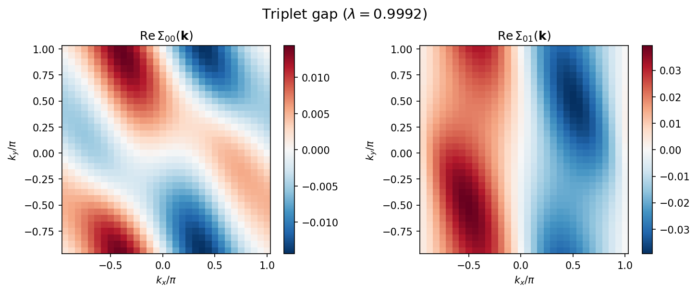

==========================================
Tutorial: Eliashberg equation solver
==========================================

This tutorial demonstrates how to use ``hwave_sc``,
the linearized Eliashberg equation solver included in H-wave.
The tool analyzes superconducting instabilities by computing
the leading eigenvalue of the linearized Eliashberg equation
using the bare susceptibility :math:`\chi_0(\mathbf{q})` from H-wave's RPA solver.

The sample files for this tutorial are located in
``docs/en/source/rpa/sample_sc`` directory.

Overview of the workflow
----------------------------

The calculation proceeds in two steps:

1. **RPA calculation** (``hwave``): Compute the bare susceptibility
   :math:`\chi_0(\mathbf{q})` and save it to ``chi0q.npz``.
2. **Eliashberg solver** (``hwave_sc``): Load ``chi0q.npz``, reconstruct
   the Green's function, compute RPA vertices, and solve the
   linearized Eliashberg equation.

Model
----------------------------

This tutorial uses a **two-orbital tight-binding model** on a
two-dimensional square lattice at 3/4 filling.
The Hamiltonian is:

.. math::

   H = \sum_{\mathbf{k},\alpha,\beta,\sigma}
       \varepsilon_{\alpha\beta}(\mathbf{k})\,
       c^\dagger_{\mathbf{k}\alpha\sigma} c_{\mathbf{k}\beta\sigma}
     + U \sum_{i,\alpha} n_{i\alpha\uparrow} n_{i\alpha\downarrow}
     + \sum_{i,\alpha\neq\beta} V_{\alpha\beta}\,
       n_{i\alpha} n_{i\beta}

with on-site Coulomb repulsion :math:`U = 0.4` and
inter-orbital Coulomb interaction :math:`V`.

This sample is based on the conduction layer model of the organic conductor
:math:`\beta`\ -(meso-DMBEDT-TTF)\ :math:`_2`\ PF\ :math:`_6`,
with transfer integrals obtained from extended Huckel calculations. [1]_

Theory
----------------------------

Superconducting susceptibility
^^^^^^^^^^^^^^^^^^^^^^^^^^^^^^^^

The RPA charge susceptibility :math:`\hat{X}^c` and spin susceptibility
:math:`\hat{X}^s` are given by:

.. math::

   \hat{X}^c = (\hat{I} + \hat{X}^{(0)} (\hat{U} + 2\hat{V}))^{-1} \hat{X}^{(0)}

.. math::

   \hat{X}^s = (\hat{I} - \hat{X}^{(0)} \hat{U})^{-1} \hat{X}^{(0)}

where :math:`\hat{X}^{(0)}` is the bare susceptibility,
:math:`\hat{U}` the on-site interaction matrix,
and :math:`\hat{V}` the inter-site interaction matrix.

Linearized Eliashberg equation
^^^^^^^^^^^^^^^^^^^^^^^^^^^^^^^^

The linearized Eliashberg equation for singlet superconductivity reads:

.. math::

   \lambda_S \Sigma^a_{\alpha\sigma;\beta\bar{\sigma}}(\mathbf{k})
   = -\frac{T}{N_L} \sum_{\mathbf{k}',n',\alpha',\beta'}
   P^S_{\alpha\sigma;\beta\bar{\sigma}}(\mathbf{k} - \mathbf{k}')
   G^{(0)}_{\alpha\alpha'}(\mathbf{k}', i\varepsilon_{n'})
   G^{(0)}_{\beta\beta'}(-\mathbf{k}', -i\varepsilon_{n'})
   \Sigma^a_{\alpha'\sigma;\beta'\bar{\sigma}}(\mathbf{k}')

The pairing interaction for the singlet channel is:

.. math::

   \hat{P}^S = \hat{U} + \hat{V}
   + \frac{3}{2} \hat{U} \hat{X}^s \hat{U}
   - \frac{1}{2} (\hat{U} + 2\hat{V}) \hat{X}^c (\hat{U} + 2\hat{V})

For the triplet channel:

.. math::

   \hat{P}^T = \hat{V}
   - \frac{1}{2} \hat{U} \hat{X}^s \hat{U}
   - \frac{1}{2} (\hat{U} + 2\hat{V}) \hat{X}^c (\hat{U} + 2\hat{V})

The superconducting transition corresponds to :math:`\lambda_S = 1`
(:math:`\lambda_T = 1` for triplet). When :math:`\lambda > 1`,
the normal state is unstable toward superconductivity.
Note that only positive eigenvalues indicate SC instability;
negative eigenvalues correspond to sign-changing gap functions
but do not satisfy the self-consistency condition :math:`\Delta = K\Delta`.

``hwave_sc`` implements two numerical methods to solve the Eliashberg equation:
self-consistent power iteration (converges to the mode with the largest eigenvalue)
and Arnoldi eigenvalue analysis.

.. [1] K. Yoshimi, M. Nakamura, and H. Mori,
   J. Phys. Soc. Jpn. **76**, 024706 (2007);
   `arXiv:cond-mat/0608466 <https://arxiv.org/abs/cond-mat/0608466>`_.

Prepare input files
----------------------------

Parameter file
^^^^^^^^^^^^^^^^^^^^^^^^^^^^^^^^

Create a TOML parameter file ``input.toml``:

.. literalinclude:: ../sample_sc/input.toml

The file contains the following sections:

``[mode.param]`` section
""""""""""""""""""""""""""""""""

- ``T``: Temperature.
- ``CellShape``: Size of the k-point mesh (32 x 32 x 1 for a 2D system).
- ``Nmat``: Number of Matsubara frequencies (512).
- ``filling``: Electron filling per orbital per spin (0.75 = 3/4 filling).

``[file]`` section
""""""""""""""""""""""""""""""""

- ``[file.input.interaction]``: Specifies files for geometry, transfer integrals,
  and interaction parameters. These files are shared with the RPA step.
- ``[file.output]``: Output directory and filenames for :math:`\chi_0(\mathbf{q})`
  and :math:`\chi(\mathbf{q})`.

``[eliashberg]`` section
""""""""""""""""""""""""""""""""

This section controls the Eliashberg solver. Key parameters:

- ``solver_mode``: ``"iteration"`` (self-consistent power iteration),
  ``"eigenvalue"`` (Arnoldi eigenvalue analysis), or ``"both"``.
- ``chi0q_mode``: ``"load"`` reads :math:`\chi_0(\mathbf{q})` from the RPA output
  file; ``"calc"`` computes it internally; ``"flex"`` reads the dressed
  susceptibilities from a FLEX run (required for ``frequency = "dynamic"``).

  .. note::

     ``"calc"`` recomputes :math:`\chi_0(\mathbf{q})` with the parameters in
     ``mode.param`` of **this** input file. For the result to be comparable
     with a ``"load"`` run, these must match the run that produced the chi0q
     file — in particular ``coeff_tail`` (Matsubara high-frequency tail
     correction), which changes :math:`\chi_0(\mathbf{q})` at :math:`O(1)`
     for moderate ``Nmat``. Its default ``coeff_tail = 0.0`` (no correction)
     can be poorly converged; production RPA/FLEX runs typically use
     ``coeff_tail = 1.0``. The chi0q file records the value it was produced
     with, and ``hwave_sc`` warns on a mismatch when loading.

  .. warning::

     **Inputs from a pre-fix** ``calc_scheme = "general"`` **FLEX run.** That
     path built its self-energy from an orbital-pair-transposed bubble, so its
     ``sigma.npz`` and ``green.npz`` are wrong off the orbital diagonal for a
     multi-orbital model. ``chi0q_mode = "flex"`` is not affected — it consumes
     the susceptibilities, which are not — but ``bond_green`` is: it takes the
     FLEX ``green.npz``, so regenerate that from a fixed build. Single-orbital
     runs and the ``"reduced"`` scheme are unaffected. See
     :ref:`the migration warning <flex_general_transpose_fix>`.
- ``frequency``: pairing-vertex frequency treatment. ``"static"`` (default)
  evaluates the pairing vertex at zero bosonic frequency (the Nakano--Kuroki
  Eq. 9 static approximation) and gives a frequency-independent gap.
  ``"dynamic"`` solves the full Matsubara-frequency-dependent Eliashberg
  equation with a frequency-dependent pairing vertex
  :math:`V(\mathbf{q}, i\omega_l)` and gap :math:`\phi(\mathbf{k}, i\omega_n)`;
  it requires ``chi0q_mode = "flex"`` (see
  :ref:`the dynamic-frequency section <sc_dynamic_frequency>` below).
- ``pairing_type``: ``"singlet"`` or ``"triplet"``. Not set in spin-orbital
  mode, where the gap is one spin-orbital matrix (see :ref:`sc_spin_orbital`).
- ``init_gap``: Initial gap symmetry for iteration.
  Options include ``"cos"`` (:math:`\cos(k_x+k_y+k_z)`),
  ``"d_x2y2"`` (:math:`\cos k_x - \cos k_y`), ``"random"``, etc.
  The full set of valid form factors is
  ``"cos"``, ``"s"``, ``"s_ext"``, ``"s_ext_2d"``, ``"d_x2y2"``,
  ``"d_y2z2"`` (:math:`\cos k_y - \cos k_z`),
  ``"d_xy"``, ``"d_xz"``, ``"d_yz"``, ``"d_z2"``,
  ``"p_x"``, ``"p_y"``, ``"p_z"``, and ``"random"``.
  For a quasi-two-dimensional cell ``CellShape = [1, Ny, Nz]``
  (:math:`k_x = 0`) the seeds built from :math:`\sin k_x`
  (``"p_x"``, ``"d_xy"``, ``"d_xz"``) vanish identically; use
  ``"p_y"``/``"p_z"`` for the triplet channel, and ``"d_y2z2"`` — which has
  opposite-sign anti-nodes at :math:`(\pi,0)` and :math:`(0,\pi)`, unlike the
  nodal ``"d_yz"`` that vanishes there — for the in-plane :math:`d`-wave.
- ``max_iter``: Maximum number of self-consistent iterations.
- ``alpha``: Mixing parameter (0 = no mixing, 1 = full mixing of old solution).
- ``convergence_tol``: Convergence criterion on the gap function.
- ``num_eigenvalues``: Number of eigenvalues to compute in eigenvalue mode.
  On the dynamic path this now controls only how many eigenvalues are listed,
  not which one is reported as leading: when the kernel conserves the channel's
  even-frequency sector, the leading eigenvalue is taken from a symmetry-valid
  solve restricted to that sector (see ``spectral_shift`` below), whose
  largest-real eigenvalue does not depend on ``num_eigenvalues``.
- ``eigenvalue_method``: ``"arnoldi"`` (default), ``"subspace"``, or
  ``"shift-invert-gmres"`` / ``"shift-invert-bicgstab"`` / ``"shift-invert-lgmres"``.
- ``g2_tail``: Apply the analytic Matsubara tail correction to the pair
  bubble :math:`G^{(2)}` (default ``true``; as of version 2.0). The bare truncated
  frequency sum misses the leading identity tail (an
  :math:`O(1/N_{\rm mat})` error) and can be slightly indefinite, which
  injects spurious imaginary parts into the reported eigenvalues at small
  ``Nmat``. The correction is asymptotic: it helps when the largest
  retained frequency exceeds the relevant energy scales (the solver warns
  when the Green function still deviates strongly from its tail at the
  window edge -- in that regime the correction can overshoot and passing
  the positivity check does not certify accuracy). Because the added term
  is the identity only at the pair-bubble stage -- not a scalar shift of
  the assembled kernel -- enabling it can legitimately change which
  eigenvalue leads or its distance from a shift-invert target; that is
  corrected physics, not a solver defect. ``false`` reproduces
  results computed before the correction existed.
- ``sigma_shift`` (shift-invert ``eigenvalue_method`` only): the real target
  :math:`\sigma` for the shift-invert eigensolver; eigenvalues near
  :math:`\sigma` are found first. Ignored (with a warning) for the plain
  ``"arnoldi"`` method -- use ``spectral_shift`` there instead.
- ``spectral_shift`` (``eigenvalue_method = "arnoldi"`` only): a positive number,
  or ``"auto"``. The default ARPACK selection (``which='LM'``) returns the
  eigenvalues of largest *magnitude*; far from a pairing instability, a small
  positive (attractive) leading eigenvalue can be masked by much larger negative
  (repulsive) eigenvalues, so the reported leading value comes out negative and
  unphysical. Setting ``spectral_shift`` makes the solver request the eigenvalue
  of largest *real* part (``which='LR'``; the physical SC eigenvalue,
  :math:`\lambda \to 1` at :math:`T_c`) on the shifted operator
  :math:`A + \sigma I`; the shift is subtracted internally, so the eigenvalues
  you receive/save are the true unshifted ones. Use ``"auto"`` to set
  :math:`\sigma` from the spectral radius automatically, or give an explicit
  positive :math:`\sigma` larger than the *absolute value* of the most negative
  eigenvalue (so :math:`A + \sigma I` has an all-positive-real spectrum).
  Recommended whenever the leading eigenvalue comes out negative or you scan
  weakly-pairing systems (low pressure, quasi-1D). Note this differs from
  ``sigma_shift`` above (a shift-invert *target*, not a spectral shift). On the
  dynamic path (``frequency = "dynamic"``) the largest-real selection is applied
  automatically for the channel (issue #202): when the kernel conserves the
  channel's even-frequency sector, the leading eigenvalue comes from a
  symmetry-valid solve restricted to that sector (``eigenvalue_selection =
  "LR_projected"``), whose largest-real eigenvalue is num_eigenvalues-
  independent; when it does not conserve the sector and a plain ``arnoldi`` set
  holds no positive channel eigenvalue, the solver instead re-solves once with
  ``spectral_shift = "auto"`` (``"LR_retry"``). Both are recorded in
  ``eigenvalue_selection`` (see below). A user-supplied ``spectral_shift`` still
  applies to the unprojected path; a seeded (eigenvector-continuation) run is
  never re-solved, so a repulsive-dominant temperature scan should set
  ``spectral_shift = "auto"`` for every point to keep the seeded continuation
  consistent with the leading value.
- ``gpu``: ``true`` runs the kernel-apply (matvec/matmat, the FFT convolution)
  on the GPU (CuPy) for **both** ``frequency = "dynamic"`` and
  ``frequency = "static"`` (default ``false``). The eigensolver itself (ARPACK
  Arnoldi, power iteration, subspace iteration, shift-invert) always runs on the
  host, because CuPy has no general non-Hermitian eigensolver; only the gap
  vector crosses to the device per iteration. Without a usable CuPy/CUDA device
  the run falls back to CPU with a warning (see the
  :ref:`GPU-execution section <sc_dynamic_gpu_en>` below). ``fft_workers`` is
  ignored on the GPU path.
- ``gpu_required``: Set ``true`` to make ``gpu = true`` strict -- the solver
  raises instead of silently falling back to CPU when CuPy/CUDA is unavailable
  (default ``false``). Honored by the dynamic Eliashberg solver (set it in
  ``[eliashberg]``) and by the FLEX and RPA solvers (set it in
  ``[mode.param]``, alongside their ``gpu`` flag).
- ``fft_workers``: Number of FFT worker threads for the dynamic-mode spatial
  FFTs (default ``1`` = the serial numpy path, unchanged from previous
  releases; ``-1`` uses all cores; ignored on the GPU).
- ``matsubara_basis``: Matsubara-axis representation of the dynamic mode:
  ``"uniform"`` (default, unchanged) or ``"ir"`` (the sparse-ir intermediate
  representation; see :ref:`the IR section <sc_dynamic_ir_en>` below).
- ``ir_tol``: IR basis cutoff accuracy (default 1e-8).
- ``ir_wmax``: real-frequency bandwidth of the IR basis, in the same energy
  units as the Hamiltonian (auto-estimated from the dispersion spectral range
  ``max|eps_k - mu|`` and the interaction scale when omitted; if the estimate
  cannot be formed, the solver fails fast and asks for an explicit value).
  The auto estimate is ``3*(max|eps_k - mu| + interaction)`` -- the spectral
  half-range measured about the chemical potential plus the largest interaction
  scale. The FLEX solver now uses the identical estimator, so a FLEX ->
  Eliashberg pair with an auto ``ir_wmax`` lands on the same IR basis.
- ``ir_keep_static_chi``: ``true`` / ``false`` (default ``false``). When the
  spin/charge susceptibility is static-dominated (large and nearly frequency-
  independent within the sampled window, i.e. the near-critical regime), the
  frequency-independent component the IR compression would otherwise discard as
  the small :math:`O(\beta/N_\mathrm{mat})` :math:`\delta(\tau)` artifact instead
  carries physical weight; dropping it corrupts the leading eigenvalue. If that discarded
  component exceeds the data scale the solver aborts with guidance. Set this to
  ``true`` to retain the static component instead of aborting (alternatively
  lower ``ir_wmax`` or increase the FLEX ``Nmat``).

.. note::

   **Keep** :math:`\beta\,\omega_\mathrm{max}` **above the truncation floor.**
   The ill-conditioning guard on the IR fit only catches a bandwidth that is
   too *large* for the sampling grid; it cannot see the opposite failure. At
   *small* :math:`\Lambda = \beta\,\omega_\mathrm{max}` the fit stays perfectly
   well-conditioned yet the basis is simply too narrow to represent the
   Green function's band edges, so it carries a silent basis-truncation error
   -- of order 1% once :math:`\omega_\mathrm{max}` no longer reaches a
   band-edge single-pole Green function to the requested ``ir_tol``. Keep
   :math:`\beta\,\omega_\mathrm{max}` above that floor: use the automatic
   ``ir_wmax`` estimate (which targets it by construction) or set an explicit
   ``ir_wmax`` :math:`\ge 3\,(\text{bandwidth} + \text{interaction})` as the
   safe lower bound.

Interaction definition files
^^^^^^^^^^^^^^^^^^^^^^^^^^^^^^^^

The interaction definition files use the Wannier90-like format,
shared with the RPA solver. See :ref:`Ch:Config_rpa` for details.

``Geometry`` (``geom.dat``):

.. literalinclude:: ../sample_sc/geom.dat

Defines a unit cell with 2 orbitals.

``Transfer`` (``transfer.dat``):

.. literalinclude:: ../sample_sc/transfer.dat

Defines the hopping integrals for the two-orbital model.

``CoulombIntra`` (``coulombintra.dat``):

.. literalinclude:: ../sample_sc/coulombintra.dat

On-site Coulomb repulsion :math:`U = 0.4` on each orbital.

``CoulombInter`` (``coulombinter.dat``):

.. literalinclude:: ../sample_sc/coulombinter.dat

Inter-orbital and inter-site Coulomb interactions.

Step 1: Run RPA calculation
----------------------------

First, compute the bare susceptibility by running the RPA solver:

.. code-block:: bash

    $ hwave input.toml

This generates ``output/chi0q.npz`` and ``output/chiq.npz``.
The RPA step takes a few seconds for a 32 x 32 mesh.

Step 2: Run Eliashberg solver
---------------------------------

Next, run the Eliashberg equation solver using the same input file:

.. code-block:: bash

    $ hwave_sc input.toml

The solver performs the following steps:

1. Loads :math:`\chi_0(\mathbf{q})` from ``output/chi0q.npz``.
2. Reads the interaction files and builds the Hamiltonian.
3. Constructs the non-interacting Green's function :math:`G(\mathbf{k}, i\omega_n)`.
4. Computes the RPA charge and spin vertices
   :math:`V_c(\mathbf{q})` and :math:`V_s(\mathbf{q})`.
5. Solves the linearized Eliashberg equation by self-consistent
   iteration and/or eigenvalue analysis.

The output log shows the iteration progress:

.. code-block:: text

    hwave_sc: === Self-consistent iteration ===
    hwave_sc: Iteration    0: eigenvalue = 0.925449, diff = 3.540384e-01
    hwave_sc: Iteration    1: eigenvalue = 0.818387, diff = 7.885727e-02
    ...
    hwave_sc: Iteration  192: eigenvalue = 0.961078, diff = 9.752299e-06
    hwave_sc: Converged at iteration 193
    hwave_sc: Iteration result: eigenvalue = 0.961078, converged = True, n_iter = 193

followed by the eigenvalue analysis:

.. code-block:: text

    hwave_sc: === Eigenvalue analysis ===
    hwave_sc: Leading eigenvalues:
    hwave_sc:     0: 0.961079 (|ev| = 0.961079)
    hwave_sc:     1: 0.837896 (|ev| = 0.837896)
    hwave_sc:     2: 0.812195 (|ev| = 0.812195)
    hwave_sc:     3: -0.889340 (|ev| = 0.889340)
    hwave_sc:     4: -1.072771 (|ev| = 1.072771)
    hwave_sc:     5: -1.351573 (|ev| = 1.351573)
    hwave_sc:     6: 0.977706 (|ev| = 0.977706)  [opposite-parity sector]
    hwave_sc:     7: 0.824931 (|ev| = 0.824931)  [opposite-parity sector]
    ...

An eigenvalue :math:`\lambda > 1` (positive) indicates a superconducting instability
at the given temperature. Negative eigenvalues correspond to sign-changing gap symmetries
but do not indicate SC instability.

The eigenpairs are ordered so that those with the **channel parity** come first
(even for singlet, odd for triplet): the leading one (index 0) is the physical
solution and matches the self-consistent iteration result. Eigenvalues tagged
``[opposite-parity sector]`` belong to the other parity sector; for a given
spin channel they are forbidden by the Pauli principle and do **not** represent
a physical instability (see the note on parity below). The last column of
``eigenvalue.dat`` records this as ``match`` (``1`` = channel parity, ``0`` =
spurious).

Results
----------------------------

Gap function
^^^^^^^^^^^^^^^^^^^^^^^^^^^^^^^^

The following figures show the gap function :math:`\Sigma_{\alpha\beta}(\mathbf{k})`
in momentum space obtained from the self-consistent iteration.

**Singlet channel** (:math:`\lambda \approx 0.96`):

.. figure:: ../sample_sc/gap_singlet.png
   :width: 90%
   :align: center

   Singlet gap function in k-space. Left: intra-orbital component
   :math:`\mathrm{Re}\,\Sigma_{00}(\mathbf{k})`.
   Right: inter-orbital component :math:`\mathrm{Re}\,\Sigma_{01}(\mathbf{k})`.
   The inter-orbital component is about 5 times larger than the intra-orbital one,
   indicating that inter-orbital pairing is dominant.

**Triplet channel** (:math:`\lambda \approx 0.97`):

   Triplet gap function in k-space. Left: intra-orbital component
   :math:`\mathrm{Re}\,\Sigma_{00}(\mathbf{k})`.
   Right: inter-orbital component :math:`\mathrm{Re}\,\Sigma_{01}(\mathbf{k})`.
   The gap is **odd** under :math:`\mathbf{k} \to -\mathbf{k}` (with the orbital
   transpose), as required for spin-triplet pairing; the inter-orbital component
   is again the larger one.

Eigenvalue spectrum
^^^^^^^^^^^^^^^^^^^^^^^^^^^^^^^^

The eigenvalue spectrum of the linearized Eliashberg equation is shown below
for both singlet and triplet channels.

.. figure:: ../sample_sc/eigenvalue_spectrum.png
   :width: 70%
   :align: center

   Positive eigenvalue spectrum :math:`\lambda` of the linearized Eliashberg equation.
   The dashed red line indicates :math:`\lambda = 1` (SC instability criterion).
   Filled markers are the **physical** eigenvalues (the gap has the channel
   parity: even for singlet, odd for triplet); open markers are **spurious**
   opposite-parity modes. All physical eigenvalues lie below 1. The two open
   markers above 1 are even-parity solutions of the
   *triplet* kernel, which the Pauli principle forbids for spin-triplet pairing
   (see the parity note below).

The Arnoldi eigenvalue analysis finds multiple eigenvalues.
The figure shows only positive eigenvalues, which are relevant for the
SC instability criterion :math:`\lambda = 1`.
For the singlet channel, the leading **physical** (even-parity) eigenvalue is
:math:`\lambda_S \approx 0.96 < 1`, matching the self-consistent iteration
result, so there is no singlet SC instability at this temperature.

For the triplet channel, the leading **physical** (odd-parity) eigenvalue is
:math:`\lambda_T \approx 0.97 < 1`. The larger values near
:math:`1.58` and :math:`1.10` that appear in the triplet calculation are
even-parity (spurious) modes and are **not** triplet instabilities. The triplet
leads narrowly (:math:`\lambda_T > \lambda_S`); both channels lie somewhat
below the threshold at this temperature.

Plotting script
^^^^^^^^^^^^^^^^^^^^^^^^^^^^^^^^

The above figures can be reproduced using the plotting script included
in the sample directory:

.. code-block:: bash

    $ python plot_results.py

Output files
----------------------------

The solver produces the following files in the ``output`` directory:

``gap.dat``
^^^^^^^^^^^^^^^^^^^^^^^^^^^^^^^^

The converged gap function :math:`\Delta_{\alpha\beta}(\mathbf{k})` in k-space.
Each line contains:

.. code-block:: text

    kx  ky  kz  Re(Δ_00)  Im(Δ_00)  Re(Δ_01)  Im(Δ_01)  Re(Δ_10)  Im(Δ_10)  Re(Δ_11)  Im(Δ_11)

where :math:`\alpha, \beta` are orbital indices.

.. _sc_eigenvalue_dat:

``eigenvalue.dat``
^^^^^^^^^^^^^^^^^^^^^^^^^^^^^^^^

The eigenvalues of the linearized Eliashberg equation:

.. code-block:: text

    # Iteration eigenvalue
    9.61078331e-01
    # Eigenvalue analysis
    # index  Re(eigenvalue)  Im(eigenvalue)  |eigenvalue|  match(1=channel-parity)
       0  9.61078596e-01 -3.64174908e-12  9.61078596e-01 1
       1  8.37896272e-01 -3.65082177e-12  8.37896272e-01 1
       ...

The trailing ``match`` column is ``1`` when the eigenvector has the channel's
parity (a physical singlet/triplet gap) and ``0`` for a spurious opposite-parity
mode (see the parity note above). Older output files without this column are
read unchanged.

Physical interpretation
----------------------------

The leading eigenvalue :math:`\lambda` of the linearized Eliashberg equation
determines whether superconductivity emerges:

- :math:`\lambda > 1`: The normal state is unstable toward superconductivity.
  The corresponding eigenvector gives the symmetry of the gap function.
- :math:`\lambda < 1` (for all positive eigenvalues): The normal state is stable
  at this temperature.

Negative eigenvalues correspond to sign-changing gap functions
(such as :math:`s_\pm`-wave in multi-orbital systems),
but they do **not** indicate SC instability regardless of their magnitude.
The self-consistency condition :math:`\Delta = K\Delta` requires :math:`\lambda = 1`
(not :math:`\lambda = -1`).

By varying the temperature and finding the point where the largest
positive eigenvalue reaches :math:`\lambda = 1`, one can determine
the superconducting transition temperature :math:`T_c`.

In this example, at :math:`T = 0.1` both physical channels are below the
instability threshold, with :math:`\lambda_S \approx 0.96` (singlet, even) and
:math:`\lambda_T \approx 0.97` (triplet, odd); the triplet leads narrowly.

.. note::

   **Parity and the Pauli principle.**
   A Cooper pair must be antisymmetric under exchange of the two electrons,
   i.e. under the combined operation of spin exchange, orbital exchange, and
   :math:`\mathbf{k} \to -\mathbf{k}`. For an (even-frequency) gap
   :math:`\Sigma_{\alpha\beta}(\mathbf{k})` this fixes the spatial parity
   :math:`P:\ \Sigma_{\alpha\beta}(\mathbf{k}) \to \Sigma_{\beta\alpha}(-\mathbf{k})`:
   spin-singlet gaps are **even** (:math:`P = +1`) and spin-triplet gaps are
   **odd** (:math:`P = -1`). The Eliashberg kernel acts on the full gap space and
   is not restricted to one parity, so each channel's kernel also has
   opposite-parity eigenvectors. These are mathematical solutions with no
   physical meaning for that spin channel (e.g. an even-parity eigenvalue of the
   triplet kernel would be a totally symmetric pair state, forbidden by Pauli).
   ``hwave_sc`` therefore projects each self-consistent iterate onto the
   channel's parity sector, and the eigenvalue analysis labels each mode as
   physical (``match = 1``) or spurious (``match = 0``). The large values
   :math:`\lambda \approx 1.58,\ 1.10` seen in the triplet calculation are such
   spurious even-parity modes, **not** triplet instabilities.

Singlet vs. triplet comparison
^^^^^^^^^^^^^^^^^^^^^^^^^^^^^^^^

By changing ``pairing_type`` to ``"triplet"`` in the input file,
one can compare the singlet and triplet channels.
When switching to the triplet channel, ``init_gap`` must also be set to an
odd-parity (triplet) seed such as ``"p_x"`` (the ready-made
``input_triplet.toml`` does this); the default ``init_gap = "cos"`` is an even
(singlet) seed, and the solver now rejects a seed of the wrong parity with an
error rather than converging to an unphysical sector. Equivalently, omit
``init_gap`` entirely to let the solver pick the channel's parity automatically.
At :math:`T = 0.1` with the same parameters, the leading physical eigenvalues are
:math:`\lambda_T \approx 0.97` (triplet) and :math:`\lambda_S \approx 0.96`
(singlet): the triplet leads narrowly, in line with Ref. [1]_, where the
triplet SC state competes with the singlet for :math:`T > 0.05`.

The two molecules of the unit cell are different sites, which the input
declares with ``orbital_site = [0, 1]``: their in-cell interaction (the
``R = 0`` inter-orbital ``CoulombInter`` row) then enters, like every other
inter-molecule interaction, through its density-density (Hartree) part only,
as in Ref. [1]_. Without the key it would be treated as an interaction within
one site, with its exchange crossing (see ``orbital_site`` in the
configuration reference). Since issue #239 the pairing vertex of
``hwave_sc`` (``bond_channels = false``) also keeps only the Hartree part of
the inter-cell interactions, as Ref. [1]_ does; earlier versions added their
exchange in an approximate, collapsed form. The numbers quoted in this section
are computed with the current treatment (earlier versions gave
:math:`\lambda_S \approx 0.94` and :math:`\lambda_T \approx 1.00`).

.. _sc_dynamic_frequency:

Dynamic (frequency-dependent) Eliashberg equation
--------------------------------------------------

By default ``hwave_sc`` solves the Eliashberg equation in the **static
approximation**: the pairing vertex is evaluated at zero bosonic Matsubara
frequency (the Nakano--Kuroki Eq. 9 static approximation) and the gap
:math:`\Sigma(\mathbf{k})` carries no frequency dependence. Setting
``frequency = "dynamic"`` in the ``[eliashberg]`` section instead solves the
**full frequency-dependent** linearized Eliashberg equation,

.. math::

   \lambda\, \phi_{\alpha\beta}(\mathbf{k}, i\omega_n)
   = -\frac{T}{N_L} \sum_{\mathbf{k}', n'}
     V_{\alpha\beta}(\mathbf{k}-\mathbf{k}', i\omega_n - i\omega_{n'})\,
     [G G](\mathbf{k}', i\omega_{n'})\,
     \phi(\mathbf{k}', i\omega_{n'}),

keeping the full fermionic Matsubara axis of the gap
:math:`\phi(\mathbf{k}, i\omega_n)` together with a frequency-dependent pairing
vertex :math:`V(\mathbf{q}, i\omega_l)`. The vertex is applied as an
imaginary-time product (not as a static prefactor), so the kernel couples
different Matsubara frequencies.

FLEX prerequisite
^^^^^^^^^^^^^^^^^^^^^^^^^^^^^^^^

The dynamic mode needs frequency-resolved input that only the FLEX solver
produces, so it **must** be run with ``chi0q_mode = "flex"``. Before calling
``hwave_sc`` you must run a FLEX calculation (``mode = "FLEX"``) that writes,
into the directory read by the Eliashberg step:

- ``chiq_s.npz`` and ``chiq_c.npz`` -- the spin and charge susceptibilities on
  the **full** bosonic Matsubara axis (all ``Nmat`` frequencies), and
- ``green.npz`` -- the **dressed** Green's function
  :math:`G(\mathbf{k}, i\omega_n)`, from which the pair bubble is built.

.. note::

   The FLEX susceptibility files carry a ``chi_convention`` tag (``"kuroki"``
   for the reduced scheme, ``"myo"`` for the general full-vertex
   scheme) that the Eliashberg loader uses to interpret their orbital layout.
   For **two-orbital** systems (``norb = 2``) the reduced spin-orbital
   dimension and the orbital-pair dimension coincide (both ``4``), so this tag
   is what distinguishes them. H-wave versions before this fix inferred the
   layout from shape alone and mislabeled a ``norb = 2`` reduced (kuroki) chi
   as orbital-pair, corrupting the pairing vertex; Eliashberg eigenvalues and
   gap functions for such runs are **corrected (and therefore change)** in this
   version. Single-orbital and general (myo) results are unaffected.

.. warning::

   **Results may change for multi-orbital reduced-scheme FLEX runs.**
   The matrix index of a reduced (kuroki) susceptibility is a *density pair*:
   the stored :math:`X[a,b]` is :math:`\chi_{(a,a),(b,b)}`. Earlier versions
   embedded it into the :math:`n_\text{orb}^2` orbital-pair space as
   :math:`\text{out}[(l_1,l_2),(l_3,l_2)] = X[l_1,l_3]`, which dropped the
   inter-orbital density coupling :math:`\chi_{(0,0),(1,1)}` -- a component the
   pairing vertex :math:`S \chi S` genuinely references -- and scattered
   :math:`X` onto pair indices the reduced scheme never computed. This version
   embeds it correctly, as
   :math:`\text{out}[(a,a),(b,b)] = X[a,b]` with every other component zero.

   Consequently, **static and dynamic** ``chi0q_mode = "flex"`` results change
   for runs with ``norb >= 2`` whose FLEX used ``calc_scheme = "reduced"``.
   Two independent effects contribute, so a vanishing
   inter-orbital density component is not enough to be safe: the old placement
   both dropped :math:`\chi_{(a,a),(b,b)}` with :math:`a \neq b`, and -- when
   the interaction reaches the off-density blocks -- fabricated dressing there
   out of the diagonal :math:`\chi_{(a,a),(a,a)}`. Treat every such stored
   eigenvalue and gap function as needing recomputation. Single-orbital (``norb = 1``) results are bit-identical
   (both placements coincide), as are all general (myo) results. With the fix,
   a ``CoulombIntra``-only reduced run reproduces the equivalent
   ``chi0q_mode = "load"`` and general-scheme results exactly **for identical**
   :math:`\Sigma = 0` **physics** (FLEX with ``Mix = 0``, ``IterationMax = 1``);
   before the fix it did not. This is a statement about the pairing vertex
   only. It does not imply the two schemes are interchangeable at full
   self-consistency, where they also differ in how the self-energy is built.

   As of this version, IR-native susceptibility files (``write_densified =
   false``) must carry this ``chi_convention`` tag, and the loader also
   rejects a ``chi_convention`` that contradicts the tensor's shape-inferred
   layout, failing fast with an explicit message instead of silently building
   a wrong pairing vertex. Files written by current H-wave always carry a
   consistent tag, so this only affects hand-edited or externally produced
   susceptibility files.

``Nmat`` must be even and must match between the FLEX output and the
``[mode.param]`` value. If ``frequency = "dynamic"`` is requested without
``chi0q_mode = "flex"``, with an odd ``Nmat``, or without a dressed
``green.npz``, the solver aborts with an explanatory error rather than falling
back silently. The FLEX output directory can be selected with
``[file.input] path_to_flex_output`` (default: the ``[file.output]``
directory), and the individual filenames overridden with the ``[eliashberg]``
keys ``flex_chi_s`` / ``flex_chi_c`` / ``flex_green``.

Outputs
^^^^^^^^^^^^^^^^^^^^^^^^^^^^^^^^

In addition to ``eigenvalue.dat`` (the leading :math:`\lambda`), the dynamic
mode writes:

``gap_dynamic.npz``
   The full frequency-resolved gap and its metadata. Keys:

   - ``gap``: complex array of shape ``(norb, norb, Nx, Ny, Nz, Nmat)`` --
     :math:`\phi_{\alpha\beta}(\mathbf{k}, i\omega_n)`.
   - ``iomega``: the centered fermionic Matsubara frequencies
     :math:`\omega_n = (2n + 1 - N_{\mathrm{mat}})\pi T`.
   - ``T``: temperature.
   - ``pairing_type``: ``"singlet"`` or ``"triplet"``.
   - ``frequency``: ``"dynamic"``.
   - ``eigenvalue``: the leading :math:`\lambda`.
   - ``axis_order``: ``"(orb1, orb2, kx, ky, kz, iomega)"``.
   - ``normalization``: the gauge convention -- the gap is L2-normalized over
     all components and its largest-magnitude component is rotated
     real-positive, so the stored gap is reproducible across runs and
     linear-algebra backends.
   - ``gap_sector_weights``: four real numbers summing to 1 -- the fraction of
     :math:`\|\phi\|^2` in each momentum/frequency parity sector of the
     returned gap (see
     :ref:`Pairing channels of the dynamic solver <sc_dynamic_channels>`).
   - ``gap_sector_labels``: the names of those four sectors, in the same
     order: ``"even_k_even_w"``, ``"odd_k_even_w"``, ``"even_k_odd_w"``,
     ``"odd_k_odd_w"``.
   - ``sector_selection``: the sector this run selected in -- ``"channel"``,
     ``"combined_parity"`` or ``"none"``. On the power-iteration path it is
     the sector the iterates were projected onto; on the eigenvalue solver
     modes, which never project, it is the stage the eigenpair reordering
     matched with, and therefore what the ``match`` column of
     ``eigenvalue.dat`` means. See the same subsection.
   - ``eigenvalue_selection``: which selection criterion produced the reported
     leading eigenvalue -- ``"LR_projected"`` (a symmetry-valid solve restricted
     to a conserved channel sector, the num_eigenvalues-independent criterion),
     ``"LM"`` (plain ``arnoldi``, largest magnitude), ``"LR"`` (``spectral_shift``
     set by the user, largest real part), ``"LR_retry"`` (the automatic
     largest-real re-solve when an unprojected ``"LM"`` set held no positive
     channel eigenvalue), ``"dense-LR"`` (the tiny-operator dense largest-real
     path), ``"shift-invert"``, or ``"iteration"`` (the power iteration). Also
     written as the ``# eigenvalue_selection: ...`` header line of
     ``eigenvalue.dat``.

``gap.dat``
   A single-frequency slice of the gap at the lowest positive Matsubara
   frequency (index ``Nmat//2``), in the same column layout as the static
   ``gap.dat`` (``kx ky kz`` then ``Re``/``Im`` per orbital pair). Its first
   line is a ``#``-prefixed header carrying ``frequency=dynamic`` together with
   the slice index and its :math:`\omega_n`.

Channel-parity selection
^^^^^^^^^^^^^^^^^^^^^^^^^^^^^^^^

Like the static solver, the dynamic mode reports the leading eigenpair **of the
requested pairing channel**, not merely the algebraically largest eigenvalue.
Fermion antisymmetry fixes the combined parity of the gap under
:math:`\phi_{\alpha\beta}(\mathbf{k}, i\omega_n) \to
\phi_{\beta\alpha}(-\mathbf{k}, -i\omega_n)`: even for ``singlet`` and odd for
``triplet``. Within that constraint the solver selects the conventional
**even-frequency** sector of the requested channel, as described in the next
subsection. The Arnoldi eigenpairs are reordered so that the channel mode
leads, and the per-eigenvalue table in ``eigenvalue.dat`` carries a trailing
``match`` column like the static output (``1`` in the matched sector, ``0``
outside it). That column is **named after the sector that matched** --
``match(1=channel even-frequency sector)``, or
``match(1=combined-parity sector; no even-frequency eigenpair)`` when the
fallback stage was used -- so a ``1`` never has to be guessed at. If none of
the ``num_eigenvalues`` computed eigenpairs lies in either sector, the solver
warns and falls back to the raw leading pair; increase ``num_eigenvalues`` or
check ``pairing_type`` in that case. The power-iteration path (``solver_mode =
"iteration"``) likewise projects every iterate onto the channel sector when the
kernel preserves it, onto the wider combined-parity sector when it preserves
only that, and not at all when it preserves neither (each fallback is warned
about). Both paths record what they used as ``sector_selection``.

.. _sc_dynamic_channels:

Pairing channels of the dynamic solver
^^^^^^^^^^^^^^^^^^^^^^^^^^^^^^^^^^^^^^^

The combined parity above is only the antisymmetry *constraint*; each of its
two eigenspaces still contains two frequency parities. The channels the solver
reports are the conventional **even-frequency** ones:

- ``singlet``: even in :math:`\mathbf{k}`, even in frequency;
- ``triplet``: odd in :math:`\mathbf{k}`, even in frequency.

Even frequency means invariance under
:math:`\phi_{\alpha\beta}(\mathbf{k}, i\omega_n) \to
\phi_{\alpha\beta}(\mathbf{k}, -i\omega_n)` (the frequency alone, orbitals
untouched); the momentum parity carries the orbital transpose,
:math:`\phi_{\alpha\beta}(\mathbf{k}, i\omega_n) \to
\phi_{\beta\alpha}(-\mathbf{k}, i\omega_n)`, exactly as on the static path.
Their product is the combined parity above.

**Odd-frequency pairing is not solved for.** The remaining two sectors --
odd :math:`\mathbf{k}` with odd frequency (combined parity :math:`+1`) and
even :math:`\mathbf{k}` with odd frequency (combined parity :math:`-1`) --
are annihilated by both channel projectors.

Each run records what it actually returned: the four sector weights
(squared-norm fractions, summing to 1) are written to ``gap_dynamic.npz`` /
``eliashberg_bond_<type>.npz`` as ``gap_sector_weights`` with their names in
``gap_sector_labels``, and as a header line

.. code-block::

   # gap_sector_weights even_k_even_w=1.000000 odd_k_even_w=0.000000 even_k_odd_w=0.000000 odd_k_odd_w=0.000000

in ``eigenvalue.dat`` (and in the bond entries' ``eigenvalue_bond_<type>.dat``).
The solver logs the channel's own weight at ``INFO`` and warns when it falls
below ``0.999`` -- the returned gap is then not a pure even-frequency state of
the requested channel, and the weights say what it is instead.

.. note::

   **The channel projection is applied only where the kernel conserves the
   frequency parity** -- any single-orbital model, and multi-orbital models
   with the corresponding lattice and orbital symmetry. A general multi-orbital
   kernel conserves only the product of the two parities (the antisymmetry
   constraint), and projecting the power iteration onto the narrower
   even-frequency sector would then turn the eigenproblem into a restriction of
   itself, whose leading value is not an eigenvalue of the kernel. In that case
   the iteration projects onto the combined-parity sector instead, with a
   warning, so the reported :math:`\lambda` is always a genuine eigenvalue and
   the sector weights show the composition of the gap that produced it. Which
   case applied is recorded per run as ``sector_selection``
   (``"channel"``, ``"combined_parity"`` or ``"none"``) -- an npz key and the
   ``# sector_selection=...`` header line of the eigenvalue file. On the
   eigenvalue solver family, when the kernel conserves the channel's
   even-frequency sector the leading eigenpair comes from a solve restricted to
   that sector (``sector_selection = "channel"``, issue #202); otherwise the
   computed eigenpairs are ordered, preferring the channel's even-frequency
   sector and falling back to its combined-parity sector only if no eigenpair
   lies in it. There ``sector_selection`` names the stage that matched, which is
   also what the ``match`` column of ``eigenvalue.dat`` is labelled with.

.. note::

   **Leading eigenvalue independent of** ``num_eigenvalues``. The plain
   ``arnoldi`` method asks ARPACK for the eigenvalues of largest *magnitude*
   (``which='LM'``), so a small positive (attractive) channel eigenvalue can be
   absent from a short list dominated by larger-real opposite-sector or repulsive
   modes -- and the reported leading value would then depend on
   ``num_eigenvalues``. When the kernel conserves the channel's even-frequency
   sector, the dynamic solver instead solves the kernel *restricted to that
   sector* (the same projector the power iteration uses), whose largest-real
   eigenvalue is the channel's Tc eigenvalue independent of ``num_eigenvalues``;
   if that sector is repulsive the answer is its least-repulsive (largest-real)
   eigenvalue. When the kernel does not conserve the sector, an unprojected
   ``"LM"`` set holding no positive channel eigenvalue is re-solved **once** with
   ``spectral_shift = "auto"`` (largest real part) as a best effort. Which
   criterion was used is recorded as ``eigenvalue_selection`` --
   ``"LR_projected"``, ``"LM"``, ``"LR"`` (user ``spectral_shift``),
   ``"LR_retry"`` (the automatic re-solve), ``"dense-LR"``, ``"shift-invert"``
   or ``"iteration"`` -- both as an npz key and as the
   ``# eigenvalue_selection: ...`` header line of ``eigenvalue.dat``. Setting
   ``spectral_shift = "auto"`` up front avoids the extra solve on the
   unprojected path. The reference
   for the leading positive eigenvalue is ``solver_mode = "iteration"`` (the
   self-consistent power iteration, with ``spectral_shift = "auto"`` when the
   kernel is repulsive-dominant): it converges to the mode of largest real part
   directly and does not depend on ``num_eigenvalues`` at all.

.. warning::

   **Changed in this version.** Earlier versions selected the eigenpair by the
   combined parity alone. A reported ``triplet`` could therefore be an
   odd-frequency (even :math:`\mathbf{k}`, odd frequency) state, and -- more
   rarely -- a reported ``singlet`` an odd :math:`\mathbf{k}`/odd-frequency
   one, since both carry the right combined parity. Triplet results of the
   dynamic solver obtained before this version should be recomputed; singlet
   runs whose gap already sits in the (even :math:`\mathbf{k}`, even frequency)
   sector are numerically unchanged.

.. _sc_channel_decomposition:

Channel decomposition (diagnostic)
^^^^^^^^^^^^^^^^^^^^^^^^^^^^^^^^^^^^

The pairing vertex is a sum of a spin-fluctuation, a charge-fluctuation, and an
instantaneous bare term. For the singlet and triplet channels,

.. math::

   V^{\mathrm s} &= \tfrac{3}{2}\, \hat S\, \chi_{\mathrm s}\, \hat S
       - \tfrac{1}{2}\, \hat C\, \chi_{\mathrm c}\, \hat C
       + \tfrac{1}{2}(\hat S + \hat C), \\
   V^{\mathrm t} &= -\tfrac{1}{2}\, \hat S\, \chi_{\mathrm s}\, \hat S
       - \tfrac{1}{2}\, \hat C\, \chi_{\mathrm c}\, \hat C
       + \tfrac{1}{2}(\hat C - \hat S),

both of which are linear in the spin (:math:`\chi_{\mathrm s}`) and charge
(:math:`\chi_{\mathrm c}`) susceptibilities (only the coefficients and the bare
term differ). The decomposition therefore applies to either ``pairing_type``.
Two optional booleans in the ``[eliashberg]`` section zero one channel before
the vertex is built, to attribute the pairing strength to spin vs. charge
fluctuations:

- ``zero_chi_c`` (default ``false``): zero :math:`\chi_{\mathrm c}`; the vertex
  keeps the spin-fluctuation term plus the bare term (spin channel).
- ``zero_chi_s`` (default ``false``): zero :math:`\chi_{\mathrm s}`; the vertex
  keeps the charge-fluctuation term plus the bare term (charge channel).

.. note::

   These flags apply only to the dynamic vertex (``frequency = "dynamic"``).
   The static solver (``frequency = "static"``, the default) builds its kernel
   from the RPA/FLEX static susceptibility and does not use them when
   constructing the kernel; setting one with ``frequency = "static"`` has no
   effect and logs a warning.

.. note::

   **Triplet bare term (issue #262).** In :math:`\tfrac{1}{2}(\hat C - \hat S)`
   the cross elements :math:`(ab, ab)`, :math:`a \neq b`, are left out. There an
   inter-orbital density-type term (``CoulombInter``, ``Hund`` or ``Ising``)
   is the exchange image of its density element :math:`(aa, bb)`, and on a gap
   of triplet parity the two would count it twice. Earlier versions kept those
   elements: the first-order triplet pairing of an on-site inter-orbital
   ``CoulombInter`` (:math:`U'`), ``Hund`` or ``Ising`` term was twice its value, and that of an
   off-site inter-orbital one on the non-bond path (``bond_channels = false``,
   which collapses its Fock content onto these elements) was off by up to a
   factor of three. Multi-orbital triplet results with such terms change (the
   singlet channel and single-orbital models are unaffected) and should be
   recomputed.

For example, a spin-channel diagnostic uses:

.. code-block:: toml

   [eliashberg]
   zero_chi_c = true

Only the dynamic susceptibility function is zeroed; the static interaction
matrices :math:`\hat S` and :math:`\hat C` in the bare term are not changed.
Setting both to ``true`` leaves only the instantaneous bare vertex. Both default
off, so a production run is unaffected, and each zeroed channel logs a warning.
These are **diagnostics**: the instantaneous bare term is retained in every case,
and because the linearized-gap eigenvalue problem is nonlinear in the vertex, the
eigenvalues from separately zeroed runs are **not additive**
(:math:`\lambda_{\mathrm s} + \lambda_{\mathrm c} \neq \lambda_{\mathrm{full}}`
in general).
Enabled flags are recorded in ``gap_dynamic.npz``, ``gap.dat``, and
``eigenvalue.dat``. Keep both flags off for production runs.

.. _sc_seed_eigenvector:

Eigenvector continuation (``seed_eigenvector``)
^^^^^^^^^^^^^^^^^^^^^^^^^^^^^^^^^^^^^^^^^^^^^^^^^^

The reported leading eigenpair is normally the algebraically largest one. For a
frequency-dependent (non-Hermitian) kernel this can be fragile near an
*exceptional point* — where two real eigenvalues collide and split into a
complex-conjugate pair — so the "leading" branch may jump discontinuously
between neighbouring temperatures even when the FLEX self-energy varies
smoothly. To help follow one physical branch, set ``[eliashberg]
seed_eigenvector`` to a ``gap_dynamic.npz`` written by a neighbouring run
(e.g. the next-higher temperature): its gap is used as the ARPACK start
vector **and**, among the eigenpairs actually *returned* by the eigensolver
(governed by ``num_eigenvalues`` and, on the shift-invert path,
``sigma_shift``), to select the one whose eigenvector maximally overlaps it,
rather than the algebraically largest one. If the physical branch is not
among the returned eigenpairs at all, increase ``num_eigenvalues`` or move
``sigma_shift`` near it. Stepping temperature down and feeding each run the
previous ``gap_dynamic.npz`` helps track the same gap symmetry (e.g. the
d-wave mode) across the sweep, though it is not a guarantee: too large a
step between temperatures can still lose the physical branch. The seed must
share the run's ``CellShape`` and ``Nmat`` (a mismatch is a fail-fast error), so
keep ``Nmat`` fixed across a continuation sweep; on the IR path the seed gap is
refit onto the IR nodes automatically. ``[eliashberg] sigma_shift`` sets an
explicit shift-invert target (otherwise estimated from a preliminary Arnoldi);
combining ``sigma_shift`` near the branch with ``seed_eigenvector`` helps
resolve a masked or complexifying eigenvalue.

.. _sc_tsweep:

Temperature continuation (``hwave_tsweep``)
^^^^^^^^^^^^^^^^^^^^^^^^^^^^^^^^^^^^^^^^^^^^^^^^^^^^^^^^^^^

Chaining ``sigma_init`` and ``seed_eigenvector`` by hand across a temperature
sweep, as described above, means re-running ``hwave``/``hwave_sc`` once per
temperature and wiring each step's output into the next step's input. The
``hwave_tsweep`` command (installed alongside ``hwave`` and ``hwave_sc``)
automates this: given one base TOML -- the same
``[mode]``/``[mode.param]``/``[file]``/``[eliashberg]`` configuration used
for a single FLEX+Eliashberg run -- plus a ``[continuation]`` section, it
runs FLEX (and, unless disabled, the Eliashberg solver) across a descending
ladder of temperatures. At each rung it feeds the previous rung's final
saved self-energy into this rung's FLEX via ``sigma_init`` (warm start) and
the previous rung's dynamic gap into this rung's Eliashberg solve via
``seed_eigenvector`` (eigenvector continuation) -- automating the whole
warm-start chain instead of cold-starting (and potentially landing on a
different metastable solution) at every rung. This chaining does not
require the previous rung to have converged: any non-error rung whose seed
files are present is used as the next rung's seed regardless of its FLEX
convergence status, so inspect the summary's ``flex_converged`` column
(below) rather than assuming every warm start came from a converged
self-energy.

Only ``mode.param.T`` is varied between rungs; ``CellShape``, ``Nmat``, and
every other shape-determining field are held fixed across the ladder, which
is what keeps each rung's ``sigma_init``/``seed_eigenvector`` files
shape-compatible with the next rung.

The ``[continuation]`` section
""""""""""""""""""""""""""""""

.. code-block:: toml

    [continuation]
      temperatures   = [0.02, 0.015, 0.01, 0.008, 0.006]  # explicit ladder
      # or, if `temperatures` is absent, a generated ladder:
      #   T_start = 0.02
      #   T_stop  = 0.006
      #   num     = 5
      #   spacing = "linear"          # "linear" (default) or "log"
      output_dir     = "tsweep"       # default
      run_eliashberg = true           # default
      warm_start     = true           # default
      seed_gap       = true           # default
      resume         = false          # default; or pass --resume
      summary_file   = "lambda_vs_T.dat"  # default

- ``temperatures``: an explicit list of temperatures, run in the order given.
  If present it takes precedence over ``T_start``/``T_stop``/``num``.
- ``T_start`` / ``T_stop`` / ``num`` / ``spacing``: used to generate the
  ladder when ``temperatures`` is absent -- ``num`` points between
  ``T_start`` and ``T_stop``, with ``spacing`` ``"linear"`` (default) or
  ``"log"``. Supplying neither ``temperatures`` nor the ``T_start``/``T_stop``/``num``
  triple is a pre-flight error.
- ``output_dir`` (default ``"tsweep"``): the parent directory for the sweep.
  Rung ``idx`` at temperature ``T`` writes to
  ``<output_dir>/<idx>_T<T>/output/`` (``idx`` zero-padded to 3 digits, ``T``
  ``%g``-formatted).
- ``run_eliashberg`` (default ``true``): also run the Eliashberg solver at
  each rung. This requires the base TOML to already have an ``[eliashberg]``
  section -- pre-flight raises an error otherwise, naming the missing
  section. Set to ``false`` to run a FLEX-only sweep that chains only
  ``sigma_init``.
- ``warm_start`` (default ``true``): chain each rung's final self-energy
  (converged or not) into the next rung's ``sigma_init``.
- ``seed_gap`` (default ``true``): chain each rung's gap into the next
  rung's ``seed_eigenvector``. This is only active for the dynamic
  Eliashberg solver (``[eliashberg] frequency = "dynamic"``); for a static
  ladder it has no effect, since ``seed_eigenvector`` itself is dynamic-only.
- ``summary_file`` (default ``"lambda_vs_T.dat"``): filename of the summary
  table written to ``<output_dir>/<summary_file>``.

Running the sweep
""""""""""""""""""""""""""""""

.. code-block:: bash

    $ hwave_tsweep input.toml

Three flags control the run:

- ``--dry-run``: resolve and print the temperature ladder, each rung's
  output directory, and the ``sigma_init``/``seed_eigenvector`` paths that
  would be wired up -- without invoking either solver. Use this to validate
  a ``[continuation]`` config before committing to a long sweep.
- ``--keep-going``: by default a rung whose solver raises an error stops the
  sweep (a broken rung would otherwise poison every downstream seed, and the
  partial summary is still written); with ``--keep-going`` the next rung is
  instead cold-started, and if it succeeds it becomes the seed for
  subsequent rungs again. This is *error continuation within one process*,
  not a restart after the process itself was interrupted.
- ``--resume`` (or ``[continuation] resume = true``): *job-level restart*.
  When a sweep is rerun with resume, ``hwave_tsweep`` skips the longest
  contiguous prefix of already-completed, seedable rungs and restarts at the
  first incomplete one -- seeded from the last valid rung's ``sigma`` and
  dynamic gap, exactly as if the sweep had never stopped. Use it after a
  wall-clock/scheduler kill, a crash, or a manual interrupt.

  A rung counts as completed only when its recorded summary row is non-error
  **and** its on-disk outputs are actually present and parseable (a
  half-written or corrupt ``eigenvalue.dat`` is detected and that rung, plus
  every rung after it, is recomputed). Resume is guarded by a small manifest
  (``tsweep_manifest.json``, written on the first run) recording the resolved
  ladder and a fingerprint of the shape/physics configuration
  (``CellShape``/``SubShape``/``Nmat``/``filling``/``Ncond``/interaction
  files/``[eliashberg]`` frequency/pairing). Resuming against a different
  ladder or configuration **fails fast** rather than mixing incompatible
  results; a manifest whose schema version predates the current one (bumped
  by the #86 tail-correction and #133 Fourier-sign changes) is likewise
  refused. The summary is written atomically after every rung and the
  manifest when the sweep is established,
  so an interruption can never leave a truncated checkpoint. Without
  ``--resume`` a rerun starts fresh and overwrites the existing sweep
  rung-by-rung (a warning is logged when it detects an existing sweep).

The three are distinct: **warm start** (``warm_start``/``seed_gap``) chains
one rung's result into the *next* rung's seed within a single run;
**--keep-going** decides what happens *after a rung errors* within one run;
**--resume** decides what happens when a *whole run* is restarted.

Summary file
""""""""""""""""""""""""""""""

Each run writes ``<output_dir>/<summary_file>`` (default
``tsweep/lambda_vs_T.dat``), one row per rung:

.. code-block:: text

    # idx  T  status  error_stage  Re_lambda  Im_lambda  parity_match  flex_converged  flex_iter
    0 0.02   ok    none 0.845000 0.000000 1 1 18
    1 0.015  ok    none 0.902000 0.000000 1 1 22
    2 0.01   error flex nan      nan      -1 0 -1
    ...

``status`` is one of:

- ``ok`` -- FLEX converged and, if ``run_eliashberg``, the leading eigenpair
  was parsed from this rung's ``eigenvalue.dat``.
- ``not_converged`` -- FLEX ran to ``IterationMax`` without meeting ``EPS``,
  but still wrote a usable self-energy (and gap, if Eliashberg ran); such a
  rung is still eligible to seed the next one.
- ``error`` -- a solver raised, or (with ``run_eliashberg``) ``eigenvalue.dat``
  was missing or unparseable; ``error_stage`` then records which solver
  failed (``flex`` or ``eliashberg``).
- ``dry`` -- a row produced by ``--dry-run``; no solver was invoked.

Missing floats (``Re_lambda``/``Im_lambda`` when Eliashberg did not run or
failed) print as ``nan``; missing integer fields (``parity_match``,
``flex_converged``, ``flex_iter``) print as ``-1``. ``error_stage`` is
``none`` unless ``status = error``.

Example
""""""""""""""""""""""""""""""

.. code-block:: toml

    [mode]
      mode        = "FLEX"
      calc_scheme = "reduced"   # required here: see the note below

    [mode.param]
      T         = 0.02
      CellShape = [32, 32, 1]
      Nmat      = 512
      filling   = 0.75

    [file]
    [file.input]
      path_to_input = "."

    [file.input.interaction]
      path_to_input = "."
      Geometry      = "geom.dat"
      Transfer      = "transfer.dat"
      CoulombIntra  = "coulombintra.dat"
      CoulombInter  = "coulombinter.dat"

    [file.output]
      path_to_output = "output"

    [eliashberg]
      frequency     = "dynamic"
      chi0q_mode    = "flex"
      pairing_type  = "singlet"
      solver_mode   = "eigenvalue"   # required by hwave_tsweep pre-flight

    [continuation]
      T_start        = 0.02
      T_stop         = 0.005
      num            = 6
      spacing        = "log"
      run_eliashberg = true
      warm_start     = true
      seed_gap       = true

.. note::

   **Why this example pins** ``calc_scheme = "reduced"``. Since version 2.0
   the default is ``calc_scheme = "auto"``, which promotes ``CoulombInter``
   (and ``Hund``, ``Ising``, the aggregate ``Coulomb``) to ``general``. The
   ``general`` FLEX path accepts the off-site ``CoulombInter`` this
   workflow uses (as its Hartree vertex only, with a warning; it is
   spin-free only), so under the default the sweep would run on the
   ``general`` path and produce different susceptibilities from the ones
   this tutorial's reference results were made with. Requesting
   ``reduced`` explicitly reproduces those results, and is what H-wave
   1.0.x did for this input:

   .. code-block:: toml

      [mode]
        mode        = "FLEX"
        calc_scheme = "reduced"

   ``reduced`` is a documented approximation, so it is warned about once at
   construction, and the Eliashberg step **will** print the approximation
   warning described in
   :ref:`Supported interactions <sc_supported_inter>`. Both are expected here
   and not a misconfiguration. Drop the ``calc_scheme`` line (or set
   ``general``) when you need the inter-orbital channels dressed as well;
   off-site ``Exchange`` / ``PairHop`` are the only two-body terms the
   ``general`` path still rejects.

This descends from :math:`T = 0.02` to :math:`T = 0.005` over 6
log-spaced rungs, running FLEX + dynamic Eliashberg at each, chaining both
``sigma_init`` and ``seed_eigenvector``, and writing
``tsweep/lambda_vs_T.dat`` -- a :math:`\lambda(T)` table from which
:math:`T_c` can be estimated as the point where the leading physical
eigenvalue crosses 1.

Memory note
^^^^^^^^^^^^^^^^^^^^^^^^^^^^^^^^

The dynamic solver stores several full-frequency tensors (the pairing vertex,
the pair bubble, and the gap), so its peak memory scales roughly as
:math:`\mathcal{O}(N_{\mathrm{orb}}^4\, N_k\, N_{\mathrm{mat}})` and grows
quickly with the orbital count, k-mesh, and number of Matsubara frequencies.
Before allocating, ``hwave_sc`` estimates the peak requirement and aborts if it
would exceed the limit; set ``[eliashberg] mem_limit_gb`` to cap it explicitly
(``0`` disables the guard), otherwise a fraction of the available RAM is used.
The estimate reads the stored ``Nmat`` (the Matsubara-frequency axis) from the
on-disk file headers (``chiq_s.npz`` / ``chiq_c.npz`` / ``green.npz``) rather
than trusting only the configured value, so a file whose stored ``Nmat`` differs
from the configuration is rejected up front (before allocation) instead of
causing an out-of-memory crash mid-load. (The k-mesh and orbital count are taken
from the configuration; a mismatch there surfaces as a reshape error from the
loader.)

Performance note
^^^^^^^^^^^^^^^^^^^^^^^^^^^^^^^^

The eigenvalue solve is dominated by repeated applications of the kernel. Two
optimizations keep this cheap: the vertex's imaginary-time transform (the
kernel's most expensive step) is precomputed once instead of on every matvec,
and the spatial FFTs are run in parallel via ``scipy.fft``. ``[eliashberg]
fft_workers`` sets the number of FFT worker threads: ``1`` (default) keeps the
serial numpy path unchanged from previous releases, ``-1`` uses all cores
(opt-in); set a smaller number (e.g. matching ``OMP_NUM_THREADS``) when running
several dynamic solves concurrently to avoid oversubscribing the CPU. Together
these give roughly a 4x speedup at ``norb = 2``, ``N_k = 1024``,
``N_{mat} = 1024``. On the GPU (``gpu = true``) the FFTs already run on the
device and ``fft_workers`` is ignored.

.. _sc_dynamic_ir_en:

IR-basis (sparse-ir) compression of the Matsubara axis
^^^^^^^^^^^^^^^^^^^^^^^^^^^^^^^^^^^^^^^^^^^^^^^^^^^^^^^^

``matsubara_basis = "ir"`` replaces the dynamic mode's uniform Matsubara grid
(``Nmat`` points) by the sparse sampling nodes of the intermediate
representation (IR) basis -- typically 50-100 nodes, improving with lower
temperature. Requires the optional
`sparse-ir <https://sparse-ir.readthedocs.io>`_ package
(``pip install sparse-ir``). The kernel, the eigen-iteration, and the parity
filtering all run on the sparse nodes, cutting the frequency-axis memory and
compute by ``Nmat/L`` (20-40x). Note that ``Nmat`` keeps its role: the
preceding FLEX run still produces (and must converge on) the uniform
``Nmat`` grid that the IR loader reads, and the outputs below are densified
back onto it -- IR compresses the dynamic solver's INTERNAL frequency axis,
whose node count is set by ``beta * ir_wmax`` and ``ir_tol``, not by
``Nmat``. Composes with GPU execution (``gpu = true``, which still requires
CuPy; ``fft_workers`` keeps its meaning for the CPU spatial FFTs and is
ignored on the GPU).

Outputs (``gap_dynamic.npz`` / ``gap.dat``) are densified back to the uniform
grid, so downstream analysis works unchanged (the npz gains provenance
metadata such as ``matsubara_basis``).

When the FLEX run itself uses ``[mode.param] matsubara_basis = "ir"`` with
``write_densified = false`` (IR-native output files, recognizable by their
``frequency_grid = "sparse_ir_nodes"`` key), the dynamic solver with
``matsubara_basis = "ir"`` consumes them directly: the stored node values
are used as-is when the node sets coincide (the common case), or refit onto
this run's basis otherwise (logged, with a residual check). The temperature
must match the FLEX run (a mismatch is an error — the susceptibilities are
physics input). With ``matsubara_basis = "uniform"``, IR-native inputs are
rejected with an explicit error; either switch this solver to ``"ir"`` or
re-run FLEX with ``write_densified = true``.

.. note::

   FLEX outputs computed on the uniform FFT grid (``chiq_s.npz`` etc.) carry
   ``O(beta/Nmat)`` discretization artifacts (a delta(tau)-derived constant
   offset plus aliasing images). The IR loader isolates and discards the
   constant when it is small (logged); if the fitted constant is
   COMPARABLE to the data scale it cannot be the discretization artifact,
   and the run stops with an error instead of silently corrupting the
   result (remedies, also printed by the error: use the automatic
   ``ir_wmax`` or a value near ``3*(bandwidth + max interaction)``;
   increase the FLEX ``Nmat``; set ``ir_keep_static_chi = true`` to
   retain a genuinely static component; or fall back to
   ``matsubara_basis = "uniform"``). The eigenvalue difference between
   the IR and uniform paths is bounded by this input-data quality
   (measured ~1.5e-2 relative at ``Nmat=128`` and ~4e-3 at ``Nmat=512``
   on the small test fixture with the dispersion-based automatic
   ``ir_wmax``; these numbers are fixture-specific, not a general
   guarantee); both converge to the same continuum limit as ``Nmat``
   grows. For production use, validate once per model: raise the FLEX
   ``Nmat`` (or compare a uniform run against the IR run at the same
   ``Nmat``) and check that the leading eigenvalue shift is within your
   tolerance.

.. warning::

   Dynamic IR results computed with H-wave 1.0.x can carry a
   frequency-independent (instantaneous) part of the pairing vertex
   incorrectly: 1.0.x fitted that constant into the bosonic IR basis,
   where a :math:`\delta(\tau)` component is aliased, instead of keeping
   it as a flat operator. How much the reported leading eigenvalue moves
   depends on how large that constant is *relative to the dynamic
   vertex*. It is large — and ``lambda`` shifts substantially — for a
   model with a large static susceptibility, i.e. off-site
   ``CoulombInter`` near a charge instability. For a **pure on-site
   Hubbard model** the constant is present (the bare singlet term is
   :math:`+U`, not zero — see the change note below) but small next to the
   dynamic part, and the singlet **leading eigenvalue is reproduced** on
   the IR basis to basis-truncation accuracy: a check on the shipped
   single-band fixture (:math:`U = 2.5`, :math:`4\times4`, :math:`T = 0.5`,
   ``Nmat = 64``) gives a uniform-vs-IR relative difference of
   :math:`1.8\times10^{-4}` at a pinned ``ir_wmax``. So recompute a 1.0.x IR
   run when it declared an off-site ``CoulombInter`` (large ``lambda``
   changes are expected there — they were the bug, not a physics change);
   a pure on-site run's leading eigenvalue was already right, though its
   gap eigenvector and any unprojected iteration were affected by the
   separate instantaneous-prescription defect described in the change note
   below. The automatic ``ir_wmax`` estimate also changed to a
   dispersion-based bound and is now much smaller (and correct) on
   realistic multi-hopping models.

.. _sc_dynamic_ir_instantaneous_en:

.. warning::

   **Changed in this version.** With ``matsubara_basis = "ir"``, the
   frequency-independent (instantaneous) part of the pairing vertex now
   multiplies the exact Matsubara sum of the pair bubble, i.e. the midpoint
   :math:`\tfrac12\bigl(F(0^+)-F(\beta^-)\bigr)` of its jump at
   :math:`\tau = 0`, instead of the one-sided value :math:`F(0^+)` used
   before. This applies to the ordinary (on-site) dynamic solver as much as
   to the bond-resolved one; the uniform-grid path is unaffected.

   What it changes. On a frequency-even pair amplitude the two
   prescriptions coincide (its even-:math:`l` IR coefficients vanish). The
   old prescription additionally mapped odd-frequency components into the
   even sector; since it never acted the other way, the old operator was
   block-triangular with respect to frequency parity and had the SAME
   spectrum as the new one -- so the leading eigenvalue of a
   parity-projected solve and the eigenvalues returned by the eigenvalue
   solver are unchanged, while eigenvectors and the behaviour of an
   unprojected iteration were affected. Two practical consequences of that
   are now gone: the parity guard of the power iteration reported a leakage
   of order :math:`10^{-1}` and switched to the unprojected iteration,
   which in a triplet run can converge to the even-parity (singlet-sector)
   eigenvalue; and the gap function of the odd-parity channel returned by
   the eigenvalue solver carried an even-parity admixture.

   Who is affected. Any ``matsubara_basis = "ir"`` run whose instantaneous
   vertex is nonzero. In the singlet channel the bare term is
   :math:`\tfrac12(S+C)` of the Kuroki spin and charge matrices, nonzero
   for essentially every density-type model (a pure Hubbard model gives
   :math:`+U`). In the triplet channel the bare term is
   :math:`\tfrac12(C-S)`, zero for a pure Hubbard model and nonzero
   wherever the assembled matrices differ -- the generic outcome of an
   inter-orbital :math:`U'`, a Hund or Ising term (on-site or off-site) or
   an off-site density interaction (particular combinations can cancel).
   Re-run an earlier IR run if its log carried the "does not
   commute with parity" warning (its projection was off) or if its gap
   function is used, in particular triplet runs; eigenvalues of
   parity-projected singlet runs are unchanged.

.. _sc_dynamic_gpu_en:

GPU execution (CuPy)
^^^^^^^^^^^^^^^^^^^^^^^^^^^^^^^^

Setting ``gpu = true`` in the ``[eliashberg]`` section runs the dynamic-mode
kernel applications (the eigensolver's matvec) on a GPU. The two large
invariant tensors (the pair bubble :math:`[GG]` and the pairing vertex) are
moved to the device once before the iteration starts; each iteration then only
transfers the gap vector. The result is numerically identical to the CPU run
(within double-precision round-off).

- Applies to ``frequency = "dynamic"`` only. The static solver is CPU-only, so
  setting ``gpu = true`` with ``frequency = "static"`` (or omitted, which
  defaults to static) fails fast with a ``ValueError`` rather than silently
  ignoring the flag.
- Requires `CuPy <https://cupy.dev/>`_ and a usable CUDA device. When CuPy is
  missing or no device is found, the solver warns and falls back to the CPU
  (numpy) path automatically -- same result, only slower.
- ``gpu_required = true`` (default ``false``) turns the silent CPU fallback
  into a hard error: if ``gpu = true`` is requested but no usable CuPy/CUDA
  backend exists, the solver raises instead of quietly running on the CPU, so
  a large scheduler job fails fast rather than turning a short GPU run into a
  very long CPU run. The same flag is honored by the FLEX and RPA solvers.
- Before the large device allocation, the FLEX and RPA GPU paths run an
  advisory VRAM preflight: if the estimated resident tensors exceed the free
  device memory, they log a warning naming the solver and the estimated/free
  amounts (CuPy still raises a hard out-of-memory error on the actual
  allocation).
- The GPU memory requirement is roughly the two resident tensors,
  :math:`2 \times 16\, N_{\mathrm{orb}}^4\, N_k\, N_{\mathrm{mat}}` bytes,
  plus workspace; if it does not fit, CuPy aborts with an explicit
  out-of-memory error.
- Reference point: :math:`N_{\mathrm{orb}}=2`, a :math:`64\times 64` k-mesh,
  and :math:`N_{\mathrm{mat}}=2048` give roughly a 16x per-matvec speedup over
  the CPU path (NVIDIA RTX 6000 Ada, about 5 GB of GPU memory).

.. _sc_supported_inter:

Supported interactions
----------------------------

The Eliashberg solver supports all interaction types available in H-wave:

- ``CoulombIntra`` (:math:`U`): Intra-orbital Coulomb repulsion
- ``CoulombInter`` (:math:`V`): Inter-orbital Coulomb repulsion
- ``Hund`` (:math:`J`): Hund's coupling
- ``Exchange`` (:math:`J'`): Pair-hopping (exchange)
- ``Ising`` (:math:`I`): Ising-type spin interaction
- ``PairHop`` (:math:`P`): Pair hopping

For systems with ``Hund``, ``Exchange``, ``Ising``, or ``PairHop``
interactions, the solver automatically uses the generalized
:math:`S`/:math:`C` matrix formulation (Kuroki et al., PRB 79, 224511)
with four-index vertex structure.

.. note::

   **Caveat for** ``chi0q_mode = "flex"`` **with a reduced-scheme FLEX run.**
   A reduced (``calc_scheme = "reduced"``) FLEX run stores
   only the density-density components :math:`\chi_{(a,a),(b,b)}`. For
   ``CoulombIntra`` alone the :math:`S`/:math:`C` matrices live entirely on
   that density-pair block, so the reduced route is exact.
   ``CoulombInter``, ``Hund`` and ``Ising`` also put weight on the
   off-density blocks :math:`S/C[(a,b),(a,b)]` with :math:`a \neq b`,
   where the reduced run computed no susceptibility at all: those channels
   then enter the pairing vertex **undressed** (the bare
   :math:`\tfrac{1}{2}(S+C)` term only), so :math:`\lambda` is an
   approximation, and the solver emits a warning naming the offending
   terms. ``Exchange`` and ``PairHop`` have **no** density-diagonal vertex
   content at all -- nothing of them would be dressed -- and are
   **rejected** with a reduced susceptibility (consistently with the
   FLEX/RPA scheme policy, which refuses to produce such runs).

   This is a limitation of the stored data, not of the loader, and cannot be
   repaired on the Eliashberg side. Re-run FLEX with
   ``calc_scheme = "general"`` (which stores the full orbital-pair
   susceptibility) for the complete vertex. Note that ``chi0q_mode =
   "load"`` is **not** an escape unless the chi0q it reads is itself a
   general (four-index) one: a reduced two-index chi0q is missing exactly
   the same off-density components.
   Single-orbital models are unaffected -- there is no off-density pair index.

.. note::

   **The Eliashberg step assumes a paramagnetic background.** The Kuroki
   :math:`S`/:math:`C` matrices carry no spin index, so a reduced FLEX
   susceptibility is consumed by keeping only its spin-up block. That is
   exact for a paramagnetic run, where the discarded blocks are redundant
   (the down block equals the up block and the cross-spin blocks vanish).
   A spin-polarized run -- ``spin_mode`` is auto-detected, so an ``Extern``
   field with ``coeff_extern`` is enough -- generally does not satisfy it.
   The solver inspects the STORED DATA rather than classifying the run
   (the file records no ``spin_mode``). Any non-redundancy is reported; if it
   exceeds a few hundred ulp of double precision relative to the kept block,
   the run is **refused** rather than returning an eigenvalue that would not
   approximate the spin-resolved problem. A file whose
   down-spin and cross-spin blocks are identically zero is ambiguous -- it may be
   a legacy layout in which only the consumed block was ever populated, or a
   fully polarized sector -- so it is refused unless it is
   declared to be the former -- either by the file itself
   (``chi_spin_blocks = "up_only"``) or, for files written before this check
   existed and which therefore cannot carry a tag, by setting
   ``[eliashberg] accept_up_block_only = true``.

   The same setting also authorizes the **dressed Green's function** loader:
   a ``green.npz`` whose spin blocks genuinely differ is otherwise refused
   (the pair bubble is built from the up block only, so the discarded block
   is real physics), and with ``accept_up_block_only = true`` it proceeds
   with a warning. Unlike the legacy-layout case above, this is an
   **uncontrolled approximation** -- the option authorizes discarding real
   spin-resolved content, and the responsibility is the user's.

.. _sc_bond_channels_static:

Bond-resolved static pairing (``bond_channels``)
--------------------------------------------------

The pairing vertex of the default path depends on the momentum transfer
:math:`\mathbf{q}` only. The exchange (Fock) crossing of an off-site
interaction pairs a particle-hole pair on the bond :math:`(i, i+R)`, which
has no exact place in such a vertex. ``[eliashberg] bond_channels = true``
(with the default ``frequency = "static"``) gives every off-site bond its own
channel instead: the pairing vertex is built on the enlarged
(orbital-pair) :math:`\times` (bond) basis, and the exchange crossing of
each off-site row acts on the bond it was declared on.

- **Which interactions are bond-resolved.** Every off-site ``CoulombInter``,
  ``Hund``, ``Ising``, ``Exchange`` and ``PairHop`` row: its exchange
  crossing (for ``PairHop``, its pair-hopping entry) sits on its bond
  channel, while the Hartree part of the density types ``CoulombInter``,
  ``Hund`` and ``Ising`` stays in the momentum-dependent on-site block. An
  off-site ``PairLift`` carries no spin/charge content and is not part of
  the bond channels. A nonzero ``R = 0`` ``CoulombInter`` row of an orbital
  with itself is refused: declare an on-site same-orbital interaction as
  ``CoulombIntra``. The topology, the bond-resolved spin/charge vertices
  and the pairing kernel are the ones of the FLEX bond gate
  (``longitudinal_bond_channels``) and of the dynamic bond pairing, so the
  static path is their zero-bosonic-frequency member.
- **The bubble.** ``hwave_sc`` builds the bond-resolved bubble itself from a
  Green function: the bare one built from the transfer integrals, or the
  file named by ``bond_green`` (for example a FLEX ``green.npz``).
  ``chi0q_mode`` and ``chi0q_tensor`` are not used, and
  ``chi0q_mode = "flex"`` is refused. ``bond_coeff_tail`` (default ``1.0``)
  is the Matsubara tail coefficient of that bubble.
- **Keys.** ``bond_max_shells`` keeps that many off-site shells (ordered by
  bond length; shell 0 is the on-site point) and refuses a cutoff that would
  drop a declared nonzero coefficient (declared-zero shells may be cut).
  ``bond_memory_cap_gb`` (default 8 GB on this path) caps the estimated
  peak memory.
  ``bond_diagnostics = true`` adds the character analysis of the leading
  state to ``eigenvalue.dat``. ``bond_precondition_atol`` /
  ``bond_precondition_rtol`` / ``bond_precondition_dense_limit`` tune the
  Hermiticity check of the kernel.
- **Outputs.** ``eigenvalue.dat`` carries the bond provenance (number of
  channels, displacements, the Green function used) and the split
  :math:`\lambda = \lambda^{pp} + \lambda^{fl}` of the leading eigenvalue
  into its bare and its fluctuation part.
- **Scope.** The static and the dynamic bond pairing (``frequency =
  "dynamic"``, and the in-process ``longitudinal_bond_pairing`` of FLEX) no
  longer restrict ``norb`` (earlier versions refused ``norb > 1`` on the
  static path and warned on the dynamic one). Two-orbital results are
  validated by supercell equivalence -- a single-band model written on a
  two-site cell reproduces the single-band static and dynamic kernels to
  machine precision for every bond-resolved type and both channels
  (``tests/test_bond_supercell.py``, issue #239) -- and by the first-order and
  exact-diagonalization oracles of genuinely inequivalent two-orbital chains.
  Every model remains subject to the documented topology, memory, parity and
  Hermiticity checks.

.. note::

   **Limitations of the bond pairing kernel** (static and dynamic alike).
   Its bare (first-order) pairing vertex is exact for every bond-resolved
   off-site type (``CoulombInter``, ``Hund``, ``Ising``, ``Exchange``,
   ``PairHop``; an off-site ``PairLift`` is not part of the bond channels):
   the density content of the off-site rows (``CoulombInter``, ``Hund``,
   ``Ising``), plus, in the singlet channel, the pairing of an off-site
   ``Exchange`` (spin flip, on the bond of the row) and ``PairHop``
   (transfer of an on-site pair along the bond), which have no density
   content (included since issue #239; earlier versions left it out). Its
   triplet channel is the equal-spin component, where ``Exchange`` and
   ``PairHop`` have no first-order pairing. The spin and charge fluctuations are combined with the coefficients
   of a spin-rotation-invariant interaction, so for a coupling that breaks
   that symmetry on its own (an off-site ``Hund`` or ``Ising`` without the
   matching ``Exchange``) the fluctuation part is an approximation. The
   static bond path, the dynamic bond path and the in-process
   ``longitudinal_bond_pairing`` of FLEX log a WARNING reporting the bonds
   (the first four by name) where ``J_Exchange != J_Hund - 2 J_Ising`` (each row taken with its
   partner); the run is not refused and no number changes. The
   spin-resolved treatment is tracked in issue #88. These
   statements are pinned against an independent spin-orbital construction
   in ``tests/test_sc_bond_pairing_oracle.py``.

.. note::

   **Migration.** Before this version the static bond path resolved only
   off-site ``CoulombInter``; the other off-site types entered the on-site
   block in the momentum-only form, which for a single-orbital model left
   them out entirely. Results for input with off-site ``Hund``, ``Ising``,
   ``Exchange`` or ``PairHop`` therefore change; results for
   ``CoulombInter``-only input are unchanged (they agree to round-off). A
   ``bond_max_shells`` cutoff that drops a declared nonzero shell, which was
   silently applied before, is now refused, and so is a nonzero ``R = 0``
   ``CoulombInter`` row of an orbital with itself.

What each mode accepts
----------------------------

Consolidated from the constraints the solvers actually enforce. Every cell below
was checked by running the combination.

``calc_scheme`` (FLEX)

.. list-table::
   :header-rows: 1
   :widths: 26 24 24 26

   * -
     - ``reduced``
     - ``general``
     - note
   * - two-body range
     - on-site and **off-site**
     - on-site; off-site ``CoulombInter``, ``Hund``, ``Ising``
       (Hartree vertex only, with or without sublattice folding)
     - off-site ``Exchange`` / ``PairHop`` raise ``ValueError`` on the
       general path; the exchange crossing of an off-site term is
       omitted there (a warning says so)
   * - spin structure
     - spin-free, spin-diag, spinful
     - **spin-free only**
     - general raises for a polarized one-body Hamiltonian
   * - ``enable_spin_orbital``
     - rejected
     - accepted with ``flex_hartree_fock = true`` (on-site interactions only)
     - the static ``hwave_sc`` reads this output with ``chi0q_mode = "flex"``;
       see :ref:`sc_spin_orbital`
   * - susceptibility stored
     - density-density only, ``chi_{(a,a),(b,b)}``
     - full orbital-pair
     - --

``calc_type``

.. list-table::
   :header-rows: 1
   :widths: 26 24 50

   * -
     - ``ring`` (default)
     - ``ring+ladder``
   * - RPA
     - every ``calc_scheme``
     - ``calc_scheme = "general"`` only; adds ``chiq_pm``, leaves ``chiq`` untouched
   * - FLEX
     - every ``calc_scheme``
     - **not supported on any scheme**

For a paramagnetic system no susceptibility content is lost by omitting the
separate transverse channel: SU(2) symmetry makes the transverse and
longitudinal spin susceptibilities equal, and the ``3/2 * chi_s`` factor in the
FLEX effective interaction is exactly the count of one longitudinal and two
transverse components. (Running ``ring+ladder`` in RPA is not free -- it solves
and stores an additional ``chiq_pm`` -- but it adds no information in the
paramagnetic case.) The ladder channel becomes distinct only once the spins are
split.

Interactions reaching the Eliashberg vertex

.. list-table::
   :header-rows: 1
   :widths: 30 34 36

   * - susceptibility supplied
     - ``CoulombIntra`` only
     - with ``CoulombInter`` / ``Hund`` / ``Ising``
   * - reduced
     - exact
     - approximate, and warned about: the off-density S/C blocks have no
       susceptibility to dress them. ``Exchange``/``PairHop`` are
       **rejected** instead (no density-diagonal vertex content at all)
   * - general (four-index)
     - exact
     - exact

``PairLift`` contributes ``S = C = 0`` to the particle-hole vertex and is inert
on every route (ignored with a warning).

Spin structure
----------------------------

The Eliashberg pairing vertex is **paramagnetic**: the Kuroki :math:`S`/:math:`C`
matrices are :math:`n_\text{orb}^2`-sized and carry no spin index, and the
singlet/triplet decomposition assumes spin-rotational symmetry. What happens for
a spin-polarized or spin-mixing model is therefore not a matter of
configuration.

``spin_mode`` below is **not an input parameter** -- there is no such key in the
TOML file. It is determined internally from the Hamiltonian: from whether the
transfer term has spin-off-diagonal blocks (in ``enable_spin_orbital`` mode) and
from whether an external field is present. It is also **independent of**
``calc_scheme``, which selects the orbital tensor rank rather than the spin
structure; the one link between them is that ``calc_scheme = "general"`` FLEX
accepts ``spin-free`` only without ``enable_spin_orbital`` (with it, the
spin-orbital FLEX of ``flex_hartree_fock = true`` keeps every model in the
full ``spinful`` form; see :ref:`flex_spin_orbital`).

- **Paramagnetic** (``spin_mode = "spin-free"``) -- fully supported. A reduced
  FLEX susceptibility stores its two spin blocks bit-identically with zero
  cross-spin blocks, so keeping only the spin-up block is exact.

- **Spin-polarized without spin mixing** (``spin_mode = "spin-diag"``; e.g. an
  ``Extern`` field with ``coeff_extern``) -- **refused.** Only the spin-up block
  would survive the embedding, so the eigenvalue would not approximate the
  spin-resolved problem at all; the loader raises rather than returning a
  number. (Content at the floating-point round-off scale -- at or below
  ``256 * eps`` relative to the kept block, about ``6e-14`` -- is reported as
  round-off and
  allowed through, so a backend rounding asymmetry cannot abort a genuinely
  paramagnetic run.)

- **Spin-orbital representation** (``mode.enable_spin_orbital = true``,
  whatever spin mode the Hamiltonian then classifies as -- a spin-diagonal
  or even spin-free model can be written in this representation) --
  **supported by the static solver and by the on-site dynamic solver**
  (``frequency = "dynamic"``), with a full spin-matrix gap function and the
  spinful (charge, longitudinal and transverse spin) susceptibility; see
  :ref:`sc_spin_orbital` and :ref:`sc_spin_orbital_dynamic` for the scope.
  The dynamic bond path (``bond_channels = true``) rejects the configuration
  up front, and ``hwave_tsweep`` with ``run_eliashberg = true`` rejects it in
  preflight before any FLEX rung runs (a FLEX-only sweep runs it, with
  ``warm_start = false``).

Supporting a spin-polarized model in the singlet/triplet channels would
require an :math:`S_z`-resolved pairing vertex together with the transverse
susceptibility :math:`\chi^{+-}`, which the reduced scheme does not store.
That is a feature addition rather than a configuration change; the
spin-orbital representation above is the route for spin-mixing models.

.. _sc_spin_orbital:

Spin-orbital models (``enable_spin_orbital``)
--------------------------------------------------

With ``[mode] enable_spin_orbital = true`` the solver treats the gap
as one general matrix :math:`\Delta_{AB}(\mathbf{k})` over the :math:`2N`
spin-orbitals (:math:`N` physical orbitals) instead of separate singlet and
triplet channels. Spin-orbit coupling and other spin-mixing one-body terms in
the Transfer file are then included exactly, and the singlet and triplet
components of the gap mix as the model dictates.

Scope
^^^^^^^^^^^^^^^^^^^^^^^^^^^^^^^^

- ``frequency = "static"`` (the default; this section) or ``"dynamic"``
  (the frequency-resolved gap of :ref:`sc_spin_orbital_dynamic`);
- on-site two-body interactions only;
- no bond-resolved channels (``bond_channels = false``, the default);
- ``chi0q_mode = "calc"`` (the spinful :math:`\chi_0` is computed
  internally), ``"load"`` (the general four-index chi0q written by a
  spin-orbital RPA run; **static only**) or ``"flex"`` (the outputs of a
  spin-orbital FLEX run, which must be a ``calc_scheme = "general"`` run with
  ``[mode.param] flex_hartree_fock = true``; see
  :ref:`flex_spin_orbital`). The dynamic solver needs ``chi0q_mode`` set
  explicitly to ``"flex"`` or ``"calc"``: ``"load"`` and an unset key (whose
  default is ``"load"``) are refused;
- ``solver_mode = "iteration"``, ``"eigenvalue"`` or ``"both"`` with
  ``eigenvalue_method = "arnoldi"``.

The input files follow the spin-orbital conventions of RPA and FLEX: the
Geometry ``norb`` is the spin-orbital count :math:`2N`, the Transfer file
uses the interleaved index :math:`2\alpha + s`, and the interaction files use
the **physical** orbital indices :math:`1 \ldots N`. ``pairing_type`` is not
set: there is only one gap.

Pairing vertex
^^^^^^^^^^^^^^^^^^^^^^^^^^^^^^^^

The pairing vertex is built from the antisymmetrized spinful vertex
:math:`\Gamma` (the direct term plus its on-site exchange crossing) -- the
same :math:`\Gamma` that spin-orbital RPA and FLEX use, which is why
``[mode.param] spinful_vertex_exchange`` must stay ``true`` -- and the
spinful susceptibility :math:`\chi`:

.. math::

   V = \tfrac{1}{2}\,\Gamma \;-\; \Gamma\,\chi(\mathbf{q})\,\Gamma ,
   \qquad
   \chi = \left[1 + \chi_0 \Gamma\right]^{-1} \chi_0 ,

at zero bosonic frequency. For ``"calc"`` and ``"load"`` :math:`\chi` is the
RPA expression on the right; for ``"flex"`` it is the susceptibility stored
by the FLEX run. :math:`\chi` carries the charge, longitudinal and
transverse spin channels and their mixing in one object.

Pauli projection
^^^^^^^^^^^^^^^^^^^^^^^^^^^^^^^^

A gap must be fermion-antisymmetric,
:math:`\Delta_{AB}(\mathbf{k}) = -\Delta_{BA}(-\mathbf{k})`. The solver
works in an orthonormal basis of this subspace: one coordinate per pair
:math:`\{(A, B, \mathbf{k}), (B, A, -\mathbf{k})\}` (the elements with
:math:`A = B` and :math:`\mathbf{k} = -\mathbf{k}` are forced to zero),
and both the power iteration and the Arnoldi solver, with or without
``spectral_shift``, act on the kernel restricted to it (the initial gap is
projected as well). The Pauli-forbidden modes of the symmetric sector,
which would otherwise appear in the spectrum and could be selected, are
therefore not part of the problem; the eigenvalues of the antisymmetric
sector are not changed. Every reported eigenvector is checked to be
antisymmetric to round-off.

Gap convention and spin decomposition
^^^^^^^^^^^^^^^^^^^^^^^^^^^^^^^^^^^^^^^^^^^^^^^^^^^^^^

The spin-orbital index of the gap is in **spin-block** order,
:math:`A = s N + \alpha` (spin :math:`s = 0` is up, :math:`s = 1` down;
``index_convention = spin_block``), not the interleaved order of the
Transfer file. For each orbital pair :math:`(a, b)` the :math:`2\times 2`
spin block :math:`[\Delta_{ab}]_{st} = \Delta_{(s,a),(t,b)}` is decomposed as

.. math::

   \Delta_{ab}(\mathbf{k}) =
   \left[\psi_{ab}(\mathbf{k}) + \mathbf{d}_{ab}(\mathbf{k})\cdot
   \boldsymbol{\sigma}\right] i\sigma_y ,

that is
:math:`\psi = (\Delta_{\uparrow\downarrow} - \Delta_{\downarrow\uparrow})/2`,
:math:`d_x = (\Delta_{\downarrow\downarrow} - \Delta_{\uparrow\uparrow})/2`,
:math:`d_y = (\Delta_{\uparrow\uparrow} + \Delta_{\downarrow\downarrow})/(2i)`,
:math:`d_z = (\Delta_{\uparrow\downarrow} + \Delta_{\downarrow\uparrow})/2`.
:math:`\psi` is the spin-singlet and :math:`\mathbf{d}` the spin-triplet
component. The four spin weights are

.. math::

   w_\psi = \frac{1}{W}\sum_{\mathbf{k},a,b} |\psi_{ab}(\mathbf{k})|^2 ,
   \qquad
   w_{d_j} = \frac{1}{W}\sum_{\mathbf{k},a,b} |d_{ab,j}(\mathbf{k})|^2 ,
   \qquad
   W = \sum_{\mathbf{k},a,b}
   \left(|\psi_{ab}(\mathbf{k})|^2 + |\mathbf{d}_{ab}(\mathbf{k})|^2\right),

so that :math:`w_\psi + w_{d_x} + w_{d_y} + w_{d_z} = 1`. Without spin-orbit
coupling a pure singlet gives :math:`w_\psi = 1` and a pure triplet
:math:`w_{d_x} + w_{d_y} + w_{d_z} = 1`; spin-orbit coupling mixes them. The
weights do not depend on the phase or the normalization of the gap.

Outputs
^^^^^^^^^^^^^^^^^^^^^^^^^^^^^^^^

- ``gap.dat`` has the usual layout over the :math:`2N` spin-orbital indices
  (``sigma_ij`` is :math:`\Delta_{ij}` in spin-block order), preceded by the
  comment lines ``# spin_orbital = true``, ``# index_convention =
  spin_block`` and ``# gap_layout = ...``.

- ``eigenvalue.dat`` starts with ``# key = value`` comment lines, among them
  ``# spin_orbital = true``, ``# index_convention = spin_block``, the gap
  layout, the decomposition formula and ``gap_spin_weights`` (the weights of
  the gap written to ``gap.dat``). Each eigenpair row carries the four
  weights after the ``match`` column, which is ``1`` for a
  fermion-antisymmetric eigenvector:

  .. code-block:: text

     # index  Re(eigenvalue)  Im(eigenvalue)  |eigenvalue|  match(1=fermion-antisymmetric)  w_psi  w_dx  w_dy  w_dz
        0  3.15509804e-01  7.35115141e-15  3.15509804e-01 1  1.00000000e+00  1.58260973e-33  2.03409188e-33  2.94567224e-32
        ...
        4 -1.06188646e-01 -3.28383154e-15  1.06188646e-01 1  7.10085111e-31  5.45001702e-01  2.16795802e-01  2.38202496e-01

  (In the spin-rotation invariant limit a triplet eigenvalue is threefold
  degenerate, so how its weight splits among :math:`d_x, d_y, d_z` depends
  on the eigenvector the solver returns; only the sum is meaningful.)

- ``gap.npz`` (the gap file name with its extension replaced by ``.npz``)
  holds the gap at full precision:

  .. list-table::
     :header-rows: 1
     :widths: 30 70

     * - key
       - content
     * - ``gap``
       - :math:`\Delta_{AB}(\mathbf{k})`, shape ``(2N, 2N, Nx, Ny, Nz)``,
         spin-block order (the gap of ``gap.dat``)
     * - ``index_convention``
       - ``"spin_block"``
     * - ``spin_orbital``, ``norb_phys``
       - ``True``; the number :math:`N` of physical orbitals
     * - ``kx``, ``ky``, ``kz``
       - the k grid
     * - ``spin_components``, ``gap_spin_weights``
       - ``["psi", "dx", "dy", "dz"]`` and the four weights of ``gap``
     * - ``eigenvalues``, ``eigenvectors``, ``eigenvector_spin_weights``,
         ``eigenvalue_match``
       - with an eigenvalue analysis only: the eigenvalues, the eigenvectors
         (shape ``(n, 2N, 2N, Nx, Ny, Nz)``), their weights ``(n, 4)`` and
         the ``match`` flags

Reading the outputs of a spin-orbital FLEX run
^^^^^^^^^^^^^^^^^^^^^^^^^^^^^^^^^^^^^^^^^^^^^^^^^^^^^^^^^^^

With ``chi0q_mode = "flex"`` the solver reads three archives of a FLEX run
with ``enable_spin_orbital = true``, ``calc_scheme = "general"`` and
``[mode.param] flex_hartree_fock = true``, from ``[file.input]
path_to_flex_output`` (falling back to ``[file.output] path_to_output``):

- ``[eliashberg] flex_chiq`` (default ``"chiq.npz"``): the spinful
  susceptibility :math:`\chi`; the FLEX run writes it when ``[file.output]
  chiq`` is set;
- ``[eliashberg] flex_chi0q`` (default ``"chi0q.npz"``): the FLEX
  :math:`\chi_0`; **required** -- write it with ``[file.output] chi0q`` in
  the FLEX run. It is used to check that the vertex of this input reproduces
  the stored :math:`\chi`, :math:`(1 + \chi_0\Gamma)\chi = \chi_0`; a
  mismatch (for example a changed interaction file) is refused;
- ``[eliashberg] flex_green`` (default ``"green.npz"``): the dressed Green
  function, also required; the FLEX run writes it only when ``[file.output]
  green`` is set.

``flex_chiq`` and ``flex_chi0q`` are used only in spin-orbital mode; the
keys are case-insensitive. ``flex_chi_s`` and ``flex_chi_c`` are refused,
because a spin-orbital FLEX run stores one spinful channel rather than
separate spin and charge channels. If the FLEX archive records
``scf_converged = false``, a WARNING is logged: the stored :math:`\chi` and
Green function agree only at convergence.

Refused combinations
^^^^^^^^^^^^^^^^^^^^^^^^^^^^^^^^

Each of the following raises an error that names the key or file to change,
before any calculation:

- a ``frequency`` other than ``"static"`` or ``"dynamic"`` (the refusals
  specific to ``"dynamic"`` are listed in :ref:`sc_spin_orbital_dynamic`);
- ``bond_channels = true``;
- any off-site two-body row (:math:`\mathbf{R} \neq 0`), an
  :math:`\mathbf{R} = 0` row between orbitals of different sites under
  ``[mode.param] orbital_site``, and off-site rows inside a ``Coulomb``
  aggregate file;
- an interaction file with an orbital index outside :math:`1 \ldots N`
  (an index larger than :math:`N` means the file was written in
  spin-orbital indices; an index 0 is never valid);
- ``chi0q_tensor`` other than ``"auto"`` or ``"general"``, a reduced
  (two-index) chi0q file, a chi0q file without the ``index_convention``
  tag, and a chi0q file without the marker ``spin_orbital = True`` (only a
  spin-orbital run writes it, so a non-spin-orbital RPA chi0q has no
  marker; over :math:`2N` orbitals it has the same shape as a spin-orbital
  one over :math:`N`; regenerate the file with a spin-orbital RPA run,
  ``[mode] enable_spin_orbital = true``);
- FLEX outputs of a run without ``enable_spin_orbital``, of a
  ``calc_scheme = "reduced"`` run, or without the ``chi_convention`` /
  ``index_convention`` tags; a FLEX archive whose ``chi_orbital_layout`` is
  not ``"acbd"``; non-finite FLEX values;
- ``flex_chi_s`` / ``flex_chi_c``;
- a missing FLEX chi0q archive (write ``[file.output] chi0q`` in the FLEX
  run), a FLEX chi0q archive without the marker ``spin_orbital = True``
  (written only by a spin-orbital FLEX run), a missing FLEX Green function
  archive, and a FLEX :math:`\chi` that the vertex of this input does not
  reproduce (checked per wavevector, so the bound does not loosen with the
  lattice size; the marker alone does not show that the interactions
  match);
- ``eigenvalue_method`` other than ``"arnoldi"``;
- an ``init_gap`` with no fermion-antisymmetric component;
- an explicit ``pairing_type``;
- an ``output_gap`` whose gap archive name (see *Outputs*) equals
  ``output_eigenvalue``;
- an odd spin-orbital count (Geometry ``norb``);
- an ``Extern`` file (write a Zeeman field into the Transfer file instead);
- ``[file.input] trans_mod`` and ``green_init`` (a mean-field one-body input is not
  supported yet; see issue #273);
- ``[mode.param] spinful_vertex_exchange = false``.

``hwave_tsweep`` with ``run_eliashberg = true`` still refuses
``enable_spin_orbital`` (for both frequencies).

Practical advice
^^^^^^^^^^^^^^^^^^^^^^^^^^^^^^^^

- The spin-orbital solve works in the antisymmetric subspace (see "Pauli
  projection" above), whose dimension is about half of
  :math:`(2N)^2 N_k`; at most that many eigenvalues exist, and a
  ``num_eigenvalues`` at or above it returns all of them (the small reduced
  operator is then diagonalized densely). Without ``spectral_shift`` the
  Arnoldi solver selects by magnitude, so large repulsive (negative)
  eigenvalues can mask the physical leading one: in the SU(2)-limit test
  model ``num_eigenvalues = 4`` missed it and ``8`` found it. Request
  enough eigenvalues, or set ``spectral_shift = "auto"`` (largest real
  part), which found it already with ``num_eigenvalues = 1``.
- The default ``init_gap = "cos"`` seed is singlet-structured
  (:math:`\phi(\mathbf{k}) \otimes i\sigma_y`). In a centrosymmetric model
  the power iteration cannot leave the parity sector of its seed, so it
  cannot reach a triplet-led state from this seed. Use ``solver_mode =
  "eigenvalue"`` (Arnoldi), or an odd seed (``"p_x"``, ``"p_y"``, ...,
  which gives the :math:`d_z` triplet; ``"random"`` spans every spin block).
- A Zeeman term written into the Transfer file as a spin-dependent one-body
  term runs, but this case has not been validated.
- Memory. The full-frequency spinful chi0q (computed in ``chi0q_mode =
  "calc"``, read whole in ``"load"`` and ``"flex"``) holds
  :math:`N_\mathrm{mat} N_k (2N)^4` complex numbers, i.e.
  :math:`16\,N_\mathrm{mat} N_k (2N)^4` bytes, with :math:`N_k` the number
  of k points. For :math:`N = 4`, a :math:`32 \times 32` grid and
  ``Nmat = 1024`` this is about 64 GiB, against about 4 GiB for a
  non-spin-orbital general chi0q (:math:`N^4` orbital indices) of the same
  physical :math:`N`.
- ``gpu = true`` with ``frequency = "static"`` in spin-orbital mode has not
  been validated (for ``"dynamic"`` see :ref:`sc_spin_orbital_dynamic`).

Validation
^^^^^^^^^^^^^^^^^^^^^^^^^^^^^^^^

- **SU(2) limit.** With spin-independent hopping and spin-rotation
  invariant interactions, every eigenvalue of the non-spin-orbital singlet
  kernel appears once in the spin-orbital spectrum and every eigenvalue of
  the triplet kernel three times, to a relative accuracy of
  :math:`10^{-8}`; the Pauli-forbidden modes are absent.
- **First order with spin-orbit coupling.** The bare part of the vertex
  equals an independent first-order construction in the spin-orbital basis
  for every on-site interaction type.
- **Second order with spin-orbit coupling.** The static pair
  susceptibility built from the vertex agrees with exact diagonalization of
  a small chain in the first- and second-order coefficients of the
  interaction.
- **Agreement between inputs.** ``chi0q_mode = "calc"`` and ``"load"`` give
  the same eigenvalues, and ``"flex"`` reproduces the spectrum built
  directly from the stored FLEX :math:`\chi` and Green function.

Relation to the non-spin-orbital singlet and triplet
^^^^^^^^^^^^^^^^^^^^^^^^^^^^^^^^^^^^^^^^^^^^^^^^^^^^^^^^^^^^

The non-spin-orbital singlet and triplet formulas assume a spin-rotation
invariant interaction. ``Hund`` alone or ``Exchange`` alone conserves
:math:`S_z` but is not rotation invariant, so for them those formulas are an
approximation (see issue #88), whereas the spin-orbital path treats these
terms exactly. Its singlet eigenvalues can therefore differ from those of a
non-spin-orbital run for such models; the equal-spin triplet agrees.
Rotation-invariant combinations (for example ``Hund`` and ``Exchange`` in
the Kanamori form) agree in both channels.

.. _sc_spin_orbital_dynamic:

Frequency-resolved gap (``frequency = "dynamic"``)
^^^^^^^^^^^^^^^^^^^^^^^^^^^^^^^^^^^^^^^^^^^^^^^^^^^^^^^^^^^

With ``[eliashberg] frequency = "dynamic"`` the spin-orbital gap carries the
fermionic Matsubara frequency as well,
:math:`\Delta_{AB}(\mathbf{k}, i\omega_n)` on the uniform grid
:math:`\omega_n = (2n + 1 - N_\mathrm{mat})\pi T`,
:math:`n = 0, \ldots, N_\mathrm{mat} - 1`, and the pairing vertex is used at
every bosonic frequency :math:`\nu_m = (2m - N_\mathrm{mat})\pi T`:

.. math::

   V(\mathbf{q}, i\nu_m) = \tfrac{1}{2}\,\Gamma \;-\;
   \Gamma\,\chi(\mathbf{q}, i\nu_m)\,\Gamma .

The bare part :math:`\tfrac{1}{2}\Gamma` does not depend on frequency. The
fluctuation part is read at :math:`+\mathbf{q}` and at the same bosonic index
as :math:`\chi`. This is the orientation that exact diagonalization fixes at
nonzero frequency; the opposite reading agrees only at :math:`\nu = 0`. The
kernel is the frequency-resolved kernel of the non-spin-orbital dynamic
solver (see :ref:`sc_dynamic_frequency`) at :math:`2N` spin-orbitals.

**Pauli projection.** A gap must satisfy
:math:`\Delta_{AB}(\mathbf{k}, i\omega_n) = -\Delta_{BA}(-\mathbf{k},
-i\omega_n)`, where :math:`-i\omega_n` is the index
:math:`N_\mathrm{mat} - 1 - n`. A fermionic frequency is never zero, so no
element is paired with itself, and the antisymmetric space has exactly half
the dimension :math:`(2N)^2 N_k N_\mathrm{mat}` of the gap. The solver works
in an orthonormal basis of that space, as the static solver does.

**Both frequency parities are solved together.** The non-spin-orbital
dynamic solver selects the even-frequency singlet or triplet channel. In
spin-orbital mode there is no singlet/triplet label, and the frequency parity
:math:`\Delta(i\omega_n) \to \Delta(-i\omega_n)` is not a symmetry of the
kernel in general (without inversion symmetry or with spin-orbit coupling).
The spectrum therefore contains even- and odd-frequency gaps, and the
even/odd content of every eigenvector is reported, not selected.

Scope
"""""

- ``matsubara_basis = "uniform"`` (the default) only;
- ``chi0q_mode`` set explicitly to ``"flex"`` or ``"calc"`` (never
  ``"load"``). A minimal ``[eliashberg]`` table, to be used with
  ``[mode] enable_spin_orbital = true``:

  .. code-block:: toml

     [eliashberg]
     frequency         = "dynamic"
     chi0q_mode        = "flex"        # or "calc"
     solver_mode       = "eigenvalue"
     eigenvalue_method = "arnoldi"

- ``chi0q_mode = "flex"``: the ``chiq``, ``chi0q`` and ``green`` archives of a
  spin-orbital FLEX run, on the full bosonic and fermionic grid of the
  configured ``Nmat`` (see "Reading the outputs of a spin-orbital FLEX run"
  above). The check that the vertex of this input reproduces the stored
  :math:`\chi`, :math:`(1 + \chi_0\Gamma)\chi = \chi_0`, runs at **every**
  bosonic frequency, not only at :math:`\nu = 0`;
- ``chi0q_mode = "calc"``: the spinful bubble of the bare Green function is
  computed at every bosonic frequency, and
  :math:`\chi = [1 + \chi_0\Gamma]^{-1}\chi_0`;
- on-site interactions, no bond channels (as in the static case);
- an even ``Nmat``;
- ``solver_mode = "iteration"`` or ``"eigenvalue"`` with
  ``eigenvalue_method = "arnoldi"``. ``"both"`` runs the eigenvalue leg only,
  as in the non-spin-orbital dynamic solver. ``spectral_shift`` and
  ``seed_eigenvector`` (a ``gap_dynamic.npz`` of another spin-orbital dynamic
  run on the same grid) are supported.

Refused combinations
""""""""""""""""""""

In addition to the static refusals above (``bond_channels``, off-site rows,
``pairing_type``, ``eigenvalue_method`` other than ``"arnoldi"``, ...), the
following are refused before any file is read. Each error names the key:

- ``matsubara_basis = "ir"`` (the IR basis is not available in spin-orbital
  mode yet);
- ``chi0q_mode = "load"`` and a missing ``chi0q_mode`` (its default is
  ``"load"``);
- ``zero_chi_s = true`` and ``zero_chi_c = true`` (``false`` is accepted).
  The vertex is built from the single spinful channel, which has no
  spin/charge split;
- ``parity_leakage_policy`` and ``parity_leakage_tol``, which are keys of the
  bond-resolved dynamic path;
- an odd ``Nmat``, and FLEX archives on a different grid;
- a ``seed_eigenvector`` without the ``spin_orbital = True`` marker. A
  non-spin-orbital gap over :math:`2N` orbitals has the same shape. Likewise a
  spin-orbital gap is refused as the seed of a non-spin-orbital run;
- an estimated peak memory above ``[eliashberg] mem_limit_gb`` (see
  *Memory* below; this raises ``MemoryError``).

``hwave_tsweep`` with ``run_eliashberg = true`` still refuses spin-orbital
mode.

Initial gap
"""""""""""

The power iteration (``solver_mode = "iteration"``) starts by default from
``init_gap = "random"``: a fixed-seed random gap over every
:math:`(A, B, \mathbf{k}, \omega_n)`, projected onto the antisymmetric space,
so both frequency parities are present. A named form factor (``"cos"``,
``"p_x"``, ...) gives the static spin-orbital seed copied to every frequency.
That seed is purely even in frequency. If the kernel happens to conserve the
frequency parity (for example a centrosymmetric model without spin-orbit
coupling), a power iteration started there cannot reach an odd-frequency
leading state. Keep the random default unless you want to follow a specific
even-frequency state. The Arnoldi solver does not use ``init_gap``.

Outputs
"""""""

The file names are those of the dynamic solver: ``eigenvalue.dat``,
``gap.dat`` and ``gap_dynamic.npz``. The conventions are those of the static
spin-orbital solver (spin-block order, ``index_convention = spin_block``, no
``pairing_type``).

- ``eigenvalue.dat``: the first line is
  ``# Dynamic Eliashberg leading eigenvalue``. It is followed by
  ``# key = value`` lines: ``spin_orbital = true``, ``index_convention``, the
  gap layout, the definition of the weights, ``gap_spin_weights``,
  ``gap_frequency_parity_weights``, ``gap_spin_frequency_weights`` (the
  :math:`4 \times 2` table below), ``pauli_leakage``, ``chi0q_mode`` and, in
  flex mode, ``flex_vertex_backward_error_max``. Then come
  ``# eigenvalue_selection: LM`` (``LR`` with ``spectral_shift``,
  ``iteration`` for the power iteration, with ``_seed_overlap`` appended when
  a seed orders the eigenpairs, ``LR_retry`` as described below), the leading
  eigenvalue, and the table. The column layout is compatible with the table
  of the non-spin-orbital dynamic solver: the match column is the fifth
  column in both (``hwave_tsweep`` itself still refuses spin-orbital mode):

  .. code-block:: text

     # index  Re(eigenvalue)  Im(eigenvalue)  |eigenvalue|  match(1=fermion-antisymmetric)  w_psi  w_dx  w_dy  w_dz  w_even_w  w_odd_w

  ``w_psi`` ... ``w_dz`` are the spin weights of the static solver, summed
  over frequency as well:
  :math:`w_X = \sum_{n,\mathbf{k},a,b} |X_{ab}(\mathbf{k}, i\omega_n)|^2 / W`.
  ``w_even_w`` and ``w_odd_w`` are the weights
  :math:`\|\Delta^{(\pm)}\|^2 / \|\Delta\|^2` of the even and odd halves
  :math:`\Delta^{(\pm)} = [\Delta(i\omega_n) \pm \Delta(-i\omega_n)]/2`.
  On the antisymmetric space the momentum parity is minus the frequency
  parity, so these two sectors are the only ones.

- ``gap.dat``: the slice at :math:`n_0 = N_\mathrm{mat}/2` (the smallest
  positive :math:`\omega_n`). Its first line is the dynamic header
  ``# frequency=dynamic index=... iomega_n=... eigenvalue=... T=...``,
  followed by the spin-orbital comment lines of the static solver.

- ``gap_dynamic.npz``:

  .. list-table::
     :header-rows: 1
     :widths: 34 66

     * - key
       - content
     * - ``gap``
       - :math:`\Delta_{AB}(\mathbf{k}, i\omega_n)`, shape
         ``(2N, 2N, Nx, Ny, Nz, Nmat)``, spin-block order, normalized with a
         fixed global phase
     * - ``iomega``, ``T``, ``frequency``, ``eigenvalue``, ``axis_order``,
         ``normalization``, ``momentum_convention``
       - as in the non-spin-orbital dynamic solver (no ``pairing_type``)
     * - ``spin_orbital``, ``index_convention``, ``norb_phys``, ``kx``,
         ``ky``, ``kz``, ``spin_components``
       - as in the static ``gap.npz``
     * - ``gap_spin_weights``
       - ``(4,)``: the weights :math:`w_\psi, w_{d_x}, w_{d_y}, w_{d_z}`
     * - ``gap_spin_weights_w``
       - ``(Nmat, 4)``: the same weights per frequency, normalized by the
         same :math:`W`, so that the whole array sums to 1
     * - ``gap_frequency_parity_labels``, ``gap_frequency_parity_weights``
       - ``["even_w", "odd_w"]`` and their weights ``(2,)``
     * - ``gap_spin_frequency_weights``
       - ``(4, 2)``: the spin weights of the even and odd halves (sums to 1).
         In the SU(2) limit, :math:`(\psi, \text{even})` is the
         even-frequency singlet, :math:`(\mathbf{d}, \text{even})` the
         even-frequency triplet, and :math:`(\psi, \text{odd})` and
         :math:`(\mathbf{d}, \text{odd})` are the two odd-frequency states
     * - ``eigenvalues``, ``eigenvector_spin_weights``,
         ``eigenvector_frequency_parity_weights``, ``eigenvalue_match``
       - with an eigenvalue analysis: the eigenvalues and the per-eigenpair
         weights ``(n, 4)`` and ``(n, 2)``. The eigenvectors themselves are
         **not** stored, because each one is as large as ``gap``; only the
         leading one is written, as ``gap``
     * - ``eigenvalue_selection``, ``pauli_leakage``
       - as in ``eigenvalue.dat``

**Largest-magnitude selection.** Without ``spectral_shift`` the Arnoldi
solver selects the ``num_eigenvalues`` eigenvalues of largest magnitude. The
repulsive (negative) dynamic eigenvalues grow with ``Nmat`` and can fill that
set. As in the non-spin-orbital dynamic solver, when the leading eigenvalue
of that set is negative (and no seed is given), the solver re-solves once
with ``spectral_shift = "auto"`` (largest real part), logs a WARNING, writes
``eigenvalue_selection: LR_retry`` and a note in ``eigenvalue.dat``. Set
``spectral_shift = "auto"`` yourself to avoid the extra solve.

``pauli_leakage`` measures how far the kernel maps antisymmetric gaps out of
the antisymmetric space. It is the largest
:math:`\|\mathrm{sym}(K E c)\| / \|K E c\|` over three fixed random probes.
On the uniform grid it is at round-off level (about :math:`10^{-15}`), and a
WARNING is logged above :math:`10^{-8}`. The solve is restricted to the
antisymmetric space in either case.

.. _sc_spin_orbital_dynamic_memory:

Memory and time
"""""""""""""""

Every four-leg tensor (:math:`\chi`, :math:`\chi_0`, the vertex, its
:math:`(\mathbf{r}, \tau)` form and the pair bubble) holds
:math:`T_4 = 16\,(2N)^4 N_k N_\mathrm{mat}` bytes, 16 times the
non-spin-orbital tensor of the same :math:`N`. The solver frees each one as
soon as it is used, and transforms the vertex one orbital-pair slab at a
time, so that at most two such tensors are alive at once. The exception is
the internal bubble of ``chi0q_mode = "calc"``, which peaks at about
:math:`4.5\,T_4`. Before reading anything, the solver estimates the peak.
The estimate is the largest of the stages (input, vertex, transform, pair
bubble, solve), and the solve stage includes the ARPACK basis,
:math:`(\max(2k+1, 20) + 4)` vectors of half the gap length for
``num_eigenvalues`` :math:`= k`. The run is refused when the estimate exceeds
``[eliashberg] mem_limit_gb`` (default: 80 % of the available memory; ``0``
disables the guard).

.. list-table::
   :header-rows: 1
   :widths: 40 15 15 15

   * - :math:`N`, grid, ``Nmat``
     - :math:`T_4`
     - estimate (flex)
     - estimate (calc)
   * - 2, :math:`32 \times 32`, 512
     - 2.0 GiB
     - 7.2 GiB
     - 10.0 GiB
   * - 3, :math:`32 \times 32`, 512
     - 10.1 GiB
     - 28.5 GiB
     - --

For the first row (``num_eigenvalues = 10``, ``chi0q_mode = "calc"``, a
10-core CPU, ``fft_workers = -1``) the whole run took 81 s, 68 s of them in
the Arnoldi solve, and the measured peak resident memory was 7.8 GiB against
the estimate of 10.0 GiB. Reduce ``Nmat`` or the k grid when the estimate is
too large.

GPU
"""

``gpu = true`` moves the vertex and the pair bubble to the device. The kernel
is the shared, backend-independent kernel of the dynamic solver; the basis
and the eigensolver stay on the host. The host and device kernel
applications are checked against each other to :math:`10^{-12}`, and the
leading eigenvalue is compared as well (this check requires CuPy).

Validation
""""""""""

- **Against exact diagonalization.** On the spin-mixing chain of the static
  validation, the production operator equals, to round-off, the kernel
  application whose pair susceptibility agrees with exact diagonalization at
  first and second order in the interaction.
- **SU(2) limit.** With spin-independent hopping and a rotation-invariant
  interaction, the spectrum on the antisymmetric space is every eigenvalue of
  the non-spin-orbital dynamic singlet kernel once and every eigenvalue of
  the triplet kernel three times, each in its combined-parity sector (which
  contains both frequency parities), and nothing else.
- **Static limit.** A frequency-independent :math:`\chi` reproduces the
  spectrum of the static spin-orbital solver (with ``g2_tail = false``),
  with frequency-independent gaps.
- **Inputs.** ``"flex"`` reproduces the spectrum built directly from the
  stored archives, and ``"calc"`` the spectrum built from an independent
  bubble of the same Green function.

Tips
----------------------------

- For large systems, set ``chi0q_mode = "calc"`` to compute
  :math:`\chi_0(\mathbf{q})` internally and avoid loading
  a large file.
- The ``"arnoldi"`` eigenvalue method is fastest for finding
  a few leading eigenvalues. For degenerate eigenvalues,
  ``"subspace"`` may be more robust.
- Different ``init_gap`` symmetries can be used to target
  specific pairing channels in iteration mode.
  The eigenvalue mode finds all leading symmetries automatically.
- The ``pairing_type = "triplet"`` option analyzes triplet
  pairing instabilities using the appropriate vertex.
