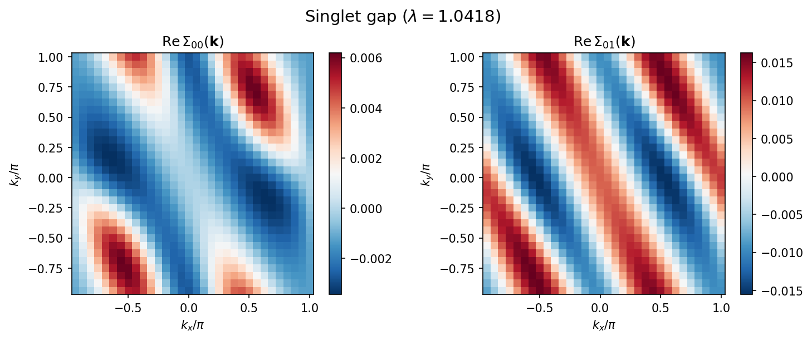
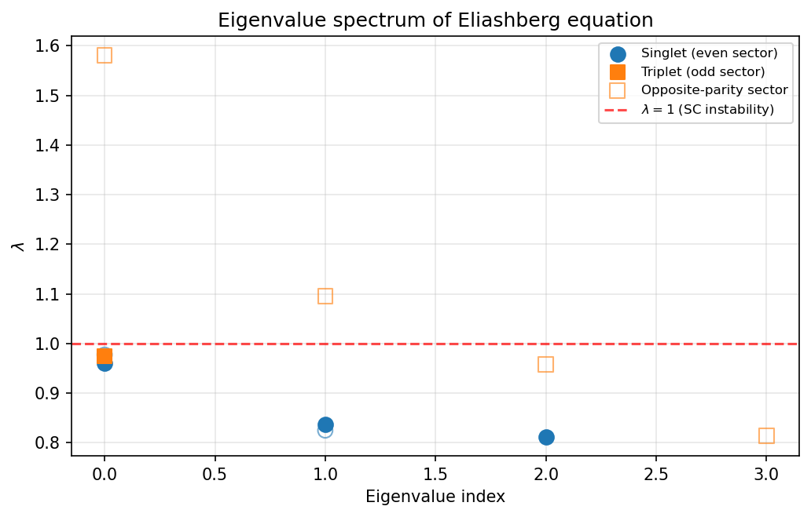

=============================================
チュートリアル: Eliashberg方程式ソルバー
=============================================

本チュートリアルでは、H-waveに含まれる線形化Eliashberg方程式ソルバー
``hwave_sc``\ の使い方を説明します。
このツールは、RPAソルバーで計算した裸感受率\ :math:`\chi_0(\mathbf{q})`
を用いて線形化Eliashberg方程式を解き、超伝導不安定性を解析します。

サンプルファイルは\ ``docs/ja/source/rpa/sample_sc``\ ディレクトリにあります。

計算の流れ
----------------------------

計算は2つのステップで行います:

1. **RPA計算** (``hwave``): 裸感受率\ :math:`\chi_0(\mathbf{q})`\ を計算し、
   ``chi0q.npz``\ に保存します。
2. **Eliashberg方程式ソルバー** (``hwave_sc``): ``chi0q.npz``\ を読み込み、
   グリーン関数を再構成し、RPA頂点を計算した後、
   線形化Eliashberg方程式を解きます。

モデル
----------------------------

本チュートリアルでは、二次元正方格子上の **2軌道タイトバインディングモデル**
を3/4フィリングで扱います。ハミルトニアンは以下の通りです:

.. math::

   H = \sum_{\mathbf{k},\alpha,\beta,\sigma}
       \varepsilon_{\alpha\beta}(\mathbf{k})\,
       c^\dagger_{\mathbf{k}\alpha\sigma} c_{\mathbf{k}\beta\sigma}
     + U \sum_{i,\alpha} n_{i\alpha\uparrow} n_{i\alpha\downarrow}
     + \sum_{i,\alpha\neq\beta} V_{\alpha\beta}\,
       n_{i\alpha} n_{i\beta}

ここで、オンサイトクーロン斥力\ :math:`U = 0.4`\ 、
軌道間クーロン相互作用\ :math:`V`\ を使用します。

このサンプルは有機導体\ :math:`\beta`\ -(meso-DMBEDT-TTF)\ :math:`_2`\ PF\ :math:`_6`
の伝導層モデルに基づいており、
トランスファー積分は拡張ヒュッケル法による計算値を使用しています。 [1]_

理論
----------------------------

超伝導感受率
^^^^^^^^^^^^^^^^^^^^^^^^^^^^^^^^

RPA電荷感受率\ :math:`\hat{X}^c`\ およびスピン感受率\ :math:`\hat{X}^s`\ は
以下のように与えられます:

.. math::

   \hat{X}^c = (\hat{I} + \hat{X}^{(0)} (\hat{U} + 2\hat{V}))^{-1} \hat{X}^{(0)}

.. math::

   \hat{X}^s = (\hat{I} - \hat{X}^{(0)} \hat{U})^{-1} \hat{X}^{(0)}

ここで\ :math:`\hat{X}^{(0)}`\ は裸感受率、
:math:`\hat{U}`\ はオンサイト相互作用行列、
:math:`\hat{V}`\ はサイト間相互作用行列です。

線形化Eliashberg方程式
^^^^^^^^^^^^^^^^^^^^^^^^^^^^^^^^

一重項超伝導の線形化Eliashberg方程式は次のように書けます:

.. math::

   \lambda_S \Sigma^a_{\alpha\sigma;\beta\bar{\sigma}}(\mathbf{k})
   = -\frac{T}{N_L} \sum_{\mathbf{k}',n',\alpha',\beta'}
   P^S_{\alpha\sigma;\beta\bar{\sigma}}(\mathbf{k} - \mathbf{k}')
   G^{(0)}_{\alpha\alpha'}(\mathbf{k}', i\varepsilon_{n'})
   G^{(0)}_{\beta\beta'}(-\mathbf{k}', -i\varepsilon_{n'})
   \Sigma^a_{\alpha'\sigma;\beta'\bar{\sigma}}(\mathbf{k}')

ペアリング相互作用は、一重項の場合:

.. math::

   \hat{P}^S = \hat{U} + \hat{V}
   + \frac{3}{2} \hat{U} \hat{X}^s \hat{U}
   - \frac{1}{2} (\hat{U} + 2\hat{V}) \hat{X}^c (\hat{U} + 2\hat{V})

三重項の場合:

.. math::

   \hat{P}^T = \hat{V}
   - \frac{1}{2} \hat{U} \hat{X}^s \hat{U}
   - \frac{1}{2} (\hat{U} + 2\hat{V}) \hat{X}^c (\hat{U} + 2\hat{V})

:math:`\lambda_S = 1` (:math:`\lambda_T = 1`) が超伝導転移点に対応します。
:math:`\lambda > 1`\ （正の固有値）のとき常伝導状態は超伝導に対して不安定です。
負の固有値は符号反転ギャップに対応しますが、
自己無撞着条件\ :math:`\Delta = K\Delta`\ を満たさないため
超伝導不安定性を示しません。

Eliashberg方程式の数値解法として、``hwave_sc``\ では自己無撞着べき乗反復法
（固有値が最大のモードに収束）とArnoldi法による固有値解析を実装しています。

.. [1] K. Yoshimi, M. Nakamura, and H. Mori,
   J. Phys. Soc. Jpn. **76**, 024706 (2007);
   `arXiv:cond-mat/0608466 <https://arxiv.org/abs/cond-mat/0608466>`_.

入力ファイルの準備
----------------------------

パラメータファイル
^^^^^^^^^^^^^^^^^^^^^^^^^^^^^^^^

TOML形式のパラメータファイル\ ``input.toml``\ を作成します:

.. literalinclude:: ../sample_sc/input.toml

このファイルは以下のセクションから構成されます。

``[mode.param]``\ セクション
""""""""""""""""""""""""""""""""

- ``T``: 温度。
- ``CellShape``: k点メッシュのサイズ（2次元系では 32 x 32 x 1）。
- ``Nmat``: 松原振動数の数（512）。
- ``filling``: 1軌道1スピンあたりの電子充填率（0.75 = 3/4フィリング）。

``[file]``\ セクション
""""""""""""""""""""""""""""""""

- ``[file.input.interaction]``: 幾何情報、トランスファー積分、
  相互作用パラメータのファイルを指定します。RPAステップと共通です。
- ``[file.output]``: :math:`\chi_0(\mathbf{q})`\ および
  :math:`\chi(\mathbf{q})`\ の出力先ディレクトリとファイル名。

``[eliashberg]``\ セクション
""""""""""""""""""""""""""""""""

Eliashberg方程式ソルバーの設定です。主なパラメータ:

- ``solver_mode``: ``"iteration"`` (自己無撞着べき乗法)、
  ``"eigenvalue"`` (Arnoldi固有値解析)、または\ ``"both"``\ 。
- ``chi0q_mode``: ``"load"``\ はRPA出力ファイルから
  :math:`\chi_0(\mathbf{q})`\ を読み込みます。
  ``"calc"``\ は内部で計算します。
  ``"flex"``\ はFLEX計算の dressed 感受率を読み込みます
  （スピン軌道モード以外では\ ``frequency = "dynamic"``\ に必須。\ :ref:`sc_spin_orbital_dynamic`\ を参照）。
  ``"calc"``\ は静的計算が使う唯一の振動数であるボソン振動数ゼロでのみ
  :math:`\chi_0(\mathbf{q})`\ を計算するため、メモリは
  :math:`O(N_\mathrm{mat} N_k\,n_d^4)`\ ではなく\ :math:`O(N_k\,n_d^4)`\ です
  （\ :math:`N_k`\ は k 点数、\ :math:`n_d`\ は軌道数で、スピン軌道モードでは
  :math:`2N`\ ）。結果は全振動数のバブルのゼロ振動数スライスと丸め誤差の範囲で
  一致します。chi0q ファイルは書き出しません。

  .. note::

     ``"calc"``\ は **この** 入力ファイルの\ ``mode.param``\ の設定で
     :math:`\chi_0(\mathbf{q})`\ を再計算します。``"load"``\ の結果と比較可能に
     するには、chi0q ファイルを生成した計算とこれらの設定を一致させる必要が
     あります。特に\ ``coeff_tail``\ （Matsubara 高周波数裾補正）は中程度の
     ``Nmat``\ において\ :math:`\chi_0(\mathbf{q})`\ を\ :math:`O(1)`\ で変えます。
     デフォルトの\ ``coeff_tail = 0.0``\ （補正なし）は収束が悪い場合があり、
     実用的な RPA/FLEX 計算では通常\ ``coeff_tail = 1.0``\ を用います。
     chi0q ファイルには生成時の値が記録されており、読み込み時に設定と
     食い違う場合は\ ``hwave_sc``\ が警告を出します。

  .. _sc_mean_field_band_note:

  .. note::

     **平均場の一体バンド: 組み立て。** ``[file.input] trans_mod``\ （UHFk が出力する
     一体ハミルトニアン）は\ ``Transfer``\ のバンドを置き換えます。
     ``green_init``\ は\ ``Transfer``\ のバンドにその Green 関数の
     Hartree-Fock 平均場を加え、
     ``Extern``\ 場（``coeff_extern``\ 倍のテーブル）はさらにその上に加わります。
     ``chi0q_mode = "calc"``\ または\ ``"load"``\ の場合（外部の
     ``bond_green``\ を指定しない\ ``bond_channels = true``\ を含む）、
     ``hwave_sc``\ はこの組み立てたバンドを
     :math:`\chi_0(\mathbf{q})`\ 、化学ポテンシャル、ペアリング核の Green
     関数のすべてに用います。したがって三つは同じハミルトニアンを表します。
     キーの大文字・小文字は区別しません。ペアリング核（一重項・三重項）は
     スピンの添字を持たないため、スピンに依存しないバンドのみに対応します。

     **スピンの判定と** ``spin_free_tol``\ 。スピンに依存するバンド
     （磁性をもつ\ ``trans_mod``\ や\ ``green_init``\ 、またはゼロでない
     ``Extern``\ 場）は、:math:`\chi_0(\mathbf{q})`\ の計算や読み込みの前に
     エラーとして拒否されます。判定は組み立てた一体バンド
     （``trans_mod``\ 、または\ ``Transfer``\ のバンドに\ ``green_init``\ の
     Hartree-Fock 項を加えたもの、さらに\ ``coeff_extern``\ 倍の\ ``Extern``\ ）
     に対して行います。上向き・下向きスピンのブロックの差とスピン混成ブロックの
     大きさは、エネルギーの単位で絶対値\ :math:`10^{-10}`\ まで許されます。
     この許容誤差は後述の\ ``spin_free_tol``\ の既定値で、``spin_free_tol``\ で
     大きくも小さくもできます。すべての成分が有限でなければなりません。
     :math:`\max|H - H^\dagger|`\ が\ :math:`\max(10^{-10}, 10^{-6}\max|H|)`\ を
     超えるバンドは拒否されます。:math:`10^{-10}`\ を超えるがそれより小さい
     ずれ（例えば\ :math:`\pm R`\ の行を別々に丸めた場合）は、エルミート部分
     :math:`(H + H^\dagger)/2`\ に置き換えられ、警告が出ます。
     ``green_init``\ の Green 関数そのものも、すべてのセルでスピンに
     依存してはなりません（上向き・上向きと下向き・下向きのブロックが等しく、
     スピン混成ブロックがない）。許容誤差は無次元の成分に対して
     :math:`\max(10^{-10}, \texttt{spin\_free\_tol})`\ です。磁性をもつ
     ``green_init``\ はスピンの向きによらず磁性状態を表すため拒否されます
     （磁性をもつ平均場の入力はスピン軌道の経路でもまだサポートされていません。
     issue #273）。収束の緩い常磁性 UHF 解（例えばランダム初期状態から
     ``EPS = 6``\ ）には\ :math:`10^{-5}`\ 程度の分裂が残ることがあります。
     UHF の収束を厳しくする、スピン対称な初期状態から UHF を始める、または
     ``spin_free_tol``\ を大きくしてください。
     Zeeman 磁場で偏極した状態は\ ``[mode] enable_spin_orbital = true``\ で
     計算できます。\ :ref:`sc_spin_polarized`\ を参照してください。

     **load・ボンド・FLEX 入力での挙動。** ``"load"``\ では、chi0q ファイルを
     出力した RPA 計算と同じ ``trans_mod``\ / ``green_init``\ / ``Extern``\ を
     指定してください。この場合、読み込む chi0q が元のバンドで計算されている
     ため、エルミート性からの :math:`10^{-10}`\ を超えるずれは、エルミート部分に
     置き換えられず拒否されます。``chi0q_mode = "flex"``\ 、
     ``frequency = "dynamic"``\ 、および外部の\ ``bond_green``\ を指定した場合は、
     これらのキーは使われず、その旨の警告が出ます。感受率と Green 関数は
     FLEX 計算または\ ``bond_green``\ のファイルから読み込まれるためです。

     ``green_init`` **と** ``trans_mod``\ 。``green_init``\ のバンドは
     :math:`T + \Sigma_{\rm HF}[G]`\ で、すべての相互作用の Hartree 項と
     Fock 項を UHFk が平均場ハミルトニアンを作るのと同じ方法
     （``flag_fock = true``\ ）で組み立てます。したがって\ ``green_init``\ と、
     ``flag_fock = true``\ （既定値）の UHFk 計算が同じ解に対して出力する
     ``trans_mod``\ は同じバンドを与えます。\ ``flag_fock = false``\ で得た
     UHFk 解には、その\ ``trans_mod``\ （Hartree 項のみのバンド）を使って
     ください。\ ``green_init``\ では Fock 項が加わります。元の格子の並進対称性を
     破る\ ``SubShape``\ の UHFk 状態では、保存された\ ``green``\ も
     ``trans_mod``\ も、読み戻したときに収束したバンドを再現しません
     （issue #294）。
     （issue #278 より前は\ ``green_init``\ のバンドに Fock 項が含まれず、
     Fock 項をもつ相互作用があると\ ``hwave_sc``\ が警告を出していました）。

  .. warning::

     **修正前の** ``calc_scheme = "general"`` **FLEX計算の出力を使う場合。**
     このパスは軌道ペアを転置したバブルから自己エネルギーを構成していたため、
     多軌道模型では\ ``sigma.npz``\ と\ ``green.npz``\ の軌道非対角成分が誤って
     います。``chi0q_mode = "flex"``\ が読む感受率は影響を受けないので問題
     ありませんが、``bond_green``\ は FLEX の\ ``green.npz``\ を取るため対象です。
     修正済みのビルドで再生成してください。1軌道の計算および
     ``"reduced"``\ スキームは影響を受けません。
     \ :ref:`移行に関する警告 <flex_general_transpose_fix_ja>`\ を参照して
     ください。
- ``frequency``: ペアリング頂点の振動数の扱い。``"static"``\ （デフォルト）は
  ボゾン振動数ゼロでペアリング頂点を評価する静的近似（Nakano--Kuroki 式(9)）で、
  振動数依存性のないギャップを与えます。``"dynamic"``\ は、振動数依存のペアリング
  頂点\ :math:`V(\mathbf{q}, i\omega_l)`\ とギャップ\ :math:`\phi(\mathbf{k}, i\omega_n)`
  を用いた、松原振動数に完全に依存する Eliashberg 方程式を解きます。
  ``chi0q_mode = "flex"``\ が必要です
  （下記の\ :ref:`動的振動数の節 <sc_dynamic_frequency>`\ を参照）。ただし
  スピン軌道モードでは\ ``"calc"``\ も使えます（\ :ref:`sc_spin_orbital_dynamic`\ を参照）。
- ``pairing_type``: ``"singlet"``\ または\ ``"triplet"``\ 。スピン軌道モードでは
  ギャップがひとつのスピン軌道行列なので指定しません（\ :ref:`sc_spin_orbital`\ を参照）。
- ``init_gap``: 反復法の初期ギャップ対称性。
  ``"cos"`` (:math:`\cos(k_x+k_y+k_z)`)、
  ``"d_x2y2"`` (:math:`\cos k_x - \cos k_y`)、
  ``"random"``\ などが利用可能です。
  有効な形状因子の一覧は
  ``"cos"``\ 、\ ``"s"``\ 、\ ``"s_ext"``\ 、\ ``"s_ext_2d"``\ 、\ ``"d_x2y2"``\ 、
  ``"d_y2z2"`` (:math:`\cos k_y - \cos k_z`) 、
  ``"d_xy"``\ 、\ ``"d_xz"``\ 、\ ``"d_yz"``\ 、\ ``"d_z2"``\ 、
  ``"p_x"``\ 、\ ``"p_y"``\ 、\ ``"p_z"``\ 、\ ``"random"``\ です。
  準2次元セル\ ``CellShape = [1, Ny, Nz]``\ （:math:`k_x = 0`\ ）では、
  :math:`\sin k_x`\ を含む形状因子（``"p_x"``\ 、\ ``"d_xy"``\ 、\ ``"d_xz"``\ ）は
  恒等的に消えるため無効です。三重項には\ ``"p_y"``/``"p_z"``\ を、面内\ :math:`d`\ 波
  には\ :math:`(\pi,0)`\ と\ :math:`(0,\pi)`\ でノードを持つ\ ``"d_yz"``\ ではなく、
  同点で逆符号のアンチノードを持つ\ ``"d_y2z2"``\ を用いてください。
- ``max_iter``: 自己無撞着反復の最大回数。
- ``alpha``: 混合パラメータ（0: 混合なし、1: 古い解を完全保持）。
- ``convergence_tol``: ギャップ関数の収束条件。
- ``num_eigenvalues``: 固有値モードで計算する固有値の数。
  動的経路では、これは列挙される固有値の個数を決めるだけで、どれが主固有値
  として報告されるかは決めなくなりました。カーネルがチャネルの偶振動数
  セクターを保存する場合、主固有値はそのセクターに制限した対称性整合な解
  （下記の\ ``spectral_shift``\ を参照）から取られ、その実部最大の固有値は
  ``num_eigenvalues``\ に依存しません。
- ``eigenvalue_method``: ``"arnoldi"``\ （デフォルト）、\ ``"subspace"``\ 、
  ``"shift-invert-gmres"`` / ``"shift-invert-bicgstab"`` /
  ``"shift-invert-lgmres"``\ 。
- ``spin_free_tol``: 平均場の一体バンドのスピン非依存性判定の絶対許容誤差
  （エネルギーの単位。上の\ ``chi0q_mode``\ の注を参照。デフォルト
  ``1e-10``\ 、0 以上の有限の数）。測定した上向き・下向きの差やスピン混成が
  ``1e-10``\ を超え\ ``spin_free_tol``\ 以下の場合、``hwave_sc``\ は
  スピン平均したバンド\ :math:`(H_\uparrow + H_\downarrow)/2`\ を用い、
  スピン混成ブロックを捨て、捨てた両方の大きさを警告として出力します。
  ``spin_free_tol``\ を超える場合はバンドを拒否します。スピン平均したバンドは、
  ``hwave_sc``\ が\ :math:`\chi_0(\mathbf{q})`\ を自ら計算する場合
  （``chi0q_mode = "calc"``\ または\ ``bond_channels = true``\ ）にのみ使えます。
  ``chi0q_mode = "load"``\ では、読み込む chi0q が RPA 計算自身のバンドで
  計算されているため、``1e-10``\ を超えるバンドは拒否されます（``"calc"``\ を
  使うか、スピン対称なバンドから chi0q を作り直してください）。``1e-10``\ より
  小さい値（例えば\ ``0``\ ）を指定すると、このバンドの判定は既定より厳しく
  なります。``spin_free_tol``\ には\ ``green_init``\ に対するもう一つの用途が
  あります。Green 関数そのものを無次元の成分について許容誤差
  :math:`\max(10^{-10}, \texttt{spin\_free\_tol})`\ で判定するため、G の判定は
  ``1e-10``\ が下限で、それより厳しくはなりません。この許容誤差内の
  ``green_init``\ でも、相互作用が大きいとバンドのスピン分裂がバンドの許容誤差を
  超えることがあり、その場合はバンドの判定のメッセージで拒否されます。
- ``g2_tail``: ペアバブル\ :math:`G^{(2)}`\ に解析的な松原 tail 補正を適用
  します（デフォルト\ ``true``\ 、バージョン 2.0 以降）。素朴な打ち切り和は主要な
  単位行列 tail を取りこぼし（\ :math:`O(1/N_{\rm mat})`\ の誤差）、わずかに
  不定符号になり得るため、小さい\ ``Nmat``\ では報告される固有値に偽の虚部が
  混入します。この補正は漸近的です。保持される最大周波数が関連するエネル
  ギースケールを超えるときに有効で、窓端でグリーン関数が tail から大きく
  外れている場合はソルバーが警告します（その領域では過補正になり得て、
  正定値性チェックの通過は精度の保証になりません）。加算項はペアバブル
  段階でのみ単位行列であり、組み上がったカーネルのスカラーシフトでは
  ないため、補正の有効化により先頭固有値の入れ替わりや shift-invert
  ターゲットとの距離の変化が正当に起こり得ます（これは補正された物理で
  あり、ソルバーの欠陥ではありません）。``false``\ は補正導入前の結果を
  再現します。
- ``sigma_shift``\ （shift-invert 系の\ ``eigenvalue_method``\ のみ）: shift-invert
  ソルバの実数ターゲット\ :math:`\sigma`\ 。\ :math:`\sigma`\ 近傍の固有値が先に
  求まります。素の\ ``"arnoldi"``\ では無視されます（警告あり）。arnoldi では
  代わりに\ ``spectral_shift``\ を使ってください。
- ``spectral_shift``\ （\ ``eigenvalue_method = "arnoldi"``\ のときのみ有効）:
  正の数値または\ ``"auto"``\ 。ARPACK の既定の選択 （\ ``which='LM'``\ ）は
  *絶対値* 最大の固有値を返すため、超伝導不安定性から遠い場合、小さな正
  （引力的）の主固有値が、より大きな負（斥力的）の固有値に隠れて取りこぼされ、
  報告される主固有値が負（非物理的）になることがあります。\ ``spectral_shift``
  を指定すると、シフトした演算子\ :math:`A + \sigma I`\ に対して *実部* 最大の
  固有値（\ ``which='LR'``\ ；\ :math:`T_c`\ で\ :math:`\lambda \to 1`\ となる物理的な
  SC固有値）を求めます。シフトは内部で差し引かれるので、受け取る／保存される
  固有値はシフト前の正しい値です。\ ``"auto"``\ はスペクトル半径から
  :math:`\sigma`\ を自動設定します。明示的に指定する場合は、最も負の固有値の
  *絶対値* より大きい正の\ :math:`\sigma`\ を与えます（\ :math:`A + \sigma I`\ の
  スペクトルが全て正の実部になるように）。主固有値が負になる場合や、対形成が
  弱い系（低圧・擬1次元）を走査する場合に推奨します。上記の\ ``sigma_shift``
  （shift-invert のターゲット）とは別物である点に注意してください。動的経路
  （\ ``frequency = "dynamic"``\ ）では、チャネルについて実部最大の選択が自動で
  適用されます（issue #202）。カーネルがチャネルの偶振動数セクターを保存する
  場合、主固有値はそのセクターに制限した対称性整合な解（``eigenvalue_selection
  = "LR_projected"``\ ）から取られ、その実部最大の固有値は\ ``num_eigenvalues``
  に依存しません。セクターを保存せず、かつ素の\ ``arnoldi``\ の集合に正のチャネル
  固有値が含まれない場合は、代わりに\ ``spectral_shift = "auto"``\ で一度だけ
  解き直します（``"LR_retry"``\ ）。いずれも\ ``eigenvalue_selection``\ に記録
  されます（下記参照）。利用者が指定した\ ``spectral_shift``\ は非射影の経路に
  適用されます。シード（固有ベクトル継続）付きの実行は解き直されないため、斥力
  優勢な温度スキャンでは各点で\ ``spectral_shift = "auto"``\ を指定して、シード
  継続を主固有値と一致させてください。
- ``gpu``: ``true``\ でカーネル適用（matvec/matmat、FFT 畳み込み）を GPU（CuPy）で
  実行します。``frequency = "dynamic"``\ と\ ``frequency = "static"``\ の **両方** に
  対応します（デフォルト\ ``false``\ ）。固有値ソルバー本体（ARPACK Arnoldi・べき乗
  反復・部分空間反復・shift-invert）は常にホストで実行されます（CuPy に一般の
  非エルミート固有値ソルバーが無いため）。反復ごとにデバイスへ渡るのはギャップ
  ベクトルのみです。使用可能な CuPy/CUDA デバイスが無い場合は警告を出して CPU に
  フォールバックします（下記の\ :ref:`GPU実行の節 <sc_dynamic_gpu>`\ を参照）。GPU
  実行時は\ ``fft_workers``\ は無視されます。
- ``gpu_required``: ``true``\ にすると\ ``gpu = true``\ を厳格化し、CuPy/CUDA が
  使えない場合に静かに CPU へフォールバックせずエラーで停止します
  （デフォルト\ ``false``\ ）。動的 Eliashberg ソルバー（``[eliashberg]``\ に設定）
  および FLEX・RPA ソルバー（``gpu``\ フラグと同じく\ ``[mode.param]``\ に設定）で
  有効です。
- ``fft_workers``: 動的モードの空間 FFT のワーカースレッド数
  （デフォルト\ ``1`` = 従来どおりの直列 numpy。``-1``\ で全コア。
  GPU 実行時は無視されます）。
- ``matsubara_basis``: 動的モードの松原軸の表現。デフォルトは\ ``"uniform"``
  （従来どおり）。``"ir"``\ を指定すると sparse-ir による中間表現基底を
  使用します（下記の\ :ref:`IR基底の節 <sc_dynamic_ir>`\ を参照）。
- ``ir_tol``: IR基底の打ち切り精度\ :math:`\varepsilon`\ 。デフォルトは 1e-8。
- ``ir_wmax``: IR基底の実周波数バンド幅\ :math:`\omega_{\max}`\ 。省略時は
  分散のスペクトル範囲\ :math:`\max|\varepsilon_k-\mu|`\ と相互作用スケールから
  自動推定します（推定できない場合は明示指定を求めるエラーになります）。
  自動推定値は\ :math:`3\,(\max|\varepsilon_k-\mu| + \text{相互作用})`\ 、すなわち
  化学ポテンシャルを基準にしたスペクトル半幅と最大相互作用スケールの和です。
  FLEX ソルバも同一の推定式を用いるようになったため、自動\ ``ir_wmax``\ で
  FLEX から Eliashberg へ渡すと同じ IR 基底に揃います。
- ``ir_keep_static_chi``: ``true`` / ``false``\ 。デフォルトは\ ``false``\ 。
  スピン・電荷感受率が静的支配的な場合（サンプリング窓内でほぼ振動数に依存せず
  大きい、すなわち臨界近傍）、IR圧縮が\ :math:`O(\beta/N_\mathrm{mat})`\ の
  :math:`\delta(\tau)`\ アーティファクトとして破棄する振動数非依存成分が
  物理的な重みを持ち、破棄すると最大固有値が誤ります。破棄成分がデータスケールを
  超える場合はソルバーが停止します。``true``\ にすると停止せず静的成分を保持します
  （あるいは\ ``ir_wmax``\ を下げる、FLEX の\ ``Nmat``\ を増やす）。

.. note::

   :math:`\beta\,\omega_\mathrm{max}`\ を打ち切り下限より上に保つこと。
   IRフィットの悪条件ガードは、サンプリンググリッドに対してバンド幅が
   *大き過ぎる* 場合のみを検出し、その逆は検出できません。
   :math:`\Lambda = \beta\,\omega_\mathrm{max}`\ が *小さい* 場合、フィット自体は
   十分に良条件のままでも、基底がグリーン関数のバンド端を表現するには狭過ぎるため、
   目に見えない基底打ち切り誤差を含みます。:math:`\omega_\mathrm{max}`\ が
   バンド端の単極グリーン関数を要求した\ ``ir_tol``\ の精度で表現できなくなると、
   その誤差は 1% 程度に達します。:math:`\beta\,\omega_\mathrm{max}`\ をこの下限より
   上に保ってください。自動\ ``ir_wmax``\ 推定（構成上この下限を満たします）を
   用いるか、安全な下限として明示的に
   ``ir_wmax`` :math:`\ge 3\,(\text{バンド幅} + \text{相互作用})`\ を設定します。

相互作用定義ファイル
^^^^^^^^^^^^^^^^^^^^^^^^^^^^^^^^

相互作用定義ファイルはWannier90形式で記述し、
RPAソルバーと共通です。詳細は\ :ref:`Ch:Config_rpa`\ を参照してください。

``Geometry`` (``geom.dat``):

.. literalinclude:: ../sample_sc/geom.dat

2軌道の単位胞を定義します。

``Transfer`` (``transfer.dat``):

.. literalinclude:: ../sample_sc/transfer.dat

2軌道モデルのホッピング積分を定義します。

``CoulombIntra`` (``coulombintra.dat``):

.. literalinclude:: ../sample_sc/coulombintra.dat

各軌道のオンサイトクーロン斥力\ :math:`U = 0.4`\ 。

``CoulombInter`` (``coulombinter.dat``):

.. literalinclude:: ../sample_sc/coulombinter.dat

軌道間・サイト間クーロン相互作用。

ステップ1: RPA計算の実行
----------------------------

まず、RPAソルバーを実行して裸感受率を計算します:

.. code-block:: bash

    $ hwave input.toml

``output/chi0q.npz``\ と\ ``output/chiq.npz``\ が生成されます。
32 x 32メッシュの場合、数秒で完了します。

ステップ2: Eliashberg方程式ソルバーの実行
---------------------------------------------

次に、同じ入力ファイルを使ってEliashberg方程式ソルバーを実行します:

.. code-block:: bash

    $ hwave_sc input.toml

ソルバーは以下の処理を行います:

1. ``output/chi0q.npz``\ から\ :math:`\chi_0(\mathbf{q})`\ を読み込みます。
2. 相互作用ファイルを読み込み、ハミルトニアンを構築します。
3. 非相互作用グリーン関数\ :math:`G(\mathbf{k}, i\omega_n)`\ を構成します。
4. RPA電荷・スピン頂点\ :math:`V_c(\mathbf{q})`\ 、
   :math:`V_s(\mathbf{q})`\ を計算します。
5. 線形化Eliashberg方程式を自己無撞着反復法および/または
   固有値解析で解きます。

実行ログの例:

.. code-block:: text

    hwave_sc: === Self-consistent iteration ===
    hwave_sc: Iteration    0: eigenvalue = 0.925449, diff = 3.540384e-01
    hwave_sc: Iteration    1: eigenvalue = 0.818387, diff = 7.885727e-02
    ...
    hwave_sc: Iteration  192: eigenvalue = 0.961078, diff = 9.752299e-06
    hwave_sc: Converged at iteration 193
    hwave_sc: Iteration result: eigenvalue = 0.961078, converged = True, n_iter = 193

引き続き固有値解析の結果が表示されます:

.. code-block:: text

    hwave_sc: === Eigenvalue analysis ===
    hwave_sc: Leading eigenvalues:
    hwave_sc:     0: 0.961079 (|ev| = 0.961079)
    hwave_sc:     1: 0.837896 (|ev| = 0.837896)
    hwave_sc:     2: 0.812195 (|ev| = 0.812195)
    hwave_sc:     3: -0.889340 (|ev| = 0.889340)
    hwave_sc:     4: -1.072771 (|ev| = 1.072771)
    hwave_sc:     5: -1.351573 (|ev| = 1.351573)
    hwave_sc:     6: 0.977706 (|ev| = 0.977706)  [opposite-parity sector]
    hwave_sc:     7: 0.824931 (|ev| = 0.824931)  [opposite-parity sector]
    ...

正の固有値\ :math:`\lambda > 1`\ は、その温度で超伝導不安定性が
存在することを示します。負の固有値は符号反転ギャップに対応しますが、
超伝導不安定性は示しません。

固有対は **チャネルのパリティ**\ （一重項=偶、三重項=奇）を持つものが
先頭に並べられます。先頭（index 0）が物理解で、自己無撞着反復の結果と
一致します。``[opposite-parity sector]``\ のタグが付いた固有値は逆パリティの
セクターに属し、そのスピンチャネルではパウリ原理により禁止され、物理的な
不安定性を表しません（下記のパリティに関する注記を参照）。
``eigenvalue.dat``\ の末尾列\ ``match``\ がこれを記録します（``1`` = チャネルのパリティ
セクター、``0`` = 逆パリティセクター）。

計算結果
----------------------------

ギャップ関数
^^^^^^^^^^^^^^^^^^^^^^^^^^^^^^^^

以下の図は、自己無撞着反復から得られた
ギャップ関数\ :math:`\Sigma_{\alpha\beta}(\mathbf{k})`
の運動量空間での分布を示しています。

**一重項チャネル** (:math:`\lambda \approx 0.96`):

   一重項ギャップ関数のk空間分布。
   左: 軌道内成分\ :math:`\mathrm{Re}\,\Sigma_{00}(\mathbf{k})`\ 。
   右: 軌道間成分\ :math:`\mathrm{Re}\,\Sigma_{01}(\mathbf{k})`\ 。
   軌道間成分が軌道内成分の約5倍大きく、
   軌道間ペアリングが支配的であることを示す。

**三重項チャネル** (:math:`\lambda \approx 0.97`):

.. figure:: ../sample_sc/gap_triplet.png
   :width: 90%
   :align: center

   三重項ギャップ関数のk空間分布。
   左: 軌道内成分\ :math:`\mathrm{Re}\,\Sigma_{00}(\mathbf{k})`\ 。
   右: 軌道間成分\ :math:`\mathrm{Re}\,\Sigma_{01}(\mathbf{k})`\ 。
   ギャップは\ :math:`\mathbf{k} \to -\mathbf{k}`\ （および軌道の入れ替え）に対して
   **奇** であり、スピン三重項ペアリングに要請される対称性を満たす。
   軌道間成分が再び大きい。

固有値スペクトル
^^^^^^^^^^^^^^^^^^^^^^^^^^^^^^^^

一重項・三重項チャネルのEliashberg方程式の固有値スペクトルを以下に示します。

   線形化Eliashberg方程式の正の固有値スペクトル\ :math:`\lambda`\ 。
   赤破線は\ :math:`\lambda = 1`\ （超伝導不安定性の判定基準）を示す。
   塗りつぶしマーカーは **物理的** な固有値（ギャップがチャネルのパリティ
   ＝一重項は偶・三重項は奇を持つ）、白抜きマーカーは **逆パリティの spurious**
   モードである。物理的な固有値はすべて1未満である。1を超える
   2つの白抜きマーカーは\ *三重項*\ カーネルの偶パリティ解で、スピン三重項
   ペアリングにはパウリ原理により禁止される（下記のパリティに関する注記を参照）。

Arnoldi固有値解析は複数の固有値を検出します。
図には超伝導不安定性の判定基準\ :math:`\lambda = 1`\ に関連する
正の固有値のみを示しています。
一重項チャネルの主要な **物理的**\ （偶パリティ）固有値は
:math:`\lambda_S \approx 0.96 < 1`\ で、自己無撞着反復法の結果と一致し、
この温度で一重項SC不安定性は存在しません。

三重項チャネルの主要な **物理的**\ （奇パリティ）固有値は
:math:`\lambda_T \approx 0.97 < 1`\ です。三重項の計算に現れる
:math:`1.58`\ や\ :math:`1.10`\ 付近の大きな値は偶パリティの spurious モードであり、
三重項不安定性では **ありません**\ 。三重項がわずかに先行します
（\ :math:`\lambda_T > \lambda_S`\ ）が、この温度ではどちらのチャネルもしきい値を
いくらか下回っています。

描画スクリプト
^^^^^^^^^^^^^^^^^^^^^^^^^^^^^^^^

上記の図はサンプルディレクトリに含まれる描画スクリプトで再現できます:

.. code-block:: bash

    $ python plot_results.py

出力ファイル
----------------------------

ソルバーは\ ``output``\ ディレクトリに以下のファイルを出力します。

``gap.dat``
^^^^^^^^^^^^^^^^^^^^^^^^^^^^^^^^

収束したギャップ関数\ :math:`\Delta_{\alpha\beta}(\mathbf{k})`
のk空間表示。各行の形式:

.. code-block:: text

    kx  ky  kz  Re(Δ_00)  Im(Δ_00)  Re(Δ_01)  Im(Δ_01)  Re(Δ_10)  Im(Δ_10)  Re(Δ_11)  Im(Δ_11)

ここで\ :math:`\alpha, \beta`\ は軌道インデックスです。

.. _sc_eigenvalue_dat:

``eigenvalue.dat``
^^^^^^^^^^^^^^^^^^^^^^^^^^^^^^^^

線形化Eliashberg方程式の固有値:

.. code-block:: text

    # Iteration eigenvalue
    9.61078331e-01
    # Eigenvalue analysis
    # index  Re(eigenvalue)  Im(eigenvalue)  |eigenvalue|  match(1=channel-parity)
       0  9.61078596e-01 -3.64174908e-12  9.61078596e-01 1
       1  8.37896272e-01 -3.65082177e-12  8.37896272e-01 1
       ...

末尾の\ ``match``\ 列は、固有ベクトルがチャネルのパリティを持つ（物理的な
一重項／三重項ギャップ）とき\ ``1``\ 、逆パリティの spurious モードのとき\ ``0``\ です
（上記のパリティに関する注記を参照）。この列を持たない旧形式の出力もそのまま
読み込めます。

物理的解釈
----------------------------

線形化Eliashberg方程式の最大固有値\ :math:`\lambda`\ は
超伝導の発生を判定します:

- :math:`\lambda > 1`: 常伝導状態は超伝導に対して不安定です。
  対応する固有ベクトルがギャップ関数の対称性を与えます。
- :math:`\lambda < 1`\ （全ての正の固有値について）:
  その温度では常伝導状態が安定です。

負の固有値は、多軌道系における\ :math:`s_\pm`\ 波のような
符号反転ペアリング対称性に対応しますが、
自己無撞着条件\ :math:`\Delta = K\Delta`\ は\ :math:`\lambda = 1`
（\ :math:`\lambda = -1`\ ではない）を要求するため、
負の固有値はその大きさによらず超伝導不安定性を **示しません** 。

温度を変化させて最大の正の固有値が\ :math:`\lambda = 1`\ となる点を
求めることで、超伝導転移温度\ :math:`T_c`\ を決定できます。

本チュートリアルでは、:math:`T = 0.1`\ で両方の物理的チャネルが不安定性の
しきい値を下回っており、:math:`\lambda_S \approx 0.96`\ （一重項・偶）、
:math:`\lambda_T \approx 0.97`\ （三重項・奇）で、三重項がわずかに先行します。

.. note::

   **パリティとパウリ原理。**
   クーパー対は2電子の交換（スピン交換・軌道交換・\ :math:`\mathbf{k} \to -\mathbf{k}`
   の同時操作）に対して反対称でなければなりません。（偶周波数の）ギャップ
   :math:`\Sigma_{\alpha\beta}(\mathbf{k})`\ では、これが空間パリティ
   :math:`P:\ \Sigma_{\alpha\beta}(\mathbf{k}) \to \Sigma_{\beta\alpha}(-\mathbf{k})`
   を固定します。スピン一重項ギャップは **偶**\ （\ :math:`P = +1`\ ）、スピン三重項
   ギャップは **奇**\ （\ :math:`P = -1`\ ）です。Eliashbergカーネルはギャップ全空間に
   作用し片方のパリティに制限されないため、各チャネルのカーネルは逆パリティの
   固有ベクトルも持ちます。これらはそのスピンチャネルでは物理的意味を持たない
   数学的解です（例えば三重項カーネルの偶パリティ固有値は全対称な対状態に相当し、
   パウリ原理で禁止されます）。そのため\ ``hwave_sc``\ は各反復をチャネルのパリティ
   セクターへ射影し、固有値解析は各モードを物理的（\ ``match = 1``\ ）か spurious
   （\ ``match = 0``\ ）かでラベル付けします。三重項の計算に現れる
   :math:`\lambda \approx 1.58,\ 1.10`\ という大きな値はこのような spurious な
   偶パリティモードであり、三重項不安定性では **ありません** 。

一重項と三重項の比較
^^^^^^^^^^^^^^^^^^^^^^^^^^^^^^^^

入力ファイルの\ ``pairing_type``\ を\ ``"triplet"``\ に変更することで、
一重項と三重項のチャネルを比較できます。
三重項チャネルに切り替える際は、``init_gap``\ も\ ``"p_x"``\ のような
奇パリティ（三重項）の初期ギャップに設定してください（同梱の
``input_triplet.toml``\ はそのように設定済みです）。既定の
``init_gap = "cos"``\ は偶パリティ（一重項）の初期ギャップであり、
ソルバーはパリティの異なる初期ギャップをエラーとして拒否するようになりました
（非物理的なセクターへ収束するのを防ぐため）。あるいは\ ``init_gap``\ を
省略すれば、ソルバーがチャネルのパリティを自動選択します。
同じパラメータで\ :math:`T = 0.1`\ の場合、主要な物理的固有値は
:math:`\lambda_T \approx 0.97`\ （三重項）と\ :math:`\lambda_S \approx 0.96`
（一重項）で、三重項がわずかに先行します。これは、\ :math:`T > 0.05`\ で
三重項SC状態が一重項と競合するという文献 [1]_ の結果と整合します。

単位胞内の2つの分子は別々のサイトなので、入力では\ ``orbital_site = [0, 1]``\ と
宣言しています。これにより、単位胞内の分子間相互作用（\ ``R = 0``\ の軌道間
``CoulombInter``\ の行）は、他の分子間相互作用と同様に密度どうしの（Hartree）部分
だけで入り、文献 [1]_ と同じ扱いになります。このキーがない場合は1つのサイト内の
相互作用として交換の寄与も含めて扱われます（設定リファレンスの\ ``orbital_site``\ を
参照）。issue #239 以降、\ ``hwave_sc``\ の対形成バーテックス（\ ``bond_channels =
false``\ ）も、文献 [1]_ と同じく単位胞をまたぐ相互作用の Hartree 部分だけを含みます
（以前の版ではその交換を近似的に、つぶした形で加えていました）。この節に示す数値は
現在の扱いで計算したものです（以前の版では\ :math:`\lambda_S \approx 0.94`\ 、
:math:`\lambda_T \approx 1.00`\ でした）。

.. _sc_dynamic_frequency:

動的（振動数依存）Eliashberg方程式
--------------------------------------------------

``hwave_sc``\ は既定では **静的近似** で Eliashberg 方程式を解きます。すなわち
ペアリング頂点をボゾン松原振動数ゼロで評価し（Nakano--Kuroki 式(9) の静的近似）、
ギャップ\ :math:`\Sigma(\mathbf{k})`\ は振動数依存性を持ちません。``[eliashberg]``
セクションで\ ``frequency = "dynamic"``\ と設定すると、代わりに **振動数に完全に
依存する** 線形化 Eliashberg 方程式

.. math::

   \lambda\, \phi_{\alpha\beta}(\mathbf{k}, i\omega_n)
   = -\frac{T}{N_L} \sum_{\mathbf{k}', n'}
     V_{\alpha\beta}(\mathbf{k}-\mathbf{k}', i\omega_n - i\omega_{n'})\,
     [G G](\mathbf{k}', i\omega_{n'})\,
     \phi(\mathbf{k}', i\omega_{n'}),

を解きます。ここではギャップ\ :math:`\phi(\mathbf{k}, i\omega_n)`\ のフェルミオン
松原軸全体と、振動数依存のペアリング頂点\ :math:`V(\mathbf{q}, i\omega_l)`\ を保持
します。頂点は（静的な係数ではなく）虚時間の積として作用するため、カーネルは
異なる松原振動数どうしを結合します。

FLEXの前提条件
^^^^^^^^^^^^^^^^^^^^^^^^^^^^^^^^

この節は\ ``enable_spin_orbital``\ を使わない動的ソルバーについて説明します。
スピン軌道モードの動的ソルバーは\ ``chi0q_mode = "calc"``\ も受け付けます。
この場合はバンドから Green 関数と\ :math:`\chi_0`\ を作るため、FLEX の出力は
不要です。また\ ``"flex"``\ では、以下のファイルの代わりにスピン軌道 FLEX 計算の
``chiq``\ 、\ ``chi0q``\ 、\ ``green``\ 、\ ``sigma``\ のアーカイブを読み込みます
（\ :ref:`sc_spin_orbital_dynamic`\ を参照）。

``enable_spin_orbital``\ を使わない場合、動的モードは FLEX ソルバーのみが生成する振動数分解された入力を必要とするため、
``chi0q_mode = "flex"``\ で実行する **必要があります**。``hwave_sc``\ を呼び出す前に、
Eliashberg ステップが読み込むディレクトリへ以下を書き出す FLEX 計算
（``mode = "FLEX"``\ ）を実行してください:

- ``chiq_s.npz``\ と\ ``chiq_c.npz`` -- **全** ボゾン松原軸（``Nmat``\ 個の全振動数）
  上のスピン・電荷感受率、および
- ``green.npz`` -- **dressed** グリーン関数
  :math:`G(\mathbf{k}, i\omega_n)`\ （これからペアバブルを構成します）。

.. note::

   FLEX の感受率ファイルには\ ``chi_convention``\ タグ（reduced スキームは
   ``"kuroki"``\ 、general full-vertex スキームは\ ``"myo"``\ ）が付与されており、
   Eliashberg ローダーはこれを用いて軌道レイアウトを解釈します。\ **2軌道系**\
   （\ ``norb = 2``\ ）では reduced のスピン軌道次元と orbital-pair 次元が一致
   （ともに\ ``4``\ ）するため、両者の区別はこのタグに依存します。本修正以前の H-wave
   は形状のみからレイアウトを推定し、``norb = 2``\ の reduced (kuroki) chi を
   orbital-pair と誤認して pairing vertex を壊していました。該当する計算の Eliashberg
   固有値・ギャップ関数は本バージョンで\ **修正されます（したがって変化します）**\ 。
   1軌道系および general (myo) の結果は影響を受けません。

.. warning::

   **多軌道の reduced スキーム FLEX を用いた計算結果は変化する可能性があります。**
   reduced (kuroki) 感受率の行列添字は\ *密度対*\ であり、保存されている
   :math:`X[a,b]`\ は\ :math:`\chi_{(a,a),(b,b)}`\ です。以前のバージョンはこれを
   :math:`n_\text{orb}^2`\ の orbital-pair 空間へ
   :math:`\text{out}[(l_1,l_2),(l_3,l_2)] = X[l_1,l_3]`\ として埋め込んでいました。
   この置き方では、pairing vertex :math:`S \chi S`\ が実際に参照する軌道間の密度結合
   :math:`\chi_{(0,0),(1,1)}`\ が失われ、さらに reduced スキームが計算していない
   軌道対の位置に\ :math:`X`\ が散布されます。本バージョンでは正しく
   :math:`\text{out}[(a,a),(b,b)] = X[a,b]`\ （他の成分はすべてゼロ）と
   埋め込みます。

   したがって、``calc_scheme = "reduced"``\ の FLEX を用いた
   ``norb >= 2``\ の計算では、\ **static・dynamic の双方**\ で
   ``chi0q_mode = "flex"``\ の結果が変化します。要因は独立に2つあり、軌道間の
   密度成分がゼロでも安全とは限りません---旧来の置き方は
   :math:`\chi_{(a,a),(b,b)}`\ （\ :math:`a \neq b`\ ）を落とすと同時に、
   相互作用が非密度ブロックに届く場合には、対角成分
   :math:`\chi_{(a,a),(a,a)}`\ からそこに dressing を捏造していました。
   保存済みの固有値・ギャップ関数は再計算が必要とお考えください。1軌道系（``norb = 1``\ ）は
   両者の埋め込みが一致するためビット単位で不変であり、general (myo) の結果も
   同様に不変です。本修正により、``CoulombIntra``\ のみの reduced 計算は、
   \ **同一の** :math:`\Sigma = 0` **の物理**\ （FLEX を\ ``Mix = 0``\ 、
   ``IterationMax = 1``\ とした場合）に対して\ ``chi0q_mode = "load"``\ および
   general スキームの結果と厳密に一致するようになります（修正前は一致しません
   でした）。これは pairing vertex についてのみの言明です。自己無撞着に
   解いた場合の両スキームが交換可能であることまでは意味しません---その場合は
   自己エネルギーの構成も異なります。

   このバージョンから、IRネイティブな感受率ファイル（``write_densified =
   false``）はこの ``chi_convention`` タグを必ず持つ必要があり、また
   ローダーはテンソルの形状から推定されるレイアウトと矛盾する
   ``chi_convention``\ を検出すると、誤った pairing vertex を黙って構築する
   代わりに明示的なメッセージで即座に停止するようになりました。現行の
   H-wave が書き出すファイルは常に整合したタグを持つため、これは手編集または
   外部生成の感受率ファイルにのみ影響します。

``Nmat``\ は偶数で、かつ FLEX 出力と\ ``[mode.param]``\ の値とで一致していなければ
なりません。``chi0q_mode = "flex"``\ なしで\ ``frequency = "dynamic"``\ を指定した
場合、``Nmat``\ が奇数の場合、あるいは dressed ``green.npz``\ が無い場合、ソルバーは
黙って別の処理へフォールバックせず、説明的なエラーで停止します。FLEX 出力
ディレクトリは\ ``[file.input] path_to_flex_output``\ で指定でき（既定は
``[file.output]``\ ディレクトリ）、個々のファイル名は\ ``[eliashberg]``\ の
``flex_chi_s`` / ``flex_chi_c`` / ``flex_green``\ で上書きできます。

出力
^^^^^^^^^^^^^^^^^^^^^^^^^^^^^^^^

動的モードは\ ``eigenvalue.dat``\ （最大固有値\ :math:`\lambda`\ ）に加えて、
以下を書き出します:

``gap_dynamic.npz``
   振動数分解されたギャップ全体とそのメタデータ。キー:

   - ``gap``: 形状\ ``(norb, norb, Nx, Ny, Nz, Nmat)``\ の複素配列 --
     :math:`\phi_{\alpha\beta}(\mathbf{k}, i\omega_n)`\ 。
   - ``iomega``: 中心化されたフェルミオン松原振動数
     :math:`\omega_n = (2n + 1 - N_{\mathrm{mat}})\pi T`\ 。
   - ``T``: 温度。
   - ``pairing_type``: ``"singlet"``\ または\ ``"triplet"``\ 。
   - ``frequency``: ``"dynamic"``\ 。
   - ``eigenvalue``: 最大固有値\ :math:`\lambda`\ 。
   - ``axis_order``: ``"(orb1, orb2, kx, ky, kz, iomega)"``\ 。
   - ``normalization``: ゲージ規約 -- ギャップは全成分について L2 規格化され、
     最大絶対値の成分が実正になるよう回転されます。これにより保存されるギャップは
     実行ごと・線形代数バックエンドごとに再現可能です。
   - ``gap_sector_weights``: 総和が 1 となる 4 つの実数 -- 返されたギャップの
     :math:`\|\phi\|^2`\ が、運動量・振動数のパリティセクターそれぞれに占める割合です
     （\ :ref:`動的ソルバーのペアリングチャネル <sc_dynamic_channels>`\ を参照）。
   - ``gap_sector_labels``: 上と同じ順序での 4 つのセクター名、すなわち
     ``"even_k_even_w"``, ``"odd_k_even_w"``, ``"even_k_odd_w"``,
     ``"odd_k_odd_w"``\ 。
   - ``sector_selection``: その実行が選んだセクター。``"channel"``\ ・
     ``"combined_parity"``\ ・\ ``"none"``\ のいずれかです。べき乗反復の経路では
     反復ベクトルを射影したセクターを、（射影を行わない）固有値ソルバーモードでは
     固有対の並べ替えが一致した段階を表し、後者は\ ``eigenvalue.dat``\ の
     ``match``\ 列の意味そのものです。同じ節を参照してください。
   - ``eigenvalue_selection``: 報告される主固有値を生んだ選択基準。
     ``"LR_projected"``\ （保存されたチャネルセクターに制限した対称性整合な解。
     ``num_eigenvalues``\ 非依存の基準）・``"LM"``\ （素の\ ``arnoldi``\ 、絶対値
     最大）・``"LR"``\ （利用者指定の\ ``spectral_shift``\ 、実部最大）・
     ``"LR_retry"``\ （非射影の\ ``"LM"``\ 集合に正のチャネル固有値が無かった
     ときの、実部最大を求める自動再求解）・``"dense-LR"``\ （微小演算子の稠密な
     実部最大解）・``"shift-invert"``\ ・``"iteration"``\ （べき乗反復）のいずれか
     です。``eigenvalue.dat``\ には\ ``# eigenvalue_selection: ...``\ ヘッダー行と
     しても書き出されます。

``gap.dat``
   最小の正の松原振動数（インデックス\ ``Nmat//2``\ ）におけるギャップの単一振動数
   スライス。列の並びは静的な\ ``gap.dat``\ と同じ（``kx ky kz``\ の後に軌道対ごとの
   ``Re``/``Im``\ ）です。先頭行は\ ``#``\ で始まるヘッダで、``frequency=dynamic``\ と
   スライスのインデックス・その\ :math:`\omega_n`\ を記録します。

チャネルパリティによる選別
^^^^^^^^^^^^^^^^^^^^^^^^^^^^^^^^

静的ソルバーと同様に、動的モードも単に代数的に最大の固有値ではなく、
**指定したペアリングチャネルの** 先頭固有対を報告します。フェルミオンの反対称性により、
ギャップの結合パリティ :math:`\phi_{\alpha\beta}(\mathbf{k}, i\omega_n) \to
\phi_{\beta\alpha}(-\mathbf{k}, -i\omega_n)` が決まります（``singlet``\ では偶、
``triplet``\ では奇）。ソルバーはその制約の中で、次節で述べる従来型の
**偶振動数** セクターを選び出します。Arnoldi
の固有対はチャネルのモードが先頭に来るよう並べ替えられ、
``eigenvalue.dat``\ の固有値表には静的出力と同様の末尾列\ ``match``\ が
付きます（一致したセクターで\ ``1``\ 、セクター外で\ ``0``\ ）。この列は
**一致したセクターの名前** を持ちます。すなわち
``match(1=channel even-frequency sector)``\ 、フォールバック段階が使われた
場合は\ ``match(1=combined-parity sector; no even-frequency eigenpair)``\ で、
``1``\ の意味を推測する必要はありません。計算した\ ``num_eigenvalues``\ 個の
固有対のいずれもどちらのセクターにも無い
場合は、警告を出して生の先頭固有対にフォールバックします。その際は
``num_eigenvalues``\ を増やすか\ ``pairing_type``\ を確認してください。べき乗反復
（``solver_mode = "iteration"``\ ）では、カーネルがチャネルセクターを保つ場合は
各反復ベクトルをそのセクターへ、結合パリティのみを保つ場合はより広い結合パリティ
セクターへ射影し、どちらも保たない場合は射影しません（いずれのフォールバックも
警告されます）。いずれの経路も、用いたセクターを\ ``sector_selection``\ として
記録します。

.. _sc_dynamic_channels:

動的ソルバーのペアリングチャネル
^^^^^^^^^^^^^^^^^^^^^^^^^^^^^^^^^^^^

上記の結合パリティは反対称性の *制約* にすぎず、その 2 つの固有空間はそれぞれ
さらに 2 つの振動数パリティを含みます。ソルバーが報告するチャネルは、従来型の
**偶振動数** セクターです。

- ``singlet``: :math:`\mathbf{k}`\ について偶、振動数について偶。
- ``triplet``: :math:`\mathbf{k}`\ について奇、振動数について偶。

ここで「振動数について偶」とは
:math:`\phi_{\alpha\beta}(\mathbf{k}, i\omega_n) \to
\phi_{\alpha\beta}(\mathbf{k}, -i\omega_n)`\ （振動数のみの反転。軌道添字は
そのまま）に対する不変性を意味します。一方、運動量のパリティは静的な経路と
同様に軌道の転置を伴い、
:math:`\phi_{\alpha\beta}(\mathbf{k}, i\omega_n) \to
\phi_{\beta\alpha}(-\mathbf{k}, i\omega_n)` です。両者の積が上記の結合パリティに
なります。

**奇振動数ペアリングは解きません。** 残る 2 つのセクター、すなわち
:math:`\mathbf{k}`\ 奇・振動数奇（結合パリティ :math:`+1`\ ）と
:math:`\mathbf{k}`\ 偶・振動数奇（結合パリティ :math:`-1`\ ）は、どちらの
チャネル射影演算子によっても消去されます。

各実行は、実際に返されたギャップの内訳を記録します。4 つのセクターの重み
（ノルム二乗の割合、総和は 1）は\ ``gap_dynamic.npz`` /
``eliashberg_bond_<type>.npz``\ に\ ``gap_sector_weights``\ として、その名前は
``gap_sector_labels``\ として書き出され、さらに\ ``eigenvalue.dat``\ （および
bond エントリの\ ``eigenvalue_bond_<type>.dat``\ ）には次のヘッダ行が付きます。

.. code-block::

   # gap_sector_weights even_k_even_w=1.000000 odd_k_even_w=0.000000 even_k_odd_w=0.000000 odd_k_odd_w=0.000000

ソルバーは当該チャネルの重みを\ ``INFO``\ でログ出力し、``0.999``\ を下回る場合は
警告します。その場合、返されたギャップは指定チャネルの純粋な偶振動数状態では
なく、重みがその内訳を示します。

.. note::

   **チャネルへの射影は、カーネルが振動数パリティを保存する場合にのみ適用されます**
   （単一軌道模型は常に、多軌道模型では対応する格子・軌道対称性がある場合）。一般の
   多軌道カーネルは 2 つのパリティの積（反対称性の制約）のみを保存します。その場合に
   より狭い偶振動数セクターへ射影すると、固有値問題がそれ自身の *制限* になり、得られる
   値はカーネルの固有値ではなくなります。そこで、そのような場合には反復ベクトルを
   結合パリティセクターへ射影し（警告を出します）、報告される :math:`\lambda`\ は
   常にカーネル本来の固有値となります。ギャップの内訳はセクター重みが示します。
   どちらの場合であったかは、``sector_selection``\ （``"channel"``\ ・
   ``"combined_parity"``\ ・\ ``"none"``\ ）として npz のキーおよび固有値ファイルの
   ``# sector_selection=...``\ ヘッダー行に記録されます。固有値ソルバー系では、
   カーネルがチャネルの偶振動数セクターを保存する場合、主固有対はそのセクターに
   制限した解から得られます（``sector_selection = "channel"``\ 、issue #202）。
   保存しない場合は計算された固有対を並べ替え、チャネルの偶振動数セクターを優先し、
   そこに固有対が無い場合にのみ結合パリティセクターへフォールバックします。この
   場合の\ ``sector_selection``\ は一致した段階を表し、``eigenvalue.dat``\ の
   ``match``\ 列の見出しもそれに従います。

.. note::

   **主固有値は** ``num_eigenvalues`` **に依存しません。** 素の\ ``arnoldi``
   は ARPACK に *絶対値* 最大の固有値（\ ``which='LM'``\ ）を要求するため、より
   大きな実部をもつ逆セクターや斥力的なモードに埋もれて、小さな正（引力的）の
   チャネル固有値が短いリストから欠落することがあり、その場合に報告される主固有値は
   ``num_eigenvalues``\ に依存してしまいます。カーネルがチャネルの偶振動数
   セクターを保存する場合、動的ソルバーはそのセクターに制限したカーネル
   （べき乗反復と同じ射影）を解き、その実部最大の固有値はチャネルの Tc 固有値で
   ``num_eigenvalues``\ に依存しません。そのセクターが斥力的なら答えは最も斥力の
   弱い（実部最大の）固有値です。セクターを保存しない場合は、非射影の\ ``"LM"``
   集合に正のチャネル固有値が無ければ\ ``spectral_shift = "auto"``\ （実部最大）で
   \ **一度だけ**\ 解き直します（ベストエフォート）。用いた基準は
   ``eigenvalue_selection``\ として記録されます（``"LR_projected"``\ ・``"LM"``\ ・
   ``"LR"``\ （利用者指定の\ ``spectral_shift``\ ）・``"LR_retry"``\ （自動再求解）・
   ``"dense-LR"``\ ・``"shift-invert"``\ ・``"iteration"``\ ）。npz のキーとしても、
   ``eigenvalue.dat``\ の\ ``# eigenvalue_selection: ...``\ ヘッダー行としても
   書き出されます。あらかじめ\ ``spectral_shift = "auto"``\ を指定しておけば非射影
   経路での追加の求解は生じません。主となる正の固有値の基準は\ ``solver_mode = "iteration"``
   （自己無撞着なべき乗反復。斥力優勢のときは\ ``spectral_shift = "auto"``\ を
   併用）です。これは実部最大のモードに直接収束し、``num_eigenvalues``\ には
   まったく依存しません。

.. warning::

   **本バージョンでの変更点。** 以前のバージョンは結合パリティのみで固有対を
   選んでいました。そのため報告された\ ``triplet``\ が奇振動数（\ :math:`\mathbf{k}`
   偶・振動数奇）の状態であることがあり、まれには報告された\ ``singlet``\ が
   :math:`\mathbf{k}`\ 奇・振動数奇の状態であることもありました。いずれも結合
   パリティは正しいためです。本バージョンより前に動的ソルバーで得た三重項の結果は
   再計算してください。ギャップが既に（\ :math:`\mathbf{k}`\ 偶・振動数偶）
   セクターにある一重項の計算は、数値的に変わりません。

.. _sc_channel_decomposition:

チャネル分解（診断用）
^^^^^^^^^^^^^^^^^^^^^^^^^^^^^^^^

ペアリング頂点は、スピンゆらぎ項・電荷ゆらぎ項・瞬間的な裸の項の和です。
一重項・三重項チャネルではそれぞれ

.. math::

   V^{\mathrm s} &= \tfrac{3}{2}\, \hat S\, \chi_{\mathrm s}\, \hat S
       - \tfrac{1}{2}\, \hat C\, \chi_{\mathrm c}\, \hat C
       + \tfrac{1}{2}(\hat S + \hat C), \\
   V^{\mathrm t} &= -\tfrac{1}{2}\, \hat S\, \chi_{\mathrm s}\, \hat S
       - \tfrac{1}{2}\, \hat C\, \chi_{\mathrm c}\, \hat C
       + \tfrac{1}{2}(\hat C - \hat S),

であり、いずれもスピン（:math:`\chi_{\mathrm s}`\ ）・電荷
（:math:`\chi_{\mathrm c}`\ ）感受率について線形です（係数と裸の項が異なるだけ）。
したがってこの分解はどちらの\ ``pairing_type``\ にも適用できます。
``[eliashberg]``\ セクションの2つの任意のブール値により、頂点を構成する前に
一方のチャネルを 0 にでき、ペアリング強度をスピン／電荷ゆらぎに切り分けられます。

- ``zero_chi_c``\ （既定\ ``false``\ ）：:math:`\chi_{\mathrm c}`\ を 0 にする。
  頂点はスピンゆらぎ項＋裸の項を保持（スピンチャネル）。
- ``zero_chi_s``\ （既定\ ``false``\ ）：:math:`\chi_{\mathrm s}`\ を 0 にする。
  頂点は電荷ゆらぎ項＋裸の項を保持（電荷チャネル）。

.. note::

   これらのフラグは動的頂点（``frequency = "dynamic"``\ ）にのみ適用されます。
   静的ソルバー（``frequency = "static"``\ 、既定）はカーネルを RPA/FLEX の
   静的感受率から構成し、カーネル構成時にこれらを使用しません。
   ``frequency = "static"``\ で指定しても効果はなく、警告が出ます。

.. note::

   **三重項の裸の項（issue #262）。** :math:`\tfrac{1}{2}(\hat C - \hat S)`\ では
   交差成分 :math:`(ab, ab)`\ （:math:`a \neq b`\ ）を除きます。そこでは軌道間の
   密度型の項（\ ``CoulombInter``\ 、\ ``Hund``\ 、\ ``Ising``\ ）が密度成分
   :math:`(aa, bb)`\ の交換像となり、三重項のパリティをもつギャップの上では両者が
   同じ項を2回数えるためです。以前の版ではこれらの成分を残していたため、オンサイトの
   軌道間の\ ``CoulombInter``\ （\ :math:`U'`\ ）・\ ``Hund``\ ・\ ``Ising``\ の1次の三重項対形成は本来の2倍で、
   非ボンド経路（\ ``bond_channels = false``\ 。Fock 成分をこれらの成分に
   畳み込みます）でのオフサイトの軌道間の項は最大で3倍ずれていました。そのような
   項を含む多軌道の三重項の結果は変わるため（一重項チャネルと単一軌道模型は
   影響を受けません）、再計算してください。

例えばスピンチャネルの診断は次のように指定します。

.. code-block:: toml

   [eliashberg]
   zero_chi_c = true

0 にするのは動的感受率関数だけであり、裸の項に含まれる静的相互作用行列
:math:`\hat S`\ と\ :math:`\hat C`\ は変更しません。
両方を\ ``true``\ にすると瞬間的な裸の頂点のみが残ります。いずれも既定で off の
ため通常の計算には影響せず、チャネルを 0 にすると警告が出ます。これらは
**診断用** です：瞬間的な裸の項は常に保持され、線形化ギャップ固有値問題は
頂点について非線形なので、別々に 0 にした計算の固有値は\ **加法的ではありません**\
（一般に
:math:`\lambda_{\mathrm s} + \lambda_{\mathrm c} \neq \lambda_{\mathrm{full}}`\ ）。
有効なフラグは\ ``gap_dynamic.npz``, ``gap.dat``, ``eigenvalue.dat``\ に記録
されます。通常の本計算では両方を off にしてください。

.. _sc_seed_eigenvector:

固有ベクトル継続（``seed_eigenvector``\ ）
^^^^^^^^^^^^^^^^^^^^^^^^^^^^^^^^^^^^^^^^^^^^^^^^

通常、報告される先頭固有対は「代数的に最大」のものです。振動数依存（非エルミート）
カーネルでは、これは *exceptional point*\ （2つの実固有値が衝突して複素共役対に分裂
する点）近傍で脆弱になり、FLEX自己エネルギーが滑らかに変化していても、隣接温度で
「先頭」ブランチが不連続にジャンプすることがあります。1つの物理ブランチの追跡を
助けるには、``[eliashberg] seed_eigenvector``\ に近傍の計算（例：1つ上の温度）が
出力した\ ``gap_dynamic.npz``\ を指定します。その gap は ARPACK の開始ベクトルとして
使われ、\ **かつ**\ 、固有値ソルバが実際に\ *返した*\ 固有対（``num_eigenvalues``\ 、
および shift-invert 経路では\ ``sigma_shift``\ で決まる範囲）の中から、単に代数的に
最大の固有値ではなく、最も重なりの大きい固有対を選ぶのに使われます。物理的な
ブランチがそもそも返された固有対の中になければ、``num_eigenvalues``\ を増やすか
``sigma_shift``\ をその近傍に移してください。温度を段階的に下げ、各計算に直前の
``gap_dynamic.npz``\ を与えることは、同じ対称性（例：d波）を掃引全体で追跡する助けに
なりますが、保証ではありません。温度刻みが大きすぎると、物理的なブランチを
見失うことがあります。種は計算と同じ\ ``CellShape``\ と\ ``Nmat``\ でなければならず
（不一致は即エラー）、continuation スイープでは\ ``Nmat``\ を固定してください。
IR経路では種の gap は IR ノードへ自動で再フィットされます。``[eliashberg]
sigma_shift``\ は shift-invert の狙い値を明示指定します（未指定なら予備 Arnoldi
から推定）。``sigma_shift``\ をブランチ近傍に置き\ ``seed_eigenvector``\ と併用
すると、隠れた／複素化する固有値の解決に役立ちます。

.. _sc_tsweep:

温度継続計算（``hwave_tsweep``\ ）
^^^^^^^^^^^^^^^^^^^^^^^^^^^^^^^^^^^^^^^^^^^^^^^^^^^^^^^^

上記のように\ ``sigma_init``\ と\ ``seed_eigenvector``\ を温度掃引で手動でつなぐには、
温度ごとに\ ``hwave``/``hwave_sc``\ を実行し直し、各ステップの出力を次のステップの
入力へ手作業で配線する必要があります。``hwave_tsweep``\ コマンド（``hwave``\ ・
``hwave_sc``\ と同様にパッケージに同梱されています）はこれを自動化します。1つの
ベース TOML（単一の FLEX+Eliashberg 計算で使う\ ``[mode]``/``[mode.param]``/
``[file]``/``[eliashberg]``\ の設定そのもの）に\ ``[continuation]``\ セクションを
加えて渡すと、降順の温度ラダーに沿って FLEX（および、無効化していなければ
Eliashberg ソルバー）を実行します。各段では、直前の段の\ **最終的に保存された**\
自己エネルギーを ``sigma_init``\ としてこの段の FLEX へ（ウォームスタート）、
直前の段の動的ギャップを ``seed_eigenvector``\ としてこの段の Eliashberg 計算へ
（固有ベクトル継続）与えます。ウォームスタートの連鎖全体を自動化することで、
各段を（毎回異なる準安定解に落ち着く恐れを抱えながら）コールドスタートせずに
済みます。この連鎖は直前の段が収束していることを要求しません。エラーになって
おらず種ファイルが存在する段であれば、その FLEX の収束状況にかかわらず次の段の
種として使われるため、あるウォームスタートが実際に収束した自己エネルギーに
由来するとは仮定せず、（後述の）サマリーの ``flex_converged``\ 列を確認して
ください。

段の間で変化させるのは\ ``mode.param.T``\ のみです。``CellShape``\ 、``Nmat``\ 、
その他の形状を決定するフィールドはラダー全体で固定されます。これにより、各段の
``sigma_init``\ ／``seed_eigenvector``\ ファイルが次の段と形状互換になります。

``[continuation]``\ セクション
""""""""""""""""""""""""""""""

.. code-block:: toml

    [continuation]
      temperatures   = [0.02, 0.015, 0.01, 0.008, 0.006]  # 明示的なラダー
      # または、`temperatures` が無い場合に生成するラダー:
      #   T_start = 0.02
      #   T_stop  = 0.006
      #   num     = 5
      #   spacing = "linear"          # "linear"（デフォルト）または "log"
      output_dir     = "tsweep"       # デフォルト
      run_eliashberg = true           # デフォルト
      warm_start     = true           # デフォルト
      seed_gap       = true           # デフォルト
      resume         = false          # デフォルト（または --resume）
      summary_file   = "lambda_vs_T.dat"  # デフォルト

- ``temperatures``: 明示的な温度のリスト。与えた順に実行されます。存在する場合、
  ``T_start``/``T_stop``/``num``\ より優先されます。
- ``T_start`` / ``T_stop`` / ``num`` / ``spacing``: ``temperatures``\ が無い場合に
  ラダーを生成するために使われます。``T_start``\ と\ ``T_stop``\ の間に\ ``num``\ 個の
  点を生成し、``spacing``\ は\ ``"linear"``\ （デフォルト）または\ ``"log"``\ です。
  ``temperatures``\ と\ ``T_start``/``T_stop``/``num``\ の三つ組のどちらも与えない場合は
  pre-flight エラーになります。
- ``output_dir``\ （デフォルト\ ``"tsweep"``\ ）: 掃引全体の親ディレクトリ。温度\ ``T``\ の
  段\ ``idx``\ は\ ``<output_dir>/<idx>_T<T>/output/``\ に出力されます（``idx``\ は3桁
  ゼロ埋め、``T``\ は\ ``%g``\ 形式）。
- ``run_eliashberg``\ （デフォルト\ ``true``\ ）: 各段で Eliashberg ソルバーも実行します。
  これにはベース TOML に\ ``[eliashberg]``\ セクションが必要で、無い場合は pre-flight
  が欠けているセクション名を挙げてエラーになります。``false``\ にすると
  ``sigma_init``\ のみを連鎖させる FLEX 専用の掃引になります。
- ``warm_start``\ （デフォルト\ ``true``\ ）: 各段の最終的な自己エネルギー（収束の
  有無を問わない）を次の段の\ ``sigma_init``\ として連鎖させます。
- ``seed_gap``\ （デフォルト\ ``true``\ ）: 各段のギャップを次の段の
  ``seed_eigenvector``\ として連鎖させます。これは動的 Eliashberg ソルバー
  （``[eliashberg] frequency = "dynamic"``\ ）でのみ有効です。``seed_eigenvector``
  自体が動的モード専用のため、静的ラダーでは効果を持ちません。
- ``summary_file``\ （デフォルト\ ``"lambda_vs_T.dat"``\ ）: ``<output_dir>/<summary_file>``
  に書き出されるサマリー表のファイル名。

掃引の実行
""""""""""""""""""""""""""""""

.. code-block:: bash

    $ hwave_tsweep input.toml

実行を制御する3つのフラグがあります:

- ``--dry-run``: 温度ラダー、各段の出力ディレクトリ、配線される
  ``sigma_init``/``seed_eigenvector``\ のパスを解決して表示するだけで、どちらの
  ソルバーも呼び出しません。長い掃引を実行する前に\ ``[continuation]``\ の設定を
  検証するのに使います。
- ``--keep-going``: デフォルトでは、ソルバーがエラーを送出した段で掃引は停止します
  （壊れた段はそれ以降のすべての種を汚染するため。部分的なサマリーは書き出されます）。
  ``--keep-going``\ を指定すると、代わりに次の段をコールドスタートし、それが成功すれば
  以降の段への種として再び使われます。これは *1プロセス内でのエラー継続* であって、
  プロセス自体が中断された後の再開ではありません。
- ``--resume``\ （または\ ``[continuation] resume = true``\ ）: *ジョブレベルの再開*。
  resume 付きで掃引を再実行すると、``hwave_tsweep``\ は既に完了して種として使える段の
  連続する先頭部分を読み飛ばし、最初の未完了段から――直前の有効な段の\ ``sigma``\ と
  動的ギャップを種として――あたかも掃引が止まらなかったかのように再開します。
  ウォールクロック／スケジューラによる kill、クラッシュ、手動中断の後に使います。

  段が「完了」と見なされるのは、記録されたサマリー行が error でなく、**かつ**
  ディスク上の出力が実際に存在して解析可能な場合だけです（途中まで書かれた／壊れた
  ``eigenvalue.dat``\ は検出され、その段とそれ以降の段は再計算されます）。resume は
  小さなマニフェスト（初回実行時に書かれる\ ``tsweep_manifest.json``\ 。解決済みラダーと、
  形状・物理設定=\ ``CellShape``/``SubShape``/``Nmat``/``filling``/``Ncond``/相互作用
  ファイル/``[eliashberg]`` frequency・pairing のフィンガープリントを記録）で保護されます。
  異なるラダーや設定に対して resume すると、非互換な結果を混ぜずに **即時停止** します。
  スキーマ版が現行より古いマニフェスト（#86 の tail 補正と #133 のフーリエ
  符号整列でバンプ済み）も同様に拒否されます。サマリーは各段の後に、
  マニフェストはスイープ確立時にアトミックに書かれるため、中断でチェックポイントが
  途中で切れることはありません。``--resume``\ 無しでの再実行は新規実行として既存の掃引を
  段ごとに上書きします（既存の掃引を検出すると警告を出します）。

3つは別物です。**ウォームスタート**\ （``warm_start``/``seed_gap``\ ）は1回の実行内で
ある段の結果を *次の* 段の種に繋ぎ、**--keep-going** は1回の実行内で *段がエラーした後*
の挙動を決め、**--resume** は *実行全体* が再起動されたときの挙動を決めます。

サマリーファイル
""""""""""""""""""""""""""""""

各実行は\ ``<output_dir>/<summary_file>``\ （デフォルト\ ``tsweep/lambda_vs_T.dat``\ ）
に段ごとに1行を書き出します:

.. code-block:: text

    # idx  T  status  error_stage  Re_lambda  Im_lambda  parity_match  flex_converged  flex_iter
    0 0.02   ok    none 0.845000 0.000000 1 1 18
    1 0.015  ok    none 0.902000 0.000000 1 1 22
    2 0.01   error flex nan      nan      -1 0 -1
    ...

``status``\ は以下のいずれかです:

- ``ok`` -- FLEX が収束し、``run_eliashberg``\ が有効な場合はこの段の
  ``eigenvalue.dat``\ から先頭固有対が読み取れた。
- ``not_converged`` -- FLEX が\ ``EPS``\ を満たさないまま\ ``IterationMax``\ に
  達したが、使用可能な自己エネルギー（Eliashberg を実行した場合はギャップも）は
  書き出された。このような段も次の段の種として利用できます。
- ``error`` -- ソルバーが例外を送出した、または（``run_eliashberg``\ の場合）
  ``eigenvalue.dat``\ が存在しないか解析できなかった場合。``error_stage``\ に
  どちらのソルバーで失敗したか（``flex``\ または\ ``eliashberg``\ ）が記録されます。
- ``dry`` -- ``--dry-run``\ によって生成された行。ソルバーは呼び出されていません。

浮動小数点値が欠けている場合（Eliashberg を実行しなかった、または失敗した場合の
``Re_lambda``/``Im_lambda``\ ）は\ ``nan``\ と表示され、整数フィールドが欠けている場合
（``parity_match``\ 、``flex_converged``\ 、``flex_iter``\ ）は\ ``-1``\ と表示されます。
``error_stage``\ は\ ``status = error``\ でない限り\ ``none``\ です。

設定例
""""""""""""""""""""""""""""""

.. code-block:: toml

    [mode]
      mode        = "FLEX"
      calc_scheme = "reduced"   # ここでは必須（下記の注記を参照）

    [mode.param]
      T         = 0.02
      CellShape = [32, 32, 1]
      Nmat      = 512
      filling   = 0.75

    [file]
    [file.input]
      path_to_input = "."

    [file.input.interaction]
      path_to_input = "."
      Geometry      = "geom.dat"
      Transfer      = "transfer.dat"
      CoulombIntra  = "coulombintra.dat"
      CoulombInter  = "coulombinter.dat"

    [file.output]
      path_to_output = "output"

    [eliashberg]
      frequency     = "dynamic"
      chi0q_mode    = "flex"
      pairing_type  = "singlet"
      solver_mode   = "eigenvalue"   # hwave_tsweep の pre-flight で必須

    [continuation]
      T_start        = 0.02
      T_stop         = 0.005
      num            = 6
      spacing        = "log"
      run_eliashberg = true
      warm_start     = true
      seed_gap       = true

.. note::

   **この例が** ``calc_scheme = "reduced"``\ **を明示する理由。**
   バージョン 2.0 以降、既定は\ ``calc_scheme = "auto"``\ であり、``auto``\ は
   ``CoulombInter``\ （および\ ``Hund``\ 、``Ising``\ 、集約された
   ``Coulomb``\ ）を\ ``general``\ へ昇格させます。``general``\ の FLEX 経路は
   このワークフローが用いるオフサイト\ ``CoulombInter``\ を受理します
   （Hartree 頂点としてのみ、警告付き。また spin-free 専用です）。そのため
   既定のままではスイープは\ ``general``\ 経路で実行され、このチュートリアルの
   参照結果を作成した際とは異なる感受率が得られます。``reduced``\ を明示的に
   要求することでその参照結果が再現でき、これは H-wave 1.0.x が
   この入力に対して行っていた挙動と同じです:

   .. code-block:: toml

      [mode]
        mode        = "FLEX"
        calc_scheme = "reduced"

   ``reduced``\ は文書化された近似であるため、構成時に一度警告が出力され、
   さらに Eliashberg ステップでも
   :ref:`対応する相互作用 <sc_supported_inter>`\ に記載の近似に関する警告が
   **出力されます**\ 。いずれも想定内であり設定の誤りではありません。
   軌道間チャネルも dress したい場合は、``calc_scheme``\ の行を削除する
   （または\ ``general``\ を指定する）ことをご検討ください。``general``\ 経路が
   依然として拒否する二体項は、オフサイトの\ ``Exchange``\ と\ ``PairHop``\ の
   2 つだけです。

この例では\ :math:`T = 0.02`\ から\ :math:`T = 0.005`\ まで、対数間隔の6段を
降順に計算します。各段で FLEX と動的 Eliashberg を実行し、``sigma_init``\ と
``seed_eigenvector``\ の両方を連鎖させ、``tsweep/lambda_vs_T.dat`` --
:math:`\lambda(T)`\ の表を書き出します。先頭の物理固有値が1を横切る点から
:math:`T_c`\ を見積もることができます。

メモリに関する注意
^^^^^^^^^^^^^^^^^^^^^^^^^^^^^^^^

動的ソルバーは複数の全振動数テンソル（ペアリング頂点・ペアバブル・ギャップ）を
保持するため、ピークメモリはおおよそ
:math:`\mathcal{O}(N_{\mathrm{orb}}^4\, N_k\, N_{\mathrm{mat}})`\ で増加し、軌道数・
k メッシュ・松原振動数の数に対して急速に大きくなります。``hwave_sc``\ は確保前に
ピーク必要量を見積もり、上限を超える場合は停止します。``[eliashberg] mem_limit_gb``
で上限を明示的に指定でき（``0``\ でガードを無効化）、指定しない場合は利用可能な
RAM の一部が上限に使われます。この見積もりは、設定値だけを信頼せず、ディスク上のファイルヘッダ
（``chiq_s.npz`` / ``chiq_c.npz`` / ``green.npz``\ ）から保存された\ ``Nmat``
（松原振動数軸）を読み取ります。そのため、ファイルに保存された\ ``Nmat``\ が設定と
異なる場合は、ロード途中で OOM で落ちるのではなく、確保前に事前に拒否されます
（k メッシュと軌道数は設定から取得し、その不一致はローダーの reshape エラーとして
現れます）。

性能に関する注意
^^^^^^^^^^^^^^^^^^^^^^^^^^^^^^^^

固有値ソルブはカーネルの繰り返し適用が支配的です。2つの最適化でこれを軽く
保ちます：頂点の虚時間変換（カーネルで最も重いステップ）を matvec ごとではなく
一度だけ事前計算し、空間 FFT を\ ``scipy.fft``\ で並列化します。``[eliashberg]
fft_workers`` は FFT のワーカースレッド数を指定します：``1``\ （デフォルト）は
従来どおりの直列 numpy、``-1``\ は全コアを使用します。既存の計算を変えないよう
オプトインです。複数の動的計算を同時に走らせる場合は、CPU の過剰割当てを避ける
ため小さめの値（例：``OMP_NUM_THREADS``\ に合わせる）に設定してください。両者を合わせ
て\ ``norb = 2``\ 、``N_k = 1024``\ 、``N_{mat} = 1024``\ でおよそ 4 倍の高速化になります。
GPU 実行（``gpu = true``\ ）では FFT は GPU 上で走るため\ ``fft_workers``\ は無視されます。

.. _sc_dynamic_ir:

IR基底（sparse-ir）による松原軸の圧縮
^^^^^^^^^^^^^^^^^^^^^^^^^^^^^^^^^^^^^^^^

``matsubara_basis = "ir"``\ を指定すると、動的モードの松原軸を一様グリッド
（``Nmat``\ 点）から中間表現（IR）基底のスパースサンプリング点（典型的には
50〜100点、低温ほど圧縮率が向上）へ置き換えます。オプションの
`sparse-ir <https://sparse-ir.readthedocs.io>`_\ パッケージが必要です
（``pip install sparse-ir``\ ）。カーネル・固有値反復・パリティ選別はすべて
スパースノード上で実行され、メモリと周波数軸の計算量が
:math:`N_{\mathrm{mat}}/L`\ 倍（20〜40×）削減されます。なお\ ``Nmat``\ の
役割は従来どおりです：前段の FLEX 計算は引き続き一様\ ``Nmat``\ グリッドで
出力し（その収束は必要）、下記の出力もそのグリッドへ密評価されます。IR が
圧縮するのは動的ソルバーの\ **内部**\ 周波数軸で、そのノード数は\ ``Nmat``\ では
なく\ :math:`\beta\,\omega_{\max}`\ と\ ``ir_tol``\ で決まります。GPU 実行
（``gpu = true``\ 、CuPy が必要）とも併用でき、``fft_workers``\ は従来どおり
CPU の空間 FFT にのみ作用します。

出力（``gap_dynamic.npz`` / ``gap.dat``\ ）は従来どおり一様グリッドへ密評価
して書き出されるため、下流の解析はそのまま動作します（npz には
``matsubara_basis``\ などの由来メタデータが追加されます）。

FLEX 側が\ ``[mode.param] matsubara_basis = "ir"``\ かつ
``write_densified = false``\ （IRネイティブ出力、``.npz``\ 内の
``frequency_grid = "sparse_ir_nodes"``\ キーで識別可能）の場合、動的ソルバーは
``matsubara_basis = "ir"``\ でそのファイルを直接読み込みます。ノード集合が
一致すれば保存値をそのまま使用（通常のケース）、異なる場合は本実行の基底へ
リフィットします（残差をログ出力）。温度は FLEX 実行と一致している必要が
あります（感受率は物理入力のため、不一致はエラーです）。
``matsubara_basis = "uniform"``\ のままIRネイティブ入力を渡すと明示エラーに
なります。本ソルバーを\ ``"ir"``\ に切り替えるか、FLEX を
``write_densified = true``\ で再実行してください。

.. note::

   一様グリッドFFTで計算された FLEX 出力（``chiq_s.npz``\ 等）には
   :math:`O(\beta/N_{\mathrm{mat}})`\ の離散化アーティファクト
   （:math:`\delta(\tau)`\ 由来の定数オフセットとエイリアシング・イメージ）
   が含まれます。IR 読み込みは定数成分が小さい場合に分離・除去します
   （ログに記録）。フィットされた定数がデータスケールに匹敵する場合、
   それは離散化アーティファクトではあり得ないため、黙って結果を壊す
   代わりにエラーで停止します（対処法はエラーメッセージにも表示:
   ``ir_wmax``\ を自動推定に戻す/``3×(バンド幅+最大相互作用)``\ 程度に
   設定する、FLEX の\ ``Nmat``\ を増やす、真に静的な成分なら
   ``ir_keep_static_chi = true``\ で保持する、または
   ``matsubara_basis = "uniform"``\ に戻す）。一様パスとの固有値の差は
   この入力データ品質程度（分散ベースの自動\ ``ir_wmax``\ での小規模
   フィクスチャ実測: ``Nmat=128``\ で約1.5×10⁻²、``Nmat=512``\ で約
   4×10⁻³。フィクスチャ固有の値であり一般保証ではありません）に
   なります。両者は\ ``Nmat``\ を増やすと同じ連続極限に収束します。
   本番計算ではモデルごとに一度、FLEX の\ ``Nmat``\ を上げる（または同じ
   ``Nmat``\ で uniform と IR を比較する）ことで先頭固有値の変化が
   許容範囲か確認してください。

.. warning::

   1.0.x で計算した動的IRの結果は、ペアリング頂点の振動数非依存
   （瞬間的）成分を誤って扱うことがあります。1.0.x はその定数をボゾンIR
   基底へフィットしていたため、\ :math:`\delta(\tau)`\ 成分がエイリアス
   されます（平坦な演算子として保持するのが正しい）。報告される先頭固有値が
   どれだけ動くかは、その定数が **動的頂点に対してどれだけ大きいか** で
   決まります。静的感受率が大きい系、すなわち電荷不安定性近傍のオフサイト\
   ``CoulombInter``\ では大きく、\ ``lambda``\ は大幅に変化します。
   **純オンサイト Hubbard 模型** では定数は存在する（裸の singlet 項は
   ゼロではなく\ :math:`+U`\ ——下の変更に関する注意を参照）ものの動的成分に
   比べて小さく、singlet の **先頭固有値は** IR基底で打ち切り精度で
   **再現されます**\ 。同梱の1バンド模型（\ :math:`U = 2.5`\ 、
   :math:`4\times4`\ 、\ :math:`T = 0.5`\ 、\ ``Nmat = 64``\ ）で
   ``ir_wmax``\ を固定して確認すると、一様格子とIRの相対差は
   :math:`1.8\times10^{-4}`\ です。したがって、オフサイト\ ``CoulombInter``
   を宣言していた 1.0.x のIR計算は再実行してください（そこでの\ ``lambda``
   の大きな変化は想定どおりで、変化分がバグであり物理の変更ではありません）。
   純オンサイト計算の先頭固有値は既に正しく、ギャップの固有ベクトルや
   非射影の反復のみが、下の変更に関する注意で述べる別の瞬間項の扱いの不具合の
   影響を受けていました。また自動\ ``ir_wmax``\ 推定は分散ベースに変わり、
   現実的な多ホッピング模型では大幅に小さい（正しい）値になります。

.. _sc_dynamic_ir_instantaneous:

.. warning::

   **本バージョンでの変更。**
   ``matsubara_basis = "ir"``\ では、ペアリング頂点の振動数に依存しない
   （瞬時）部分に、ペアバブルの厳密な松原和、すなわち
   :math:`\tau = 0`\ における跳びの中間点
   :math:`\tfrac12\bigl(F(0^+)-F(\beta^-)\bigr)`\ を掛けるように
   なりました。以前用いていた片側の値
   :math:`F(0^+)`\ ではありません。これはボンド分解のソルバーと同様に
   通常の（オンサイトの）動的ソルバーにも適用されます。一様グリッドの
   経路は影響を受けません。

   何が変わるか。振動数について偶の対振幅に対しては2つの処方は一致
   します（その偶数\ :math:`l`\ の IR 係数は消えるためです）。以前の
   処方はこれに加えて奇振動数成分を偶セクターへ写していましたが、
   逆向きには作用しなかったため、以前の演算子は振動数パリティに関して
   ブロック三角であり、新しい演算子と **同じ** スペクトルを持ちます。
   したがってパリティ射影を行った計算の先頭固有値も、固有値ソルバーが
   返す固有値も変わりませんが、固有ベクトルと射影なしの反復の振る舞いは
   影響を受けていました。これによる実用上の2つの帰結は現在では解消
   されています。1つはべき乗法のパリティガードが
   :math:`10^{-1}`\ 程度の漏れを報告して射影なしの反復に切り替わり、
   triplet の計算では偶パリティ（singlet セクター）の固有値に収束し
   得たこと、もう1つは固有値ソルバーが返す奇パリティチャネルの
   ギャップ関数に偶パリティ成分が混入していたことです。

   誰が影響を受けるか。瞬時バーテックスが非零である
   ``matsubara_basis = "ir"``\ の計算すべてです。singlet チャネルの裸の
   項は Kuroki のスピン行列と電荷行列を用いた\ :math:`\tfrac12(S+C)`
   であり、密度型の相互作用を持つほぼあらゆる模型で非零です（純粋な
   Hubbard 模型では\ :math:`+U`\ になります）。triplet チャネルの裸の
   項は\ :math:`\tfrac12(C-S)`\ であり、純粋な Hubbard 模型では零、
   組み上げた2つの行列が一致しない場合には非零になります。これは
   軌道間の\ :math:`U'`\ 、（オンサイトかオフサイトかによらず）Hund
   または Ising 項、あるいはオフサイトの密度間相互作用がある場合の
   一般的な帰結です（特定の組み合わせでは相殺し得ます）。
   以前の IR 計算については、ログに
   「does not commute with parity」の警告が出ていた場合（射影が無効に
   なっていました）、またはそのギャップ関数を利用する場合、特に
   triplet の計算では再実行してください。パリティ射影を行った
   singlet 計算の固有値は変わりません。

.. _sc_dynamic_gpu:

GPU実行（CuPy）
^^^^^^^^^^^^^^^^^^^^^^^^^^^^^^^^

``[eliashberg]``\ セクションで\ ``gpu = true``\ と設定すると、動的モードの
カーネル適用（固有値ソルバーの matvec）を GPU 上で実行します。2つの大きな
不変テンソル（ペアバブル\ :math:`[GG]`\ とペアリング頂点）を反復開始前に一度だけ
GPU へ転送して常駐させ、各反復ではギャップベクトルのみを転送します。結果は
CPU 実行と数値的に同一（倍精度の丸め誤差の範囲内）です。

- ``frequency = "dynamic"``\ のみに適用されます。静的ソルバーは CPU 専用のため、
  ``frequency = "static"``\ （または省略時。既定は静的）で\ ``gpu = true``\ を設定
  すると、フラグを黙って無視せず\ ``ValueError``\ で即時停止します。
- `CuPy <https://cupy.dev/>`_\ がインストールされ CUDA デバイスが利用可能で
  ある必要があります。CuPy が無い・デバイスが見つからない場合は、警告を出して
  自動的に CPU（numpy）実行へフォールバックします（結果は同一で、速度のみ
  低下します）。
- ``gpu_required = true``\ （デフォルト\ ``false``\ ）にすると、この暗黙の CPU
  フォールバックをハードエラーに変えます。``gpu = true``\ を指定したのに利用可能
  な CuPy/CUDA バックエンドが無い場合、静かに CPU 実行へ移らずエラーで停止する
  ため、短い GPU ジョブが長大な CPU ジョブに化けるのをスケジューラ段階で防げます。
  同じフラグは FLEX・RPA ソルバーでも有効です。
- FLEX・RPA の GPU 経路は、大きなデバイス確保の前に advisory な VRAM プリフライト
  を実行します。常駐テンソルの見積りが空きデバイスメモリを超える場合、ソルバー名と
  見積り／空き容量を示す警告を出します（実際の確保時には CuPy が明示的な
  OutOfMemory エラーで停止します）。
- 必要な GPU メモリはおおよそ常駐テンソル 2 本分
  :math:`2 \times 16\, N_{\mathrm{orb}}^4\, N_k\, N_{\mathrm{mat}}`\ バイト＋
  作業領域です。不足する場合は CuPy が明示的な OutOfMemory エラーで停止します。
- 参考値: :math:`N_{\mathrm{orb}}=2`, :math:`64\times 64` k メッシュ,
  :math:`N_{\mathrm{mat}}=2048`\ で matvec あたり CPU 比 16 倍程度
  （NVIDIA RTX 6000 Ada、GPU メモリ約 5 GB 使用）。

.. _sc_supported_inter:

対応する相互作用
----------------------------

Eliashberg方程式ソルバーは、H-waveで利用可能な
全ての相互作用型に対応しています:

- ``CoulombIntra`` (:math:`U`): 軌道内クーロン斥力
- ``CoulombInter`` (:math:`V`): 軌道間クーロン斥力
- ``Hund`` (:math:`J`): フント結合
- ``Exchange`` (:math:`J'`): ペアホッピング（交換）
- ``Ising`` (:math:`I`): イジング型スピン相互作用
- ``PairHop`` (:math:`P`): ペアホッピング

``Hund``\ 、``Exchange``\ 、``Ising``\ 、``PairHop``
相互作用が存在する場合、ソルバーは自動的に
一般化\ :math:`S`/:math:`C`\ 行列定式化
（Kuroki et al., PRB 79, 224511）を使用し、
4インデックスの頂点構造で計算します。

.. note::

   **reduced スキームの FLEX を** ``chi0q_mode = "flex"`` **で読む場合の注意。**
   reduced（``calc_scheme = "reduced"``\ ）の FLEX 計算は
   密度‐密度成分\ :math:`\chi_{(a,a),(b,b)}`\ しか保存しません。``CoulombIntra``
   のみであれば\ :math:`S`/:math:`C`\ 行列はこの密度対ブロックに完全に収まるため、
   reduced 経路は厳密です。``CoulombInter``\ 、``Hund``\ 、``Ising``\ は
   :math:`a \neq b`\ の非密度ブロック\ :math:`S/C[(a,b),(a,b)]`\ にも重みを
   持ちますが、そこでは reduced 計算が感受率をまったく求めていません。
   これらのチャネルは pairing vertex に
   **裸のまま**\ （\ :math:`\tfrac{1}{2}(S+C)`\ の項のみ）入るため、\ :math:`\lambda`
   は近似値になり、ソルバーは該当する項名を挙げて警告を出力します。
   ``Exchange``\ と\ ``PairHop``\ は密度対角の頂点内容を **一切持たない** ため
   （dress される成分が存在しない）、reduced な感受率との組み合わせは
   **拒否されます**\ （そのような実行を生成しない FLEX/RPA 側のスキーム
   ポリシーとも整合します）。

   これはローダーではなく保存データ側の制約であり、Eliashberg 側では修復できません。
   完全な頂点を得るには\ ``calc_scheme = "general"``\ （orbital-pair 感受率を
   すべて保存します）で FLEX を再実行してください。なお\ ``chi0q_mode = "load"``
   は回避策になりません---読み込む chi0q 自体が general（4インデックス）でない限り、
   reduced の2インデックス chi0q にはまったく同じ非密度成分が欠けています。
   1軌道系には非密度の軌道対添字が存在しないため影響ありません。

.. note::

   **Eliashberg ステップは常磁性を前提とします。** Kuroki の\ :math:`S`/:math:`C`
   行列はスピン添字を持たないため、reduced の FLEX 感受率は上向きスピンブロック
   だけを取り出して消費されます。常磁性ランではこれは厳密です（捨てられる部分が
   冗長、すなわち下向きブロックが上向きと一致し交差ブロックがゼロ）。一方、
   スピン偏極したラン---``spin_mode``\ は自動判定されるため\ ``Extern``\ 場と
   ``coeff_extern``\ があれば該当します---では一般にこれが成り立ちません。
   ソルバーはランを分類するのではなく\ **保存データそのもの**\ を検査します
   （ファイルに\ ``spin_mode``\ は記録されていません）。冗長でない成分は必ず
   報告され、保持ブロックに対して倍精度の数百 ulp を超える場合は、スピン分解
   した問題を近似しない固有値を返す代わりに\ **実行を拒否します**\ 。
   下向き・交差ブロックが恒等的にゼロなファイルは、消費するブロックだけを
   埋めた旧来のレイアウトなのか完全に偏極したセクターなのか区別できないため、
   前者であることが宣言されない限り拒否されます。宣言はファイル自身
   （``chi_spin_blocks = "up_only"``\ ）でも、この検査より前に書かれ
   タグを持ちえないファイル向けに\ ``[eliashberg] accept_up_block_only = true``
   を設定することでも行えます。宣言どおり本当に旧来の up-only レイアウト
   （両ブロックに同じ常磁性データを持つはずだったファイル）であれば結果は
   厳密です。実際に偏極したデータに対してオーバーライドを使った場合、得られる
   固有値はスピン分解した問題に対する制御された近似ではありません。

   同じ設定は **dressed Green 関数** のローダにも効きます。スピンブロックの
   内容が実際に異なる\ ``green.npz``\ は通常拒否されます（pair bubble は
   上向きブロックのみから構成されるため、捨てられるブロックは実在の物理
   です）が、``accept_up_block_only = true``\ の場合は警告を出して続行します。
   上記の旧来レイアウトの場合と異なり、こちらは **制御されていない近似**
   です --- 実在のスピン分解データを捨てることを承認するオプションであり、
   責任はユーザーにあります。

.. _sc_bond_channels_static:

ボンド分解した静的対形成（\ ``bond_channels``\ ）
--------------------------------------------------

デフォルトの経路の対形成バーテックスは運動量移行 :math:`\mathbf{q}` のみに
依存します。オフサイト相互作用の交換（Fock）交差はボンド :math:`(i, i+R)`
上の粒子-正孔対を結びつけるため、このようなバーテックスには厳密な居場所が
ありません。\ ``[eliashberg] bond_channels = true``\ （デフォルトの
``frequency = "static"``\ ）を指定すると、オフサイトのボンドごとに独立した
チャネルを与えます。対形成バーテックスは拡大した（軌道対）
:math:`\times`\ （ボンド）基底の上で構築され、各オフサイト行の交換交差は
その行が宣言されたボンドに作用します。

- **ボンド分解される相互作用。** オフサイトの\ ``CoulombInter``\ ・
  ``Hund``\ ・\ ``Ising``\ ・\ ``Exchange``\ ・\ ``PairHop``\ の
  すべての行です。交換交差（\ ``PairHop``\ ではペアホッピングの要素）は
  そのボンドのチャネルに置かれ、密度型の\ ``CoulombInter``\ ・
  ``Hund``\ ・\ ``Ising``\ の Hartree 部分は運動量に依存するオンサイト
  ブロックに残ります。オフサイトの\ ``PairLift``\ はスピン/電荷の成分を
  持たず、ボンドチャネルには含まれません。軌道とそれ自身の間の
  ``R = 0``\ の\ ``CoulombInter``\ の行（非ゼロ）は拒否されます。
  オンサイトの同一軌道の相互作用は\ ``CoulombIntra``\ として宣言して
  ください。トポロジー・ボンド分解した
  スピン/電荷バーテックス・対形成カーネルは、FLEX のボンドゲート
  （\ ``longitudinal_bond_channels``\ ）および動的なボンド分解対形成と
  同じものであり、静的経路はそのボソン振動数ゼロの場合にあたります。
- **バブル。** ``hwave_sc``\ はボンド分解したバブルを Green 関数から
  自ら構築します。Green 関数は、トランスファー積分から作る裸の Green 関数、
  または\ ``bond_green``\ で指定したファイル（たとえば FLEX の
  ``green.npz``\ ）です。\ ``chi0q_mode``\ と\ ``chi0q_tensor``\ は
  使われず、\ ``chi0q_mode = "flex"``\ は拒否されます。
  ``bond_coeff_tail``\ （デフォルト\ ``1.0``\ ）はこのバブルの
  松原テール補正の係数です。
- **キー。** ``bond_max_shells``\ はオフサイトのシェルを（ボンド長の
  順に。シェル0はオンサイトの点）その数だけ残し、宣言された非ゼロの係数を
  落とすことになるカットオフは拒否します（宣言値がゼロのシェルは切れます）。
  ``bond_memory_cap_gb``\ （この経路ではデフォルト 8 GB）はピークメモリの
  見積もりの上限です。\ ``bond_diagnostics = true``\ は主要な状態の性格解析を
  ``eigenvalue.dat``\ に追加します。\ ``bond_precondition_atol`` /
  ``bond_precondition_rtol`` / ``bond_precondition_dense_limit``\ は
  カーネルのエルミート性検査を調整します。
- **出力。** ``eigenvalue.dat``\ にはボンドの来歴（チャネル数・変位・
  用いた Green 関数）と、主要固有値の裸の部分と揺らぎの部分への分解
  :math:`\lambda = \lambda^{pp} + \lambda^{fl}`\ が記録されます。
- **適用範囲。** 静的・動的なボンド分解対形成（\ ``frequency = "dynamic"``\ 、
  および FLEX のインプロセスの\ ``longitudinal_bond_pairing``\ ）は\ ``norb``\ を
  制限しません（以前の版では静的経路は\ ``norb > 1``\ を拒否し、動的経路は警告を
  出していました）。2軌道の結果は、スーパーセル等価性（2サイトの単位胞に書き直した
  単一軌道模型が、単一軌道の静的・動的カーネルを、ボンド分解されるすべての型と
  両チャネルについて機械精度で再現します。\ ``tests/test_bond_supercell.py``\ 、
  issue #239）と、真に非等価な2軌道の鎖に対する1次の参照構成および厳密対角化に
  よって検証されています。どの模型にも、記載したトポロジー・メモリ・パリティ・
  エルミート性の検査が適用されます。

.. note::

   **ボンド分解対形成カーネルの制約**\ （静的・動的とも共通）。
   裸の（1次の）対形成バーテックスは、ボンド分解されるすべてのオフサイトの型
   （\ ``CoulombInter``\ 、\ ``Hund``\ 、\ ``Ising``\ 、\ ``Exchange``\ 、\ ``PairHop``\ 。
   オフサイトの\ ``PairLift``\ はボンドチャネルに含まれません）について厳密です。
   オフサイト行の密度成分（\ ``CoulombInter``\ 、\ ``Hund``\ 、\ ``Ising``\ ）に
   加え、一重項チャネルでは、密度成分を持たないオフサイトの\ ``Exchange``\
   （スピン反転。行のボンド上）と\ ``PairHop``\ （オンサイト対のボンドに沿った
   移動）の対形成を含みます（issue #239 で追加。以前の版では含まれていません
   でした）。三重項チャネルは同スピン成分で、\ ``Exchange``\ と\ ``PairHop``\ は
   そこに1次の対形成を持ちません。スピンと
   電荷の揺らぎはスピン回転不変な相互作用の係数で組み合わされるため、単独で
   その対称性を破る結合（対応する\ ``Exchange``\ を伴わないオフサイトの
   ``Hund``\ や\ ``Ising``\ ）では揺らぎの部分は近似になります。静的な
   ボンド経路・動的なボンド経路・FLEX のインプロセスの
   ``longitudinal_bond_pairing``\ は、\ ``J_Exchange != J_Hund - 2 J_Ising``
   となるボンド（各行はその相手の行と合わせて扱います。名前を挙げるのは最初の4つまで）を
   報告する WARNING をログに出力します。計算は拒否されず、数値も変わりません。
   スピン軌道の経路（\ :ref:`sc_spin_orbital`\ ）はオンサイト相互作用について
   このような結合を厳密に扱います。そのボンド分解版は issue #270 です。これらは
   ``tests/test_sc_bond_pairing_oracle.py``\ で独立なスピン軌道の構成と
   比較して固定されています。

.. note::

   **移行について。** このバージョンより前の静的なボンド経路はオフサイトの
   ``CoulombInter``\ のみをボンド分解しており、それ以外のオフサイトの型は
   運動量のみの形でオンサイトブロックに入っていました（単一軌道模型では
   まったく含まれていませんでした）。そのため、オフサイトの\ ``Hund``\ ・
   ``Ising``\ ・\ ``Exchange``\ ・\ ``PairHop``\ を含む入力の結果は
   変わります。\ ``CoulombInter``\ のみの入力の結果は変わりません
   （丸め誤差の範囲で一致します）。また、宣言された非ゼロのシェルを落とす
   ``bond_max_shells``\ のカットオフは、以前は黙って適用されていましたが、
   今後は拒否されます。軌道とそれ自身の間の\ ``R = 0``\ の
   ``CoulombInter``\ の行（非ゼロ）も同様に拒否されます。

各モードが受け付けるもの
----------------------------

ソルバーが実際に課している制約をまとめたものです。以下の各項目は、その組み合わせを
実行して確認しています。

``calc_scheme``\ （FLEX）

.. list-table::
   :header-rows: 1
   :widths: 26 24 24 26

   * -
     - ``reduced``
     - ``general``
     - 備考
   * - 2体項の距離
     - オンサイト・\ **オフサイト**\ 両方
     - オンサイト。オフサイトは\ ``CoulombInter``\ ・\ ``Hund``\ ・\ ``Ising``
       （Hartree 頂点のみ、副格子折り畳みの有無を問わず）
     - オフサイトの\ ``Exchange``\ / ``PairHop``\ は general で\ ``ValueError``\ 。
       受理されるオフサイト項の交換交差は省かれます（警告が出ます）
   * - スピン構造
     - spin-free / spin-diag / spinful
     - **spin-free のみ**
     - 偏極した一体ハミルトニアンでは general は例外
   * - ``enable_spin_orbital``
     - 拒否
     - ``flex_hartree_fock = true``\ で受け付ける（オンサイト相互作用のみ）
     - 静的な\ ``hwave_sc``\ は\ ``chi0q_mode = "flex"``\ でこの出力を読みます。
       :ref:`sc_spin_orbital`\ を参照
   * - 保存される感受率
     - 密度‐密度成分のみ\ ``chi_{(a,a),(b,b)}``
     - orbital-pair 全体
     - --

``calc_type``

.. list-table::
   :header-rows: 1
   :widths: 26 24 50

   * -
     - ``ring``\ （既定）
     - ``ring+ladder``
   * - RPA
     - すべての\ ``calc_scheme``
     - ``calc_scheme = "general"``\ のみ。``chiq_pm``\ を追加し\ ``chiq``\ は変更しない
   * - FLEX
     - すべての\ ``calc_scheme``
     - **どのスキームでも非対応**

常磁性系では、横成分チャネルを別に持たなくても感受率としての情報は失われません。
SU(2) 対称性から横成分と縦成分のスピン感受率は一致し、FLEX の有効相互作用の
``3/2 * chi_s``\ という係数が縦1・横2のスピン3成分をちょうど数えているためです。
（RPA で\ ``ring+ladder``\ を走らせること自体は無償ではなく---``chiq_pm``\ を追加で
解いて保存します---常磁性では情報が増えない、という意味です。）ラダーチャネルが
別物になるのは、スピンが分裂したときだけです。

Eliashberg 頂点に入る相互作用

.. list-table::
   :header-rows: 1
   :widths: 30 34 36

   * - 与える感受率
     - ``CoulombIntra``\ のみ
     - ``CoulombInter`` / ``Hund`` / ``Ising``\ を含む
   * - reduced
     - 厳密
     - 近似となり警告が出ます（非密度の S/C ブロックを dress する感受率が
       存在しない）。``Exchange``/``PairHop``\ は密度対角の頂点を一切持たない
       ため **拒否** されます
   * - general（4インデックス）
     - 厳密
     - 厳密

``PairLift``\ は粒子‐正孔頂点に\ ``S = C = 0``\ しか寄与しないため、どの経路でも
無効です（警告のうえ無視されます）。

スピン構造の取り扱い
----------------------------

Eliashberg の pairing vertex は\ **常磁性を前提**\ としています。Kuroki の
:math:`S`/:math:`C`\ 行列は\ :math:`n_\text{orb}^2`\ サイズでスピン添字を持たず、
一重項/三重項への分解自体がスピン回転対称性を仮定しています。したがって
スピン偏極系・スピン混成系での挙動は、設定で変えられる類のものではありません。

以下の\ ``spin_mode``\ は\ **入力パラメータではありません**\ ---TOML にそのような
キーは存在しません。ハミルトニアンから内部的に決定されます（\ ``enable_spin_orbital``
モードでは transfer 項がスピン非対角ブロックを持つかどうか、それ以外では外場の
有無から判定されます）。また\ ``calc_scheme``\ とは\ **独立**\ です---``calc_scheme``
が選ぶのは軌道テンソルの階数であってスピン構造ではありません。両者の唯一の関係は、
``enable_spin_orbital``\ を使わない場合、\ ``calc_scheme = "general"``\ の FLEX が
``spin-free``\ のみを受け付ける、という制約です（使う場合は\ ``flex_hartree_fock = true``\ の
スピン軌道 FLEX が全ての模型を\ ``spinful``\ の形のまま扱います。
:ref:`flex_spin_orbital`\ を参照）。

- **常磁性**\ （``spin_mode = "spin-free"``\ ）--- 完全にサポートされます。
  reduced の FLEX 感受率は2つのスピンブロックをビット単位で同一に保存し、
  交差ブロックはゼロなので、上向きブロックのみを使うことは厳密です。

- **スピン混成を伴わない偏極**\ （``spin_mode = "spin-diag"``\ 。たとえば
  ``Extern``\ 場と\ ``coeff_extern``\ ）--- \ **拒否されます。** 埋め込みで残るのは
  上向きブロックのみであり、得られる固有値はスピン分解した問題を近似しません。
  数値を返さずに例外を送出します。（保持ブロックに対して\ ``256 * eps``\ 、
  およそ\ ``6e-14``\ の相対量を下回る成分は
  丸め誤差として報告のうえ通過させるので、バックエンド由来の丸めの非対称で
  常磁性ランが止まることはありません。）

- **スピン軌道表現**\ （``mode.enable_spin_orbital = true``\ 。
  ハミルトニアンがどのスピンモードに分類されるかによらず---スピン対角や
  スピン自由な模型もこの表現で書けます）--- \ **静的ソルバーとオンサイトの動的
  ソルバー（**\ ``frequency = "dynamic"``\ **）でサポートされます。**
  ギャップ関数はスピン行列として扱い、スピンフルな（電荷・縦スピン・横スピンの）
  感受率を用います。適用範囲は\ :ref:`sc_spin_orbital`\ と
  :ref:`sc_spin_orbital_dynamic`\ を参照してください。動的なボンド分解の経路
  （\ ``bond_channels = true``\ ）は設定を即座に拒否し、
  ``run_eliashberg = true``\ の\ ``hwave_tsweep``\ は FLEX rung の実行前に preflight で
  拒否します（FLEX のみの掃引は\ ``warm_start = false``\ で実行できます）。

偏極した模型を一重項・三重項チャネルで扱うには、\ :math:`S_z`\ で分解した
pairing vertex と、reduced スキームが保存していない横成分感受率
:math:`\chi^{+-}`\ が必要になります。設定変更ではなく機能追加の範疇です。
スピン混成のある模型と、スピン偏極した（Zeeman 磁場のある）模型には上のスピン軌道表現を
使ってください（\ :ref:`sc_spin_polarized`\ を参照）。

.. _sc_spin_orbital:

スピン軌道模型（\ ``enable_spin_orbital``\ ）
--------------------------------------------------

``[mode] enable_spin_orbital = true``\ のとき、ソルバーはギャップを一重項・
三重項の別々のチャネルではなく、\ :math:`2N`\ 個のスピン軌道（\ :math:`N`\ は物理
軌道の数）にわたるひとつの一般的な行列\ :math:`\Delta_{AB}(\mathbf{k})`\ として
扱います。Transfer ファイル中のスピン軌道相互作用などのスピン混成一体項は厳密に
取り込まれ、ギャップの一重項成分と三重項成分は模型に応じて混ざります。

適用範囲
^^^^^^^^^^^^^^^^^^^^^^^^^^^^^^^^

- ``frequency = "static"``\ （既定値。この節）または\ ``"dynamic"``\ （振動数に
  依存するギャップ。\ :ref:`sc_spin_orbital_dynamic`\ を参照）;
- オンサイトの2体相互作用のみ;
- ボンド分解チャネルなし（\ ``bond_channels = false``\ 、既定値）;
- ``chi0q_mode = "calc"``\ （スピンフルな\ :math:`\chi_0`\ を内部計算）、
  ``"load"``\ （スピン軌道 RPA が出力した一般の4添字 chi0q。**静的のみ**）、または
  ``"flex"``\ （スピン軌道 FLEX の出力。FLEX は\ ``calc_scheme = "general"``\ かつ
  ``[mode.param] flex_hartree_fock = true``\ で実行したものに限ります。
  :ref:`flex_spin_orbital`\ を参照）。動的ソルバーでは\ ``chi0q_mode``\ を
  ``"flex"``\ または\ ``"calc"``\ に明示的に指定する必要があり、\ ``"load"``\ と
  指定なし（既定値が\ ``"load"``\ ）は拒否されます;
- ``solver_mode = "iteration"``\ 、\ ``"eigenvalue"``\ 、\ ``"both"``\ と
  ``eigenvalue_method = "arnoldi"``\ 。

入力ファイルは RPA・FLEX のスピン軌道の規約に従います。Geometry の\ ``norb``\ は
スピン軌道の数\ :math:`2N`\ 、Transfer ファイルはインターリーブした添字
:math:`2\alpha + s`\ 、相互作用ファイルは\ **物理軌道**\ の添字\ :math:`1 \ldots N`\ を
用います。ギャップはひとつなので\ ``pairing_type``\ は指定しません。

Pairing vertex
^^^^^^^^^^^^^^^^^^^^^^^^^^^^^^^^

Pairing vertex は、反対称化したスピンフル頂点\ :math:`\Gamma`\ （直接項とその
オンサイト交換交差の和）とスピンフル感受率\ :math:`\chi`\ から作ります。
:math:`\Gamma`\ はスピン軌道 RPA・FLEX と同じものであり、そのため
``[mode.param] spinful_vertex_exchange``\ は\ ``true``\ のままにする必要があります。

.. math::

   V = \tfrac{1}{2}\,\Gamma \;-\; \Gamma\,\chi(\mathbf{q})\,\Gamma ,
   \qquad
   \chi = \left[1 + \chi_0 \Gamma\right]^{-1} \chi_0 ,

（ボソン振動数ゼロ）。\ ``"calc"``\ と\ ``"load"``\ では\ :math:`\chi`\ は右式の RPA の
表式、\ ``"flex"``\ では FLEX が保存した感受率です。\ :math:`\chi`\ は電荷・縦スピン・
横スピンの各チャネルとその混成をひとつの量として含みます。

Pauli 射影
^^^^^^^^^^^^^^^^^^^^^^^^^^^^^^^^

ギャップはフェルミオン反対称
:math:`\Delta_{AB}(\mathbf{k}) = -\Delta_{BA}(-\mathbf{k})`\ でなければなりません。
ソルバーはこの部分空間の正規直交基底で計算します。基底は組
:math:`\{(A, B, \mathbf{k}), (B, A, -\mathbf{k})\}` ごとに 1 つの座標をもち
（:math:`A = B` かつ :math:`\mathbf{k} = -\mathbf{k}` の要素は 0 に固定されます）、
べき乗反復も Arnoldi 法も、\ ``spectral_shift`` の有無によらず、この部分空間に
制限したカーネルに作用します（初期ギャップも射影します）。そのため、さもなければ
スペクトルに現れて選ばれうる対称セクターの Pauli 禁制モードは、問題に含まれません。
反対称セクターの固有値は変わりません。報告するすべての固有ベクトルについて、
丸め誤差の精度で反対称であることを確認します。

ギャップの規約とスピン分解
^^^^^^^^^^^^^^^^^^^^^^^^^^^^^^^^^^^^^^^^^^^^^^^^^^^^^^

ギャップのスピン軌道添字は\ **spin-block**\ 順
:math:`A = s N + \alpha`\ （\ :math:`s = 0`\ が上向き、\ :math:`s = 1`\ が下向き。
``index_convention = spin_block``\ ）であり、Transfer ファイルのインターリーブ順
ではありません。各軌道対\ :math:`(a, b)`\ について\ :math:`2\times 2`\ のスピン
ブロック\ :math:`[\Delta_{ab}]_{st} = \Delta_{(s,a),(t,b)}`\ を

.. math::

   \Delta_{ab}(\mathbf{k}) =
   \left[\psi_{ab}(\mathbf{k}) + \mathbf{d}_{ab}(\mathbf{k})\cdot
   \boldsymbol{\sigma}\right] i\sigma_y

と分解します。すなわち
:math:`\psi = (\Delta_{\uparrow\downarrow} - \Delta_{\downarrow\uparrow})/2`\ 、
:math:`d_x = (\Delta_{\downarrow\downarrow} - \Delta_{\uparrow\uparrow})/2`\ 、
:math:`d_y = (\Delta_{\uparrow\uparrow} + \Delta_{\downarrow\downarrow})/(2i)`\ 、
:math:`d_z = (\Delta_{\uparrow\downarrow} + \Delta_{\downarrow\uparrow})/2`\ です。
:math:`\psi`\ がスピン一重項成分、\ :math:`\mathbf{d}`\ がスピン三重項成分です。
4つのスピン重みは

.. math::

   w_\psi = \frac{1}{W}\sum_{\mathbf{k},a,b} |\psi_{ab}(\mathbf{k})|^2 ,
   \qquad
   w_{d_j} = \frac{1}{W}\sum_{\mathbf{k},a,b} |d_{ab,j}(\mathbf{k})|^2 ,
   \qquad
   W = \sum_{\mathbf{k},a,b}
   \left(|\psi_{ab}(\mathbf{k})|^2 + |\mathbf{d}_{ab}(\mathbf{k})|^2\right)

で、\ :math:`w_\psi + w_{d_x} + w_{d_y} + w_{d_z} = 1`\ となるよう規格化されて
います。スピン軌道相互作用がなければ、純粋な一重項は\ :math:`w_\psi = 1`\ 、純粋な
三重項は\ :math:`w_{d_x} + w_{d_y} + w_{d_z} = 1`\ を与えます。スピン軌道相互作用は
両者を混ぜます。重みはギャップの位相や規格化によりません。

出力
^^^^^^^^^^^^^^^^^^^^^^^^^^^^^^^^

- ``gap.dat``\ は通常と同じ形式で\ :math:`2N`\ 個のスピン軌道添字にわたります
  （\ ``sigma_ij``\ が spin-block 順の\ :math:`\Delta_{ij}`\ ）。先頭にコメント行
  ``# spin_orbital = true``\ 、\ ``# index_convention = spin_block``\ 、
  ``# gap_layout = ...``\ が付きます。

- ``eigenvalue.dat``\ は\ ``# key = value``\ 形式のコメント行で始まり、その中に
  ``# spin_orbital = true``\ 、\ ``# index_convention = spin_block``\ 、ギャップの
  並び、分解の式、\ ``gap_spin_weights``\ （\ ``gap.dat``\ に書いたギャップの重み）が
  含まれます。各固有対の行には\ ``match``\ 列の後ろに4つの重みが付きます。
  ``match``\ はフェルミオン反対称な固有ベクトルで\ ``1``\ です。

  .. code-block:: text

     # index  Re(eigenvalue)  Im(eigenvalue)  |eigenvalue|  match(1=fermion-antisymmetric)  w_psi  w_dx  w_dy  w_dz
        0  3.15509804e-01  7.35115141e-15  3.15509804e-01 1  1.00000000e+00  1.58260973e-33  2.03409188e-33  2.94567224e-32
        ...
        4 -1.06188646e-01 -3.28383154e-15  1.06188646e-01 1  7.10085111e-31  5.45001702e-01  2.16795802e-01  2.38202496e-01

  （スピン回転不変な極限では三重項の固有値は3重に縮退しているので、重みが
  :math:`d_x, d_y, d_z`\ にどう分かれるかはソルバーが返す固有ベクトルによります。
  意味があるのは和だけです。）

- ``gap.npz``\ （ギャップファイル名の拡張子を\ ``.npz``\ に置き換えた名前）に
  ギャップを全精度で保存します。

  .. list-table::
     :header-rows: 1
     :widths: 30 70

     * - キー
       - 内容
     * - ``gap``
       - :math:`\Delta_{AB}(\mathbf{k})`\ 、形状\ ``(2N, 2N, Nx, Ny, Nz)``\ 、
         spin-block 順（\ ``gap.dat``\ のギャップ）
     * - ``index_convention``
       - ``"spin_block"``
     * - ``spin_orbital``\ 、\ ``norb_phys``
       - ``True``\ 、物理軌道の数\ :math:`N`
     * - ``kx``\ 、\ ``ky``\ 、\ ``kz``
       - k メッシュ
     * - ``spin_components``\ 、\ ``gap_spin_weights``
       - ``["psi", "dx", "dy", "dz"]``\ と\ ``gap``\ の4つの重み
     * - ``eigenvalues``\ 、\ ``eigenvectors``\ 、\ ``eigenvector_spin_weights``\ 、
         ``eigenvalue_match``
       - 固有値解析を行った場合のみ。固有値、固有ベクトル（形状
         ``(n, 2N, 2N, Nx, Ny, Nz)``\ ）、その重み\ ``(n, 4)``\ 、\ ``match``\ フラグ

スピン軌道 FLEX の出力の読み込み
^^^^^^^^^^^^^^^^^^^^^^^^^^^^^^^^^^^^^^^^^^^^^^^^^^^^^^^^^^^

``chi0q_mode = "flex"``\ では、\ ``enable_spin_orbital = true``\ 、
``calc_scheme = "general"``\ 、\ ``[mode.param] flex_hartree_fock = true``\ で実行した
FLEX の4つのアーカイブを\ ``[file.input] path_to_flex_output``\ （なければ
``[file.output] path_to_output``\ ）から読みます。

- ``[eliashberg] flex_chiq``\ （既定値\ ``"chiq.npz"``\ ）: スピンフル感受率
  :math:`\chi`\ 。FLEX は\ ``[file.output] chiq``\ を指定したときに出力します;
- ``[eliashberg] flex_chi0q``\ （既定値\ ``"chi0q.npz"``\ ）: FLEX の\ :math:`\chi_0`\ 。
  **必須**\ です。FLEX の実行で\ ``[file.output] chi0q``\ を指定して出力してください。
  この入力の頂点が保存された\ :math:`\chi`\ を再現すること
  :math:`(1 + \chi_0\Gamma)\chi = \chi_0`\ の確認に使い、一致しない場合（たとえば
  相互作用ファイルを変更した場合）は拒否します;
- ``[eliashberg] flex_green``\ （既定値\ ``"green.npz"``\ ）: 繰り込まれた Green 関数。
  これも必須です。FLEX は\ ``[file.output] green``\ を指定したときだけ出力します;
- ``[eliashberg] flex_sigma``\ （既定値\ ``"sigma.npz"``\ ）: 同じ FLEX 計算の自己
  エネルギー。これも必須です（\ ``[file.output] sigma``\ で出力してください）。その
  静的部分から借りた Green 関数の閉包密度を求め、ギャップのアーカイブに記録します
  （\ :ref:`sc_so_archive_checks`\ を参照）。

``flex_chiq``\ 、\ ``flex_chi0q``\ 、\ ``flex_sigma``\ はスピン軌道モードでのみ使われ、
キーの大文字・小文字は区別しません。\ ``flex_chi_s``\ と\ ``flex_chi_c``\ は拒否します。スピン軌道
FLEX はスピン・電荷の別チャネルではなく、ひとつのスピンフルチャネルを保存する
ためです。FLEX のアーカイブが\ ``scf_converged = false``\ を記録している場合は
WARNING を出します。保存された\ :math:`\chi`\ と Green 関数が整合するのは収束時
だけです。

.. _sc_spin_polarized:

スピン偏極した状態（Zeeman 磁場）
^^^^^^^^^^^^^^^^^^^^^^^^^^^^^^^^^^^^^^^^^^^

スピン軌道モードの\ ``hwave_sc``\ の計算（静的・動的）には Zeeman 磁場\ :math:`h`\ を
かけられます。符号の規則は全体を通して一つです。磁場は上向きスピンの準位を\ :math:`+h`\ 、
下向きスピンの準位を\ :math:`-h`\ だけずらします（Extern 項の\ :math:`\sigma^z`\ の符号）。
以下のどちらの方法でも、\ ``[mode] enable_spin_orbital = true``\ 、Geometry の\ ``norb``\ を
:math:`2N`\ とし、Transfer ファイルをインターリーブしたスピン軌道インデックス
（1始まりのファイル上のインデックス\ :math:`2a + s + 1`\ 、上向きが\ :math:`s = 0`\ 、
下向きが\ :math:`s = 1`\ ）で書く必要があります。

- **方法 1: Transfer に Zeeman 項を書く。** 各軌道\ :math:`a`\ についてオンサイト項を
  加えます（1始まりのファイル上のインデックス）::

     0 0 0  2a+1 2a+1  +h 0.0     # up:   +h
     0 0 0  2a+2 2a+2  -h 0.0     # down: -h

- **方法 2: Extern + coeff_extern。** Extern ファイルは\ **物理**\ 軌道インデックスを
  使います。各\ :math:`R`\ について\ :math:`N \times N`\ 行列で、インデックスは
  :math:`1, \ldots, N`\ 、形式は\ ``enable_spin_orbital``\ を使わない場合と同じ
  Wannier90 形式です。Transfer ファイルのスピン軌道インデックス
  :math:`1, \ldots, 2N`\ は使いません。物理軌道の範囲外のインデックス、別の軌道数を
  宣言するヘッダ（2行目）、または不正なヘッダは、どの\ ``chi0q_mode``\ でも計算の前に
  拒否されます。演算子は
  :math:`\sum H_{ab}(R)\,\sigma^z_{ss'}\,c^\dagger_{as} c_{bs'}`\ で、
  ``[mode.param] coeff_extern``\ 倍されます（既定値 0.0 なので、\ ``coeff_extern``\ を
  例えば 1.0 に設定するまで Extern ファイルは効きません）。\ ``coeff_extern = 1.0``\ で
  :math:`H_{aa}(0) = h`\ とすると方法 1 と同じになります。このとき\ ``hwave_sc``\ の
  バンドは、同じ入力によるスピン軌道モードの RPA・FLEX のバンドと一致します。

2軌道、\ :math:`h = 0.1`\ の場合を並べると次のとおりです::

   # Route 1 -- Transfer, spin-orbital indices 1..4       # Route 2 -- Extern, physical indices 1..2; coeff_extern = 1.0
   0 0 0  1 1   0.1 0.0     # orbital 1 up   +h           0 0 0  1 1   0.1 0.0
   0 0 0  2 2  -0.1 0.0     # orbital 1 down -h           0 0 0  2 2   0.1 0.0
   0 0 0  3 3   0.1 0.0     # orbital 2 up   +h           # down gets -h from sigma^z
   0 0 0  4 4  -0.1 0.0     # orbital 2 down -h

どちらか一方の方法だけを使ってください。両方書くと磁場が足し合わされます
（有効な Extern 場とスピン依存のオンサイトの Transfer 項が両方あると WARNING が
出ます）。\ :math:`h > 0`\ では下向きスピンが有利になるので、フィリング一定のもとで
電子は下向きスピンに偏極します。ログにもこの規則が出力されます
（\ ``Zeeman sign: +h raises spin-up (favours spin-down occupation)``\ ）。

磁場はソルバーが使うすべての入力に入ります。

- ``chi0q_mode = "calc"``\ : バンド、化学ポテンシャル、Green 関数、内部で計算する
  スピンを含む\ :math:`\chi_0`\ のすべてが磁場を含みます。
- ``chi0q_mode = "flex"``\ : 同じ磁場でスピン軌道モードの FLEX を実行してください
  （\ :ref:`flex_spin_orbital`\ を参照）。その\ :math:`\chi`\ と Green 関数はすでに
  磁場を含んでいます。
- ``chi0q_mode = "load"``\ にはスピン混成のあるホッピングが必要です。それがないと
  スピン軌道モードの RPA は模型をスピン対角の形に簡約し、物理軌道の chi0q を
  出力しますが、このモードはそれを拒否します。Zeeman 項だけの模型には
  ``"calc"``\ または\ ``"flex"``\ を使ってください。スピン混成のあるホッピングが
  ある場合は、chi0q ファイルを出力した RPA 計算と同じ磁場を与えてください。

出力側（RPA または FLEX）と、そのアーカイブを再利用する\ ``hwave_sc``\ の計算は、
同じ方法を使う必要があります（両方とも Transfer、または両方とも同じファイルと
同じ\ ``coeff_extern``\ の Extern）。アーカイブの検査は結果のバンドではなく
Transfer・Extern のテーブルと\ ``coeff_extern``\ を比較するので、同じ磁場でも別の方法で
書くとバンドの差として拒否されます。

磁場の値ごとに別の状態点です。別の磁場の値（別の\ ``coeff_extern``\ や Extern
テーブル）で出力された RPA・FLEX のアーカイブは別の状態を表し、拒否されます
（\ :ref:`sc_so_archive_checks`\ を参照）。磁場を掃引するときは、値ごとに RPA・FLEX を
実行し直してください。自発的な磁気秩序
（強磁性・反強磁性の平均場）は対象外です。スピン軌道モードでは\ ``trans_mod``\ と
``green_init``\ は拒否されます（issue #273）。

**S_z ごとの重み。**\ スピン軌道モードの計算（静的・動的）は、各固有ベクトルの
:math:`S_z`\ の成分も出力します。上向き・下向きは\ **入力の量子化軸**\ 、すなわち
スピンブロック添字の\ :math:`\sigma^z`\ 基底を指します。これは Transfer のスピン
ラベルと Extern の\ :math:`\sigma^z`\ の軸です。重みは磁場や磁化の軸へは回転
しません。ギャップのスピンブロックを\ :math:`D_{st}`\ 、
:math:`\psi = (D_{\uparrow\downarrow} - D_{\downarrow\uparrow})/2`\ 、
:math:`d_z = (D_{\uparrow\downarrow} + D_{\downarrow\uparrow})/2`\ として

.. math::

   w_{\uparrow\uparrow} = \frac{\sum |D_{\uparrow\uparrow}|^2}{W_\text{tot}},\quad
   w_{\downarrow\downarrow} = \frac{\sum |D_{\downarrow\downarrow}|^2}{W_\text{tot}},\quad
   w^{S_z=0}_\text{singlet} = \frac{2\sum |\psi|^2}{W_\text{tot}},\quad
   w^{S_z=0}_\text{triplet} = \frac{2\sum |d_z|^2}{W_\text{tot}},\qquad
   W_\text{tot} = \sum |\Delta|^2

です。和は軌道の組、k（動的計算では松原振動数も）について取ります。4 つの重みの
和は 1 です。上の重みとの関係は
:math:`w^{S_z=0}_\text{singlet} = w_\psi`\ 、
:math:`w^{S_z=0}_\text{triplet} = w_{d_z}`\ 、
:math:`w_{\uparrow\uparrow} + w_{\downarrow\downarrow} = w_{d_x} + w_{d_y}`\ です。
ログには固有ベクトルごとに 1 行が出力されます（\ ``solver_mode = "iteration"``\ では
1 つのギャップを固有ベクトル 0 とします）::

   S_z decomposition of eigenvector 0: up-up = 0.000000, down-down = 0.000000, S_z=0 singlet = 0.999999, S_z=0 triplet = 0.000001 (the four sum to 1)

ギャップのアーカイブ（\ ``gap.npz``\ 、動的計算では\ ``gap_dynamic.npz``\ ）には
``sz_weight_upup``\ 、\ ``sz_weight_dndn``\ 、\ ``sz_weight_singlet0``\ 、
``sz_weight_triplet0``\ （float64、固有ベクトルごとに 1 要素）、
``sz_conservation_residual``\ 、\ ``sz_conserved``\ が入ります。残差は入力が
:math:`S_z`\ を保存するかどうかを測ります。\ :math:`r = \max(r_V, r_G)`\ で、
:math:`r_V`\ は\ :math:`S_z(a) + S_z(d) \neq S_z(b) + S_z(c)`\ となるペアリング
バーテックスの成分\ :math:`V_{abcd}`\ についての\ :math:`\max|V_\text{off}| / \max|V|`
（すべての k と振動数について）、\ :math:`r_G`\ は Green 関数のスピン非対角ブロック
についての同じ比です。\ ``sz_conserved``\ は\ :math:`r \le 10^{-12}`\ です。
スピン軌道相互作用のない Zeeman 磁場では厳密に 0 になります。\ :math:`S_z`\ が
保存しない場合（スピン軌道相互作用、スピン反転ホッピング）も重みは厳密な分解
ですが、WARNING が 1 回出力されます::

   S_z is not conserved (residual 5.215e-01): the S_z weights describe the composition of each eigenvector in the input quantization axis, not separate pairing channels.

.. _sc_so_archive_checks:

アーカイブの検査: 同一の状態点でのみ再利用
^^^^^^^^^^^^^^^^^^^^^^^^^^^^^^^^^^^^^^^^^^^^^^^^

**アーカイブは同一の状態点でのみ再利用されます。**\ 掃引の初期値（ウォーム
スタート）には使えません。別の磁場・フィリング・温度・バンドで出力された chi0q、
chiq、green、sigma のアーカイブは拒否されるので、この入力で出力側の計算を
実行し直してください。唯一の例外は\ ``chi0q_mode = "load"``\ での\ ``Nmat``\ です
（下の 3 項）。この場合、別の\ ``Nmat``\ の chi0q アーカイブは WARNING を出して
受け入れます。

スピン軌道モードの RPA と FLEX は、アーカイブに version 1 の来歴メンバーを書き込み
ます（\ ``fingerprint_version = 1``\ 、\ ``producer_stage``\ 、\ ``producer_label``\ 、
バンドのダイジェスト\ ``fp_transfer``\ 、\ ``fp_extern``\ 、\ ``fp_meta``\ 、
``fp_band``\ 、Green 関数のダイジェスト\ ``fp_green``\ 、バンド入力の写し
``prov_*``\ 、実現した状態\ ``state_*``\ ）。\ ``chi0q_mode = "load"``\ と\ ``"flex"``\ では、
スピン軌道モードの\ ``hwave_sc``\ は読み込む各アーカイブを、大きな配列を読む前に
自身の入力と照合します。

1. **構造。**\ version が 1 であること、\ ``producer_stage``\ が既知の段階であること、
   すべてのメンバーが正確な dtype（\ ``int64``\ 、\ ``float64``\ 、\ ``complex128``\ 、
   ``bool``\ のいずれか、バイト順はどちらでもよい。文字列は任意の幅）と次元で存在すること、重複するフィールドが一致する
   こと（\ ``beta`` = ``state_beta``\ 、\ ``nmat`` = ``state_nmat``\ ）、\ ``prov_*``\ から
   再計算したバンドのダイジェストが保存値と等しいこと、記録された密度の残差が
   整合し、1セルあたり\ :math:`10^{-8}\max(1, |t|)`\ 電子以下であること
   （\ :math:`t`\ は目標値）。
2. **バンド。**\ Transfer テーブル、Extern テーブル（とその有無）、メタデータ
   （\ ``coeff_extern``\ 、添字の規約、軌道数、\ ``CellShape``\ 、\ ``SubShape``\ ）が同一で
   なければなりません。メッセージは各差分を示します。例:
   ``coeff_extern: file 0.0, run 0.1``\ 、\ ``Transfer: file 12 rows, run 12 rows;
   first differing row (R=(1, 0, 0), a=1, b=2): file (0.1+0j), run (0.11+0j)``
   （軌道は1始まり）。
3. **状態。**\ :math:`\beta`\ （相対\ :math:`10^{-12}`\ ）、μ の探索の有無
   （\ ``hwave_sc``\ はつねに μ を探索するので、μ 固定のアーカイブは拒否されます）、
   目標値\ ``filling * 2N``\ （1セルあたりの電子数、相対\ :math:`10^{-12}`\ ）、その目標値に
   対する出力側の閉包密度（許容幅\ :math:`\max(10^{-8}\max(1,|t|), 10\,r)`\ 、
   :math:`r`\ はファイルの残差）、Green 関数を借りる場合（\ ``"flex"``\ ）は\ ``Nmat``\ の
   完全一致。\ ``"load"``\ では\ ``Nmat``\ は異なってもかまいません。従来の規則が
   ファイルの\ ``nmat``\ からボソン振動数ゼロの位置を決めます。このとき読み込んだ
   :math:`\chi_0`\ は別の松原格子で和をとったもので、振動数の打ち切りがこの計算と
   異なる（差は\ ``Nmat``\ とともに小さくなりますが、% のオーダーに達することがあります）ため、
   WARNING を出します。出力側と同じ\ ``Nmat``\ にすれば再現します。μ 自体は比較しません。
   バンドが同一なら密度で判定できるためです。
4. **Green 関数。**\ ``"flex"``\ では、読み込んだ Green 関数のダイジェストが chiq
   アーカイブ（および chiq と同様に検査する chi0q のアーカイブ）の\ ``fp_green``\ と
   等しく、sigma のアーカイブも同じ\ ``fp_green``\ を記録していなければなりません。
   chiq と chi0q のアーカイブは、両方が\ ``fingerprint_version``\ をもつか、両方とも
   もたないかのどちらかでなければなりません。
   ``green.npz``\ 自体はこのダイジェストで検証し、それ自身の来歴メンバーでは検証
   しません。\ ``"load"``\ では Green 関数を借りないので、アーカイブの
   ``fp_green``\ は出力側の主張として INFO で記録されます。

``fingerprint_version``\ のないアーカイブ（このバージョンより前に書かれたもの、または
version 1 のダイジェストが扱わないバンドの計算、すなわち\ ``trans_mod``\ ・
``green_init``\ やメモリ上で与えた chi0q の計算で書かれたもの）は検査できません。
この計算に Extern 場があれば拒否し、なければ WARNING を出して受け入れます。

**ギャップのアーカイブに記録される内容。**\ ``gap.npz``\ （\ ``producer_stage =
"sc_so_static"``\ ）と\ ``gap_dynamic.npz``\ （\ ``"sc_so_dynamic"``\ ）は同じ version 1 の
メンバーをもち、\ *この*\ 計算のカーネルが実際に使ったものを記録します。出力側の
値を写すことはありません。

- ``"calc"``\ と\ ``"load"``\ : 自身のバンドと自身の μ から作った Green 関数。
  ``state_density``\ はその μ でのバンドの1セルあたりの Fermi 分布の和、
  ``state_mu_tol = |state_density - state_target|``\ です;
- ``"flex"``\ : ``fp_green``\ は消費した借用 Green 関数のダイジェスト、\ ``state_mu``\ は
  それを作った FLEX の μ、\ ``state_density``\ はその閉包密度で、FLEX と同じ手続き
  （\ ``flex_sigma``\ の静的自己エネルギー、この計算のバンド）で求めます。
  ``fingerprint_version``\ のないアーカイブでは Green 関数の μ がわからないため、
  ギャップのアーカイブには来歴メンバーを書き込みません（INFO で通知します）。

スカラーのメンバーは\ ``eigenvalue.dat``\ にも\ ``# key = value``\ の行として出力されます。
version 1 で受け入れている制約: sigma のアーカイブは\ ``fp_green``\ によってのみ Green 関数と
結び付けられます。出力側は密度を1セルあたり\ :math:`10^{-8}\max(1,|t|)`\ 電子まで
閉じる必要があります（FLEX の閉包検査\ :math:`10^{-10}`\ と RPA の μ 探索はどちらも
満たします）。

**トラブルシューティング。**\ どの拒否もファイルと出力側の計算を示す1行の
メッセージです。

.. list-table::
   :header-rows: 1
   :widths: 30 40 30

   * - メッセージ
     - 原因と対処
     - 揃える・作り直すキー
   * - ``... does not match this run: band differs: coeff_extern: file 0.0,
       run 0.1 ... Archives are reused only at the identical state point``
     - 別のバンド（別の磁場、Transfer、Extern テーブル）のアーカイブです。または
       出力側とこの計算が同じ磁場を別の方法（一方は Transfer、他方は Extern）で
       与えています。検査はバンドではなくテーブルを比較します。一致する磁場で、
       この入力と同じ方法により出力側の計算を実行し直してください。
     - ``Transfer``\ 、\ ``Extern``\ 、\ ``[mode.param] coeff_extern``\ （\ ``CellShape``\ 、
       ``SubShape``\ も）
   * - ``state differs: calc_mu: file False, run True``
     - 出力側は μ 固定で実行されています。\ ``hwave_sc``\ はつねに\ ``filling``\ から
       μ を探索します。\ ``mu``\ の代わりに\ ``filling``\ で実行し直してください。
     - ``[mode.param] filling``\ （\ ``mu``\ を削除）
   * - ``state differs: target ... (file) vs ... (run) ...; density ...
       (file) vs target ... (run, tol ...)``
     - FLEX（または RPA）が別のフィリングで実行されています。このフィリングで
       実行し直してください。
     - ``[mode.param] filling``
   * - ``state differs: beta ... (file) vs ... (run)``
     - 別の温度です（相対許容幅\ :math:`10^{-12}`\ ）。この\ ``T``\ で実行し直して
       ください。
     - ``[mode.param] T``
   * - ``state differs: nmat ... (file) vs ... (run)``
     - ``"flex"``\ は Green 関数をそれ自身の格子で再利用します。FLEX の\ ``Nmat``\ を
       使ってください。
     - ``[mode.param] Nmat``
   * - ``state_nmat ... (file) vs Nmat ... (run)``\ （WARNING、\ ``"load"``\ モード）
     - chi0q のアーカイブは別の松原格子で和をとったものです。使用はされますが、
       振動数の打ち切りが異なります。再現するには\ ``Nmat``\ を出力側の値にしてください。
     - ``[mode.param] Nmat``
   * - ``FLEX archives '...chiq.npz' (unversioned) and '...chi0q.npz'
       (versioned) disagree on fingerprint_version``\ （またはその逆）
     - chiq と chi0q のアーカイブが別々の FLEX 計算のものです。ひとつの FLEX
       計算から両方を作り直してください。
     - ``[eliashberg] flex_chiq``\ 、\ ``flex_chi0q``\ 、FLEX の\ ``[file.output] chi0q``
   * - ``fp_green mismatch``\ ／\ ``sigma.npz and green.npz come from different
       runs``
     - Green 関数（または自己エネルギー）が chiq の計算に使われたものではありません
       （変更された、または取り違えたファイル）。ひとつの FLEX 計算のアーカイブを
       使うか、実行し直してください。
     - ``[eliashberg] flex_green``\ 、\ ``flex_sigma``\ 、\ ``flex_chiq``
   * - ``... has no fingerprint_version (...); the run has an Extern field,
       so its band cannot be verified. Regenerate it.``
     - バージョンのないアーカイブを磁場のある計算で読もうとしています。この
       バージョンで出力側を実行し直してください（Extern がなければ WARNING のみ）。
     - 出力側の\ ``[file.output]``\ のアーカイブ
   * - ``... needs the general (4-index) spinful chi0q ...``\ （load モード、
       スピン混成のホッピングのない Zeeman 場）
     - スピン軌道 RPA は Zeeman 項だけの模型をスピン対角の形に簡約します。
       ``chi0q_mode = "calc"``\ または\ ``"flex"``\ を使ってください。
     - ``[eliashberg] chi0q_mode``
   * - ``'<file>' is malformed or truncated: <check> (<stored> vs
       <expected>). Regenerate it with <producer>.``\ （\ ``the producer did not
       reach its filling``\ も）
     - 壊れた・途中で切れた・手で編集したアーカイブ、または密度が閉じなかった
       出力側の計算です。実行し直してください。
     - 出力側の\ ``[file.output]``\ のアーカイブ

拒否される組み合わせ
^^^^^^^^^^^^^^^^^^^^^^^^^^^^^^^^

次のいずれも、計算の前に、変更すべきキーやファイルを示すエラーになります。

- ``"static"``\ ・\ ``"dynamic"``\ 以外の\ ``frequency``\ （\ ``"dynamic"``\ に固有の
  拒否は\ :ref:`sc_spin_orbital_dynamic`\ にまとめています）;
- ``bond_channels = true``;
- オフサイトの2体項の行（\ :math:`\mathbf{R} \neq 0`\ ）、\ ``[mode.param]
  orbital_site``\ のもとで異なるサイトの軌道間の\ :math:`\mathbf{R} = 0`\ の行、
  ``Coulomb``\ 集約ファイル中のオフサイトの行;
- 軌道添字が\ :math:`1 \ldots N`\ の範囲外の相互作用ファイル（\ :math:`N`\ を
  超える添字はスピン軌道添字で書かれたファイルを意味します。添字 0 はつねに不正です）;
- ``"auto"``\ ・\ ``"general"``\ 以外の\ ``chi0q_tensor``\ 、reduced（2添字）の
  chi0q ファイル、\ ``index_convention``\ タグのない chi0q ファイル、
  マーカー\ ``spin_orbital = True``\ をもたない chi0q ファイル（このマーカーは
  スピン軌道の計算だけが書き込むため、非スピン軌道 RPA の chi0q はマーカーを
  もちません。\ :math:`2N`\ 軌道の非スピン軌道 RPA の chi0q は\ :math:`N`\ 軌道の
  スピン軌道の chi0q と同じ形をもちます。スピン軌道の RPA（\ ``[mode]
  enable_spin_orbital = true``\ ）でファイルを作り直してください）;
- ``enable_spin_orbital``\ なしの FLEX、\ ``calc_scheme = "reduced"``\ の FLEX、
  ``chi_convention``\ ・\ ``index_convention``\ タグのない FLEX の出力、
  ``chi_orbital_layout``\ が\ ``"acbd"``\ でない FLEX のアーカイブ、有限でない値を
  含む FLEX の出力;
- ``flex_chi_s``\ ・\ ``flex_chi_c``;
- FLEX の chi0q アーカイブがない場合（FLEX の実行で\ ``[file.output] chi0q``\ を
  指定してください）、FLEX の chi0q アーカイブがマーカー\ ``spin_orbital = True``
  （スピン軌道の FLEX 計算だけが書き込みます）をもたない場合、FLEX の Green 関数
  または自己エネルギーのアーカイブがない場合、\ :ref:`sc_so_archive_checks`\ の
  検査に通らないアーカイブの場合、この入力の頂点が FLEX の\ :math:`\chi`\ を再現しない場合
  （波数ごとに判定するため、許容幅は格子の大きさで緩みません。マーカーだけでは
  相互作用が一致することは示せません）;
- ``"arnoldi"``\ 以外の\ ``eigenvalue_method``;
- フェルミオン反対称な成分をもたない\ ``init_gap``;
- ``pairing_type``\ の明示的な指定;
- ギャップアーカイブの名前（「出力」を参照）が\ ``output_eigenvalue``\ と一致する
  ``output_gap``;
- 奇数のスピン軌道数（Geometry の\ ``norb``\ ）;
- 軌道インデックスが\ :math:`1 \ldots N`\ の範囲外の\ ``Extern``\ ファイル、
  またはヘッダが\ :math:`N`\ 軌道を宣言しない\ ``Extern``\ ファイル
  （\ :ref:`sc_spin_polarized`\ を参照）;
- ``[file.input]``\ の\ ``trans_mod``\ と\ ``green_init``\ （平均場の一体入力は
  まだサポートされていません。issue #273 を参照）;
- ``[mode.param] spinful_vertex_exchange = false``\ 。

``run_eliashberg = true``\ の\ ``hwave_tsweep``\ は引き続き（どちらの振動数でも）
``enable_spin_orbital``\ を拒否します。

逆に、\ ``enable_spin_orbital``\ を指定しない\ ``hwave_sc``\ は、
``spin_orbital = True``\ をもつ chi0q または FLEX のアーカイブ（FLEX では
``chi_convention = "spin_orbital"``\ も）や不正なマーカーをもつファイルを、
計算前に拒否します。そのままでは\ :math:`2N`\ 軌道の非スピン軌道ファイルと誤って
解釈されるためです。\ ``[mode] enable_spin_orbital``\ を有効にするか、非スピン
軌道の計算でアーカイブを作り直してください。マーカーのないアーカイブはこれまで
どおり読み込まれます。

実用上の注意
^^^^^^^^^^^^^^^^^^^^^^^^^^^^^^^^

- スピン軌道の計算は反対称部分空間（上の「Pauli 射影」を参照）で行われ、その
  次元はおよそ\ :math:`(2N)^2 N_k`\ の半分です。固有値はたかだかその個数しか
  なく、\ ``num_eigenvalues``\ がそれ以上のときはすべてを返します（このとき
  小さな縮約演算子を密行列として対角化します）。\ ``spectral_shift``\ を指定
  しない Arnoldi 法は絶対値で選ぶため、大きな斥力的（負の）固有値が物理的な
  最大固有値を隠すことがあります。SU(2) 極限のテスト模型では
  ``num_eigenvalues = 4``\ で取りこぼし、\ ``8``\ で見つかりました。十分な数を
  要求するか、\ ``spectral_shift = "auto"``\ （実部最大）を指定してください。
  後者は\ ``num_eigenvalues = 1``\ でも見つけました。
- 既定の\ ``init_gap = "cos"``\ は一重項構造（\ :math:`\phi(\mathbf{k}) \otimes
  i\sigma_y`\ ）の初期値です。反転対称な模型ではべき乗反復は初期値のパリティ
  セクターから出られないため、この初期値から三重項が主となる状態には到達
  できません。\ ``solver_mode = "eigenvalue"``\ （Arnoldi）を使うか、奇の初期値
  （\ ``"p_x"``\ 、\ ``"p_y"``\ など。\ :math:`d_z`\ 三重項を与えます。
  ``"random"``\ は全スピンブロックを含みます）を使ってください。
- メモリ。\ ``frequency = "static"``\ では、\ ``chi0q_mode = "calc"``\ はスピンを
  含む chi0q をボソン振動数ゼロでのみ計算します。大きさは
  :math:`N_k (2N)^4`\ 個の複素数、すなわち\ :math:`16\,N_k (2N)^4`\ バイトです
  （\ :math:`N_k`\ は k 点の数。\ :math:`N = 4`\ 、\ :math:`32 \times 32`\ の格子で
  約 64 MiB）。\ ``Nmat``\ とともに増えるのはグリーン関数の
  :math:`O(N_\mathrm{mat} N_k (2N)^2)`\ だけです。\ ``"load"``\ と\ ``"flex"``\ は
  全振動数のファイルを全体として読み込み、\ :math:`16\,N_\mathrm{mat} N_k (2N)^4`
  バイトを要します。同じ模型で\ ``Nmat = 1024``\ では約 64 GiB で、同じ物理軌道数
  :math:`N`\ の非スピン軌道 general の chi0q（軌道添字\ :math:`N^4`\ ）の約 4 GiB と
  比べて大きくなります。\ ``frequency = "dynamic"``\ は全振動数を必要とします
  （\ :ref:`sc_spin_orbital_dynamic_memory`\ を参照）。
- スピン軌道モードの\ ``frequency = "static"``\ での\ ``gpu = true``\ は、A100 GPU
  上で\ ``gpu = false``\ と照合済みです。SU(2) 模型の全スペクトルと複素 SOC 模型の
  Arnoldi 法の解は固有値が\ :math:`10^{-10}`\ で一致し、反復法の解は収束時の残差の
  範囲で一致します
  （\ ``tests/test_sc_spin_orbital_gpu.py``\ 。\ ``"dynamic"``\ については
  \ :ref:`sc_spin_orbital_dynamic`\ を参照）。

検証
^^^^^^^^^^^^^^^^^^^^^^^^^^^^^^^^

- **SU(2) 極限。** スピンに依存しないホッピングとスピン回転不変な相互作用では、
  非スピン軌道の一重項カーネルの各固有値はスピン軌道のスペクトルに1回、
  三重項カーネルの各固有値は3回、相対精度\ :math:`10^{-8}`\ で現れます。
  Pauli 禁制モードは現れません。
- **スピン軌道相互作用のある1次。** 頂点の裸の部分は、すべてのオンサイト相互作用
  について、スピン軌道基底での独立な1次の構成と一致します。
- **スピン軌道相互作用のある2次。** 頂点から作った静的なペア感受率は、小さな鎖の
  厳密対角化と相互作用の1次・2次の係数で一致します。
- **入力経路間の一致。** ``chi0q_mode = "calc"``\ と\ ``"load"``\ は同じ固有値を
  与え、\ ``"flex"``\ は保存された FLEX の\ :math:`\chi`\ と Green 関数から直接
  作ったスペクトルを再現します。
- **Zeeman 磁場。** Extern による方法と Transfer による方法は、同じバンド
  （スピン軌道相互作用があってもスピン軌道モードの RPA のバンドと一致）と同じ
  スペクトルを、静的・動的のどちらでも与えます。スピン軌道相互作用がなければ
  磁場は\ :math:`S_z`\ を保存し、静的なスペクトルはペアの\ :math:`S_z`\ の3つのセクター
  （上上・上下・下下）のスペクトルの和集合に一致します。磁場は上上と下下の
  セクターを分裂させます。

非スピン軌道の一重項・三重項との関係
^^^^^^^^^^^^^^^^^^^^^^^^^^^^^^^^^^^^^^^^^^^^^^^^^^^^^^^^^^^^

非スピン軌道の一重項・三重項の式はスピン回転不変な相互作用を仮定しています。
``Hund``\ のみ、または\ ``Exchange``\ のみの相互作用は\ :math:`S_z`\ を保存しますが
回転不変ではないので、これらに対してその式は近似です。
一方、スピン軌道の経路はこれらの項を厳密に扱います。したがってこのような模型
では、スピン軌道の一重項の固有値は非スピン軌道の計算のものと異なり得ます。
等スピンの三重項は一致します。回転不変な組み合わせ（たとえば Kanamori 形式の
``Hund``\ と\ ``Exchange``\ ）では両チャネルとも一致します。

.. _sc_spin_orbital_dynamic:

振動数に依存するギャップ（\ ``frequency = "dynamic"``\ ）
^^^^^^^^^^^^^^^^^^^^^^^^^^^^^^^^^^^^^^^^^^^^^^^^^^^^^^^^^^^^

``[eliashberg] frequency = "dynamic"``\ では、スピン軌道のギャップはフェルミオン
松原振動数ももちます。一様格子
:math:`\omega_n = (2n + 1 - N_\mathrm{mat})\pi T`\ 、
:math:`n = 0, \ldots, N_\mathrm{mat} - 1`\ の上の
:math:`\Delta_{AB}(\mathbf{k}, i\omega_n)`\ を求め、pairing vertex はすべてのボソン
振動数\ :math:`\nu_m = (2m - N_\mathrm{mat})\pi T`\ で使います。

.. math::

   V(\mathbf{q}, i\nu_m) = \tfrac{1}{2}\,\Gamma \;-\;
   \Gamma\,\chi(\mathbf{q}, i\nu_m)\,\Gamma .

裸の部分\ :math:`\tfrac{1}{2}\Gamma`\ は振動数によりません。揺らぎの部分は
:math:`+\mathbf{q}`\ と、\ :math:`\chi`\ と同じボソン添字で読みます。これは厳密対角化が
有限振動数で決める向きです。逆向きの読み方は\ :math:`\nu = 0`\ でしか一致しません。
カーネルは、非スピン軌道の動的ソルバー（\ :ref:`sc_dynamic_frequency`\ を参照）の
振動数分解カーネルを\ :math:`2N`\ 個のスピン軌道で使ったものです。

**Pauli 射影。** ギャップは
:math:`\Delta_{AB}(\mathbf{k}, i\omega_n) = -\Delta_{BA}(-\mathbf{k},
-i\omega_n)`\ を満たす必要があります。\ :math:`-i\omega_n`\ は添字
:math:`N_\mathrm{mat} - 1 - n`\ です。フェルミオン振動数は決してゼロにならないので、
自分自身と組になる要素はなく、反対称空間の次元はギャップの次元
:math:`(2N)^2 N_k N_\mathrm{mat}`\ のちょうど半分です。ソルバーは静的ソルバーと
同じく、この空間の正規直交基底で計算します。

**振動数の偶奇の両方をまとめて解きます。** 非スピン軌道の動的ソルバーは
振動数について偶の一重項または三重項のチャネルを選びます。スピン軌道モードには
一重項・三重項のラベルがなく、振動数パリティ
:math:`\Delta(i\omega_n) \to \Delta(-i\omega_n)`\ は一般にはカーネルの対称性では
ありません（反転対称性がない場合やスピン軌道相互作用がある場合）。そのため
スペクトルは振動数について偶と奇のギャップを含み、各固有ベクトルの偶・奇の
成分は選択せずに出力します。

適用範囲
""""""""

- ``matsubara_basis = "uniform"``\ （既定値）のみ;
- ``chi0q_mode``\ を\ ``"flex"``\ または\ ``"calc"``\ に明示的に指定する
  （``"load"``\ は不可）。最小の\ ``[eliashberg]``\ テーブルの例（\ ``[mode]
  enable_spin_orbital = true``\ と併用します）:

  .. code-block:: toml

     [eliashberg]
     frequency         = "dynamic"
     chi0q_mode        = "flex"        # or "calc"
     solver_mode       = "eigenvalue"
     eigenvalue_method = "arnoldi"

- ``chi0q_mode = "flex"``: スピン軌道 FLEX 計算の\ ``chiq``\ ・\ ``chi0q``\ ・
  ``green``\ ・\ ``sigma``\ のアーカイブで、設定した\ ``Nmat``\ のボソン・フェルミオンの全格子を
  もつもの（上の「スピン軌道 FLEX の出力の読み込み」を参照）。この入力の頂点が保存
  された\ :math:`\chi`\ を再現すること、\ :math:`(1 + \chi_0\Gamma)\chi = \chi_0`\ 、の
  確認は\ :math:`\nu = 0`\ だけでなく\ **すべての**\ ボソン振動数で行います;
- ``chi0q_mode = "calc"``: 裸の Green 関数のスピンフルなバブルをすべてのボソン
  振動数で計算し、\ :math:`\chi = [1 + \chi_0\Gamma]^{-1}\chi_0`\ とします;
- オンサイト相互作用のみ、ボンドチャネルなし（静的な場合と同じ）;
- 両方のモードで\ ``[mode.param] filling``\ が必要（アーカイブの検査がフィリングの
  目標値を比較するため）;
- 偶数の\ ``Nmat``;
- ``eigenvalue_method = "arnoldi"``\ での\ ``solver_mode = "iteration"``\ または
  ``"eigenvalue"``\ 。\ ``"both"``\ は非スピン軌道の動的ソルバーと同じく固有値の
  計算だけを行います。\ ``spectral_shift``\ と\ ``seed_eigenvector``\ （同じ格子での
  別のスピン軌道動的計算の\ ``gap_dynamic.npz``\ ）を使えます。

拒否される組み合わせ
""""""""""""""""""""

上の静的な場合の拒否（\ ``bond_channels``\ 、オフサイトの行、\ ``pairing_type``\ 、
``"arnoldi"``\ 以外の\ ``eigenvalue_method``\ など）に加えて、次のものはファイルを
読む前に拒否します。どのエラーもキーを示します。

- ``matsubara_basis = "ir"``\ （スピン軌道モードではまだ IR 基底を使えません）;
- ``chi0q_mode = "load"``\ と、\ ``chi0q_mode``\ の指定なし（既定値が\ ``"load"``\ の
  ため）;
- ``zero_chi_s = true``\ と\ ``zero_chi_c = true``\ （\ ``false``\ は受け付けます）。
  頂点はひとつのスピンフルなチャネルから作り、スピン・電荷への分解がありません;
- ``parity_leakage_policy``\ と\ ``parity_leakage_tol``\ （ボンド分解の動的経路の
  キーです）;
- 奇数の\ ``Nmat``\ と、格子の異なる FLEX アーカイブ;
- ``spin_orbital = True``\ のマーカーをもたない\ ``seed_eigenvector``\ 。
  :math:`2N`\ 軌道の非スピン軌道のギャップは同じ形をもつためです。逆に、
  スピン軌道のギャップは非スピン軌道の計算の seed としては拒否します;
- ``[eliashberg] mem_limit_gb``\ を超えるピークメモリの見積もり（下の「メモリと
  時間」を参照。\ ``MemoryError``\ になります）。

``run_eliashberg = true``\ の\ ``hwave_tsweep``\ は引き続きスピン軌道モードを拒否
します。

初期ギャップ
""""""""""""

べき乗反復（\ ``solver_mode = "iteration"``\ ）の既定の初期値は
``init_gap = "random"``\ です。すべての\ :math:`(A, B, \mathbf{k}, \omega_n)`\ に
わたる固定シードの乱数ギャップを反対称空間へ射影したもので、振動数の偶奇の両方を
含みます。名前付きの形状因子（\ ``"cos"``\ 、\ ``"p_x"``\ など）は、静的なスピン
軌道の初期値をすべての振動数に写したものになり、振動数について純粋に偶です。
カーネルがたまたま振動数パリティを保存する場合（たとえばスピン軌道相互作用の
ない反転対称な模型）、そこから始めたべき乗反復は振動数について奇の主要状態に
到達できません。特定の偶振動数の状態を追う場合を除き、乱数の既定値を使って
ください。Arnoldi 法は\ ``init_gap``\ を使いません。

出力
""""

ファイル名は動的ソルバーと同じ\ ``eigenvalue.dat``\ ・\ ``gap.dat``\ ・
``gap_dynamic.npz``\ です。規約は静的なスピン軌道ソルバーのもの（spin-block 順、
``index_convention = spin_block``\ 、\ ``pairing_type``\ なし）です。

- ``eigenvalue.dat``: 1行目は\ ``# Dynamic Eliashberg leading eigenvalue``\ です。
  続いて\ ``# key = value``\ の行が並びます: ``spin_orbital = true``\ 、
  ``index_convention``\ 、ギャップの配置、重みの定義、\ ``gap_spin_weights``\ 、
  ``gap_frequency_parity_weights``\ 、\ ``gap_spin_frequency_weights``\ （下の
  :math:`4 \times 2`\ の表）、\ ``pauli_leakage``\ 、\ ``chi0q_mode``\ 、flex モードでは
  ``flex_vertex_backward_error_max``\ 。その後に\ ``# eigenvalue_selection: LM``
  （\ ``spectral_shift``\ では\ ``LR``\ 、べき乗反復では\ ``iteration``\ 。seed で固有対を
  並べた場合は\ ``_seed_overlap``\ が付き、下で述べる場合は\ ``LR_retry``\ ）、主要固有値、
  表が続きます。列の並びは
  非スピン軌道の動的ソルバーの表と互換で、どちらも match の列は5列目です
  （\ ``hwave_tsweep``\ 自体は引き続きスピン軌道モードを拒否します）。

  .. code-block:: text

     # index  Re(eigenvalue)  Im(eigenvalue)  |eigenvalue|  match(1=fermion-antisymmetric)  w_psi  w_dx  w_dy  w_dz  w_even_w  w_odd_w

  ``w_psi`` ... ``w_dz``\ は静的ソルバーのスピンの重みを振動数についても和を
  とったもの、\ :math:`w_X = \sum_{n,\mathbf{k},a,b} |X_{ab}(\mathbf{k}, i\omega_n)|^2 / W`
  です。\ ``w_even_w``\ と\ ``w_odd_w``\ は偶・奇の半分
  :math:`\Delta^{(\pm)} = [\Delta(i\omega_n) \pm \Delta(-i\omega_n)]/2`\ の重み
  :math:`\|\Delta^{(\pm)}\|^2 / \|\Delta\|^2`\ です。反対称空間では運動量のパリティは
  振動数のパリティの符号を反転したものなので、セクターはこの2つだけです。

- ``gap.dat``: :math:`n_0 = N_\mathrm{mat}/2`\ （正で最小の\ :math:`\omega_n`\ ）の
  スライスです。1行目は動的ソルバーの見出し
  ``# frequency=dynamic index=... iomega_n=... eigenvalue=... T=...``\ で、
  その後に静的なスピン軌道ソルバーのコメント行が続きます。

- ``gap_dynamic.npz``:

  .. list-table::
     :header-rows: 1
     :widths: 34 66

     * - キー
       - 内容
     * - ``gap``
       - :math:`\Delta_{AB}(\mathbf{k}, i\omega_n)`\ 、形状
         ``(2N, 2N, Nx, Ny, Nz, Nmat)``\ 、spin-block 順。規格化し、全体の位相を
         固定したもの
     * - ``iomega``\ 、\ ``T``\ 、\ ``frequency``\ 、\ ``eigenvalue``\ 、
         ``axis_order``\ 、\ ``normalization``\ 、\ ``momentum_convention``
       - 非スピン軌道の動的ソルバーと同じ（\ ``pairing_type``\ はなし）
     * - ``spin_orbital``\ 、\ ``index_convention``\ 、\ ``norb_phys``\ 、\ ``kx``\ 、
         ``ky``\ 、\ ``kz``\ 、\ ``spin_components``
       - 静的な\ ``gap.npz``\ と同じ
     * - ``gap_spin_weights``
       - ``(4,)``: 重み\ :math:`w_\psi, w_{d_x}, w_{d_y}, w_{d_z}`
     * - ``gap_spin_weights_w``
       - ``(Nmat, 4)``: 振動数ごとの同じ重み。同じ\ :math:`W`\ で規格化しているので、
         配列全体の和が1になります
     * - ``gap_frequency_parity_labels``\ 、\ ``gap_frequency_parity_weights``
       - ``["even_w", "odd_w"]``\ とその重み\ ``(2,)``
     * - ``gap_spin_frequency_weights``
       - ``(4, 2)``: 偶・奇の半分それぞれのスピンの重み（和は1）。SU(2) 極限では
         :math:`(\psi, \text{偶})`\ が振動数について偶の一重項、
         :math:`(\mathbf{d}, \text{偶})`\ が偶の三重項で、\ :math:`(\psi, \text{奇})`\ と
         :math:`(\mathbf{d}, \text{奇})`\ が2つの奇振動数の状態です
     * - ``eigenvalues``\ 、\ ``eigenvector_spin_weights``\ 、
         ``eigenvector_frequency_parity_weights``\ 、\ ``eigenvalue_match``
       - 固有値計算をした場合: 固有値と、固有対ごとの重み\ ``(n, 4)``\ と\ ``(n, 2)``\ 。
         各固有ベクトルは\ ``gap``\ と同じ大きさなので、固有ベクトル自体は
         **保存しません**\ 。主要なものだけを\ ``gap``\ として書きます
     * - ``eigenvalue_selection``\ 、\ ``pauli_leakage``
       - ``eigenvalue.dat``\ と同じ

**絶対値最大の選択。** ``spectral_shift``\ を指定しない Arnoldi 法は、絶対値の
大きい\ ``num_eigenvalues``\ 個の固有値を選びます。斥力的（負）な動的固有値は
``Nmat``\ とともに大きくなり、この集合を埋めることがあります。非スピン軌道の
動的ソルバーと同じく、その集合の主要固有値が負のとき（seed がない場合）は
``spectral_shift = "auto"``\ （実部最大）で一度だけ解き直し、WARNING を出して
``eigenvalue.dat``\ に\ ``eigenvalue_selection: LR_retry``\ と注記を書きます。
余分な求解を避けるには\ ``spectral_shift = "auto"``\ を自分で指定してください。

``pauli_leakage``\ は、カーネルが反対称なギャップを反対称空間の外へどれだけ写す
かを測ります。固定した3つの乱数プローブについての
:math:`\|\mathrm{sym}(K E c)\| / \|K E c\|`\ の最大値です。一様格子では丸め誤差の
大きさ（約\ :math:`10^{-15}`\ ）で、\ :math:`10^{-8}`\ を超えると WARNING を出します。
どちらの場合も計算は反対称空間に制限されます。

.. _sc_spin_orbital_dynamic_memory:

メモリと時間
""""""""""""

4脚のテンソル（\ :math:`\chi`\ 、\ :math:`\chi_0`\ 、頂点、その
:math:`(\mathbf{r}, \tau)`\ 表示、ペアバブル）はそれぞれ
:math:`T_4 = 16\,(2N)^4 N_k N_\mathrm{mat}`\ バイトで、同じ\ :math:`N`\ の非スピン
軌道のテンソルの16倍です。ソルバーは各テンソルを使い終わり次第解放し、頂点の
変換を軌道対のスラブごとに行うので、同時に存在するのはたかだか2つです。例外は
``chi0q_mode = "calc"``\ の内部のバブル計算で、ピークは約\ :math:`4.5\,T_4`\ です。
ソルバーは何も読む前にピークを見積もります。見積もりは各段階（入力、頂点、変換、
ペアバブル、求解）の最大で、求解の段階には ARPACK の基底、つまり
``num_eigenvalues``\ :math:`= k`\ に対してギャップの半分の長さのベクトル
:math:`(\max(2k+1, 20) + 4)`\ 本を含めます。見積もりが\ ``[eliashberg]
mem_limit_gb``\ （既定値は利用可能メモリの 80 %。\ ``0``\ で無効）を超えると
計算を拒否します。

.. list-table::
   :header-rows: 1
   :widths: 40 15 15 15

   * - :math:`N`\ 、格子、\ ``Nmat``
     - :math:`T_4`
     - 見積もり（flex）
     - 見積もり（calc）
   * - 2、\ :math:`32 \times 32`\ 、512
     - 2.0 GiB
     - 7.2 GiB
     - 10.0 GiB
   * - 3、\ :math:`32 \times 32`\ 、512
     - 10.1 GiB
     - 28.5 GiB
     - --

1行目の場合（\ ``num_eigenvalues = 10``\ 、\ ``chi0q_mode = "calc"``\ 、10コアの
CPU、\ ``fft_workers = -1``\ ）、計算全体は 81 秒（うち Arnoldi の求解が 68 秒）
で、実測のピーク常駐メモリは見積もり 10.0 GiB に対して 7.8 GiB でした。見積もりが
大きすぎる場合は\ ``Nmat``\ か k 点の格子を小さくしてください。

GPU
"""

``gpu = true``\ では頂点とペアバブルをデバイスへ移します。カーネルは動的ソルバーで
共通の、バックエンドによらないカーネルです。基底と固有値ソルバーはホストに残り
ます。ホストとデバイスのカーネルの作用を\ :math:`10^{-12}`\ で照合し、
主要固有値も比べます（この確認には CuPy が必要です）。A100 GPU 上で、
``gpu = true``\ の全スペクトルと Arnoldi 法の解は\ ``gpu = false``\ と固有値が
:math:`10^{-10}`\ で一致し、反復法の解は収束時の残差の範囲で一致します。主要固有値が縮退している場合、ギャップは部分空間
として比べます（\ ``tests/test_sc_spin_orbital_gpu.py``\ ）。

検証
""""

- **厳密対角化との比較。** 静的な検証と同じスピン混成のある鎖で、本番の演算子は、
  ペア感受率が相互作用の1次・2次で厳密対角化と一致するカーネルの作用に、丸め誤差
  の範囲で一致します。
- **SU(2) 極限。** スピンに依存しないホッピングと回転不変な相互作用では、反対称
  空間でのスペクトルは、非スピン軌道の動的な一重項カーネルの各固有値が1回、
  三重項カーネルの各固有値が3回（それぞれ振動数の偶奇の両方を含む combined-parity
  セクター）で、それ以外は現れません。
- **静的極限。** 振動数によらない\ :math:`\chi`\ は、静的なスピン軌道ソルバー
  （\ ``g2_tail = false``\ ）のスペクトルを、振動数によらないギャップとともに再現
  します。
- **入力。** ``"flex"``\ は保存されたアーカイブから直接作ったスペクトルを、
  ``"calc"``\ は同じ Green 関数の独立なバブルから作ったスペクトルを再現します。

Tips
----------------------------

- 大規模系では\ ``chi0q_mode = "calc"``\ と設定すると、
  :math:`\chi_0(\mathbf{q})`\ を内部計算し、
  大きなファイルの読み込みを回避できます。
- ``"arnoldi"``\ 固有値法は少数の主要固有値を求めるのに最速です。
  縮退した固有値がある場合は\ ``"subspace"``\ がより堅牢です。
- 反復法では異なる\ ``init_gap``\ 対称性を使用して、
  特定のペアリングチャネルを狙うことができます。
  固有値法は全ての主要対称性を自動的に見つけます。
- ``pairing_type = "triplet"``\ オプションで、
  適切な頂点を用いた三重項ペアリング不安定性を解析できます。
